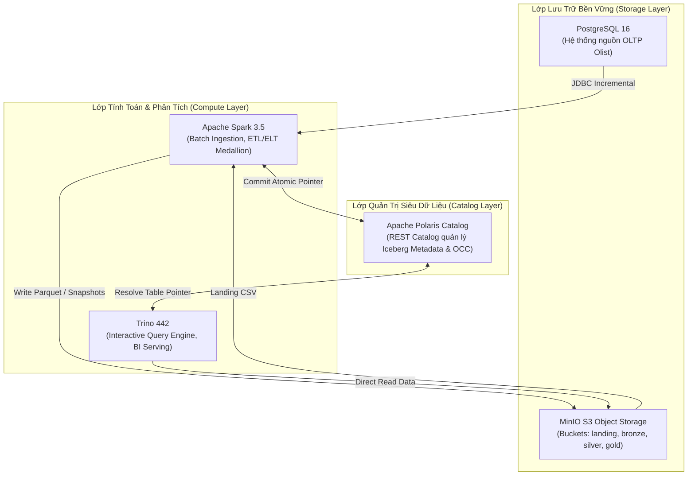

# Olist Lakehouse — Customer & Sales Analytics Platform

> **Kiến trúc Data Lakehouse Hiện Đại (Open Source Modern Data Stack)**  
> **Tác giả:** Anh Tú (IT Lecturer & Technical Writer)  
> **Mục tiêu:** Nền tảng phân tích dữ liệu thương mại điện tử Olist áp dụng mô hình tách rời Lưu trữ & Tính toán (Storage-Compute Decoupling), định dạng bảng mở (Apache Iceberg), REST Catalog (Apache Polaris) và truy vấn phân tán (Apache Spark, Trino).

---

## 🧭 1. Kiến Trúc Hệ Thống (System Architecture)



---

## 📁 2. Cấu Trúc Thư Mục Dự Án (Repository Layout)

```text
.
├── .env.example                     # Biến môi trường mẫu
├── .gitignore                        # Loại bỏ secrets, cache, data thô lớn
├── README.md                         # Hướng dẫn tổng quan và vận hành dự án
├── docker-compose.yml                # Định nghĩa toàn bộ cụm dịch vụ (Profiles: core / full)
├── data_prep/                        # Công cụ chuẩn bị dữ liệu & mô phỏng nguồn
│   ├── raw/                          # 9 file CSV gốc Kaggle Olist
│   ├── processed/                    # Dữ liệu sau sinh PII và cắt 8 mẻ B0-B7
│   ├── gen_pii.py                    # Script sinh Faker PII
│   ├── split_batches.py              # Script cắt batch theo mốc thời gian
│   └── seed_postgres.py              # Script nạp mẻ B0 vào PostgreSQL
├── etc/                              # Cấu hình các công cụ
│   └── trino/catalog/                # Cấu hình Iceberg REST Catalog cho Trino
├── spark_jobs/                       # Các Spark job xử lý batch & ETL
│   └── smoke_test_e2e.py             # Script Hello-World Postgres → Iceberg → Trino
├── sql/                              # Bài tập SQL và truy vấn phân tích
│   └── week01_daily_queries.sql      # 5 truy vấn kèm chú thích WHY
├── tests/                            # Bộ kiểm thử tự động & script nghiệm thu
│   ├── test_storage_infra.py         # Kiểm thử PostgreSQL & MinIO
│   ├── test_trino_catalog.py         # Kiểm thử Trino kết nối Polaris
│   ├── test_data_prep.py             # Kiểm thử sinh PII & cắt batch
│   ├── test_postgres_seeded.py       # Kiểm thử nạp dữ liệu OLTP
│   ├── test_e2e_smoke.py             # Kiểm thử đối soát E2E PG == Trino
│   └── gate_g1_check.sh              # Script tự chấm điểm cổng Gate G1
├── lab_syllabus_v2/                  # Giáo trình lý thuyết & lộ trình 8 tuần
├── plan/                             # Kế hoạch thực thi chi tiết (Power Skill)
└── requirements/                     # Đặc tả kỹ thuật chuẩn Enterprise (Option C)
```

---

## 🚀 3. Hướng Dẫn Khởi Chạy Nhanh (Quickstart)

### Điều kiện tiên quyết
- Docker Engine & Docker Compose v2 (Cấp tối thiểu 6GB–8GB RAM cho Docker).
- Python 3.10+ (Khuyến nghị tạo Virtualenv).

### Các bước khởi chạy (Chỉ với 3 lệnh)

1. **Chuẩn bị cấu hình môi trường:**
   ```bash
   cp .env.example .env
   ```

2. **Khởi chạy cụm Core Lakehouse (RAM < 6GB):**
   ```bash
   docker compose --profile core up -d
   ```

3. **Kiểm tra trạng thái các dịch vụ:**
   ```bash
   docker compose ps
   ```

### Bảng tra cứu cổng dịch vụ (Service Ports)
| Dịch vụ | URL / Cổng | Tài khoản mặc định | Vai trò |
|---|---|---|---|
| **PostgreSQL** | `localhost:5432` | `olist_admin` / `olist_password` | Nguồn OLTP Database |
| **MinIO Console** | `http://localhost:9001` | `minioadmin` / `minioadmin` | Web UI quản lý Object Storage |
| **MinIO S3 API** | `http://localhost:9000` | `minioadmin` / `minioadmin` | S3 API endpoint |
| **Polaris Catalog** | `http://localhost:8181` | *(Không cần auth cho dev)* | Iceberg REST Catalog |
| **Trino Web UI** | `http://localhost:8080` | `admin` *(không mật khẩu)* | Query Execution UI |
| **PySpark Jupyter** | `http://localhost:8888` | *(Không cần token)* | Interactive Notebook |

---

## 🧪 4. Kiểm Thử & Nghiệm Thu Cổng (Gate Verification)

Hệ thống được thiết kế theo văn hóa kiểm thử tự động (TDD). Để tự động đánh giá tiêu chí hoàn thành của Milestone M0 (Gate G1):

```bash
bash tests/gate_g1_check.sh
```

---
*Made by Anh Tu - Share to be share*
