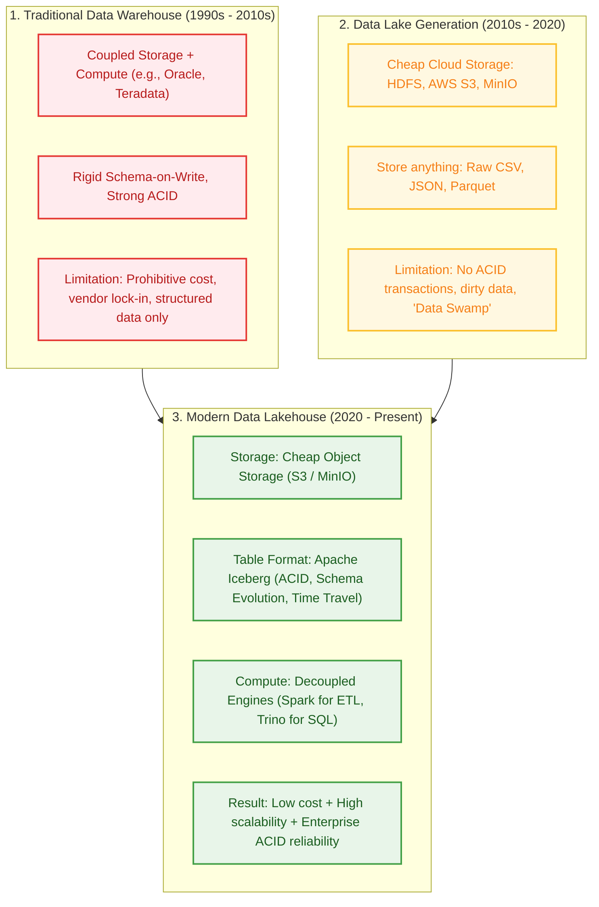
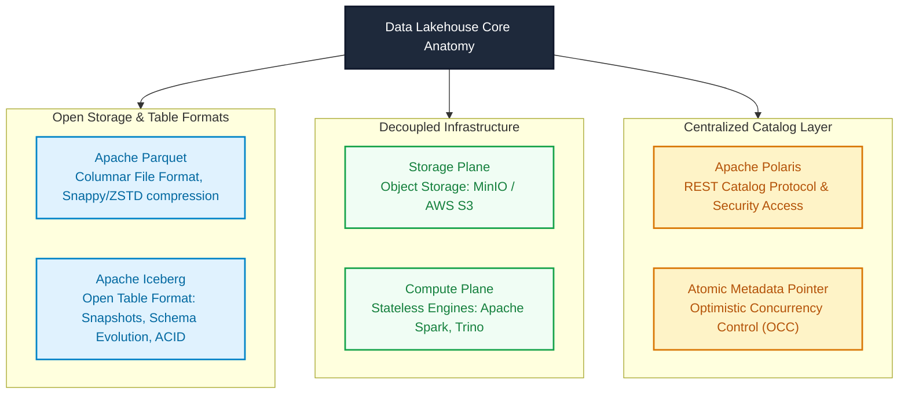
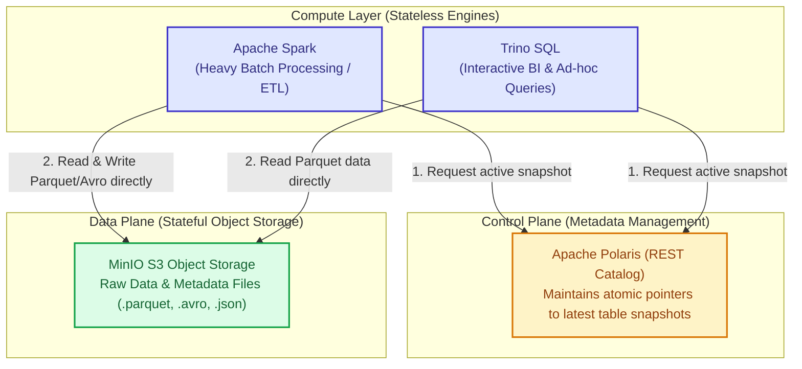
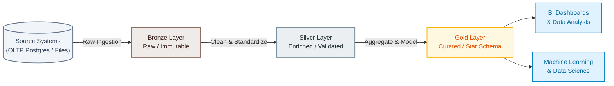
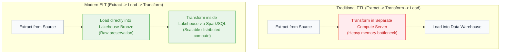
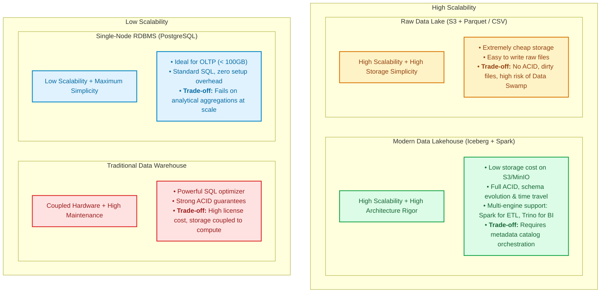

# Module 01: Foundations of Modern Data Lakehouse

> **Target Audience:** IT Students & Software Engineers transitioning to Data Engineering  
> **Topic Scope:** Data Lakehouse Architecture, Storage-Compute Decoupling, Medallion Architecture, ETL vs ELT  
> **Estimated Reading Time:** 15 minutes  

---

## 1. The Big Picture: Why Do We Need a Lakehouse?

In software development, you are familiar with relational databases like PostgreSQL or MySQL. They handle transactions (OLTP) exceptionally well. However, when an enterprise scales to petabytes of historical data, analytics queries (OLAP) will slow down or crash your production databases.

To solve this, data architecture has evolved through three major generations:

---

## 2. Concept Anatomy: Data Lakehouse

### Academic Definition
> A **Data Lakehouse** is an *open data management architecture* that combines the flexibility, cost-efficiency, and scalability of a **Data Lake** with the data structure, transaction reliability (ACID), and query performance of a **Data Warehouse**.

### Keyword Dissection (Anatomy)

1. **Open Storage & Table Format:**  
   Instead of storing data in proprietary binary databases, files are stored as standard **Apache Parquet** files and managed by **Apache Iceberg**. Any modern engine (Python, Spark, Trino, DuckDB) can read the exact same data files.
2. **ACID Transactions:**  
   Guarantees *Atomicity, Consistency, Isolation, and Durability*. If a Spark job fails halfway through writing 1,000,000 rows, partial writes are discarded cleanly. Readers never see corrupted or partial data.
3. **Storage-Compute Decoupling:**  
   Storage and compute scale independently. You pay pennies per gigabyte for storage on S3/MinIO, and compute nodes (Spark/Trino) are only spun up when needed.

---

## 3. Architectural Principle: Storage-Compute Decoupling

In traditional RDBMS (like local PostgreSQL), compute (CPU/RAM) and storage (SSD) live on the same machine. If disk space runs out, you must upgrade the entire instance—even if your CPU usage is only at 5%.

### How Decoupling Works in Lakehouse:

### Dev-to-DE Analogy:
* Think of **Storage-Compute Decoupling** like **Stateless Web Services vs. Database Storage** in backend engineering:
  * Your web API containers (Compute) can scale up to 50 pods or scale down to 0 depending on traffic.
  * Your persistent data (Storage) remains safe in object storage without paying for idle CPUs.

---

## 4. Data Quality Framework: Medallion Architecture

In software engineering, you never display raw API inputs directly onto a user's dashboard without validation and sanitization. In Data Engineering, the **Medallion Architecture** (Multi-Hop Architecture) enforces this exact data hygiene practice across three progressive tiers:

### Layer Breakdown & Responsibilities

| Dimension | Bronze Layer | Silver Layer | Gold Layer |
| :--- | :--- | :--- | :--- |
| **Data Nature** | Raw, immutable append-only copy of source | Cleansed, validated, normalized, deduplicated | Aggregated, denormalized, Star Schema |
| **Transformation Level** | None (1:1 with source) + ingestion timestamp | Type casting, deduplication, handling nulls, SCD Type 2 | Dimensional modeling (Facts & Dimensions), KPI metrics |
| **PII Handling** | Raw PII masked or tokenized | PII hashed or isolated | Strictly no raw PII |
| **Primary Audience** | Data Engineers (auditing & backfilling) | Data Engineers, Data Scientists | Data Analysts, BI Dashboards, Business Executives |
| **Olist Project Example** | `lakehouse.bronze.orders` (Raw copy from Postgres) | `lakehouse.silver.orders` (Clean dates, valid status) | `lakehouse.gold.kpi_monthly_revenue` |

---

## 5. Paradigm Shift: ETL vs ELT

When designing data pipelines, you will encounter two fundamental execution models: **ETL** and **ELT**.

### Why Did the Industry Shift from ETL to ELT?

* **Root Cause (Historical Context):**  
  In the 1990s, storage was extremely expensive ($10,000+ per gigabyte). Enterprises could not afford to store raw, unformatted data. They had to discard raw records and only store pre-aggregated summary tables.
* **Modern Reality:**  
  Cloud storage is virtually free (~$0.02 per GB per month on S3). Distributed compute (Spark) can process terabytes in parallel.
* **The Key Advantage of ELT:**  
  **Auditing and Reprocessing (Zero Data Loss).** If business logic changes or a bug is discovered in month 6, in ELT you simply re-run your transformation job from the raw Bronze layer. In ETL, because raw data was discarded during extraction, re-running is impossible without re-extracting from the production database.

---

## 6. Trade-Off Analysis & Critical Thinking

Every engineering decision involves trade-offs. The 2x2 matrix below maps architectural options by **Scalability** versus **Operational Simplicity**:

### Architectural Decision Guide

| Strategy | When to Choose | When to Avoid (Trade-Off) |
| :--- | :--- | :--- |
| **Pure PostgreSQL (OLTP only)** | Small datasets (< 100GB), simple CRUD applications. | Large-scale aggregations, historical audit logs, petabyte analytics. |
| **Data Lake without Iceberg (Raw S3 + Parquet)** | Ad-hoc machine learning training, simple file archiving. | Concurrent writes, row-level updates/deletes, ACID guarantees needed. |
| **Data Lakehouse (Iceberg + MinIO + Spark)** | Enterprise multi-tier analytics, multiple concurrent compute engines, auditable data. | Small teams needing a simple dashboard within 1 hour; requires orchestration overhead. |

---

## 7. Practical Connection: Our Olist Project Mapping

Here is how each theory concept maps to the running code in our repository:

| Theory Concept | Implementation in `olist-lakehouse` |
| :--- | :--- |
| **Storage Engine (Data Plane)** | **MinIO** running at `http://localhost:9000` (Buckets: `landing`, `bronze`, `silver`, `gold`) |
| **Table Format** | **Apache Iceberg 1.6** storing `.parquet` data and `.avro` snapshots |
| **Metadata Catalog (Control Plane)** | **Apache Polaris REST** running at `http://localhost:8181` |
| **Compute - Ingestion & ETL** | **PySpark 3.5** executing jobs from [spark_jobs/](file:///Users/anhtus/Documents/Development/DE/GRT_DA-DE/spark_jobs) |
| **Compute - Interactive Analytics** | **Trino 442** running at `http://localhost:8080` querying catalog `lakehouse` |

---

## 8. Knowledge Check (Self-Assessment)

1. **Question:** *If MinIO stores both `.parquet` data files and `.json` metadata files, why can't MinIO itself guarantee ACID transactions?*  
   * **Answer:** MinIO is a simple Key-Value store; it does not understand table states or atomic commits. The ACID guarantee is managed by **Apache Iceberg** writing atomic snapshot files, with **Polaris Catalog** atomically swapping the pointer to the latest valid metadata file.

2. **Question:** *Why don't we clean, remove duplicates, and cast datatypes directly when writing into the Bronze layer?*  
   * **Answer:** The Bronze layer must remain an exact 1:1 raw copy of the source system. Preserving raw data guarantees an immutable audit trail and enables data engineers to re-play and re-process historical data if business logic changes.

3. **Question:** *Can Trino and Apache Spark read from the same Iceberg table at the same time?*  
   * **Answer:** Yes! Because metadata is centrally managed by Polaris REST Catalog, Spark can write a new snapshot while Trino safely reads from the current committed snapshot using Optimistic Concurrency Control (OCC).

---
*Made by Anh Tu - Share to be share*
