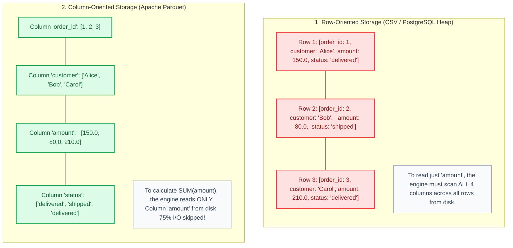
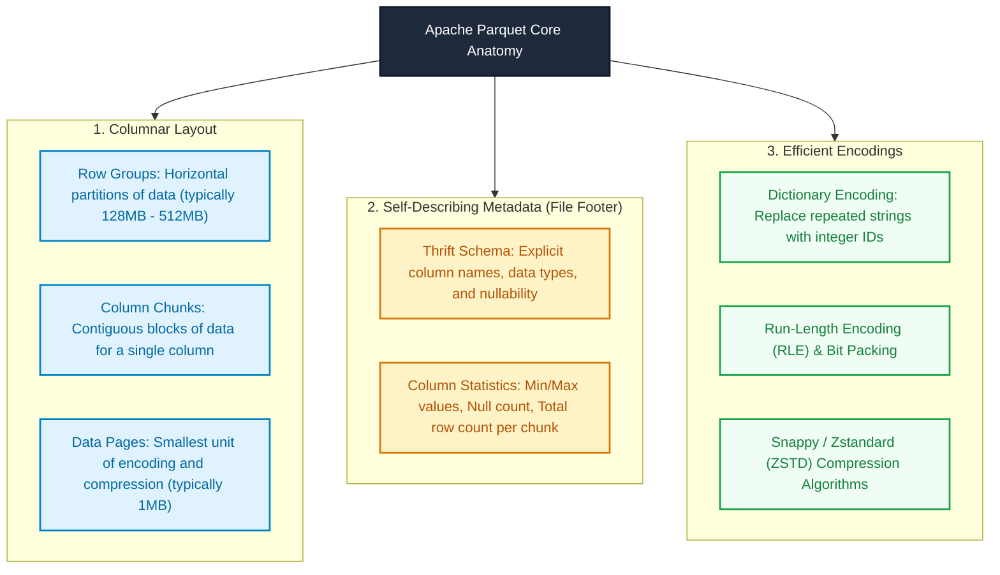
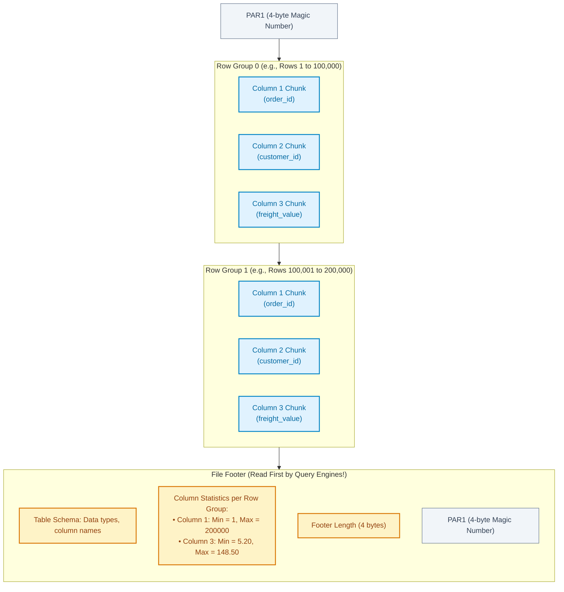
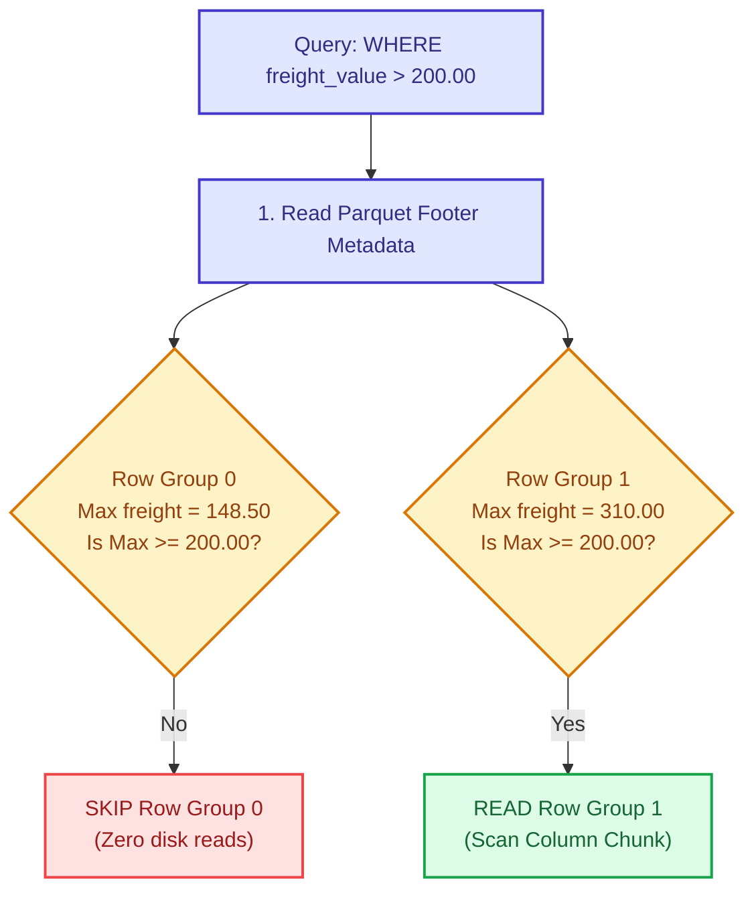
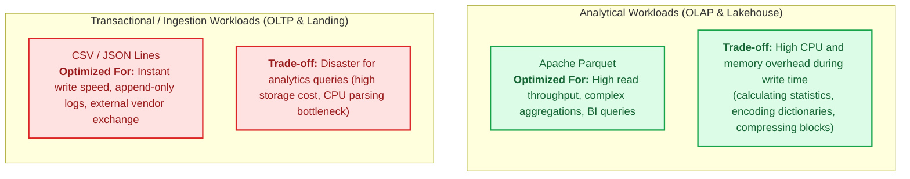

# Module 02: Storage Formats for Analytics — Parquet vs. CSV Deep Dive

> **Target Audience:** IT Students & Software Engineers transitioning to Data Engineering  
> **Topic Scope:** Row-oriented vs. Columnar Storage, Apache Parquet Internals, Compression, Predicate Pushdown, Trade-offs  
> **Estimated Reading Time:** 15 minutes  

---

## 1. The Big Picture: Why Text Files Fail at Scale

In software development, CSV (Comma-Separated Values) and JSON are the default choices for data exchange. They are human-readable, simple to parse, and supported by every programming language.

However, when processing millions or billions of rows in an analytical system (OLAP), plain-text files create massive performance bottlenecks:

1. **Massive Disk I/O:** Text files store numbers, dates, and booleans as strings of ASCII characters. Storing the number `123456789` takes 9 bytes in CSV, but only 4 bytes as an integer in binary formats.
2. **Slow Parsing Overhead:** Every time Spark reads a CSV, CPU threads spend heavy processing power scanning characters, escaping quotes, and converting strings back into integers and timestamps.
3. **Full Table Scans:** To calculate the sum of just *one* column, the storage engine must read the *entire* file from disk into memory.

To solve this, modern Data Lakehouses use **binary, columnar file formats**, primarily **Apache Parquet**.



---

## 2. Concept Anatomy: Apache Parquet

### Academic Definition
> **Apache Parquet** is an *open-source, column-oriented binary data file format* designed for efficient data storage and retrieval, providing complex nested data structures, efficient compression encodings, and rich metadata statistics per column chunk.

### Keyword Dissection (Anatomy)



---

## 3. Physical File Structure of Parquet

A Parquet file is divided into three key physical sections: **Header**, **Row Groups**, and **File Footer**.



> **Why is the Metadata in the Footer?**  
> In streaming or distributed writing, the total number of rows and column statistics are not known until the file write finishes. By placing metadata in the **Footer**, the writer does not need to buffer the entire file in RAM; it writes data blocks sequentially and appends the metadata at the very end.

---

## 4. The Three Pillars of Parquet Superiority

Why does Parquet query 10x-100x faster than CSV? It comes down to three technical capabilities:

### Pillar 1: Column Projection (I/O Pruning)

In analytical queries, you rarely select every column. Consider this query:
```sql
SELECT status, COUNT(*) FROM orders GROUP BY status;
```
* **CSV:** Must read the entire file from disk (all columns), splitting every line into tokens.
* **Parquet:** The storage engine reads **only the byte offset containing the `status` column chunk**. All other columns (customer name, timestamps, IDs) are completely ignored at the disk level.

### Pillar 2: High Compression Ratio via Homogeneous Typing

In CSV, every row mixes different data types together: `1, "Alice", 150.00, true`. Compression algorithms struggle because adjacent data has high entropy (randomness).

In Parquet, values of the *same* column are stored contiguously:
* A column of Brazilian state codes: `["SP", "SP", "SP", "RJ", "SP", "MG"]`.
* **Dictionary Encoding:** Replaces `"SP"` with `0`, `"RJ"` with `1`, `"MG"` with `2`. The text is stored once in a dictionary, and the data is stored as tiny integers `[0, 0, 0, 1, 0, 2]`.
* **Snappy / Zstandard (ZSTD):** Compresses identical data types 4x to 8x better than gzipped CSV.

### Pillar 3: Predicate Pushdown (Data Skipping)

When you run a filter query:
```sql
SELECT * FROM orders WHERE freight_value > 200.00;
```
1. Before scanning any data blocks, Spark reads the **File Footer**.
2. It inspects the statistics for `Row Group 0`:
   * `freight_value: Min = 5.20, Max = 148.50`.
3. Because the maximum value in `Row Group 0` is `148.50`, it is mathematically impossible for any row in this group to match `> 200.00`.
4. **Spark skips the entire Row Group (100,000 rows) without decompressing or reading a single byte!**



---

## 5. Technical Comparison: CSV vs. Parquet

| Feature | CSV (Comma-Separated Values) | Apache Parquet |
| :--- | :--- | :--- |
| **Storage Layout** | Row-oriented, plain text | Column-oriented, binary |
| **File Size** | Large (uncompressed or gzip) | Very small (Snappy/ZSTD + Dictionary encoding) |
| **Schema Definition** | Weak (no data types, implicit header) | Strong (Thrift binary schema embedded in file) |
| **Column Projection** | No (must scan all columns) | Yes (reads only requested column chunks) |
| **Data Skipping (Min/Max)** | No (must scan all rows) | Yes (skips entire row groups via footer stats) |
| **Human Readability** | Yes (can open in Notepad / Excel) | No (requires tools like Python, Spark, DuckDB) |
| **Write Speed** | Fast (simple string appending) | Slower (requires encoding, statistics, compression) |
| **Best Used For** | Initial raw data drops, small exports | Analytical data layers (Bronze, Silver, Gold) |

---

## 6. Trade-Off Analysis: Write Latency vs. Read Performance

Every format choice represents an engineering trade-off:



### Engineering Rule of Thumb:
* If data is written once and read thousands of times by analysts and machine learning models $\rightarrow$ **Always use Parquet**.
* If data is an external vendor drop or a configuration file $\rightarrow$ **Accept CSV at landing, then convert immediately to Parquet in Bronze**.

---

## 7. Practical Connection: Our Olist Project Mapping

Here is how storage formats are handled across our Lakehouse architecture:

| Pipeline Stage | Storage Location | Format | Reason |
| :--- | :--- | :--- | :--- |
| **Source Data** | `data_prep/raw/*.csv` | CSV | Kaggle public dataset is distributed in raw CSV. |
| **Landing Reference** | MinIO `s3://lakehouse/landing/ref/` | CSV | Dimension lookups (`category_translation.csv`) are kept as reference files. |
| **Bronze Layer** | MinIO `s3://lakehouse/bronze/` | **Parquet (Iceberg)** | Converted to Parquet via Spark to enable ACID, compression, and sub-second Trino queries. |
| **Silver & Gold** | MinIO `s3://lakehouse/silver/` & `gold/` | **Parquet (Iceberg)** | High-speed aggregated reads for Superset dashboards. |

In [spark_jobs/smoke_test_e2e.py](file:///Users/anhtus/Documents/Development/DE/GRT_DA-DE/spark_jobs/smoke_test_e2e.py), we explicitly instruct Iceberg to write in Parquet:
```python
df_orders.writeTo("lakehouse.bronze.oms_orders_hello") \
    .tableProperty("write.format.default", "parquet") \
    .createOrReplace()
```

---

## 8. Knowledge Check (Self-Assessment)

1. **Question:** *Why does reading a Parquet file start by reading the end of the file (Footer) rather than the beginning?*  
   * **Answer:** The file footer contains the complete table schema and column statistics (Min/Max values) for every Row Group. By reading the footer first, the query engine can plan which Row Groups to skip before reading any raw data blocks.

2. **Question:** *If a table has 100 columns and a query selects only 2 columns, what is the approximate I/O reduction when using Parquet instead of CSV?*  
   * **Answer:** Approximately 98% disk I/O reduction. Parquet uses columnar projection to read only the contiguous byte offsets for those 2 columns, whereas CSV must read all 100 columns from disk.

3. **Question:** *Why does Parquet achieve higher compression ratios than compressing a CSV file with GZIP?*  
   * **Answer:** Parquet stores values of the same column (same data type) adjacent to each other. Homogeneous data has low entropy and enables specialized algorithms like Dictionary Encoding and Run-Length Encoding before applying general compression algorithms (Snappy/ZSTD).

---
*Made by Anh Tu - Share to be share*
