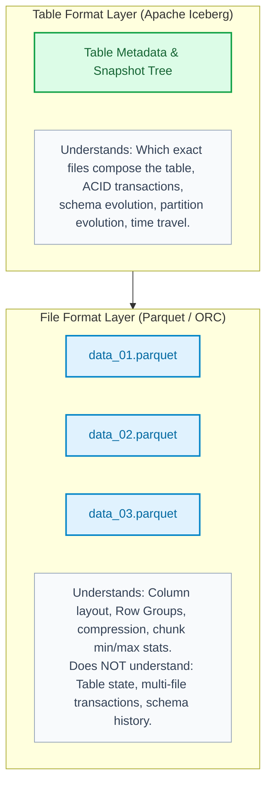
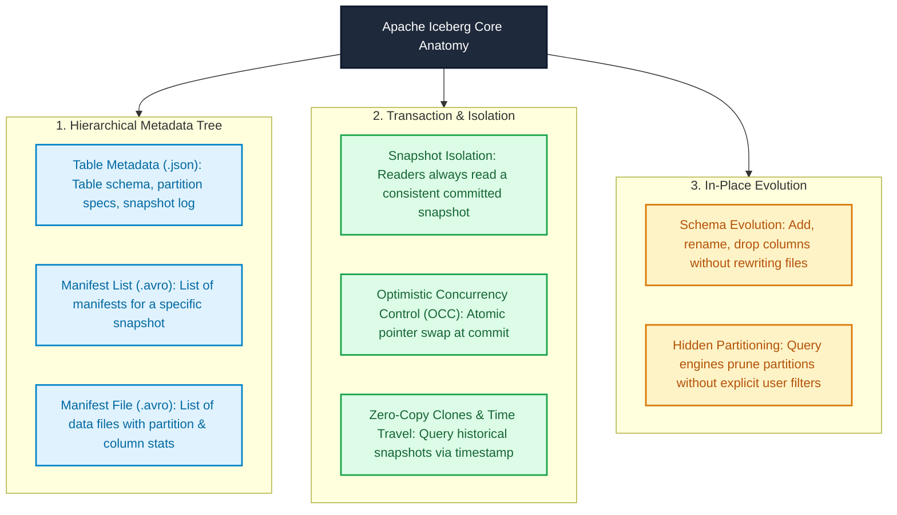
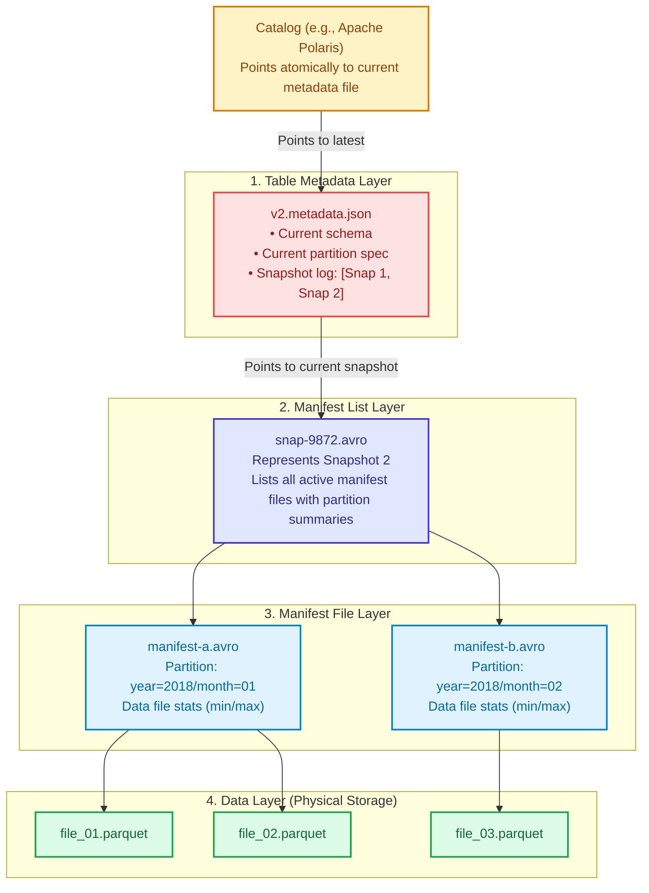
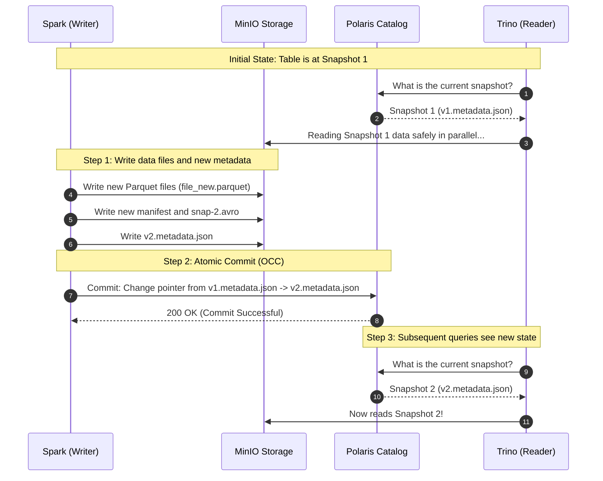
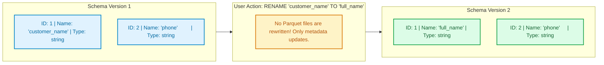

# Module 03: Apache Iceberg — Open Table Format Deep Dive

> **Target Audience:** IT Students & Software Engineers transitioning to Data Engineering  
> **Topic Scope:** Table Format vs. File Format, Iceberg Metadata Tree, ACID Transactions, Hidden Partitioning, Schema Evolution, Time Travel  
> **Estimated Reading Time:** 18 minutes  

---

## 1. The Big Picture: File Format vs. Table Format

In [Module 02](file:///Users/anhtus/Documents/Development/DE/GRT_DA-DE/docs/week01/02-storage-formats.md), you learned that **Apache Parquet** is an outstanding columnar *file format*. It makes individual files fast and compact.

However, a production Data Lakehouse does not consist of just one file. A single production table contains **millions of Parquet files** spread across thousands of cloud storage directories.

This raises critical questions:
* *Which specific files belong to the table right now?*
* *What happens if a writer crashes while writing 50 new files?*
* *How do multiple compute engines (Spark and Trino) read and write concurrently without corrupting data?*

In the early days of Hadoop, the industry used directory-based tracking (Hive Metastore). If a directory contained a file, that file was assumed to be part of the table. This caused three fatal problems:
1. **No Atomic Commits:** Adding a partition required renaming files or directories on cloud storage, which is not atomic.
2. **Eventual Consistency Bugs:** Amazon S3 or MinIO directory listings could omit newly created files, resulting in missing query data.
3. **Slow Table Scans:** Finding which files to read required recursively listing thousands of directories (`O(N)` network roundtrips).

To fix this, the industry created **Open Table Formats**, led by **Apache Iceberg**.



---

## 2. Concept Anatomy: Apache Iceberg

### Academic Definition
> **Apache Iceberg** is an *open-source, high-performance table format for huge analytic tables* that provides SQL table abstractions on top of object storage, enabling full ACID transactions, snapshot isolation, schema and partition evolution, and fast metadata-driven query pruning.

### Keyword Dissection (Anatomy)



---

## 3. The Iceberg Metadata Architecture (Tree Structure)

Iceberg organizes metadata into a three-tiered tree structure. This tree guarantees that **every read and write is tracked by explicit file paths**, never by directory listings.



### What Each Layer Does:
1. **Catalog:** Holds the single source of truth: the atomic pointer to the current `v<N>.metadata.json` file.
2. **Table Metadata (`*.metadata.json`):** Contains the complete table definition, table properties, all historical schemas, and a history of all snapshots.
3. **Manifest List (`snap-*.avro`):** Generated for every commit. It lists all manifest files that make up that snapshot, along with summary ranges for each partition.
4. **Manifest File (`*.avro`):** Tracks individual data files (`.parquet`), recording their exact file paths, partition values, and column-level lower/upper bounds.
5. **Data Files (`*.parquet`):** The actual analytical data files stored on MinIO or S3.

---

## 4. How ACID Transactions Work in Iceberg

In traditional databases, transactions use Write-Ahead Logs (WAL) and row-level locks. On cloud object storage, there are no distributed locks. Iceberg achieves ACID transactions through **Snapshot Isolation** and **Optimistic Concurrency Control (OCC)**.



### Why Readers Never Block Writers:
* When Spark writes 1,000,000 new rows, it writes them as **new files**. It never modifies existing Parquet files.
* Trino queries continue reading Snapshot 1 without interruption or locking.
* The moment the Catalog updates its pointer to `v2.metadata.json`, new queries immediately see Snapshot 2.
* If Spark crashes mid-write, the catalog pointer is never updated. The uncommitted Parquet files are simply orphaned and cleaned up later. **Readers never see dirty or partial data.**

---

## 5. Schema Evolution Without Table Rewrites

In traditional databases or Hive tables, renaming or dropping a column can require rewriting gigabytes of data or breaking historical partitions.

Iceberg uses **Unique Column IDs** instead of column names:



* When reading historical Parquet files created under Version 1, Iceberg matches data by **Column ID (ID: 1)**, not by name.
* Adding a column, dropping a column, or renaming a column is an **instant metadata-only operation** taking milliseconds.

---

## 6. Time Travel and Rollbacks

Because Iceberg never deletes historical files immediately, every commit creates an immutable snapshot. This gives you native **Time Travel**:

```sql
-- Query the table as it existed at a specific timestamp
SELECT count(*) 
FROM lakehouse.bronze.oms_orders_hello 
FOR TIMESTAMP AS OF (TIMESTAMP '2026-10-19 10:00:00 UTC');

-- Query the table as of a specific Snapshot ID
SELECT count(*) 
FROM lakehouse.bronze.oms_orders_hello 
FOR VERSION AS OF 837492817492;
```

### Real-World Use Cases:
1. **Reproducible Machine Learning:** Train models on the exact dataset version used 6 months ago.
2. **Instant Rollback:** If a buggy batch job corrupts data at 02:00 AM, roll the catalog pointer back to the 01:59 AM snapshot instantly.
3. **Audit & Compliance:** Prove to financial auditors exactly what numbers were reported at month-end.

---

## 7. Trade-Off Analysis: Iceberg vs. Hive Table Format

| Capability | Legacy Hive Table Format | Apache Iceberg |
| :--- | :--- | :--- |
| **Commit Mechanism** | File system rename / directory listing | Atomic Catalog Pointer Swap |
| **ACID Guarantee** | No (Partial writes leave dirty files) | Full ACID (Snapshot Isolation) |
| **Cloud Storage Speed** | Slow (recursive `O(N)` S3 directory scans) | Sub-second (metadata tree in memory) |
| **Concurrent Writers** | Risky (causes race conditions and data loss) | Safe (Optimistic Concurrency Control) |
| **Partitioning** | Manual (users must query explicit partition columns) | Hidden Partitioning (engine handles transforms) |
| **Time Travel** | Not supported | Fully supported out-of-the-box |
| **Operational Trade-off** | Simple (just drop files in folders) | Requires a Catalog service (e.g., Polaris) |

---

## 8. Practical Connection: Our Olist Project Mapping

In our repository:
* **Storage Location:** All Iceberg data files are written to MinIO bucket `s3://lakehouse/`.
* **Table Identification:** Fully qualified table names use three tiers:
  $$\text{catalog}.\text{namespace}.\text{table\_name}$$
  Example: `lakehouse.bronze.oms_orders_hello`.
* **Spark Configuration:** In [spark_jobs/smoke_test_e2e.py](file:///Users/anhtus/Documents/Development/DE/GRT_DA-DE/spark_jobs/smoke_test_e2e.py), we register Iceberg extensions:
  ```python
  .config("spark.sql.extensions", "org.apache.iceberg.spark.extensions.IcebergSparkSessionExtensions") \
  .config("spark.sql.catalog.lakehouse", "org.apache.iceberg.spark.SparkCatalog") \
  .config("spark.sql.catalog.lakehouse.type", "rest") \
  .config("spark.sql.catalog.lakehouse.uri", "http://polaris:8181")
  ```

---

## 9. Knowledge Check (Self-Assessment)

1. **Question:** *What is the fundamental difference between Apache Parquet and Apache Iceberg?*  
   * **Answer:** Parquet is a **file format** that organizes data into columnar chunks inside a single file. Iceberg is a **table format** that manages collections of Parquet files to provide database-grade ACID transactions, schema evolution, and snapshots across an entire table.

2. **Question:** *How does Iceberg prevent readers (Trino) from seeing partial data when a writer (Spark) fails mid-job?*  
   * **Answer:** Spark writes data to new Parquet files without altering existing files. The catalog pointer is only swapped to the new metadata snapshot after all writes successfully complete. If the job fails, the pointer is never updated, and readers only see the previous committed snapshot.

3. **Question:** *Why does renaming a column in an Iceberg table take 5 milliseconds instead of rewriting 100GB of Parquet files?*  
   * **Answer:** Iceberg tracks columns by immutable integer IDs rather than names. Renaming a column simply updates the name mapped to that column ID in the `v<N>.metadata.json` file. The underlying Parquet data files remain untouched.

---
*Made by Anh Tu - Share to be share*
