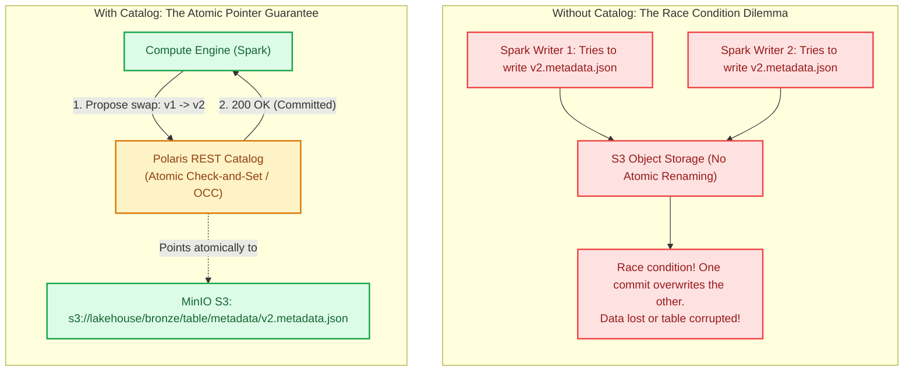
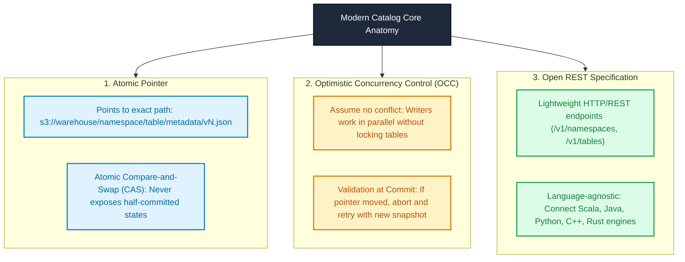
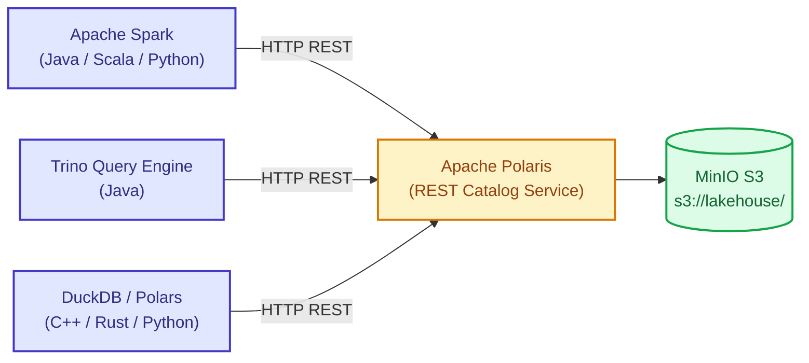
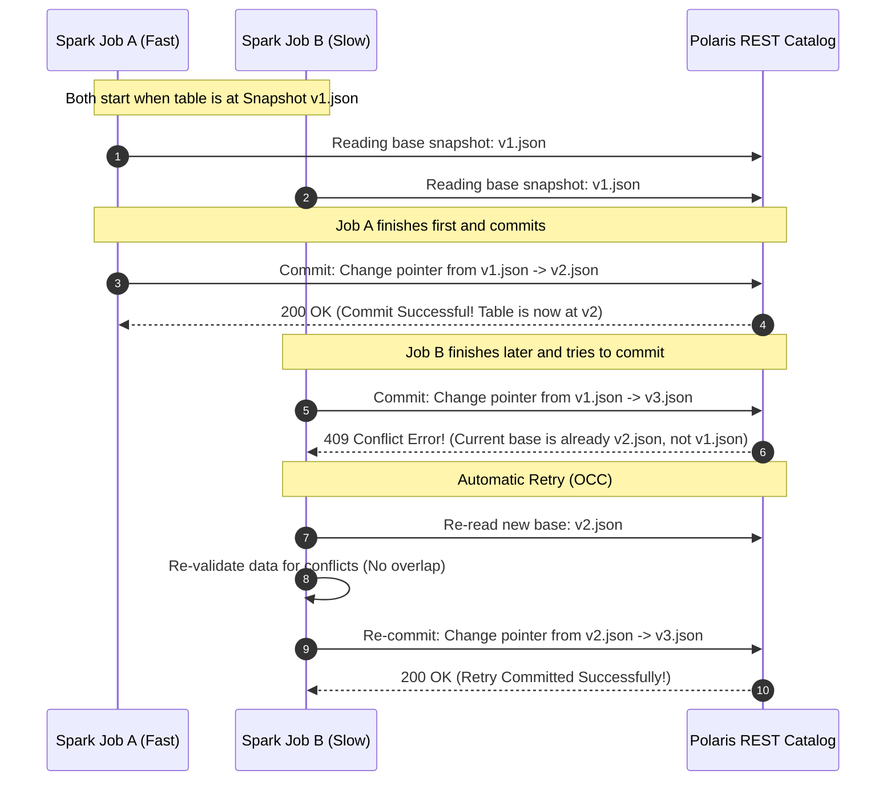
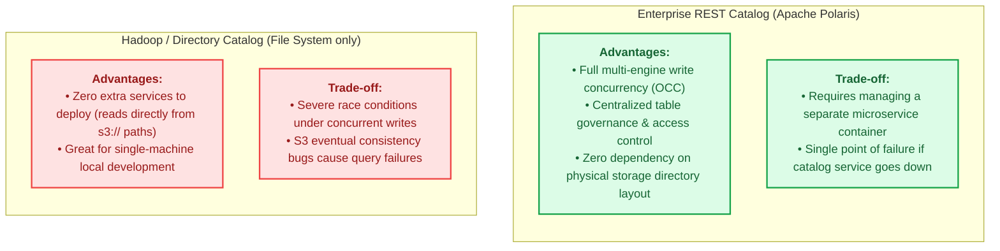

# Module 04: Modern Catalogs — Apache Polaris REST Catalog

> **Target Audience:** IT Students & Software Engineers transitioning to Data Engineering  
> **Topic Scope:** Role of a Catalog in Lakehouses, Apache Polaris, REST Catalog Specification, Optimistic Concurrency Control (OCC), Multi-Engine Interoperability  
> **Estimated Reading Time:** 15 minutes  

---

## 1. The Big Picture: Why Cloud Storage Needs a Catalog

In [Module 03](file:///Users/anhtus/Documents/Development/DE/GRT_DA-DE/docs/week01/03-apache-iceberg.md), you saw that Apache Iceberg organizes table metadata into a tree of `.json` and `.avro` files.

However, a fundamental question remains:  
**Where does the engine find the very first file (`v1.metadata.json` vs. `v2.metadata.json`)?**

On local file systems or POSIX storage, you might store a file called `latest_version.txt` and rename it atomically. But on cloud object storage (Amazon S3, MinIO, Google Cloud Storage):
1. **There is NO atomic file rename:** Renaming a file on S3 is actually a `COPY` followed by a `DELETE`. This is not atomic. If two writers copy at the same time, data corruption is guaranteed.
2. **Eventual Consistency & Cache Latency:** When multiple distributed query engines query S3 directly, they might see stale directory listings.

To provide a single, universal source of truth, modern Lakehouse architectures require a **Catalog**.



---

## 2. Concept Anatomy: Modern Catalog

### Academic Definition
> An **Iceberg Catalog** is a *centralized metadata registry and transaction coordinator* that maintains an atomic reference (pointer) to the current metadata file of every table in the Lakehouse, enforces access control, and resolves concurrent write conflicts using Optimistic Concurrency Control (OCC).

### Keyword Dissection (Anatomy)



---

## 3. What is Apache Polaris?

**Apache Polaris** is an open-source, vendor-neutral implementation of the **Iceberg REST Catalog specification**, originally developed by Snowflake and donated to the Apache Software Foundation (ASF).

### Why the Shift to the REST Catalog Protocol?

In the previous decade, Hadoop systems used the **Hive Metastore (HMS)**:
* HMS was tightly coupled to Java, Thrift RPC protocols, and Hadoop libraries.
* Connecting non-Java tools (like Python Polars, Rust DataFusion, or C++ DuckDB) required heavy bridge drivers.

The **Iceberg REST Catalog Specification** replaced this with standard HTTP REST calls:



Any engine that can send standard HTTP GET/POST requests can discover and query Iceberg tables.

---

## 4. How Optimistic Concurrency Control (OCC) Works

When multiple jobs write to the same table simultaneously, how does Polaris prevent data loss?



### Dev-to-DE Analogy:
* Think of **OCC in Iceberg** like **Git Pull Request & Rebase**:
  1. You create a branch from `main` (Snapshot v1).
  2. While you are working, a colleague merges their PR into `main` (Snapshot v2).
  3. When you try to push, Git rejects your branch: *Remote contains work that you do not have locally*.
  4. You simply `git pull --rebase` (fetch Snapshot v2, apply your changes on top), and push cleanly.

---

## 5. Comparison: Catalog Implementations

| Dimension | Hive Metastore (HMS) | JDBC Catalog (PostgreSQL) | Apache Polaris (REST Catalog) |
| :--- | :--- | :--- | :--- |
| **Protocol** | Thrift RPC | JDBC (SQL connection) | HTTP / REST API (Open Spec) |
| **Vendor Neutrality** | Legacy Hadoop ecosystem | Open source | Standard Open Specification |
| **Performance** | High latency on partition scans | Fast for small setups (< 1,000 tables) | High performance, lightweight HTTP JSON |
| **Multi-Engine Access** | Difficult for non-JVM engines | Engines must have direct DB credentials | Language-agnostic (Spark, Trino, DuckDB) |
| **Centralized Security** | Kerberos / Sentry (Complex) | Database-level users | Role-Based Access Control (RBAC) via API |
| **Use Case in DE** | Legacy enterprise migrations | Simple local testing / Fallback | Modern enterprise production standard |

---

## 6. Trade-Off Analysis: Centralized Catalog vs. File-System Catalog



---

## 7. Practical Connection: Our Olist Project Mapping

In our project:
1. **Container Definition:** In [docker-compose.yml](file:///Users/anhtus/Documents/Development/DE/GRT_DA-DE/docker-compose.yml), service `polaris` runs on port `8181`:
   ```yaml
   polaris:
     image: tabulario/iceberg-rest:latest
     container_name: olist_polaris
     ports:
       - "8181:8181"
     environment:
       CATALOG_WAREHOUSE: s3://lakehouse/
       CATALOG_IO__IMPL: org.apache.iceberg.aws.s3.S3FileIO
       CATALOG_S3_ENDPOINT: http://minio:9000
   ```
2. **Trino Integration:** In [etc/trino/catalog/lakehouse.properties](file:///Users/anhtus/Documents/Development/DE/GRT_DA-DE/etc/trino/catalog/lakehouse.properties):
   ```properties
   connector.name=iceberg
   iceberg.catalog.type=rest
   iceberg.rest-catalog.uri=http://polaris:8181
   ```
3. **PySpark Integration:** Configured in [spark_jobs/smoke_test_e2e.py](file:///Users/anhtus/Documents/Development/DE/GRT_DA-DE/spark_jobs/smoke_test_e2e.py):
   ```python
   .config("spark.sql.catalog.lakehouse.type", "rest") \
   .config("spark.sql.catalog.lakehouse.uri", "http://polaris:8181")
   ```

---

## 8. Knowledge Check (Self-Assessment)

1. **Question:** *Why can't multiple query engines like Spark and Trino simply communicate by reading and writing a `metadata.json` file directly on MinIO without Polaris?*  
   * **Answer:** Object storage lacks atomic check-and-set operations. Without a central catalog managing atomic commits, two writers writing at the same millisecond would overwrite each other's metadata, leading to unrecoverable data loss.

2. **Question:** *What happens when two Spark jobs try to write new snapshots to the same Iceberg table at the exact same second?*  
   * **Answer:** Polaris uses Optimistic Concurrency Control (OCC). The first job to commit succeeds (200 OK). The second job receives a 409 Conflict error, automatically re-reads the new base snapshot, checks if its written data conflicts with the first job, and re-commits cleanly without user intervention.

3. **Question:** *Why is the Iceberg REST Catalog protocol superior to the legacy Hive Metastore (HMS)?*  
   * **Answer:** The REST Catalog protocol uses standard, language-agnostic HTTP/JSON endpoints. Any engine (Spark, Trino, Python DuckDB, Rust DataFusion) can query table metadata without heavy Java or Thrift dependencies.

---
*Made by Anh Tu - Share to be share*
