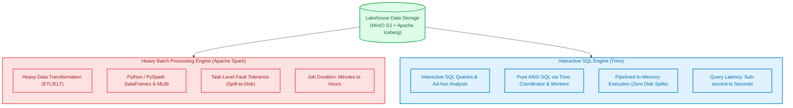
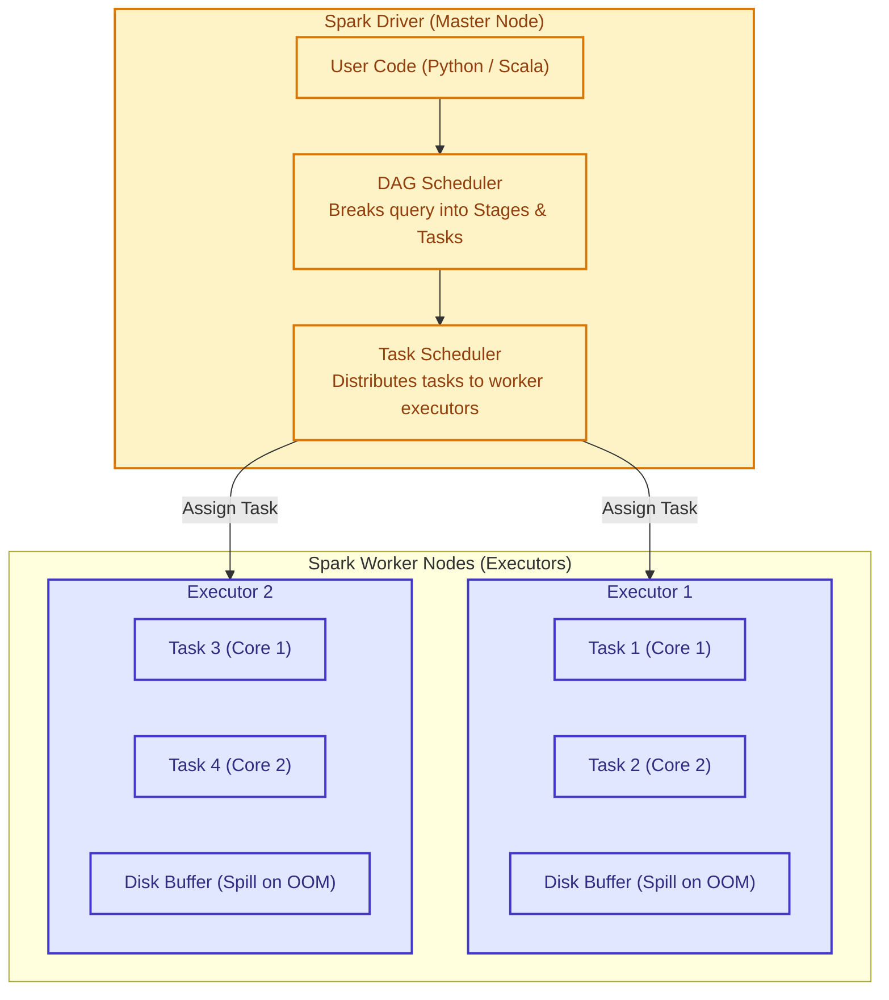
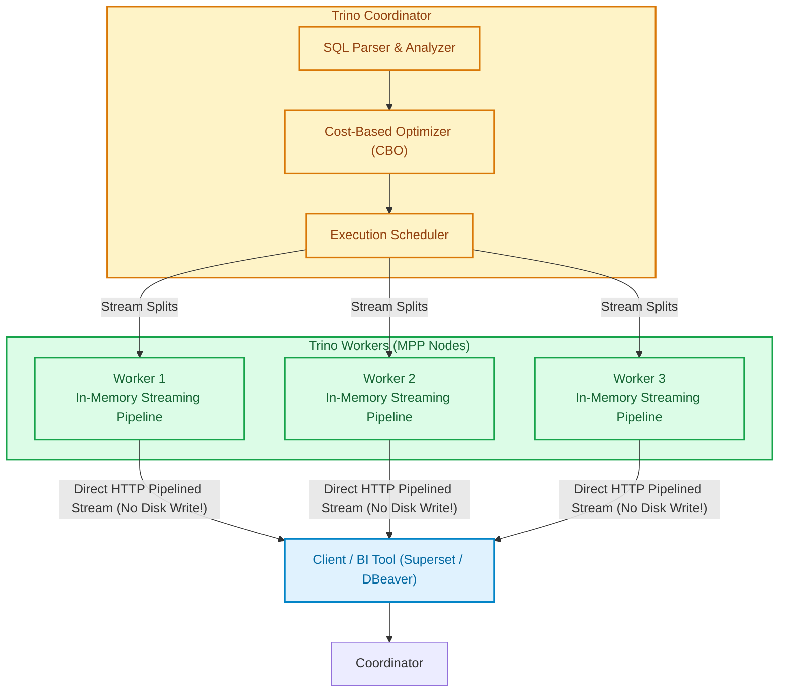
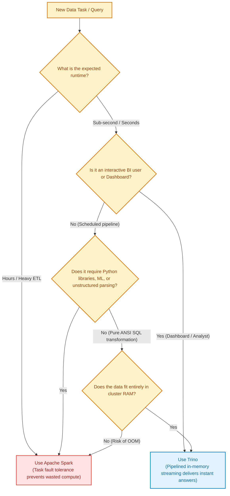

# Module 05: Distributed Compute Engines — Apache Spark vs. Trino

> **Target Audience:** IT Students & Software Engineers transitioning to Data Engineering  
> **Topic Scope:** Distributed Computing Principles, Apache Spark Architecture, Trino MPP Architecture, Head-to-Head Comparison, Workload Selection Matrix  
> **Estimated Reading Time:** 18 minutes  

---

## 1. The Big Picture: Why Two Engines Instead of One?

In software engineering, you might ask:  
*"Why does our Lakehouse stack deploy both **Apache Spark** and **Trino**? Can't we just choose one and eliminate unnecessary infrastructure overhead?"*

The answer lies in a fundamental law of distributed computing: **The Trade-Off Between Fault Tolerance and Low-Latency In-Memory Performance**.

* **Workload A (Heavy Batch ETL):** A pipeline processes 500 million orders, joins 10 tables, runs complex Python user-defined functions (UDFs), and takes 3 hours to complete. If a server node crashes 2 hours and 50 minutes in, you **cannot afford to restart the entire 3-hour job from scratch**. You need an engine that isolates the failed node and recalculates only that missing partition. $\rightarrow$ **This is Apache Spark.**
* **Workload B (Interactive BI & Dashboards):** A business executive opens a Superset dashboard and clicks a filter to calculate monthly revenue. They expect a response in **less than 2 seconds**. They do not want to wait 20 seconds for an engine to allocate heavy containers, compile DAG graphs, and write intermediate shuffle files to disk. $\rightarrow$ **This is Trino.**



---

## 2. Concept Anatomy: Apache Spark

### Academic Definition
> **Apache Spark** is a *multi-language, distributed general-purpose compute engine* designed for large-scale data processing that organizes computation into a Directed Acyclic Graph (DAG) and provides task-level fault tolerance through lineage graphs and resilient distributed memory abstraction.

### Internal Architecture & Fault Tolerance



### Key Architectural Superpowers of Spark:
1. **DAG (Directed Acyclic Graph) Execution:**  
   Spark inspects your transformations lazily. It optimizes filter placement (predicate pushdown) and column pruning before submitting tasks to worker nodes.
2. **Task-Level Chained Retries:**  
   If Executor 2 crashes during Task 3, the Spark Driver simply re-assigns Task 3 to Executor 1. The other 99 tasks continue running without interruption.
3. **Spill to Disk:**  
   If a partition exceeds available physical RAM, Spark does not crash with an Out-of-Memory (OOM) error; it seamlessly spills the excess bytes to temporary local SSD storage.

---

## 3. Concept Anatomy: Trino (Formerly PrestoSQL)

### Academic Definition
> **Trino** is an *open-source, distributed Massively Parallel Processing (MPP) query engine* designed for high-performance interactive SQL queries across one or heterogeneous data sources without moving or replicating data.

### Internal Architecture & Pipelined Execution



### Key Architectural Superpowers of Trino:
1. **Streaming Execution (Zero Intermediate Disk I/O):**  
   Unlike Spark, which writes shuffle data to disk between stages, Trino streams rows over internal network sockets in memory from worker to worker. Data is processed in micro-batches and returned to the client as fast as network packets arrive.
2. **Federated Query Engine:**  
   Trino can join data across different systems in a single SQL query:
   ```sql
   -- Join Lakehouse Iceberg table with an operational PostgreSQL database!
   SELECT l.order_id, p.payment_status 
   FROM lakehouse.bronze.orders l
   JOIN postgres.public.payments p ON l.order_id = p.order_id;
   ```
3. **Fail-Stop Execution Model (The Deliberate Trade-Off):**  
   If one Trino worker node runs out of memory or crashes during a query, **the entire query fails immediately**. Trino prioritizes speed over fault tolerance. For interactive queries taking 3 seconds, failing fast and re-running is far better than adding disk-buffering latency.

---

## 4. Head-to-Head Comparison: Spark vs. Trino

| Feature | Apache Spark | Trino |
| :--- | :--- | :--- |
| **Primary Design Goal** | Heavy, batch ETL & advanced processing | Fast, interactive SQL queries & BI |
| **Execution Architecture** | Stage-based with disk checkpoints | Pipelined in-memory streaming |
| **Latency Profile** | High startup overhead (10s to hours) | Sub-second to seconds |
| **Fault Tolerance** | **Task-level retry:** One task fails, only that task restarts | **Fail-stop:** One worker fails, whole query fails |
| **Memory Exhaustion Handling** | **Spills to disk** (slower, but job completes) | **Throws OOM error** (aborts query) |
| **Programming Interfaces** | Python (PySpark), Scala, Java, SQL, R | Pure ANSI SQL |
| **Machine Learning Support** | Native (Spark MLlib, PyTorch/TensorFlow integration) | None (Pure SQL analysis) |
| **Best Used For** | Medallion Ingestion (Bronze $\rightarrow$ Silver $\rightarrow$ Gold) | Superset Dashboards, Ad-hoc SQL exploration |

---

## 5. Decision Matrix: Which Engine Should You Use?

Use this decision tree when designing a new pipeline or analytics task:



---

## 6. Practical Connection: Our Olist Project Mapping

In our repository:
1. **PySpark Container (`olist_spark_notebook`):**
   * Configured in [docker-compose.yml](file:///Users/anhtus/Documents/Development/DE/GRT_DA-DE/docker-compose.yml#L66-L94).
   * Runs batch ingestion from PostgreSQL to MinIO: [spark_jobs/smoke_test_e2e.py](file:///Users/anhtus/Documents/Development/DE/GRT_DA-DE/spark_jobs/smoke_test_e2e.py).
   * Handles heavy transformations, deduplication, and PII masking.
2. **Trino Container (`olist_trino`):**
   * Configured in [docker-compose.yml](file:///Users/anhtus/Documents/Development/DE/GRT_DA-DE/docker-compose.yml#L49-L65).
   * Connects to the Iceberg REST catalog on Polaris via [etc/trino/catalog/lakehouse.properties](file:///Users/anhtus/Documents/Development/DE/GRT_DA-DE/etc/trino/catalog/lakehouse.properties).
   * Used for fast automated reconciliation tie-out tests (`tests/test_e2e_smoke.py`) and Superset dashboards.

---

## 7. Knowledge Check (Self-Assessment)

1. **Question:** *If a server node crashes during a 4-hour batch job, why is Apache Spark far superior to Trino for that workload?*  
   * **Answer:** Spark has task-level fault tolerance. It tracks data lineage using a Directed Acyclic Graph (DAG) and can recalculate only the tasks that were running on the failed node. Trino uses a fail-stop model; if one node crashes, the entire query fails and must restart from the beginning.

2. **Question:** *Why does Trino execute an ad-hoc query like `SELECT count(*) FROM orders` in 0.8 seconds while Spark takes 12 seconds on the exact same table?*  
   * **Answer:** Spark incurs significant JVM and executor coordination startup overhead, compiles DAGs, and allocates execution containers. Trino workers are constantly running in memory with active streaming threads, allowing it to parse, plan, and stream rows immediately with near-zero latency.

3. **Question:** *Can Trino write data into an Apache Iceberg table, or is it strictly read-only?*  
   * **Answer:** Trino can write to Iceberg tables! Trino supports `CREATE TABLE`, `INSERT INTO`, `DELETE`, and `UPDATE` on Iceberg tables via its native Iceberg connector. However, for massive ETL jobs involving complex Python logic, Spark remains the industry standard.

---
*Made by Anh Tu - Share to be share*
