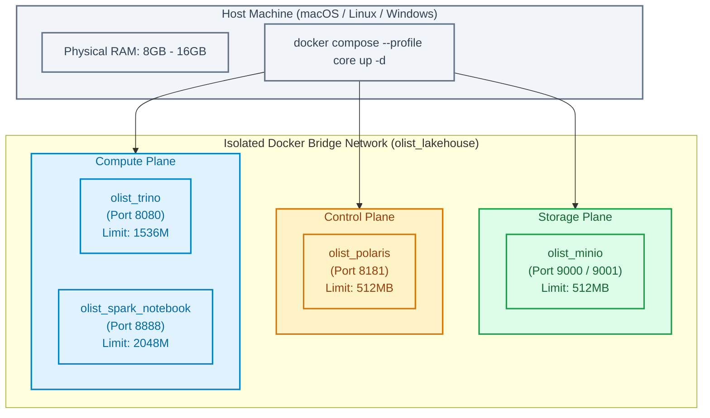
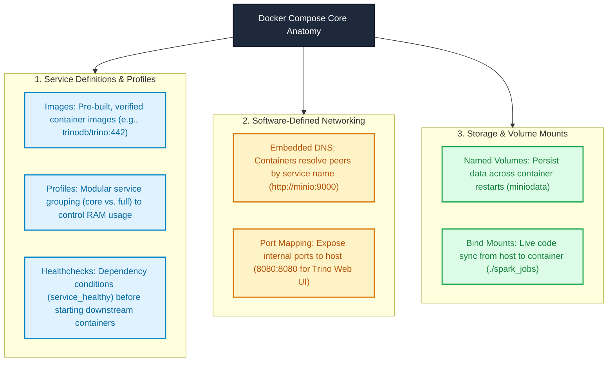
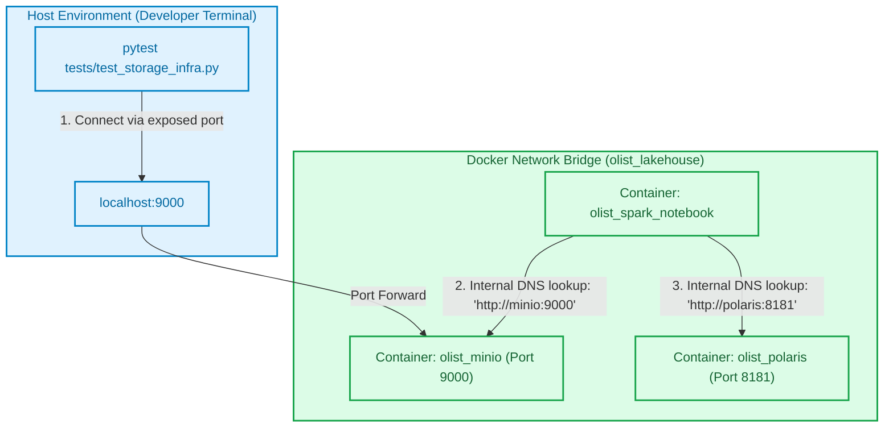
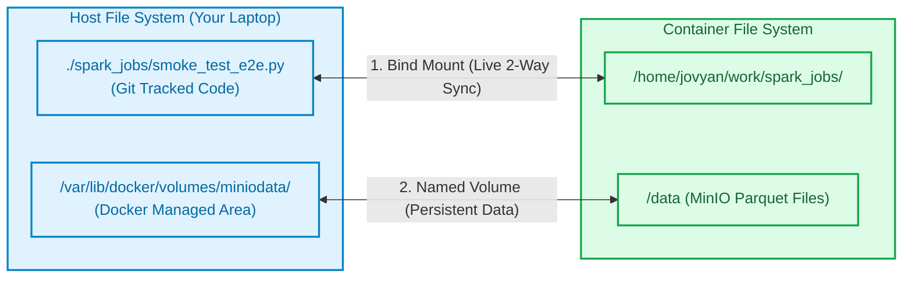

# Module 06: Infrastructure as Code — Docker Compose Essentials for Data Engineers

> **Target Audience:** IT Students & Software Engineers transitioning to Data Engineering  
> **Topic Scope:** Docker Compose in Data Engineering, Memory Optimization via Profiles, Internal DNS & Networking, Storage Persistence Patterns, Resource Limits  
> **Estimated Reading Time:** 16 minutes  

---

## 1. The Big Picture: The "Works on My Machine" Nightmare in Data Engineering

In basic programming classes, setting up an application usually involves installing Python and PostgreSQL directly on your operating system.

In modern Data Engineering, this approach leads to immediate disaster:
* Your ingestion engine requires **Java 17 and Scala 2.12** for Apache Spark.
* Your catalog service requires **Java 21** for Apache Polaris.
* Your query engine requires specific Hadoop native libraries and Python bindings.
* When you collaborate with teammates running macOS ARM64 (Apple Silicon) versus Windows/Linux x86_64, version mismatches guarantee that code running on one machine will crash on another.

To guarantee **100% reproducibility**, Data Engineers use **Infrastructure as Code (IaC)** powered by **Docker Compose**. With a single command (`docker compose up`), an entire enterprise data stack—distributed storage, catalog, query engines, and databases—spins up in isolated, deterministic containers.



---

## 2. Concept Anatomy: Docker Compose for Data Platforms

### Academic Definition
> **Docker Compose** is a *declarative orchestration tool* for defining and running multi-container Docker applications using a single YAML configuration file, providing automated service discovery, software-defined private networking, volume persistence, and cgroup resource governance.

### Keyword Dissection (Anatomy)



---

## 3. The Memory Problem & Solution: Docker Compose Profiles

In enterprise architectures, a complete Lakehouse stack includes:
* PostgreSQL (OLTP)
* MinIO (Object Storage)
* Polaris (Catalog)
* Trino (Query Engine)
* PySpark (Compute)
* Apache Airflow (Scheduler, Webserver, Worker)
* Apache Superset (BI Dashboard)

Running all 8 services simultaneously consumes **more than 12 GB of RAM**, causing developer laptops to freeze or crash with Out-Of-Memory (OOM) kernel panics.

### The Two-Profile Strategy:

To keep memory consumption **strictly below 6 GB RAM**, our architecture splits services into two declarative profiles:

```mermaid
flowchart LR
    subgraph CoreProfile ["Profile: 'core' (< 5.0 GB Total RAM) - Active in Week 1"]
        direction TB
        M_Core["MinIO (512MB)"]
        P_Core["Polaris (512MB)"]
        T_Core["Trino (1536MB)"]
        S_Core["PySpark Notebook (2048MB)"]
        PG_Ext["PostgreSQL: Offloaded to Supabase Cloud (0MB local RAM!)"]
    end

    subgraph FullProfile ["Profile: 'full' (> 12.0 GB Total RAM) - Activated in Week 6"]
        direction TB
        AF["Apache Airflow (Scheduler + Webserver + Worker)"]
        SS["Apache Superset (BI Dashboards)"]
    end

    CoreProfile -.->|"Add for Orchestration & BI"| FullProfile

    classDef coreStyle fill:#dcfce7,stroke:#16a34a,stroke-width:2px,color:#166534;
    classDef fullStyle fill:#fee2e2,stroke:#ef4444,stroke-width:2px,color:#991b1b;

    class CoreProfile,M_Core,P_Core,T_Core,S_Core,PG_Ext coreStyle;
    class FullProfile,AF,SS fullStyle;
```



In [docker-compose.yml](file:///Users/anhtus/Documents/Development/DE/GRT_DA-DE/docker-compose.yml), each service specifies which profile it belongs to:
```yaml
profiles: ["core", "full"]
```
By setting `COMPOSE_PROFILES=core` in your [.env](file:///Users/anhtus/Documents/Development/DE/GRT_DA-DE/.env) file, Docker Compose automatically starts only the lightweight foundation stack.

---

## 4. Docker Networking & The "Localhost" Trap

The most common bug encountered by Junior Data Engineers is **Network Resolution Mismatch**.

### The Problem:
* When running Python scripts directly on your **Host Machine** (e.g., in VS Code or Terminal), MinIO is reached via:
  $$\text{http://localhost:9000}$$
* When running PySpark inside the **Docker Container** (`olist_spark_notebook`), `localhost` refers to the container itself! MinIO is not running inside that container, so the connection immediately fails with `ConnectionRefusedError`.

### How Docker Internal DNS Solves This:



### Golden Rule for Data Engineers:
* **Host $\rightarrow$ Container:** Use `localhost:<PORT>` (e.g., `localhost:9000`).
* **Container $\rightarrow$ Container:** Use the **Service Name** defined in `docker-compose.yml` (e.g., `http://minio:9000`, `http://polaris:8181`).

In [tests/test_spark_iceberg.py](file:///Users/anhtus/Documents/Development/DE/GRT_DA-DE/tests/test_spark_iceberg.py), our code automatically detects its runtime environment:
```python
is_docker = os.path.exists("/.dockerenv")
default_polaris = "http://polaris:8181" if is_docker else "http://localhost:8181"
default_minio = "http://minio:9000" if is_docker else "http://localhost:9000"
```

---

## 5. Storage Persistence: Named Volumes vs. Bind Mounts

Containers are ephemeral by default. If a container crashes or is deleted (`docker compose down`), any file saved inside its root file system vanishes permanently.

To prevent data loss, Data Engineering stacks use two distinct storage strategies:



| Type | Definition | Best Used For in DE | Example in Our Project |
| :--- | :--- | :--- | :--- |
| **Bind Mount** | Directly maps a host folder into a container directory. Changes in IDE appear instantly inside container. | Python scripts, SQL files, unit tests, configurations. | `./spark_jobs:/home/jovyan/work/spark_jobs` |
| **Named Volume** | Dedicated storage space managed entirely by Docker engine. Survives `down` and `up` cycles. | Heavy physical binary data (MinIO objects, PostgreSQL database data, `.ivy2` JAR cache). | `miniodata:/data`<br/>`ivy_cache:/home/jovyan/.ivy2` |

---

## 6. Resource Governance (cgroups)

To prevent Apache Spark or Trino from consuming 100% of the host machine's CPU and RAM, every production Docker Compose service specifies hard resource constraints:

```yaml
deploy:
  resources:
    limits:
      memory: 2048M
```

* If a Spark job leaks memory and exceeds 2048 MB, Docker terminates that specific container cleanly without taking down your entire operating system.

---

## 7. Practical Connection: Our Olist Project Mapping

Here is how our [docker-compose.yml](file:///Users/anhtus/Documents/Development/DE/GRT_DA-DE/docker-compose.yml) implements these architectural principles:

| Service | Memory Limit | Ports Exposed | Volume Mapping | Dependency Check |
| :--- | :--- | :--- | :--- | :--- |
| **minio** | 512M | 9000, 9001 | `miniodata:/data` | Healthcheck (`/minio/health/live`) |
| **polaris** | 512M | 8181 | None (stateless) | `minio: condition: service_healthy` |
| **trino** | 1536M | 8080 | `./etc/trino/catalog` (read-only) | Depends on `polaris`, `minio` |
| **spark-notebook** | 2048M | 8888 | `./spark_jobs`, `ivy_cache` | Depends on `polaris`, `minio` |

---

## 8. Knowledge Check (Self-Assessment)

1. **Question:** *Why does running `docker compose down` followed by `docker compose up -d` NOT delete our MinIO Iceberg data?*  
   * **Answer:** Because MinIO storage is backed by a Docker **Named Volume** (`miniodata`). Named volumes are managed independently from container lifecycles and are only deleted if you explicitly pass the `-v` flag (`docker compose down -v`).

2. **Question:** *Why does PySpark fail with `Connection refused` if its configuration specifies `s3.endpoint = "http://localhost:9000"` when running inside Docker?*  
   * **Answer:** Inside a container, `localhost` refers to the container's own network namespace, where no MinIO service is listening. Inside the Docker bridge network, containers must use the internal DNS service name: `http://minio:9000`.

3. **Question:** *What is the purpose of Docker Compose Profiles in this project?*  
   * **Answer:** Profiles allow modular service activation. By specifying `--profile core`, we run only the essential Lakehouse services (MinIO, Polaris, Trino, Spark) to keep RAM usage under 6 GB, saving resource-heavy tools like Airflow and Superset for later modules.

---
*Made by Anh Tu - Share to be share*
