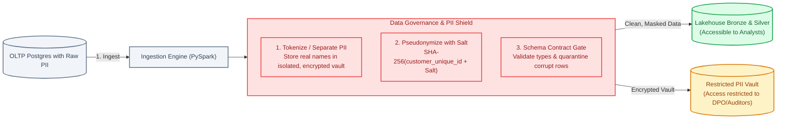
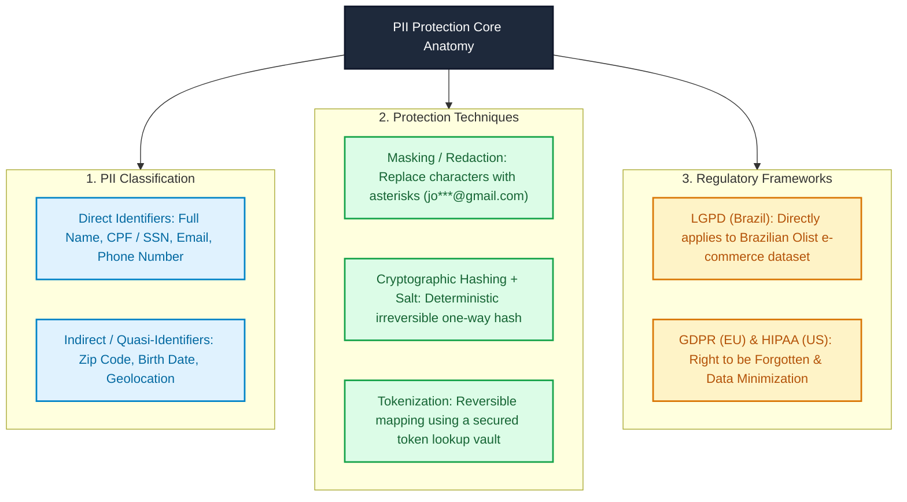
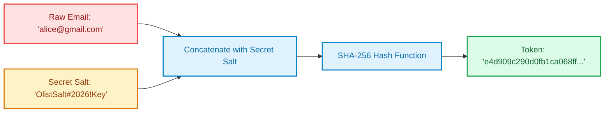
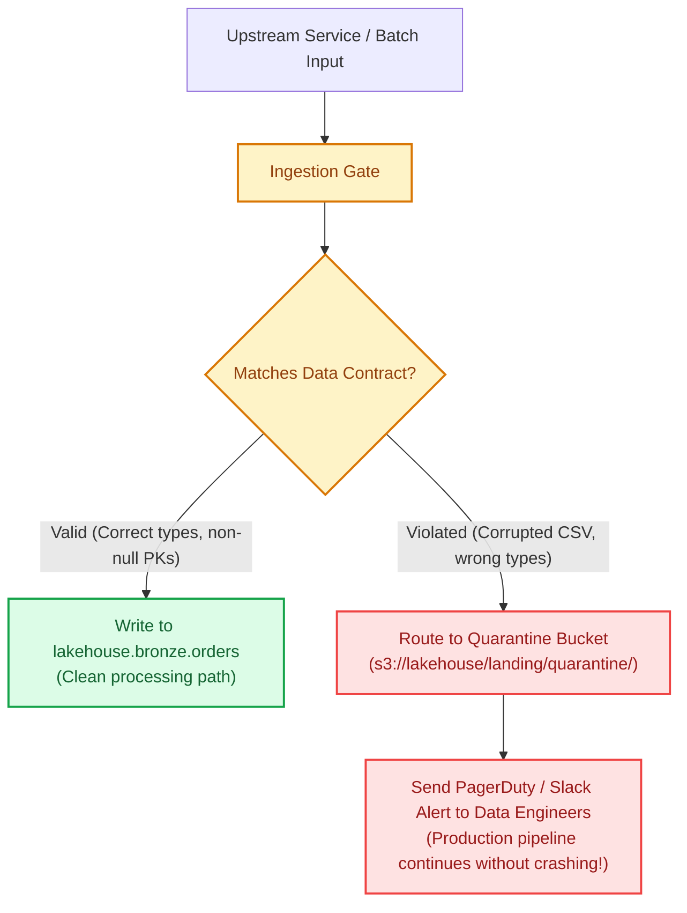

# Module 07: Data Governance & Security — PII Protection & Data Contracts

> **Target Audience:** IT Students & Software Engineers transitioning to Data Engineering  
> **Topic Scope:** Personally Identifiable Information (PII), LGPD/GDPR Compliance, Pseudonymization & Hashing, Data Contracts, Batch Slicing Strategies  
> **Estimated Reading Time:** 16 minutes  

---

## 1. The Big Picture: Why Data Engineers Go to Jail Without Governance

In software engineering, security often focuses on preventing SQL injection and securing JWT auth tokens.

In Data Engineering, you hold the keys to the **entire enterprise data warehouse**. A single unprotected Parquet file on S3 containing customer names, credit card numbers, or email addresses can result in catastrophic data leaks, multimillion-dollar regulatory fines under **GDPR (Europe)** or **LGPD (Brazil)**, and severe reputational damage.

Furthermore, upstream web services constantly change database schemas—adding columns, renaming fields, or sending invalid date strings. If your data pipeline blindly ingests this without a formal **Data Contract**, downstream dashboards will silently display corrupt metrics to executives.

Modern Data Engineering treats **Data Governance and PII Protection** as day-one engineering requirements, not afterthoughts.

---

## 2. Concept Anatomy: PII & Pseudonymization

### Academic Definition
> **Personally Identifiable Information (PII)** is *any data that could potentially identify a specific individual*, either directly (e.g., full name, social security number, email) or indirectly when combined with other data points (e.g., birth date, zip code, gender).  
> **Pseudonymization** is a *data privacy technique* that replaces private identifiers with artificial pseudonyms, ensuring the data cannot be attributed to a specific person without the use of additional, separately stored secret information.

### Keyword Dissection (Anatomy)

---

## 3. Cryptographic Hashing with Salt: The Golden Standard

Why can't we simply use `SHA-256(email)` to protect user privacy?

### The Rainbow Table Vulnerability:
* If you hash common emails or phone numbers without salt, attackers use precomputed tables of billions of known hashes (**Rainbow Tables**) to instantly reverse the hash and identify your users.

### The Solution: HMAC / Salted Hash:
$$\text{Secure\_Token} = \text{SHA-256}(\text{Raw\_PII} + \text{Secret\_Server\_Salt})$$

* **Deterministic:** Every time Alice makes a purchase, the pipeline generates the exact same token. This allows Analysts to calculate Customer Lifetime Value (LTV) and join tables without ever seeing Alice's real email address!
* **Irreversible:** Even if an external hacker steals the Parquet files on S3, they cannot reverse the token to Alice's email without your private server salt.

---

## 4. Concept Anatomy: Data Contracts

### Academic Definition
> A **Data Contract** is a *formal, binding agreement* between a data producer (software service) and data consumers (data engineering & analytics) that defines the explicit schema, semantic meaning, data quality rules, and SLAs of data emitted by a system.

### How a Data Contract Operates in the Lakehouse Pipeline:

---

## 5. The Olist Batch Replay Strategy (Batches B0 to B7)

Real-world data engineers rarely receive perfectly packaged static datasets. Data arrives in historical waves, frequently laced with production bugs.

In our project, we deliberately slice the Olist dataset into **8 chronological batches (B0 to B7)**, with specific real-world anomalies engineered into each batch:

| Batch | Period | Engineered Production Anomaly | Engineering Skill Trained |
| :--- | :--- | :--- | :--- |
| **B0** | Before 2018-01 | Baseline clean historical data | Initial Full Load & Smoke Test (M0) |
| **B1** | 2018-01 | Customers change their city and state | **Slowly Changing Dimensions (SCD Type 2)** |
| **B2** | 2018-02 | Orders table introduces a new column `sales_channel` | **Schema Drift Handling** |
| **B3** | 2018-03 | A reviews CSV file contains corrupted comma separators | **Structural Quarantine & Bad File Isolation** |
| **B4** | 2018-04 | Order items reference non-existent `product_id` | **Referential Integrity Enforcement** |
| **B5** | 2018-05 | Negative payments, corrupted date strings, invalid emails | **Data Quality (DQ) Rules & Severity Gates** |
| **B6** | 2018-06 | Duplicate transmission of Batch B5 | **Pipeline Idempotency & Deduplication** |
| **B7** | 2018-07 | Corrected data for 2018-03 | **Historical Backfilling** |

---

## 6. Practical Connection: Our Olist Project Mapping

Here is how PII and batch replay are implemented in our repository:

1. **Synthetic PII Generation:**  
   The public Kaggle Olist dataset was anonymized. In [data_prep/gen_pii.py](file:///Users/anhtus/Documents/Development/DE/GRT_DA-DE/data_prep/gen_pii.py), we use Python `Faker` to generate realistic Brazilian names, emails, phones, and dates of birth tied to `customer_unique_id`.
2. **Dedicated PII Isolation Table:**  
   The generated PII is stored in a separate table `customer_pii` inside PostgreSQL, completely isolated from transactional `orders` and `order_items`.
3. **Batch Slicing Script:**  
   In [data_prep/split_batches.py](file:///Users/anhtus/Documents/Development/DE/GRT_DA-DE/data_prep/split_batches.py), the dataset is sliced by `order_purchase_timestamp` into folders `batch_B0` through `batch_B7`.
4. **Seed Execution:**  
   In [data_prep/seed_postgres.py](file:///Users/anhtus/Documents/Development/DE/GRT_DA-DE/data_prep/seed_postgres.py), Batch B0 was seeded into the operational database to test our initial smoke test pipeline.

---

## 7. Knowledge Check (Self-Assessment)

1. **Question:** *Why is hashing an email using plain `MD5(email)` or `SHA-256(email)` without a secret salt considered an unacceptable security practice?*  
   * **Answer:** Without salt, hashes are vulnerable to precomputed Rainbow Table dictionary attacks. Because the space of common email domains and usernames is finite, attackers can reverse unsalted hashes in seconds. Adding a secret server-side salt ensures the hash cannot be reversed without access to the secret key.

2. **Question:** *What is the difference between `customer_id` and `customer_unique_id` in the Olist e-commerce database, and why is this critical for data analytics?*  
   * **Answer:** `customer_id` is an ephemeral transaction key generated newly for every single order. `customer_unique_id` represents the actual unique human being. If an analyst computes Customer Lifetime Value (LTV) using `customer_id`, returning customers will be counted as new users, completely invalidating retention and churn metrics.

3. **Question:** *What is a "Quarantine Table" in Data Engineering, and why is it preferred over simply failing a pipeline with an exception?*  
   * **Answer:** A quarantine pattern routes malformed or contract-violating records into a separate storage location (e.g., `s3://lakehouse/quarantine/`) while allowing all valid records to continue downstream. This prevents a single corrupt row from halting an entire mission-critical enterprise pipeline while alerting engineers to investigate the bad data.

---
*Made by Anh Tu - Share to be share*
