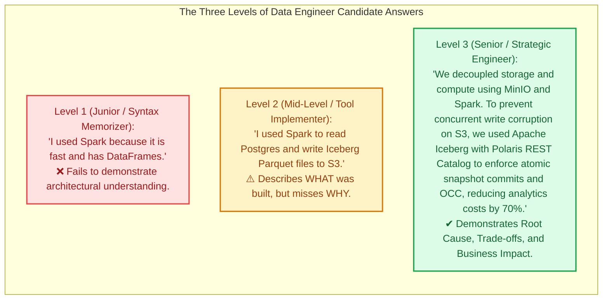
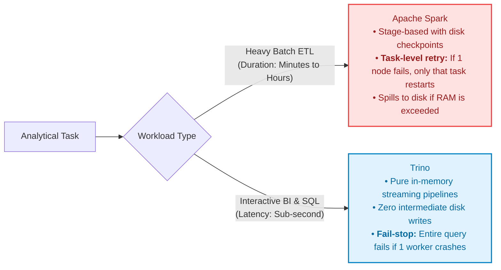

# Module 08: Week 01 Synthesis & Technical Interview Cheatsheet

> **Target Audience:** IT Students & Software Engineers transitioning to Data Engineering  
> **Topic Scope:** Comprehensive Architectural Q&A, Root Cause Explanations, STAR Method Interview Framework, Elevator Pitches  
> **Estimated Reading Time:** 15 minutes  

---

## 1. The Big Picture: How to Ace a Data Engineering Interview

In Software Engineering interviews, technical screeners test algorithms, data structures (LeetCode), and REST API design.

In Data Engineering interviews, screeners look for something different: **Architectural Reasoning and Trade-Off Awareness**.  
Senior hiring managers do not care whether you have memorized every PySpark API syntax. They care whether you can explain:
* *Why did you choose a Lakehouse instead of an RDBMS?*
* *What happens when two distributed writers collide on S3?*
* *How do you keep infrastructure costs under control without sacrificing query latency?*

This cheatsheet equips you with the exact technical depth, root cause arguments, and trade-off comparisons needed to stand out as a top-tier candidate.

---

## 2. Core Question 1: Data Lakehouse vs. Data Lake vs. Data Warehouse

### Question:
> *"Why did you choose a Data Lakehouse architecture for your project instead of a traditional Data Warehouse or a simple Data Lake?"*

### Model Answer:
* **The Root Cause:**  
  * **Data Warehouses** (e.g., Snowflake, Teradata) couple compute and storage. They provide strong ACID transactions and fast SQL, but storing petabytes of raw, unstructured data in proprietary formats is cost-prohibitive and causes vendor lock-in.
  * **Data Lakes** (e.g., raw S3 with CSV/Parquet) are cheap and scalable, but they lack ACID transactions and row-level updates. Without transactional guarantees, they quickly degrade into unmanageable "Data Swamps" with corrupted or duplicate records.
* **The Lakehouse Solution:**  
  A **Data Lakehouse** decouples storage from compute. It stores raw data in open formats (Apache Parquet) on cheap object storage (MinIO/S3), but introduces an **Open Table Format (Apache Iceberg)** and a **REST Catalog (Apache Polaris)** to provide full ACID transactions, schema evolution, and time travel.
* **Project Connection:**  
  *"In our Olist Lakehouse, raw and processed tables are stored as Parquet files on MinIO. Apache Iceberg manages the transactional metadata, allowing PySpark to execute heavy batch ETL jobs while Trino concurrently serves low-latency BI queries against the exact same data without duplicating storage."*

---

## 3. Core Question 2: The Role of a Catalog in Iceberg

### Question:
> *"If Apache Iceberg already stores metadata files (`.metadata.json` and `.avro`) on MinIO/S3, why do we need a Catalog like Apache Polaris at all?"*

### Model Answer:
* **The Technical Challenge on Object Storage:**  
  Amazon S3 and MinIO are Key-Value object stores. They do not support atomic file renames or distributed file locks.
* **The Atomic Pointer Problem:**  
  When an engine writes a new table state, it produces a new metadata file (e.g., `v2.metadata.json`). If multiple engines write simultaneously, which file represents the true state of the table? Without a central coordinator, two writers would encounter a race condition and overwrite each other's data.
* **The Catalog's Responsibility:**  
  The Catalog acts as the **single source of truth holding an atomic pointer** to the current metadata file. It resolves concurrent writes using **Optimistic Concurrency Control (OCC)**:
  1. The writer proposes swapping the pointer from `v1.json` to `v2.json`.
  2. The Catalog performs an atomic Compare-And-Swap (CAS).
  3. If another writer committed first, the Catalog rejects the second commit (409 Conflict), prompting it to rebase its changes and retry cleanly.
* **Why REST Catalog?**  
  Unlike legacy Hive Metastore (HMS) which was bound to Java/Thrift, the **Iceberg REST Catalog specification** uses standard HTTP endpoints, enabling multi-engine access across Java, Python, C++, and Rust.

---

## 4. Core Question 3: Parquet vs. CSV for Analytical Systems

### Question:
> *"Why is Apache Parquet significantly faster and cheaper than CSV for analytical queries?"*

### Model Answer:
Parquet's superiority rests on three technical pillars:
1. **Columnar Projection (I/O Reduction):**  
   In analytics, queries usually request 3 to 5 columns out of 50. CSV is row-oriented; reading even one column requires scanning the entire file from disk. Parquet reads only the contiguous byte offsets of the requested columns, cutting disk I/O by 90% or more.
2. **Homogeneous Compression & Dictionary Encoding:**  
   In Parquet, values of the same column (same data type) are stored together. Identical strings (like state codes `"SP"`, `"RJ"`) are replaced by tiny integer IDs via Dictionary Encoding, and compressed with Snappy/ZSTD, achieving 4x to 8x smaller storage footprints than CSV.
3. **Predicate Pushdown & Data Skipping:**  
   The Parquet File Footer records Min/Max statistics for every Row Group. If a query filters for `WHERE freight_value > 200.00`, the query engine checks the footer before reading data. If a Row Group's maximum is `148.50`, the engine skips that entire block without decompressing or reading a single byte.

---

## 5. Core Question 4: Choosing Between Apache Spark and Trino

### Question:
> *"How do you decide whether to write a pipeline task in Apache Spark or Trino?"*

### Model Answer:
The decision comes down to the trade-off between **Fault Tolerance** and **In-Memory Streaming Latency**:

* **Use Spark:** For Medallion data transformations (Bronze $\rightarrow$ Silver $\rightarrow$ Gold), deduplication, PySpark user-defined logic, and long-running batch jobs where task-level fault tolerance is mandatory.
* **Use Trino:** For ad-hoc exploratory SQL, automated tie-out reconciliation tests, and powering live Superset dashboards where human users expect answers in seconds.

---

## 6. Core Question 5: Software Engineering Practices in Data Engineering

### Question:
> *"You come from a Software Engineering background. How did those software engineering skills influence your Data Engineering implementation?"*

### Model Answer:
*"Software engineering discipline is the single biggest differentiator between a fragile data pipeline and an enterprise-grade data platform:"*
1. **Test-Driven Development (TDD) for Data:**  
   *"In our project, before implementing the Spark ingestion pipeline, we wrote failing tie-out reconciliation tests ([tests/test_e2e_smoke.py](file:///Users/anhtus/Documents/Development/DE/GRT_DA-DE/tests/test_e2e_smoke.py)) to assert that the record count in PostgreSQL matches the Iceberg table count via Trino with zero discrepancy."*
2. **Pipeline Idempotency:**  
   *"We design every write operation to be idempotent. Running a pipeline once or five times produces the exact same result without duplicate rows, using Iceberg's `createOrReplace()` or merge capabilities."*
3. **Infrastructure as Code (IaC):**  
   *"We manage our entire Lakehouse infrastructure using declarative Docker Compose with strict cgroup memory boundaries and automated healthchecks, ensuring complete local reproducibility."*
4. **Data Privacy by Design:**  
   *"We treat PII as an architectural concern, isolating real user data in dedicated vault tables and using salted cryptographic hashing for analytical keys."*

---

## 7. The 90-Second Elevator Pitch

### Prompt:
> *"Tell me about the architecture of your Olist Lakehouse project."*

### Pitch Script (Memorize & Internalize):
> *"Our project builds an enterprise-grade Data Lakehouse based on the principle of Storage-Compute Decoupling.*  
>  
> *At the storage layer, we use MinIO as an S3-compatible object store, organized under the Medallion Architecture across Bronze, Silver, and Gold buckets.*  
>  
> *To eliminate data swamps and guarantee ACID transactions on object storage, we use Apache Iceberg as our open table format. Central metadata coordination and concurrent commit locks are managed by Apache Polaris using the open REST Catalog specification.*  
>  
> *For compute, we decouple workloads into two specialized engines: Apache Spark handles heavy batch ETL ingestion and transformations with task-level fault tolerance, while Trino serves sub-second interactive SQL queries for BI dashboards and automated data reconciliation.*  
>  
> *The entire platform is containerized using Docker Compose with optimized memory profiles, keeping local resource usage under 6 GB RAM while remaining completely reproducible."*

---

## 8. Summary of Week 01 Modules

Congratulations! You have completed all 8 theoretical modules for Week 01:

| Module | Document Link | Key Concept Mastered |
| :--- | :--- | :--- |
| **01** | [01-data-lakehouse.md](file:///Users/anhtus/Documents/Development/DE/GRT_DA-DE/docs/week01/01-data-lakehouse.md) | Data Lakehouse, Medallion Architecture, ETL vs. ELT |
| **02** | [02-storage-formats.md](file:///Users/anhtus/Documents/Development/DE/GRT_DA-DE/docs/week01/02-storage-formats.md) | Columnar Parquet, Compression, Predicate Pushdown |
| **03** | [03-apache-iceberg.md](file:///Users/anhtus/Documents/Development/DE/GRT_DA-DE/docs/week01/03-apache-iceberg.md) | Iceberg Metadata Trees, Snapshots, ACID, Time Travel |
| **04** | [04-catalog-polaris.md](file:///Users/anhtus/Documents/Development/DE/GRT_DA-DE/docs/week01/04-catalog-polaris.md) | REST Catalog Protocol, OCC, Atomic Pointer Swaps |
| **05** | [05-compute-engines.md](file:///Users/anhtus/Documents/Development/DE/GRT_DA-DE/docs/week01/05-compute-engines.md) | Spark vs. Trino: Execution Engines & Trade-offs |
| **06** | [06-docker-compose-essentials.md](file:///Users/anhtus/Documents/Development/DE/GRT_DA-DE/docs/week01/06-docker-compose-essentials.md) | Docker Profiles, Internal DNS, Volume Persistence |
| **07** | [07-data-contracts-and-pii.md](file:///Users/anhtus/Documents/Development/DE/GRT_DA-DE/docs/week01/07-data-contracts-and-pii.md) | PII Masking, Salted Hashing, Data Contracts, Batch Slicing |
| **08** | [08-week01-interview-cheatsheet.md](file:///Users/anhtus/Documents/Development/DE/GRT_DA-DE/docs/week01/08-week01-interview-cheatsheet.md) | Comprehensive Technical Interview Preparation & Elevator Pitch |

---
*Made by Anh Tu - Share to be share*
