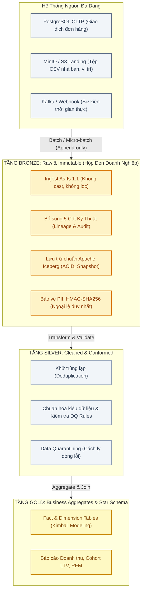
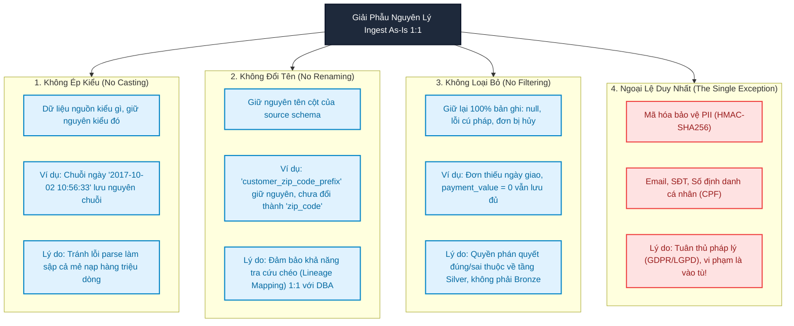
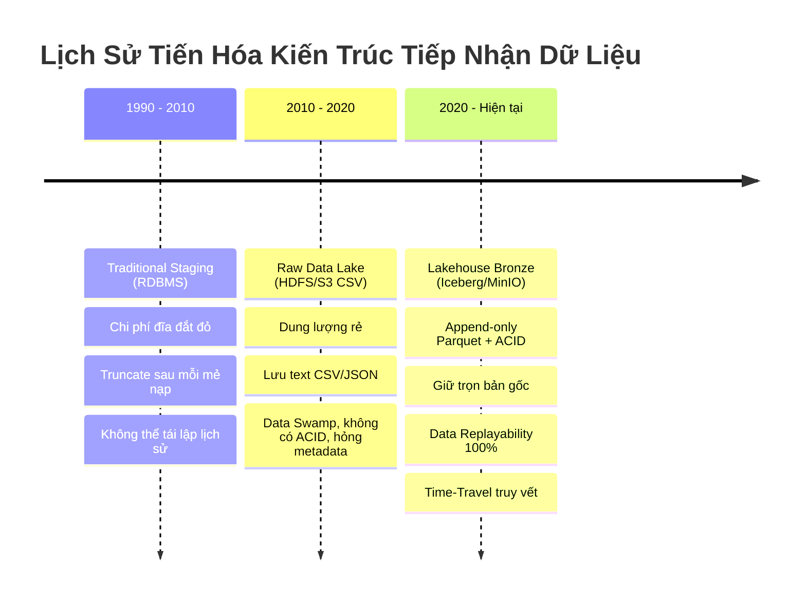
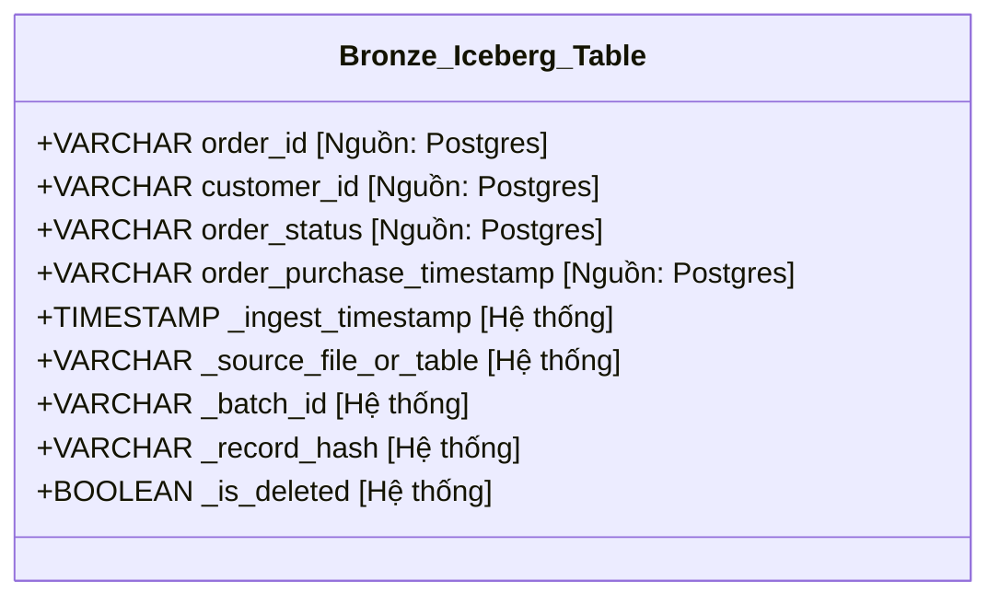
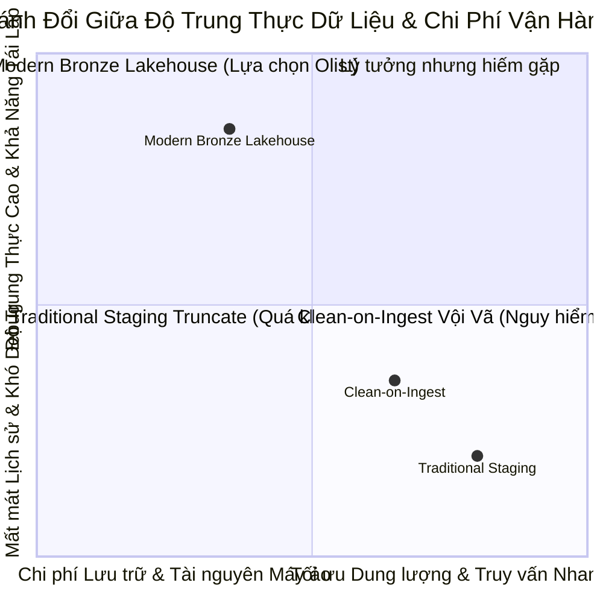

# Module 01: Bronze Layer Foundations — Khởi Nguồn Sự Thật Của Modern Lakehouse

> **Target Audience:** Sinh viên CNTT & Kỹ sư phần mềm đang chuyển dịch sang Data Engineering  
> **Topic Scope:** Medallion Architecture, Bronze Layer Principles, Ingest As-Is 1:1, Raw Immutability, Data Replayability, PII Exception  
> **Estimated Reading Time:** 18 phút  

---

## 1. The Big Picture: Tại Sao Data Lakehouse Cần Tầng Bronze?

Trong phát triển phần mềm truyền thống, khi bạn kết nối một dịch vụ mới, thói quen thường thấy là: "Dữ liệu đến đâu, ta làm sạch (clean), lọc bỏ (filter) và chuyển đổi (transform) ngay đến đó để lưu vào cơ sở dữ liệu."

Tuy nhiên, trong kỹ nghệ dữ liệu phân tán (Data Engineering), nếu bạn vội vã làm sạch dữ liệu ngay khi vừa nhận từ nguồn, bạn đang tự đẩy hệ thống vào một rủi ro chí mạng mang tên: **Mất mát vĩnh viễn nguồn cội sự thật (Loss of Raw Truth)**.

Hãy hình dung kịch bản thực tế sau:
* Ngày hôm nay, bạn viết mã lọc bỏ tất cả các bản ghi đơn hàng có trạng thái `canceled` hoặc `unavailable` vì nghĩ rằng bộ phận kinh doanh không cần chúng.
* 6 tháng sau, Ban Giám đốc yêu cầu: *"Hãy phân tích tỷ lệ khách hàng rời bỏ (churn rate) dựa trên các đơn hàng bị hủy trong 2 năm qua!"*
* Nếu bạn không lưu lại dữ liệu thô (raw data) ban đầu, toàn bộ dữ liệu đó đã biến mất vĩnh viễn. Cách duy nhất là cầu cứu đội ngũ quản trị cơ sở dữ liệu nguồn (OLTP DBA) để dump lại dữ liệu — điều thường bất khả thi do chính sách dọn dẹp (retention policy) của hệ thống vận hành.

Chính vì vậy, kiến trúc **Medallion Architecture** (Bronze ➔ Silver ➔ Gold) ra đời, trong đó **Tầng Bronze (Huy chương Đồng)** đóng vai trò là "chiếc hộp đen" ghi lại toàn bộ lịch sử thô nguyên bản của doanh nghiệp.



---

## 2. Concept Anatomy: Ingest As-Is 1:1

### Academic Definition (Định nghĩa chuẩn học thuật)
> **Ingest As-Is (Nạp nguyên trạng 1:1)** là *nguyên lý cốt lõi của tầng Bronze trong kiến trúc Lakehouse*, quy định rằng dữ liệu từ hệ thống nguồn phải được thu nạp vào hồ dữ liệu mà **không trải qua bất kỳ biến đổi ngữ nghĩa (semantic transformation), ép kiểu dữ liệu (data casting), đổi tên trường (renaming) hay loại bỏ bản ghi (filtering) nào**, bảo đảm tính toàn vẹn tuyệt đối (raw fidelity) và khả năng tái lập dữ liệu (data replayability).

### Keyword Dissection (Giải phẫu từ khóa)



---

## 3. Lịch Sử & Tiến Hóa: Staging Truyền Thống vs. Modern Lakehouse Bronze

Để hiểu thấu đáo một công nghệ, chúng ta phải làm rõ **Root Cause**: *Nó giải quyết nỗi đau gì của quá khứ?*

### 1. Thời kỳ Data Warehouse truyền thống: Bảng Staging tạm bợ
Trong các hệ thống Data Warehouse cổ điển (Oracle, SQL Server, Teradata), tầng đầu tiên tiếp nhận dữ liệu được gọi là **Staging Area**.
* **Đặc điểm:** Thường là các bảng tạm (temporary tables). Mỗi đêm, quy trình ETL chạy:
  1. Truncate bảng Staging.
  2. Nạp dữ liệu mới nhất từ OLTP vào Staging.
  3. Transform và nạp vào bảng Fact/Dimension.
  4. Truncate hoặc xóa sạch Staging để tiết kiệm dung lượng ổ cứng SAN đắt đỏ.
* **Hậu quả cay đắng:** 
  * Nếu phát hiện lỗi tính sai doanh thu của 3 tháng trước do logic ETL bị bug, kỹ sư không có cách nào tính lại, vì dữ liệu thô của 3 tháng trước trong Staging đã bị `TRUNCATE` mất từ lâu!

### 2. Kỷ nguyên Cloud Lakehouse: Bronze Layer bất biến (Immutable & Append-Only)
Với sự bùng nổ của Object Storage giá rẻ (AWS S3, MinIO, GCP GCS) và định dạng bảng hiện đại (Apache Iceberg):
* Dung lượng lưu trữ trở nên cực rẻ (~$0.02 / GB / tháng).
* **Bronze Layer** không bao giờ bị `TRUNCATE`. Mọi mẻ nạp đều được ghi dưới dạng **Append-only** hoặc ghi nhận lịch sử trạng thái qua các snapshot.
* **Khả năng Tái Lập Dữ Liệu (Data Replayability):** Nếu logic nghiệp vụ tại tầng Gold hoặc quy tắc làm sạch tầng Silver thay đổi, ta chỉ việc xóa bảng Silver/Gold và chạy lại luồng xử lý từ mốc thời gian bất kỳ trong Bronze. Tầng Bronze là "cái rễ" vĩnh cửu của cái cây dữ liệu.



---

## 4. Cơ Chế Kỹ Thuật: Cấu Trúc Bảng Bronze Chuẩn Doanh Nghiệp

Khi nạp dữ liệu từ nguồn vào Bronze, một câu hỏi quan trọng đặt ra: *Nếu giữ nguyên 1:1, làm sao biết dữ liệu được nạp vào lúc nào và từ đâu tới?*

Câu trả lời: **Bổ sung 5 Cột Siêu Dữ Liệu Kỹ Thuật (Technical Metadata Columns)** bao bọc lấy phần dữ liệu nguồn.



### Minh Họa PySpark Ingestion Chuẩn Cho Tầng Bronze

Dưới đây là đoạn mã minh họa cách nạp dữ liệu từ PostgreSQL vào bảng Apache Iceberg tầng Bronze, giữ nguyên 100% bản chất nguồn và bổ sung metadata:

```python
from pyspark.sql import SparkSession
from pyspark.sql.functions import col, current_timestamp, lit, sha2, concat_ws

def ingest_orders_to_bronze(spark: SparkSession, batch_id: str):
    """
    Nạp dữ liệu bảng orders từ PostgreSQL vào Apache Iceberg Bronze Layer.
    Tuân thủ nguyên tắc: Ingest As-Is 1:1 + Metadata Enrichment.
    
    Lý do (Why):
    - Không cast kiểu datetime tại đây để tránh lỗi runtime nếu gặp dữ liệu rác.
    - Tạo _record_hash từ tất cả các cột nghiệp vụ để phục vụ Change Detection ở các tầng sau.
    """
    # 1. Đọc nguyên trạng từ PostgreSQL OLTP
    raw_orders_df = spark.read \
        .format("jdbc") \
        .option("url", "jdbc:postgresql://postgres:5432/postgres") \
        .option("dbtable", "public.orders") \
        .option("user", "postgres") \
        .option("password", "olist-lakehouse") \
        .load()

    # 2. Bổ sung các cột kỹ thuật (Technical Metadata Columns)
    # Tuyệt đối KHÔNG thay đổi tên cột hoặc ép kiểu các trường nghiệp vụ gốc
    business_columns = raw_orders_df.columns
    
    bronze_orders_df = raw_orders_df \
        .withColumn("_ingest_timestamp", current_timestamp()) \
        .withColumn("_source_file_or_table", lit("postgresql.public.orders")) \
        .withColumn("_batch_id", lit(batch_id)) \
        .withColumn("_record_hash", sha2(concat_ws("||", *[col(c) for c in business_columns]), 256)) \
        .withColumn("_is_deleted", lit(False))

    # 3. Ghi vào Apache Iceberg Bronze Catalog dưới dạng Append-Only
    bronze_orders_df.write \
        .format("iceberg") \
        .mode("append") \
        .save("lakehouse.bronze.orders")
    
    print(f"✔ Đã nạp thành công {bronze_orders_df.count()} bản ghi vào lakehouse.bronze.orders")
```

---

## 5. Ngoại Lệ Duy Nhất Của Ingest As-Is: PII Protection

Nguyên tắc Ingest As-Is nói rằng "không được sửa đổi dữ liệu". Nhưng tại sao **PII (Personally Identifiable Information)** lại là ngoại lệ duy nhất?

### Bối Cảnh Pháp Lý (GDPR & LGPD)
Olist là nền tảng thương mại điện tử hoạt động tại Brazil. Đạo luật bảo vệ dữ liệu của Brazil là **LGPD (Lei Geral de Proteção de Dados)** quy định mức phạt lên tới **50 triệu Reais (~10 triệu USD)** cho mỗi hành vi để lộ dữ liệu định danh khách hàng.

Nếu bạn nạp trực tiếp Email, Số điện thoại hoặc Mã số thuế cá nhân (CPF) vào tầng Bronze dưới dạng plaintext:
1. Mọi kỹ sư dữ liệu, thực tập sinh, nhà phân tích BI có quyền truy cập hồ dữ liệu đều sẽ nhìn thấy thông tin riêng tư của khách hàng.
2. Dữ liệu khi đã vào bảng Iceberg trên S3/MinIO sẽ được sao chép qua các snapshot, cực kỳ khó để truy quét và xóa bỏ triệt để theo "Quyền được lãng quên" (Right to be Forgotten).

> [!CAUTION]
> **Ranh Giới An Ninh Tối Thượng:**  
> Dữ liệu PII nhạy cảm cao bắt buộc phải được băm bảo vệ (**Tokenization qua HMAC-SHA256 với Secret Key**) NGAY TẠI THỜI ĐIỂM BẮT ĐẦU NẠP VÀO BRONZE. Dữ liệu gốc plaintext chỉ được lưu trữ trong một kho biệt lập có mã hóa phần cứng (KMS-encrypted Vault) dành riêng cho kiểm toán viên được ủy quyền.

---

## 6. Phân Tích Đánh Đổi (Trade-Off Analysis)

Không có giải pháp công nghệ nào là hoàn hảo. Kỹ sư giỏi là người nhìn thấy rõ cái giá phải trả khi lựa chọn kiến trúc:



### Bảng Ma Trận Ra Quyết Định Kiến Trúc

| Tiêu Chí | Ingest As-Is 1:1 (Modern Bronze) | Clean-on-Ingest (Làm sạch ngay từ đầu) |
| :--- | :--- | :--- |
| **Bảo tồn nguồn gốc (Data Lineage)** | **Hoàn hảo (100%):** Dữ liệu thô luôn còn nguyên. | **Kém:** Không thể chứng minh dữ liệu gốc hình thù ra sao nếu có tranh chấp. |
| **Khả năng tái lập (Replayability)** | **Tuyệt đối:** Đổi logic business chỉ cần re-run Bronze ➔ Silver. | **Bất khả thi:** Phải nhờ DBA nguồn dump lại dữ liệu cũ. |
| **Chi phí lưu trữ (Storage Cost)** | Cao hơn ~15-25% do lưu trữ dữ liệu thô song song dữ liệu sạch. | Thấp hơn do chỉ giữ lại các cột và dòng hợp lệ. |
| **Tốc độ Ingestion Pipeline** | **Cực nhanh:** Không tốn CPU phân tích cú pháp hay kiểm tra logic phức tạp. | **Chậm:** Dễ bị nghẽn (bottleneck) CPU do validate hàng triệu dòng. |
| **Khả năng chịu lỗi (Fault Tolerance)** | **Rất cao:** Bản ghi lỗi cú pháp vẫn được lưu vào Bronze, sau đó Silver mới xử lý. | **Kém:** 1 dòng lỗi kiểu dữ liệu có thể làm đứt gãy cả pipeline nạp. |

---

## 7. Ánh Xạ Vào Dự Án Thực Tế `olist-lakehouse`

Dưới đây là cách nguyên lý Bronze Layer được tổ chức cụ thể trong repo của chúng ta:

| Khái Niệm Lý Thuyết | Triển Khai Thực Tế Trong Repo `GRT_DA-DE` |
| :--- | :--- |
| **Nguồn OLTP (Transactional Source)** | 5 bảng trong PostgreSQL: `orders`, `order_items`, `order_payments`, `customers`, `customer_pii` |
| **Nguồn Object Landing (Reference Files)** | 5 tệp CSV trong MinIO bucket `landing`: `products`, `sellers`, `geolocation`, `order_reviews`, `category_translation` |
| **Bronze Catalog (Lưu trữ bảng thô)** | Apache Iceberg REST Catalog (Polaris) với namespace: `lakehouse.bronze.*` |
| **Vị trí lưu trữ dữ liệu thô** | MinIO Bucket `s3://bronze/` định dạng Apache Parquet nén Snappy |
| **Kỹ thuật bảo vệ PII** | Script `data_prep/seed_postgres.py` tách riêng `customer_pii` để sẵn sàng áp dụng HMAC Tokenizer trước khi nạp |

---

## 8. Bài Tập Tự Đánh Giá (Knowledge Check)

1. **Câu hỏi:** *Một kỹ sư thực tập đề xuất: "Em thấy bảng `orders` có 3 dòng bị lỗi thiếu ngày đặt hàng và 5 dòng trạng thái hủy. Em có nên lọc bỏ chúng ngay khi ghi vào bảng Bronze không?" Bạn sẽ trả lời thế nào?*  
   * **Đáp án:** Tuyệt đối không! Tầng Bronze phải tuân thủ nguyên tắc Ingest As-Is 1:1 để đảm bảo tính toàn vẹn của lịch sử. Các dòng lỗi hoặc đơn hủy có thể là tín hiệu nghiệp vụ quan trọng phục vụ phân tích hệ thống lỗi hoặc tỷ lệ hủy đơn sau này. Việc phân loại, làm sạch hoặc cách ly (quarantine) sẽ được thực hiện tại tầng Silver.

2. **Câu hỏi:** *Sự khác biệt căn bản nhất giữa bảng Staging trong cơ sở dữ liệu truyền thống và bảng Bronze trong Modern Lakehouse là gì?*  
   * **Đáp án:** Bảng Staging truyền thống mang tính tạm thời (ephemeral), thường xuyên bị `TRUNCATE` sau mỗi mẻ nạp để tiết kiệm đĩa. Ngược lại, bảng Bronze trong Lakehouse mang tính bất biến (immutable) và lưu trữ lịch sử dài hạn (append-only snapshot), cho phép tái lập dữ liệu (data replayability) bất cứ lúc nào.

3. **Câu hỏi:** *Tại sao PII lại là ngoại lệ duy nhất được phép biến đổi (masking) trước khi lưu vào tầng Bronze?*  
   * **Đáp án:** Do rủi ro pháp lý tối thượng (Luật GDPR/LGPD). Dữ liệu PII nếu lọt vào hồ dữ liệu Bronze sẽ lan truyền qua vô số snapshot và bảng phái sinh, vi phạm quyền riêng tư và đối mặt với các khoản phạt khổng lồ. Do đó, việc mã hóa bằng HMAC-SHA256 với Secret Key ngay từ cửa ngõ là yêu cầu an ninh bắt buộc.

---
*Made by Anh Tu - Share to be share*
