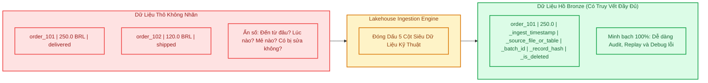
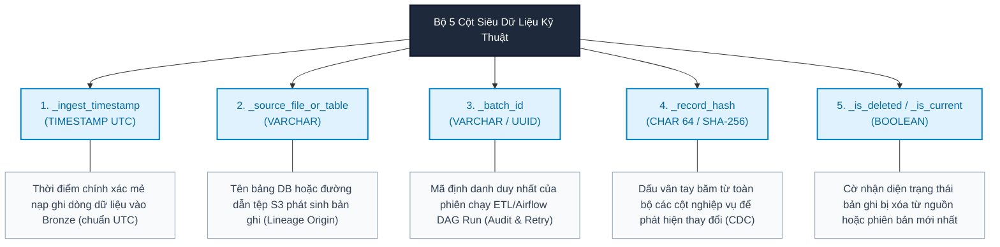
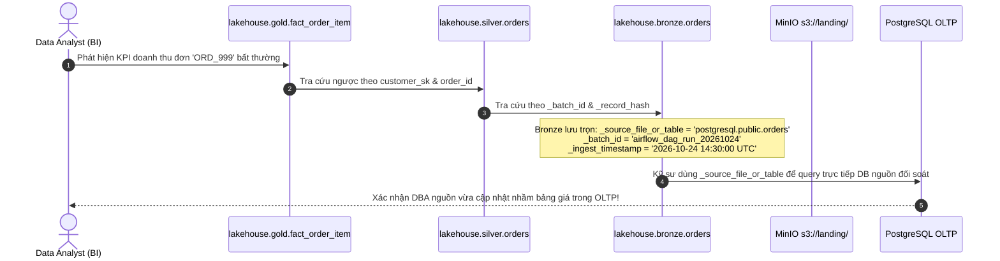
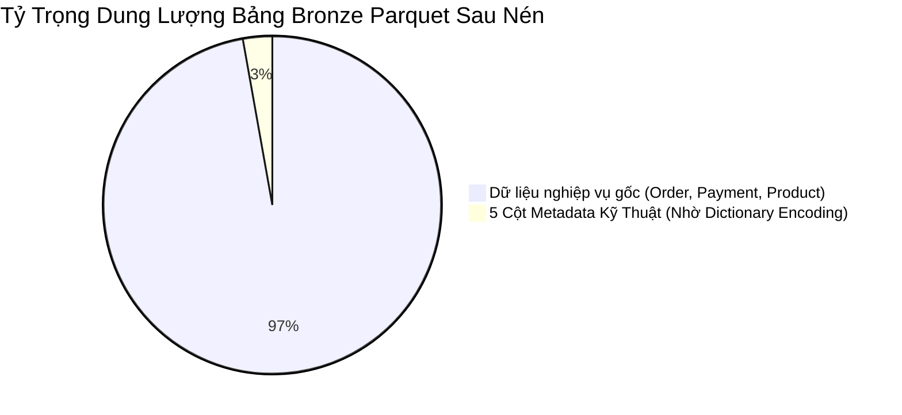

# Module 02: Metadata Columns & Tracing Data Lineage — Quản Trị Vết Dữ Liệu Phân Tán

> **Target Audience:** Sinh viên CNTT & Kỹ sư phần mềm đang chuyển dịch sang Data Engineering  
> **Topic Scope:** Technical Metadata Columns, Auditability, Data Lineage, Batch Idempotency, Spark Overhead Optimization  
> **Estimated Reading Time:** 16 phút  

---

## 1. The Big Picture: Khi Dữ Liệu Phân Tán Thiếu Vết Manh Mối

Hãy hình dung một buổi sáng thứ Hai, Giám đốc Tài chính (CFO) gửi một email khẩn cấp cho đội ngũ Data:
> *"Tại sao tổng doanh thu tháng 9 trên dashboard báo cáo hiển thị 15,2 tỷ đồng, nhưng sao kê tiền về tài khoản ngân hàng thực tế chỉ có 12,8 tỷ đồng? Chênh lệch 2,4 tỷ này từ đâu ra?"*

Nếu bảng dữ liệu của bạn chỉ lưu trữ thuần túy các cột nghiệp vụ (`order_id, amount, customer_id`):
* Bạn hoàn toàn bất lực không thể biết 2,4 tỷ chênh lệch đó được nạp vào lúc mấy giờ?
* Do tệp CSV nào ở Landing đẩy lên, hay từ bảng PostgreSQL nào đồng bộ sang?
* Mẻ nạp đó (Batch) do ai kích hoạt, chạy vào lúc nào, có bị chạy trùng lặp (duplicate execution) 2 lần hay không?

Trong hệ thống phần mềm đơn lẻ (Monolith), bạn có file `access.log` hoặc `application.log`. Nhưng trong hệ sinh thái dữ liệu phân tán (Distributed Lakehouse) với hàng tỷ bản ghi, log ứng dụng là chưa đủ. Bạn cần **gắn thẻ căn cước (Identity Tag) trực tiếp lên từng dòng dữ liệu**.

Đó là lý do các hệ thống Data Lakehouse chuẩn doanh nghiệp luôn trang bị **Bộ 5 Cột Siêu Dữ Liệu Kỹ Thuật (The 5 Standard Technical Metadata Columns)**.



---

## 2. Concept Anatomy: Technical Metadata Columns

### Academic Definition (Định nghĩa chuẩn học thuật)
> **Technical Metadata Columns (Cột siêu dữ liệu kỹ thuật)** là *tập hợp các trường dữ liệu hệ thống được sinh tự động trong quá trình nạp (ingestion)*, gắn liền với từng bản ghi nhằm ghi nhận **thời điểm xử lý, nguồn gốc phát sinh, định danh mẻ chạy, dấu vân tay dữ liệu và trạng thái vòng đời của bản ghi**, phục vụ công tác kiểm toán (audit), gỡ lỗi (debugging) và truy vết nguồn gốc (data lineage).

### Keyword Dissection (Giải phẫu 5 Cột Kỹ Thuật Chuẩn)



1. **`_ingest_timestamp` (Thời điểm nạp):**  
   * **Bản chất:** Ghi lại thời điểm bản ghi được đẩy vào Lakehouse theo giờ chuẩn quốc tế `UTC`.
   * **Tại sao không dùng thời gian của hệ thống nguồn?** Thời gian nguồn (`created_at`, `order_purchase_timestamp`) phản ánh thời điểm giao dịch phát sinh, nhưng không cho biết *khi nào Data Pipeline nhìn thấy nó*. Một đơn hàng đặt từ năm 2017 có thể được nạp lại vào Lakehouse vào tháng 10/2026. `_ingest_timestamp` giúp phân biệt rõ hai mốc thời gian này.

2. **`_source_file_or_table` (Nguồn gốc phát sinh):**  
   * **Bản chất:** Lưu chuỗi nhận diện nguồn, ví dụ `postgresql.public.orders` hoặc `s3://landing/ref/olist_products_dataset.csv`.
   * **Giá trị thực tế:** Trong các kiến trúc đa nguồn (Multi-source), nếu một trường bị corrupt, kỹ sư biết chính xác phải mở server nào hoặc tải tệp nào trên S3 để đối soát với bên cung cấp.

3. **`_batch_id` (Mã định danh mẻ nạp):**  
   * **Bản chất:** Chuỗi ID duy nhất đại diện cho lần chạy đó (thường lấy từ `Airflow execution_date` hoặc `UUID`).
   * **Tính lũy đẳng (Idempotency):** Nếu một pipeline bị đứt cáp mạng giữa chừng khi đã nạp được 50% dữ liệu, bạn chỉ việc xóa các dòng có `_batch_id` đó (`DELETE FROM bronze.orders WHERE _batch_id = 'batch_20261024_01'`) và chạy lại mẻ nạp mà không lo sợ bị nhân đôi dòng dữ liệu!

4. **`_record_hash` (Dấu vân tay bản ghi):**  
   * **Bản chất:** Chuỗi băm SHA-256 tính toán dựa trên các cột nghiệp vụ nguồn (đã được nối chuỗi chuẩn hóa).
   * **Tác dụng:** Cực kỳ quan trọng trong Change Data Capture (CDC). Nếu hai lần nạp liên tiếp cùng có `order_id = 'ABC'`, ta chỉ việc so sánh `_record_hash`. Nếu hash không đổi ➔ Dữ liệu không thay đổi, bỏ qua. Nếu hash khác nhau ➔ Khách hàng đã cập nhật trạng thái đơn hàng!

5. **`_is_deleted` (Cờ xóa mềm):**  
   * **Bản chất:** Giá trị boolean (`TRUE`/`FALSE`).
   * **Tác dụng:** Khi hệ thống nguồn phát sinh thao tác `DELETE` trong cơ sở dữ liệu OLTP, hệ thống CDC (Debezium/Kafka) sẽ bắn sự kiện xóa. Thay vì xóa vật lý dòng đó trong Bronze (làm mất lịch sử), ta ghi một dòng mới với `_is_deleted = TRUE`.

---

## 3. Kiến Trúc Truy Vết Vòng Đời Dữ Liệu (End-to-End Lineage Flow)

Sự kết hợp giữa 5 cột metadata kỹ thuật và định dạng bảng **Apache Iceberg** tạo nên khả năng truy vết hoàn hảo:



---

## 4. Hiện Thực Kỹ Thuật: Tối Ưu PySpark Cho Động Cơ Phân Tán

Một sai lầm phổ biến của các lập trình viên mới làm quen với Apache Spark là: *Gợi ý tạo ID hoặc Timestamp bằng các hàm Python cục bộ chạy trên máy chủ điều khiển (Driver)*.

* **Hiểm họa nghẽn Driver:** Nếu bạn dùng vòng lặp Python `for row in df.collect(): ...` để gán metadata, toàn bộ dữ liệu hàng chục triệu dòng sẽ bị kéo về bộ nhớ Driver, gây sập bộ nhớ ngay lập tức (`OutOfMemoryError: Java heap space`).
* **Giải pháp chuẩn phân tán:** Sử dụng các hàm dựng sẵn (Built-in Spark SQL Functions) để các **Spark Executors** song song tính toán metadata trực tiếp trên từng phân vùng dữ liệu (Partition) mà không cần trao đổi qua mạng (Zero Shuffle Overhead).

```python
from pyspark.sql import SparkSession
from pyspark.sql.functions import (
    col, current_timestamp, lit, sha2, concat_ws, coalesce, input_file_name
)

def enrich_bronze_metadata(raw_df, source_identifier: str, batch_id: str):
    """
    Hàm chuẩn hóa bổ sung 5 cột Metadata cho tầng Bronze.
    
    Giải thích kỹ thuật (Why):
    1. current_timestamp(): Sinh thời gian tại thời điểm thực thi trên executor, chuẩn UTC.
    2. concat_ws + coalesce: Đảm bảo nếu cột có giá trị NULL, thuật toán băm không bị nuốt chuỗi.
    3. lit(batch_id): Gán nhãn mẻ nạp đồng nhất trên toàn bộ các partition.
    """
    business_cols = raw_df.columns
    
    # Xử lý an toàn: Thay thế NULL bằng chuỗi rỗng '__NULL__' khi tính hash
    normalized_cols = [
        coalesce(col(c).cast("string"), lit("__NULL__")) 
        for c in business_cols
    ]
    
    enriched_df = raw_df \
        .withColumn("_ingest_timestamp", current_timestamp()) \
        .withColumn("_source_file_or_table", lit(source_identifier)) \
        .withColumn("_batch_id", lit(batch_id)) \
        .withColumn("_record_hash", sha2(concat_ws("##", *normalized_cols), 256)) \
        .withColumn("_is_deleted", lit(False))
        
    return enriched_df
```

---

## 5. Các Kịch Bản Thất Bại & Cách Khắc Phục (Failure Modes)

### 1. Kịch bản "Chạy lại mẻ nạp bị lỗi" (Failed Batch Retry & Idempotency)
* **Vấn đề:** Mẻ nạp `batch_001` đang ghi được 700.000 dòng thì container Spark bị sập nguồn (OOM). Nếu chạy lại mà không dọn dẹp, 700.000 dòng cũ sẽ bị nhân đôi.
* **Cách khắc phục:** 
  1. Với Iceberg: Sử dụng tính năng **Atomic Snapshot Commit**. Nếu job sập, snapshot mới không được commit vào Polaris Catalog, các file rác tự động bị dọn dẹp.
  2. Bổ sung điều kiện dọn mẻ: 
     ```sql
     DELETE FROM lakehouse.bronze.orders WHERE _batch_id = 'batch_001';
     ```

### 2. Kịch bản "Lệch múi giờ giữa các máy chủ" (Clock Drift in Cluster)
* **Vấn đề:** 10 máy ảo Worker chạy Spark có đồng hồ lệch nhau vài giây, hoặc máy chủ nguồn ở múi giờ GMT+7 còn Lakehouse lưu trữ theo UTC.
* **Cách khắc phục:** LUÔN cấu hình timezone của Spark Cluster và Trino đồng nhất về `UTC`:
  ```python
  spark.conf.set("spark.sql.session.timeZone", "UTC")
  ```

---

## 6. Đánh Đổi Lưu Trữ (Storage Overhead Analysis)

Nhiều người e ngại: *"Thêm 5 cột metadata vào hàng trăm triệu bản ghi có làm phình to dung lượng ổ cứng S3 không?"*

Câu trả lời là: **GẦN NHƯ KHÔNG ĐÁNG KỂ!** Nhờ cơ chế lưu trữ dạng cột của **Apache Parquet**:
1. **Dictionary Encoding:** Trường `_source_file_or_table` và `_batch_id` có giá trị lặp lại y hệt nhau trên hàng triệu dòng của cùng một mẻ nạp. Parquet chỉ lưu chuỗi này đúng **1 lần** vào từ điển (Dictionary Page), và các dòng bên dưới chỉ tốn vài bit để trỏ tới chỉ mục đó!
2. **Boolean Bit-packing:** Cột `_is_deleted` kiểu boolean chỉ tốn đúng 1 bit cho mỗi bản ghi (8 bản ghi mới tốn 1 byte).
3. **Thực tế đo lường:** Việc bổ sung 5 cột metadata chỉ làm tăng dung lượng file Parquet nén Snappy thêm **dưới 3%**, nhưng mang lại 100% khả năng truy vết và kiểm toán cho doanh nghiệp.



---

## 7. Ánh Xạ Vào Dự Án Thực Tế `olist-lakehouse`

Dưới đây là cấu hình metadata áp dụng xuyên suốt cho 10 bảng của dự án Olist:

| Nguồn Dữ Liệu | Định Danh `_source_file_or_table` | Mẫu Batch ID |
| :--- | :--- | :--- |
| **PostgreSQL Orders** | `postgresql.public.orders` | `batch_B0` (lịch sử) / `batch_B1` (tăng dần) |
| **PostgreSQL Order Items** | `postgresql.public.order_items` | `batch_B0` / `batch_B1` |
| **PostgreSQL Payments** | `postgresql.public.order_payments` | `batch_B0` / `batch_B1` |
| **PostgreSQL Customers** | `postgresql.public.customers` | `snapshot_daily_YYYYMMDD` |
| **MinIO S3 Products** | `s3://landing/ref/olist_products_dataset.csv` | `full_snapshot_v1` |
| **MinIO S3 Reviews** | `s3://landing/reviews/olist_order_reviews_dataset.csv` | `batch_reviews_YYYYMMDD` |

---

## 8. Bài Tập Tự Đánh Giá (Knowledge Check)

1. **Câu hỏi:** *Tại sao không nên dựa vào cột ngày mua hàng của khách (`order_purchase_timestamp`) để biết mẻ nạp dữ liệu chạy vào lúc nào?*  
   * **Đáp án:** Vì `order_purchase_timestamp` là dấu vết của nghiệp vụ thực tế, có thể xảy ra trong quá khứ (ví dụ năm 2017). Nó không phản ánh thời điểm hệ thống dữ liệu Lakehouse tiếp nhận và xử lý bản ghi đó. Để phục vụ kiểm toán hệ thống, ta bắt buộc phải có cột riêng `_ingest_timestamp` ghi lại mốc thời gian nạp thực tế.

2. **Câu hỏi:** *Nếu nối các cột nghiệp vụ để tính `_record_hash` bằng câu lệnh `concat(colA, colB)`, điều gì nguy hiểm có thể xảy ra?*  
   * **Đáp án:** Có 2 hiểm họa:
     1. Hiện tượng nhập nhằng chuỗi: Cặp giá trị `('AB', 'C')` và `('A', 'BC')` khi dùng `concat` sẽ cùng cho ra chuỗi `'ABC'`, dẫn đến sinh cùng mã hash sai lệch. (Khắc phục bằng `concat_ws` có ký tự phân tách như `##`).
     2. Hiện tượng nuốt chuỗi khi gặp NULL: Trong SQL chuẩn, `concat('A', NULL)` sẽ trả về `NULL`. Nếu 1 cột bất kỳ bị NULL, toàn bộ chuỗi hash sẽ thành NULL! (Khắc phục bằng `coalesce(col, '__NULL__')`).

3. **Câu hỏi:** *Tại sao việc thêm 5 cột metadata vào hàng chục triệu dòng lại không làm tốn kém nhiều dung lượng lưu trữ trên MinIO S3?*  
   * **Đáp án:** Nhờ định dạng lưu trữ dạng cột Apache Parquet áp dụng kỹ thuật Dictionary Encoding và Bit-packing. Các trường có độ trùng lặp cao như `_batch_id` hay `_source_file_or_table` chỉ được lưu một lần duy nhất vào từ điển của Parquet File Footer, giúp tiết kiệm gần như tuyệt đối dung lượng đĩa.

---
*Made by Anh Tu - Share to be share*
