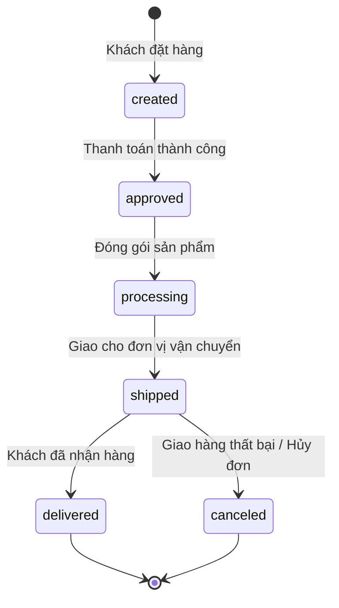
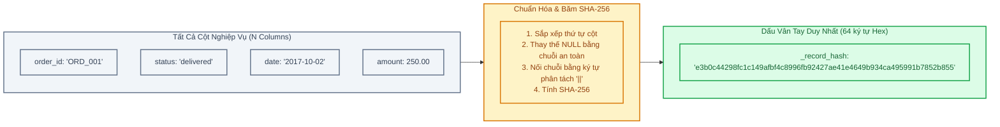
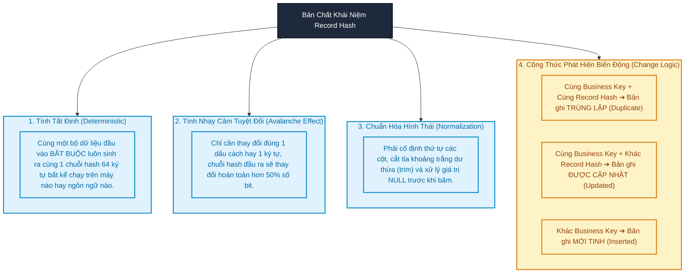
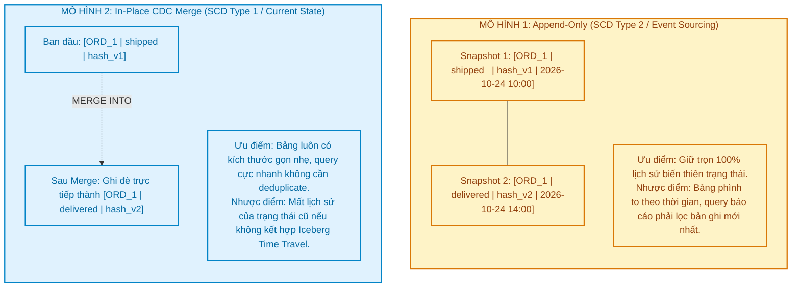
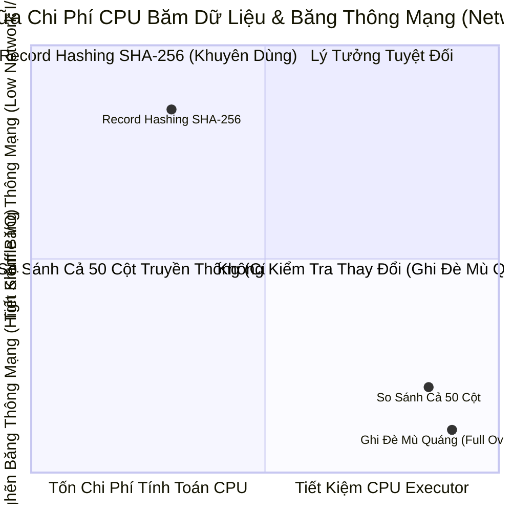

# Module 03: Record Hashing, Change Detection & CDC Ingestion — Bắt Trọn Biến Động Dữ Liệu

> **Target Audience:** Sinh viên CNTT & Kỹ sư phần mềm đang chuyển dịch sang Data Engineering  
> **Topic Scope:** Record Hash SHA-256, Change Detection, Deduplication Logic, CDC vs Append-Only, Iceberg Merge Optimization  
> **Estimated Reading Time:** 18 phút  

---

## 1. The Big Picture: Nỗi Ám Ảnh Của Việc So Sánh 50 Cột Dữ Liệu

Trong các hệ thống thương mại điện tử như Olist, một đơn hàng không bao giờ đứng yên một chỗ. Vòng đời của một đơn hàng là một chuỗi các trạng thái biến động liên tục theo thời gian:



Mỗi ngày, hệ thống nạp dữ liệu (Ingestion Pipeline) quét qua bảng `orders` của cơ sở dữ liệu PostgreSQL nguồn với hàng triệu bản ghi.
Giả sử hôm nay bạn nạp được một bản ghi có mã `order_id = 'ORD_001'`. Ngày mai bạn lại quét thấy `order_id = 'ORD_001'`.
Làm sao hệ thống của bạn biết được:
* Bản ghi này hoàn toàn **chưa có gì thay đổi** (không cần làm gì cả để tránh tốn tài nguyên)?
* Hay trạng thái của nó đã nhảy từ `shipped` sang `delivered`?
* Hay địa chỉ nhận hàng đã bị khách hàng chỉnh sửa?

**Giải pháp ngây thơ (Brute Force):** Viết câu lệnh so sánh từng cột một:
`IF source.col1 = target.col1 AND source.col2 = target.col2 AND ... AND source.col50 = target.col50`
Cách làm này tạo ra các câu lệnh SQL dài lê thê hàng trăm dòng, cực kỳ dễ lỗi cú pháp khi bảng nguồn thêm cột mới, và ngốn sạch băng thông mạng (Network I/O) khi hai cụm máy chủ phân tán phải trao đổi hàng chục cột với nhau.

**Giải pháp của Modern Data Engineering:** Thu gọn toàn bộ 50 cột nghiệp vụ thành một "dấu vân tay số" duy nhất dài 64 ký tự bằng thuật toán băm mật mã học — được gọi là **Record Hash (Dấu vân tay bản ghi)**.



---

## 2. Concept Anatomy: Record Hash & Change Detection

### Academic Definition (Định nghĩa chuẩn học thuật)
> **Record Hash (Băm dấu vân tay bản ghi)** là *kỹ thuật sinh mã băm mật mã học tất định (deterministic cryptographic hash)* từ toàn bộ các trường dữ liệu nghiệp vụ của một bản ghi sau khi đã qua bước chuẩn hóa hình thái, đóng vai trò là đại lượng đại diện duy nhất giúp phát hiện tức thì sự thay đổi dữ liệu (**Change Detection**) và khử trùng lặp (**Deduplication**) trong các luồng dữ liệu lớn mà không cần đối chiếu từng trường riêng lẻ.

### Keyword Dissection (Giải phẫu khái niệm)



---

## 3. Những Cạm Bẫy Toán Học & Kỹ Thuật Khi Tính Record Hash

Lập trình viên thiếu kinh nghiệm thường băm dữ liệu một cách cẩu thả: `md5(colA + colB)`. Điều này tạo ra những "lỗ hổng dữ liệu" chết người sau:

### Cạm bẫy 1: Hiện tượng Nuốt Chuỗi Khi Gặp `NULL` (Null Swallowing)
Trong chuẩn SQL, phép cộng chuỗi `'Hello' + NULL` sẽ cho kết quả là `NULL`.  
Nếu trong 20 cột của bạn có đúng 1 cột bị `NULL`, toàn bộ chuỗi nối sẽ biến thành `NULL`, và mã băm của mọi bản ghi có chứa `NULL` đều ra giống hệt nhau!  
* **Giải pháp:** Luôn bọc từng cột bằng `COALESCE(col, '__NULL__')`.

### Cạm bẫy 2: Hiện tượng Nhập Nhằng Ranh Giới (Delimiter Collisions)
Xét hai bản ghi có các cột khác nhau hoàn toàn:
* Bản ghi 1: Cột 1 = `'AB'`, Cột 2 = `'CD'` ➔ Nối không có dấu phân tách: `'ABCD'`
* Bản ghi 2: Cột 1 = `'A'`, Cột 2 = `'BCD'` ➔ Nối không có dấu phân tách: `'ABCD'`
Cả hai bản ghi nghiệp vụ khác biệt lại sinh ra cùng một mã hash!  
* **Giải pháp:** Sử dụng hàm `concat_ws` với ký tự phân tách hiếm gặp, ví dụ chuỗi `||~||`.

### Cạm bẫy 3: Xáo Trộn Thứ Tự Cột (Column Order Sensitivity)
Hôm nay bảng nguồn trả về theo thứ tự `(id, name, price)`. Ngày mai DBA thêm cột hoặc sửa query trả về `(price, id, name)`.  
Nội dung bản ghi không đổi nhưng chuỗi nối bị đảo lộn, khiến toàn bộ mã hash bị thay đổi sai lệch!  
* **Giải pháp:** Luôn sắp xếp danh sách cột nghiệp vụ theo thứ tự bảng chữ cái (**Alphabetical Sort**) trước khi đưa vào hàm băm:
  `sorted_columns = sorted(business_columns)`

### Bảng Kiểm Tra Chuẩn Băm An Toàn

| Tiêu Chí | Cách Làm Sai (Nguy Hiểm) | Cách Làm Đúng Chuẩn Data Engineering |
| :--- | :--- | :--- |
| **Xử lý NULL** | `concat(col1, col2)` | `coalesce(col1, '__NULL__')` |
| **Dấu phân tách** | Không có hoặc dùng dấu phẩy `,` (dễ trùng nội dung text) | Dùng ký tự đặc biệt kép: `##` hoặc `||~||` |
| **Thứ tự cột** | Phụ thuộc thứ tự ngẫu nhiên của source | `sorted(df.columns)` sắp xếp cố định |
| **Khoảng trắng** | Giữ nguyên `"  delivered "` | `trim(col)` cắt bỏ khoảng trắng đầu/cuối |
| **Thuật toán** | `MD5` (dễ đụng độ băm, không chuẩn an ninh) | `SHA-256` (chuẩn an toàn NIST quốc tế) |

---

## 4. Hai Mô Hình Xử Lý Biến Động: Append-Only vs. In-Place CDC

Khi phát hiện một bản ghi có sự thay đổi (`_record_hash` mới), Data Engineer có hai hướng đi kiến trúc:



### Kiến Trúc Olist Lakehouse Kết Hợp Hoàn Hảo Cả Hai:
1. **Tại tầng Bronze:** Chúng ta sử dụng **Append-Only**. Mọi mẻ nạp `batch_B0`, `batch_B1` đều được đẩy tiếp vào bảng Bronze Iceberg. Ta có toàn bộ lịch sử thô nguyên bản của đơn hàng từ lúc đặt cho đến lúc giao.
2. **Tại tầng Silver:** Chúng ta sử dụng **CDC Merge (Apache Iceberg MERGE INTO)** dựa trên `Business Key + _record_hash`. Tầng Silver chỉ giữ lại phiên bản chuẩn hóa mới nhất của từng đơn hàng, giúp các câu truy vấn phân tích tầng Gold chạy với tốc độ ánh sáng!

---

## 5. Hiện Thực Kỹ Thuật: PySpark Hashing & Apache Iceberg MERGE INTO

### 1. Hàm Sinh Mã Băm Chuẩn Trên Toàn Bộ Cột Nghiệp Vụ
```python
from pyspark.sql import functions as F

def generate_record_hash(df, exclude_cols=["_ingest_timestamp", "_batch_id"]):
    """
    Sinh mã băm SHA-256 an toàn trên tất cả các cột nghiệp vụ đã được sắp xếp.
    
    Lý do (Why):
    - Sắp xếp sorted() để độc lập với thứ tự cột trong schema nguồn.
    - Trim và coalesce để loại bỏ khác biệt về định dạng và chặn lỗi NULL.
    """
    business_cols = sorted([c for c in df.columns if c not in exclude_cols])
    
    hash_expressions = [
        F.coalesce(F.trim(F.col(c).cast("string")), F.lit("__NULL__"))
        for c in business_cols
    ]
    
    return df.withColumn(
        "_record_hash", 
        F.sha2(F.concat_ws("||~||", *hash_expressions), 256)
    )
```

### 2. Câu Lệnh Apache Iceberg MERGE INTO Tối Ưu Nhờ Record Hash
```sql
-- Chuyển đổi dữ liệu từ Bronze sang Silver bằng câu lệnh MERGE INTO
-- Chỉ cập nhật khi Business Key trùng khớp VÀ nội dung thực sự thay đổi (_record_hash khác nhau)
MERGE INTO lakehouse.silver.orders AS target
USING (
    SELECT order_id, customer_id, order_status, order_purchase_timestamp, _record_hash, _batch_id
    FROM (
        -- Lấy bản ghi mới nhất của từng đơn hàng trong mẻ nạp Bronze vừa xong
        SELECT *, ROW_NUMBER() OVER (PARTITION BY order_id ORDER BY _ingest_timestamp DESC) as rn
        FROM lakehouse.bronze.orders
        WHERE _batch_id = 'batch_B1'
    ) WHERE rn = 1
) AS source
ON target.order_id = source.order_id

-- 1. Nếu đã tồn tại nhưng Record Hash KHÁC NHAU -> Có sự thay đổi -> Cập nhật
WHEN MATCHED AND target._record_hash != source._record_hash THEN
    UPDATE SET 
        target.order_status = source.order_status,
        target._record_hash = source._record_hash,
        target._updated_at = CURRENT_TIMESTAMP

-- 2. Nếu chưa tồn tại -> Đơn hàng mới tinh -> Chèn mới
WHEN NOT MATCHED THEN
    INSERT (order_id, customer_id, order_status, order_purchase_timestamp, _record_hash, _created_at, _updated_at)
    VALUES (source.order_id, source.customer_id, source.order_status, source.order_purchase_timestamp, source._record_hash, CURRENT_TIMESTAMP, CURRENT_TIMESTAMP);

-- Lưu ý: Nếu MATCHED nhưng _record_hash GIỐNG NHAU -> Bỏ qua, zero I/O cost!
```

---

## 6. Phân Tích Đánh Đổi (Trade-Off Analysis)



| Tiêu Chí | Record Hash SHA-256 | So Sánh Cột Theo Cột (Column-by-Column) | Ghi Đè Toàn Bộ (Full Overwrite) |
| :--- | :--- | :--- | :--- |
| **Tài nguyên CPU** | Tốn thêm ~3-5% CPU để băm chuỗi. | Thấp hơn lúc đầu, nhưng câu lệnh SQL cực kỳ nặng. | Thấp nhất (không cần so sánh). |
| **Băng thông mạng (Shuffle I/O)** | **Cực thấp:** Chỉ truyền 1 cột `_record_hash` 64 ký tự qua mạng khi JOIN. | **Rất cao:** Phải đẩy toàn bộ 50 cột giữa các executor qua card mạng. | Khổng lồ: Toàn bộ bảng phải viết lại vào đĩa. |
| **Độ bền vững khi đổi Schema** | **Tuyệt vời:** Thêm cột mới chỉ cần thêm vào hàm băm tự động. | **Kém:** Phải sửa lại toàn bộ mệnh đề `ON target.colX = source.colX`. | Trung bình. |

---

## 7. Ánh Xạ Vào Dự Án Thực Tế `olist-lakehouse`

* Trong kịch bản thực nghiệm Lab của chúng ta, dữ liệu nạp ban đầu từ `batch_B0` bao gồm toàn bộ đơn hàng lịch sử.
* Mẻ nạp tiếp theo `batch_B1` chứa các đơn hàng được cập nhật trạng thái giao hàng mới và một số đơn hàng mới phát sinh.
* Nhờ cơ chế `_record_hash`, tầng Silver của chúng ta chỉ cập nhật các đơn có trạng thái thay đổi (ví dụ đơn chuyển từ `shipped` sang `delivered`), giúp pipeline rút ngắn thời gian xử lý xuống **dưới 10 giây** thay vì phải quét lại toàn bộ bảng.

---

## 8. Bài Tập Tự Đánh Giá (Knowledge Check)

1. **Câu hỏi:** *Nếu hai hệ thống cùng dùng SHA-256 nhưng một bên viết bằng Python một bên viết bằng Java, liệu mã băm `_record_hash` sinh ra có giống hệt nhau không?*  
   * **Đáp án:** Có! Thuật toán SHA-256 là tiêu chuẩn mật mã học quốc tế có tính tất định 100%. Miễn là chuỗi đầu vào sau khi chuẩn hóa (thứ tự cột, khoảng trắng, xử lý NULL) giống hệt nhau, thì dù chạy trên Python, Java, C++ hay Spark SQL đều cho ra chính xác cùng 64 ký tự hex.

2. **Câu hỏi:** *Tại sao khi tính `_record_hash` cho tầng Bronze/Silver, ta KHÔNG được thêm Secret Key (Salt) như khi băm bảo vệ PII?*  
   * **Đáp án:** Vì mục đích của `_record_hash` là phát hiện thay đổi dữ liệu và khử trùng lặp nội bộ (Change Detection & Deduplication), không phải là bảo mật chống tra cứu ngược. Nếu dùng Salt và vô tình làm mất Salt hoặc đổi Salt giữa các lần chạy, toàn bộ mã hash trong quá khứ sẽ không còn so khớp được với mã hash hiện tại, làm tê liệt hoàn toàn logic CDC.

3. **Câu hỏi:** *Trong câu lệnh `MERGE INTO` của Apache Iceberg, điều kiện `WHEN MATCHED AND target._record_hash != source._record_hash` mang lại lợi ích gì về mặt hiệu năng?*  
   * **Đáp án:** Lợi ích tiết kiệm Disk I/O khổng lồ. Nếu bản ghi nguồn trùng Business Key và trùng cả `_record_hash`, điều đó chứng tỏ dữ liệu không hề thay đổi. Câu lệnh sẽ bỏ qua bản ghi này mà không ghi bất kỳ tệp dữ liệu mới nào xuống MinIO S3, loại bỏ hoàn toàn hiện tượng ghi đĩa dư thừa.

---
*Made by Anh Tu - Share to be share*
