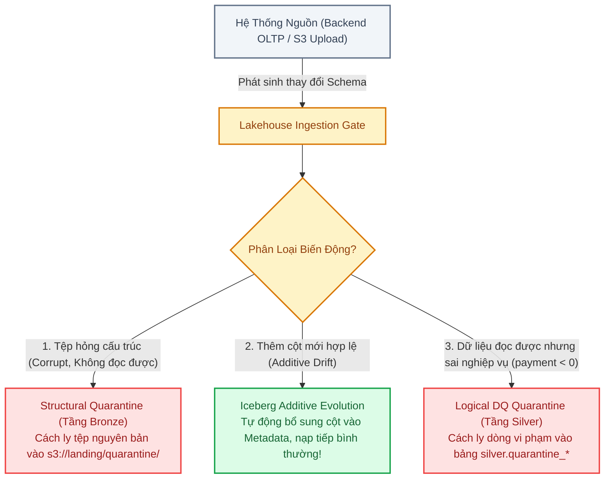
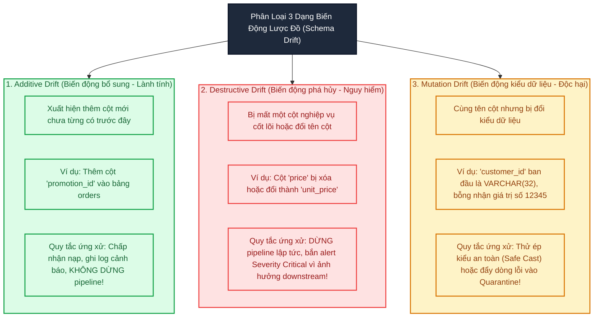
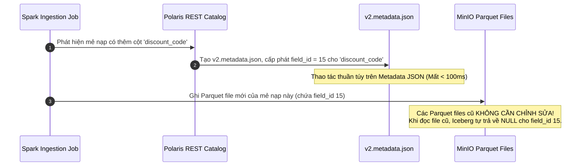
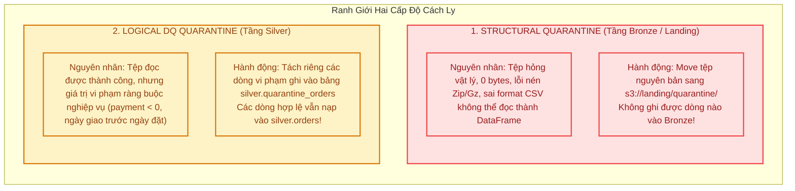
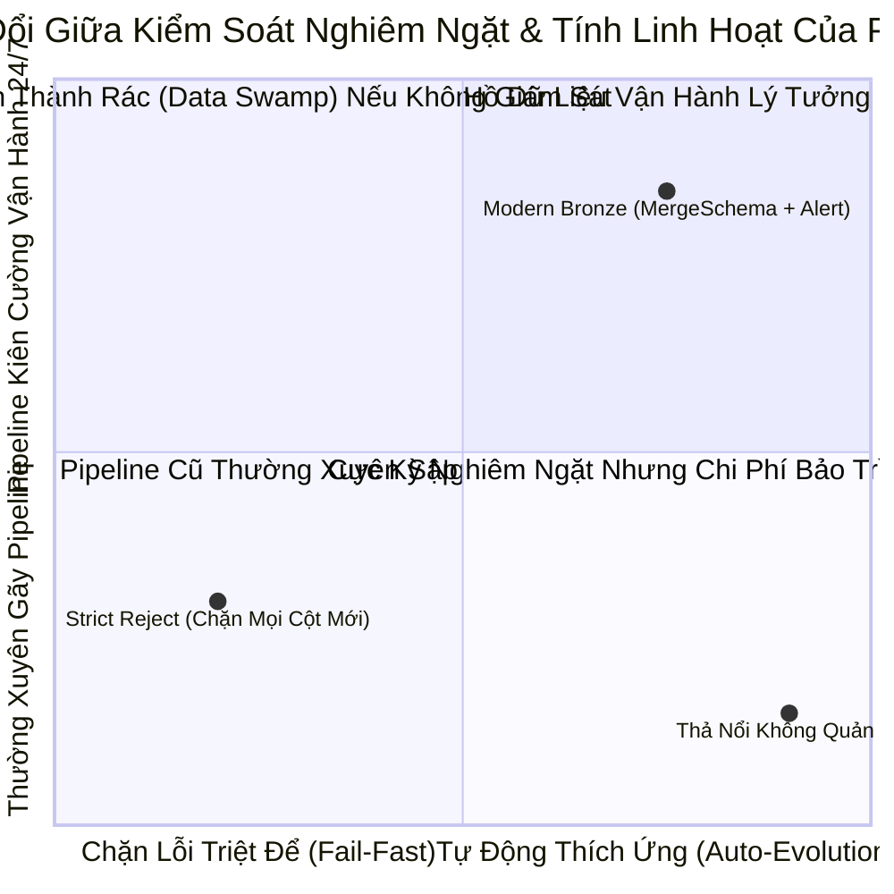

# Module 04: Schema Drift Management & Structural Quarantine — Khắc Tinh Của Broken Pipelines

> **Target Audience:** Sinh viên CNTT & Kỹ sư phần mềm đang chuyển dịch sang Data Engineering  
> **Topic Scope:** Schema Drift Types, Iceberg Additive Evolution, Structural vs Logical Quarantine, Dead Letter Queue (DLQ)  
> **Estimated Reading Time:** 17 phút  

---

## 1. The Big Picture: Nỗi Ám Ảnh Báo Động Lúc 3 Giờ Sáng

Trong thực tế doanh nghiệp, kịch bản sau đây diễn ra như cơm bữa:
* Vào tối thứ Sáu, đội ngũ Backend phát hành tính năng mới cho ứng dụng Olist: Họ thêm một trường `discount_coupon_code` vào bảng đơn hàng và đổi kiểu dữ liệu cột `payment_sequential` từ số nguyên sang chuỗi.
* Họ không hề gửi bất kỳ thông báo nào cho đội ngũ Data Engineering (vì nghĩ rằng đây là thay đổi nhỏ của ứng dụng).
* Đến 3 giờ sáng thứ Bảy, mẻ nạp dữ liệu định kỳ (Scheduled Airflow Job) thức dậy. Khi đọc dữ liệu mới, pipeline va phải cột lạ và bị sập ngay lập tức:
  `AnalysisException: A schema mismatch detected when writing into the table!`
* Báo cáo sáng thứ Hai cho Ban Giám đốc bị trắng xóa, và kỹ sư dữ liệu phải thức trắng cuối tuần để gỡ lỗi thủ công.

Sự thay đổi không báo trước về cấu trúc, kiểu dữ liệu hoặc số lượng cột từ hệ thống nguồn được gọi là **Schema Drift (Biến động lược đồ dữ liệu)**.

Một kỹ sư dữ liệu giỏi không phải là người cầu nguyện hệ thống nguồn đừng bao giờ thay đổi, mà là người **thiết kế đường ống đủ kiên cường (Resilient Pipeline)** để tự động thích ứng với các thay đổi hợp lệ và có cơ chế **Cách ly (Quarantine)** đối với các tệp dữ liệu hỏng hóc.



---

## 2. Concept Anatomy: Schema Drift & Quarantine

### Academic Definition (Định nghĩa chuẩn học thuật)
> **Schema Drift (Biến động lược đồ dữ liệu)** là *hiện tượng cấu trúc siêu dữ liệu của nguồn dữ liệu (tên cột, số lượng trường, kiểu dữ liệu) bị thay đổi bất ngờ theo thời gian* so với định dạng cam kết ban đầu.  
> **Structural Quarantine (Cách ly cấu trúc)** là *cơ chế phòng vệ tại tầng tiếp nhận (Bronze/Landing)* nhằm cô lập các tệp dữ liệu bị hỏng định dạng vật lý (corrupted bytes, unparseable syntax) ra một vùng lưu trữ riêng biệt (Dead Letter Queue) để bảo vệ đường ống không bị tê liệt hoàn toàn, đồng thời kích hoạt cảnh báo kỹ thuật.

### Keyword Dissection (Phân Loại 3 Dạng Schema Drift)



---

## 3. Bản Chất Kỹ Thuật: Iceberg Additive Schema Evolution Vượt Trội Thế Nào?

Trong các định dạng lưu trữ cũ (Hive metastore, raw Parquet trên S3):
* Khi nguồn phát sinh cột mới, bạn phải chạy câu lệnh `ALTER TABLE ADD COLUMN` thủ công, hoặc đọc lại toàn bộ dữ liệu cũ hàng terabyte để ghi đè lại (Table Rewrite) — cực kỳ tốn kém và nguy cơ hỏng dữ liệu.

Trong **Apache Iceberg**, cơ chế tiến hóa lược đồ (Schema Evolution) được thiết kế ở tầm kiệt tác kiến trúc:
1. **Quản trị bằng Field ID:** Mọi cột trong bảng Iceberg đều được định danh bằng một số nguyên duy nhất (`field_id`), hoàn toàn không phụ thuộc vào tên cột hay vị trí thứ tự của cột.
2. **Tiến hóa thuần Metadata (Zero Data Rewrite):** Khi có cột mới, Iceberg chỉ ghi thêm định nghĩa trường đó vào tệp JSON metadata mới (`v*.metadata.json`) với một `field_id` mới. 
3. **Giá trị mặc định cho dữ liệu cũ:** Khi người dùng truy vấn dữ liệu của các năm trước (thời điểm chưa có cột mới này), Iceberg tự động gán giá trị `NULL` cho cột mới mà không cần chạm vào một byte nào của các file Parquet cũ trên đĩa!



---

## 4. Phân Biệt Sống Còn: Structural Quarantine vs. Logical DQ Quarantine

Rất nhiều kỹ sư nhầm lẫn giữa hai khái niệm này, dẫn đến đặt sai vị trí xử lý lỗi trong kiến trúc Medallion:



### Bảng So Sánh Chi Tiết

| Đặc Điểm | Structural Quarantine (Cách Ly Cấu Trúc) | Logical DQ Quarantine (Cách Ly Nghiệp Vụ) |
| :--- | :--- | :--- |
| **Vị trí trong kiến trúc** | **Trước Bronze (Tại Landing S3)** | **Từ Bronze chuyển sang Silver** |
| **Đối tượng xử lý** | **Tệp tin vật lý (Entire File)** | **Từng dòng dữ liệu (Individual Rows)** |
| **Khả năng đọc vào Spark** | **Thất bại hoàn toàn (Unreadable):** Spark ném ngoại lệ `MalformedInputException`. | **Thành công (Readable):** Dữ liệu đã nằm gọn gàng trong DataFrame. |
| **Nơi lưu trữ cách ly** | Thư mục S3: `s3://landing/quarantine/raw_file.csv` | Bảng Iceberg Silver: `lakehouse.silver.quarantine_orders` |
| **Hành vi luồng xử lý** | Bỏ qua tệp hỏng, tiếp tục nạp các tệp khác, gửi cảnh báo P1 cho DevOps. | Nạp các dòng sạch vào Silver, các dòng bẩn chuyển sang bảng kiểm soát cho DA rà soát. |

---

## 5. Hiện Thực Kỹ Thuật: PySpark Dead Letter Queue (DLQ) & Additive Drift

### 1. Kỹ Thuật Đón Nhận Additive Drift Tự Động Trong PySpark
```python
def write_bronze_with_schema_evolution(df, target_table: str):
    """
    Ghi dữ liệu vào bảng Bronze Iceberg với chế độ tự động chấp nhận cột mới (Additive Evolution).
    
    Lý do (Why):
    - mergeSchema cho phép Iceberg tự động đăng ký các cột mới xuất hiện vào Metadata.
    - Không làm đứt gãy luồng nạp khi backend bổ sung trường dữ liệu mới.
    """
    df.write \
        .format("iceberg") \
        .mode("append") \
        .option("mergeSchema", "true") \
        .save(target_table)
    print(f"✔ Đã nạp thành công vào {target_table} (Đã kích hoạt mergeSchema)")
```

### 2. Mô Hình Xử Lý Structural Quarantine Bằng Python Boto3
```python
import boto3

def ingest_landing_csv_with_quarantine(s3_client, bucket: str, key: str, spark):
    """
    Kiểm tra tính toàn vẹn cấu trúc của tệp CSV trước khi nạp vào Bronze.
    Nếu tệp rỗng hoặc hỏng định dạng -> Cách ly ngay vào thư mục quarantine/.
    """
    try:
        # 1. Kiểm tra kích thước tệp trên MinIO S3
        header_meta = s3_client.head_object(Bucket=bucket, Key=key)
        if header_meta['ContentLength'] == 0:
            raise ValueError(f"Tệp s3://{bucket}/{key} rỗng hoàn toàn (0 bytes)!")
            
        # 2. Thử đọc thử 1 dòng với Spark
        df = spark.read.option("header", "true").csv(f"s3a://{bucket}/{key}")
        row_count = df.take(1)
        if len(row_count) == 0:
            raise ValueError("Tệp không có dữ liệu sau header!")
            
        return df  # Tệp cấu trúc hợp lệ, tiếp tục pipeline nạp vào Bronze
        
    except Exception as e:
        # 3. KÍCH HOẠT STRUCTURAL QUARANTINE: Di chuyển tệp hỏng sang vùng cách ly
        quarantine_key = f"quarantine/{key.split('/')[-1]}"
        print(f"⚠️ CẢNH BÁO KỸ THUẬT: {e} -> Đang cách ly tệp sang s3://{bucket}/{quarantine_key}")
        
        # Sao chép sang quarantine và xóa tệp cũ ở landing
        s3_client.copy_object(
            Bucket=bucket, 
            CopySource={'Bucket': bucket, 'Key': key}, 
            Key=quarantine_key
        )
        s3_client.delete_object(Bucket=bucket, Key=key)
        
        # Bắn cảnh báo kỹ thuật (Slack / PagerDuty webhook)
        return None
```

---

## 6. Phân Tích Đánh Đổi (Trade-Off Analysis)



| Chiến Lược | Ưu Điểm | Nhược Điểm (Trade-Off) | Khi Nào Nên Áp Dụng |
| :--- | :--- | :--- | :--- |
| **Strict Schema (Từ Chối Cột Mới)** | Đảm bảo 100% dữ liệu downstream không có trường lạ. | Pipeline thường xuyên gãy lúc nửa đêm, tốn công trực ca. | Hệ thống tài chính ngân hàng lõi (Core Banking, GL ledger). |
| **Additive Evolution + Alert (Khuyên Dùng)** | **Pipeline chạy trơn tru 24/7**, không gián đoạn kinh doanh. | Cần hệ thống giám sát để nhắc nhở DE cập nhật tài liệu STTM. | **Data Lakehouse hiện đại (Olist Analytics).** |
| **Structural Quarantine** | Ngăn tệp rác làm treo cụm máy chủ phân tán. | Cần quy trình vận hành để kỹ sư kiểm tra lại các tệp trong quarantine. | Áp dụng cho mọi luồng nạp tệp từ bên thứ 3 hoặc S3 Landing. |

---

## 7. Ánh Xạ Vào Dự Án Thực Tế `olist-lakehouse`

* Trong dự án Olist, các tệp CSV như `olist_order_reviews_dataset.csv` và `olist_geolocation_dataset.csv` đến từ nguồn landing của MinIO.
* Nếu một tệp CSV bị lỗi cắt cụt chuỗi (chẳng hạn ký tự xuống dòng nằm trong chuỗi nhận xét mà không escape đúng quy cách), bộ phận Ingestion của chúng ta sẽ phát hiện và đẩy tệp đó vào `s3://landing/quarantine/`.
* Khi nạp bảng `orders` vào `lakehouse.bronze.orders`, chúng ta cấu hình Apache Iceberg với `mergeSchema = true` để sẵn sàng đón nhận các cột mở rộng tương lai của Olist mà không làm gián đoạn hệ thống.

---

## 8. Bài Tập Tự Đánh Giá (Knowledge Check)

1. **Câu hỏi:** *Nếu bảng nguồn trong PostgreSQL bổ sung thêm cột `order_delivered_carrier_phone`, pipeline nạp vào tầng Bronze nên làm gì: Dừng lại báo lỗi hay tự động ghi nhận?*  
   * **Đáp án:** Pipeline nên tự động ghi nhận cột mới thông qua cơ chế Additive Schema Evolution của Apache Iceberg, đồng thời ghi một dòng thông báo (Warning Log) vào hệ thống giám sát. Không được dừng pipeline vì đây là thay đổi bổ sung (additive), không làm ảnh hưởng đến các cột hiện hữu hay làm sai lệch báo cáo cũ.

2. **Câu hỏi:** *Một tệp CSV ở landing có 1.000 dòng, trong đó có 2 dòng có giá trị `payment_value = -50`. Đây là trường hợp áp dụng Structural Quarantine hay Logical DQ Quarantine? Vì sao?*  
   * **Đáp án:** Đây là trường hợp áp dụng **Logical DQ Quarantine tại tầng Silver**. Lý do: Về mặt cấu trúc vật lý, tệp CSV hoàn toàn hợp lệ và đọc được trơn tru vào DataFrame (không bị hỏng tệp). Lỗi `-50` là lỗi vi phạm quy tắc nghiệp vụ. Do đó, 1.000 dòng vẫn được nạp nguyên trạng vào tầng Bronze; sau đó khi xử lý lên Silver, 2 dòng lỗi sẽ bị lọc đẩy vào bảng `silver.quarantine_payments`, còn 998 dòng sạch vẫn được xử lý tiếp.

3. **Câu hỏi:** *Tại sao Apache Iceberg có thể thêm một cột mới vào bảng có hàng triệu dòng mà chỉ mất chưa đầy 100 mili-giây?*  
   * **Đáp án:** Vì cơ chế Schema Evolution của Iceberg hoàn toàn dựa trên Metadata và Field ID. Iceberg chỉ tạo một file JSON metadata mới ghi nhận ID của cột mới mà tuyệt đối không viết lại (zero rewrite) bất kỳ file dữ liệu Parquet cũ nào trên MinIO S3. Khi truy vấn các file cũ, Iceberg tự động ánh xạ giá trị NULL cho cột mới này.

---
*Made by Anh Tu - Share to be share*
