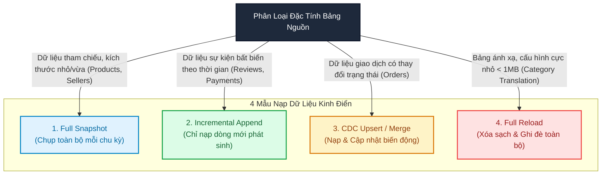
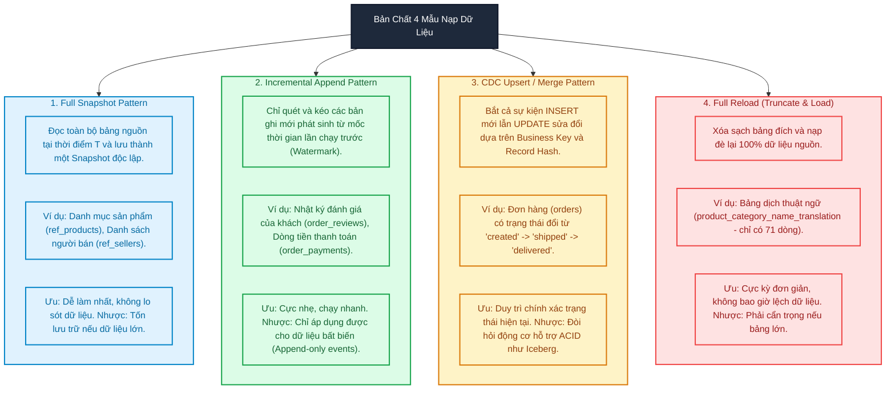
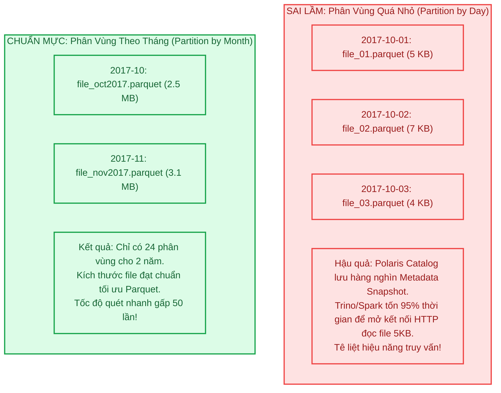
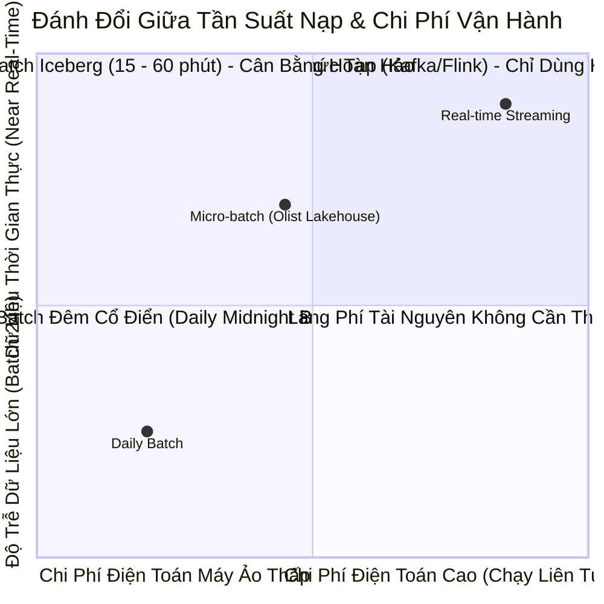

# Module 05: Ingestion Load Patterns & Watermark Engineering — Chiến Lược Nạp Dữ Liệu Phân Tán

> **Target Audience:** Sinh viên CNTT & Kỹ sư phần mềm đang chuyển dịch sang Data Engineering  
> **Topic Scope:** 4 Ingestion Load Patterns, High-Watermark Selection, Small Files Problem, Apache Iceberg Partitioning  
> **Estimated Reading Time:** 20 phút  

---

## 1. The Big Picture: Không Có Chiếc Áo Nào Vừa Vặn Cho Mọi Bảng Dữ Liệu

Trong các dự án kỹ nghệ dữ liệu thực tế, sai lầm phổ biến nhất của các kỹ sư mới vào nghề là: **Chọn duy nhất một phương pháp nạp dữ liệu cho toàn bộ hệ thống**.

* **Kịch bản sai lầm 1 (Lạm dụng Full Dump):**  
  Mỗi đêm, bạn kích hoạt pipeline đọc toàn bộ bảng `orders` (100.000 dòng, sau này tăng lên 100 triệu dòng) từ cơ sở dữ liệu PostgreSQL rồi ghi đè vào hồ dữ liệu.  
  *Hậu quả:* Cơ sở dữ liệu vận hành (OLTP) bị khóa bảng hoặc nghẽn CPU lúc nửa đêm, băng thông mạng bị chiếm dụng vô ích, hóa đơn điện toán đám mây tăng vọt chỉ để đọc lại 99% dữ liệu đã có từ trước!
* **Kịch bản sai lầm 2 (Lạm dụng Incremental Append cho bảng thay đổi trạng thái):**  
  Bạn chỉ nạp các đơn hàng có `created_at` của ngày hôm nay. Nhưng các đơn hàng đặt từ 5 ngày trước vừa được khách nhận và chuyển trạng thái sang `delivered` thì pipeline của bạn... bỏ quên hoàn toàn! Báo cáo doanh thu và giao hàng bị sai lệch nghiêm trọng.

Để giải quyết triệt để vấn đề này, Data Engineer bắt buộc phải phân loại từng thực thể dữ liệu và áp dụng chính xác **1 trong 4 Mẫu Nạp Dữ Liệu Kinh Điển (The 4 Classic Ingestion Patterns)**, kết hợp với kỹ thuật **Quản trị Mốc Thủy Triều Cao (High-Watermark Engineering)**.



---

## 2. Concept Anatomy: 4 Mẫu Nạp Dữ Liệu Kinh Điển

### Academic Definition (Định nghĩa chuẩn học thuật)
> **Ingestion Load Patterns (Mẫu nạp dữ liệu)** là *chiến lược kiến trúc xác định phương thức trích xuất và đồng bộ dữ liệu từ hệ thống nguồn vào hồ dữ liệu*, dựa trên các tiêu chí: tốc độ biến động dữ liệu (velocity), tính bất biến (immutability), dung lượng thực thể (volume) và yêu cầu bảo toàn lịch sử biến thiên.

### Keyword Dissection (Giải phẫu 4 Mẫu Thiết Kế)



---

## 3. Nghệ Thuật Chọn High-Watermark & Cửa Sổ An Toàn (Safe Lookback Window)

Để nạp dữ liệu tăng dần (**Incremental Load**), hệ thống cần một "cái cọc đánh dấu" để biết mẻ nạp trước đã dừng lại ở đâu. Cột giá trị này được gọi là **High-Watermark**.

### 1. Phân Tích Lựa Chọn Cột Làm Watermark

| Loại Watermark | Cơ Chế Hoạt Động | Rủi Ro Tiềm Ẩn & Cạm Bẫy |
| :--- | :--- | :--- |
| **Cột ngày cập nhật (`updated_at`)** | `WHERE updated_at > :last_watermark` | **Rất tốt**, nhưng nếu DBA sửa trực tiếp trong DB mà không cập nhật trigger `updated_at` thì sẽ bị sót bản ghi. |
| **Khóa tự tăng (`id > :last_id`)** | `WHERE id > :last_id` | **Chỉ bắt được INSERT mới!** Không thể bắt được các bản ghi cũ bị sửa đổi (UPDATE). |
| **Sổ nhật ký WAL (CDC Log / LSN)** | Đọc trực tiếp PostgreSQL Write-Ahead Log bằng Debezium | **Chuẩn xác 100%**, nhưng đòi hỏi hạ tầng Kafka/Debezium phức tạp và tốn tài nguyên quản trị. |

### 2. Cạm Bẫy Trọng Yếu: Giao Dịch Đến Trễ (Late-Arriving Transactions)
Hãy xem xét kịch bản sau trong PostgreSQL:
* Vào lúc `10:00:00`, một giao dịch lớn mở ra và chèn bản ghi A với timestamp `10:00:00`, nhưng giao dịch này mất 30 giây để xử lý (`COMMIT` lúc `10:00:30`).
* Vào lúc `10:00:10`, một giao dịch ngắn chèn bản ghi B và `COMMIT` ngay lập tức với timestamp `10:00:10`.
* Vào lúc `10:00:15`, mẻ nạp Spark thức dậy, đọc bản ghi B và lưu `last_watermark = 10:00:10`. Lúc này bản ghi A chưa commit nên Spark không thấy!
* Mẻ nạp tiếp theo chạy `WHERE updated_at > 10:00:10` ➔ **Bản ghi A (timestamp 10:00:00) bị bỏ rơi vĩnh viễn!**

### Giải Pháp Kỹ Thuật: Cửa Sổ Nhìn Lại An Toàn (Safe Lookback Window)
Không bao giờ truy vấn sát nút `> last_watermark`. Luôn lùi lại một khoảng đệm an toàn (ví dụ 5 đến 15 phút):
```sql
-- Kỹ thuật Safe Lookback Window: Quét trùm lại 10 phút trước đó
SELECT * 
FROM public.orders
WHERE updated_at >= (:last_watermark - INTERVAL '10 minutes');
```
*Sau đó, tại tầng Bronze/Silver, ta sử dụng `_record_hash` để tự động loại bỏ các bản ghi trùng lặp bị quét lại trong khoảng 10 phút này mà không làm ảnh hưởng đến tính toàn vẹn!*

---

## 4. Chiến Lược Phân Vùng & Vấn Nạn Tệp Nhỏ (The Small Files Problem)

Một trong những sai lầm kinh điển nhất khi thiết kế bảng Apache Iceberg là: **Phân vùng quá nhỏ (Over-partitioning)**.

### Thảm Họa Phân Vùng Theo Ngày (Day Partitioning) Trong Olist:
* Tập dữ liệu Olist có khoảng **100.000 đơn hàng** trải dài trong **2 năm (khoảng 730 ngày)**.
* Nếu bạn phân vùng bảng `orders` theo ngày (`order_date`):
  * Trung bình mỗi ngày chỉ có: $100.000 / 730 \approx \mathbf{136\text{ đơn hàng}}$.
  * 136 đơn hàng lưu dưới dạng Parquet chỉ tốn khoảng **5 KB đến 10 KB** đĩa!
  * Sau 2 năm, bạn tạo ra **730 thư mục và hàng nghìn tệp tin tí hon (Small Files)** trên MinIO S3!



> [!TIP]
> **Quy Tắc Vàng Của Data Lakehouse:**  
> Kích thước lý tưởng của một tệp Parquet trong hồ dữ liệu phân tán là từ **128 MB đến 512 MB**.  
> * Với tập dữ liệu Olist (tổng dung lượng toàn bộ 10 bảng chỉ khoảng 150 MB), các bảng dưới 50.000 dòng như `products`, `sellers`, `payments` **tuyệt đối KHÔNG PHÂN VÙNG (Unpartitioned)**.  
> * Với bảng `orders`, nếu phân vùng, mức tối đa cho phép là **Phân vùng theo Tháng (`months(order_purchase_timestamp)`)**.

---

## 5. Ma Trận Thiết Kế Mẫu Nạp (Load Pattern Matrix) Cho 10 Bảng Olist

Dưới đây là thiết kế chuẩn xác được áp dụng cho toàn bộ 10 thực thể dữ liệu trong kiến trúc Olist Lakehouse:

| # | Tên Thực Thể | Hệ Thống Nguồn | Kích Thước | Mẫu Nạp Lựa Chọn (Load Pattern) | Cột Watermark / Tiêu Chí | Lý Do Kỹ Thuật (Why) |
| :---: | :--- | :--- | :---: | :--- | :--- | :--- |
| 1 | **orders** | Postgres OLTP | 99.441 | **CDC Upsert / Merge** | `order_purchase_timestamp` | Đơn hàng thay đổi trạng thái liên tục; cần bắt biến động nhưng không được làm trùng lặp. |
| 2 | **order_items** | Postgres OLTP | 112.650 | **Incremental Append** | `shipping_limit_date` | Chi tiết đơn sau khi đặt ít khi sửa đổi; nạp tăng dần giúp tối ưu thời gian chạy. |
| 3 | **order_payments** | Postgres OLTP | 103.886 | **Incremental Append** | N/A (Theo `order_id`) | Sự kiện quẹt thẻ/trả góp mang tính lịch sử bất biến (Event Stream). |
| 4 | **customers** | Postgres OLTP | 99.441 | **Full Snapshot** | N/A (Daily Snapshot) | Bảng kích thước nhỏ (<10MB); snapshot hàng ngày giúp dễ dàng đối soát thông tin địa chỉ khách. |
| 5 | **customer_pii** | Postgres OLTP | 99.441 | **Full Snapshot (HMAC)** | N/A (Mã hóa tại chỗ) | Dữ liệu nhạy cảm; chụp snapshot có mã hóa tokenization để bảo vệ toàn vẹn. |
| 6 | **products** | MinIO Landing | 32.951 | **Full Snapshot** | `product_id` (Business Key) | Bảng danh mục tham chiếu (Reference Dimension); dữ liệu ít biến động. |
| 7 | **sellers** | MinIO Landing | 3.095 | **Full Snapshot** | `seller_id` (Business Key) | Quy mô rất nhỏ (3.095 dòng); nạp full snapshot mất chưa tới 1 giây. |
| 8 | **geolocation** | MinIO Landing | 1.000.163 | **Full Snapshot** | `geolocation_zip_code_prefix` | Dữ liệu bản đồ tọa độ tĩnh; chỉ cần nạp snapshot một lần khi khởi tạo hệ thống. |
| 9 | **order_reviews** | MinIO Landing | 99.224 | **Incremental Append** | `review_creation_date` | Đánh giá nhận xét của khách là sự kiện phát sinh theo thời gian, tính chất append-only. |
| 10 | **category_translation** | MinIO Landing | 71 | **Full Reload** | N/A (Ghi đè toàn bộ) | Bảng mapping siêu nhỏ (71 dòng, vài KB); ghi đè hoàn toàn đảm bảo luôn khớp 100% với file gốc. |

---

## 6. Hiện Thực Kỹ Thuật: Cú Pháp DDL Phân Vùng Trong Apache Iceberg

Dưới đây là cú pháp SQL chuẩn mực khi khởi tạo bảng Bronze trong Apache Iceberg, sử dụng hàm phân vùng ẩn (**Hidden Partitioning**) tối ưu:

```sql
-- Khởi tạo bảng Bronze Orders với phân vùng theo Tháng (Tránh Small Files Problem)
CREATE TABLE lakehouse.bronze.orders (
    order_id STRING,
    customer_id STRING,
    order_status STRING,
    order_purchase_timestamp TIMESTAMP,
    order_approved_at TIMESTAMP,
    order_delivered_carrier_date TIMESTAMP,
    order_delivered_customer_date TIMESTAMP,
    order_estimated_delivery_date TIMESTAMP,
    -- 5 Cột Metadata Kỹ Thuật
    _ingest_timestamp TIMESTAMP,
    _source_file_or_table STRING,
    _batch_id STRING,
    _record_hash STRING,
    _is_deleted BOOLEAN
)
USING iceberg
PARTITIONED BY (months(order_purchase_timestamp))
TBLPROPERTIES (
    'write.parquet.compression-codec' = 'snappy',
    'write.target-file-size-bytes' = '134217728' -- 128 MB target file size
);
```

---

## 7. Phân Tích Đánh Đổi (Trade-Off Analysis)



---

## 8. Bài Tập Tự Đánh Giá (Knowledge Check)

1. **Câu hỏi:** *Bảng `order_payments` trong Olist chứa các giao dịch thanh toán của khách. Tại sao nên chọn mẫu nạp Incremental Append thay vì Full Snapshot?*  
   * **Đáp án:** Vì các giao dịch thanh toán quẹt thẻ, phiếu ghi nợ boleto hay voucher là các sự kiện mang tính lịch sử bất biến (immutable events) — một khi đã thanh toán thành công thì không bị sửa đổi. Việc áp dụng Incremental Append chỉ quét các giao dịch mới giúp pipeline chạy cực nhanh, tiết kiệm CPU và tài nguyên mạng so với việc ngày nào cũng kéo lại hàng trăm nghìn dòng thanh toán cũ.

2. **Câu hỏi:** *Tại sao việc phân vùng bảng `orders` của Olist theo từng ngày (`days(order_purchase_timestamp)`) lại là một sai lầm kiến trúc nghiêm trọng?*  
   * **Đáp án:** Vì dẫn tới **Vấn nạn Tệp Nhỏ (The Small Files Problem)**. Olist chỉ có trung bình ~136 đơn hàng/ngày. Mỗi ngày sẽ sinh ra một file Parquet siêu nhỏ chỉ khoảng 5KB - 10KB. Việc tạo ra hàng nghìn file tí hon làm phình to metadata của Iceberg và khiến các động cơ tính toán như Trino/Spark mất phần lớn thời gian cho việc kết nối I/O thay vì xử lý dữ liệu.

3. **Câu hỏi:** *Kỹ thuật "Cửa sổ nhìn lại an toàn" (Safe Lookback Window) khi sử dụng Watermark giải quyết bài toán gì trong thực tế?*  
   * **Đáp án:** Giải quyết vấn đề **Giao dịch đến trễ (Late-Arriving Transactions)** do các giao dịch cơ sở dữ liệu lớn mất nhiều thời gian để `COMMIT`. Việc lùi lại mốc quét (ví dụ 10 phút trước `last_watermark`) đảm bảo không bỏ sót bất kỳ bản ghi nào đã chèn nhưng commit chậm, trong khi cơ chế `_record_hash` sẽ loại bỏ an toàn các dòng bị đọc lặp lại.

---
*Made by Anh Tu - Share to be share*
