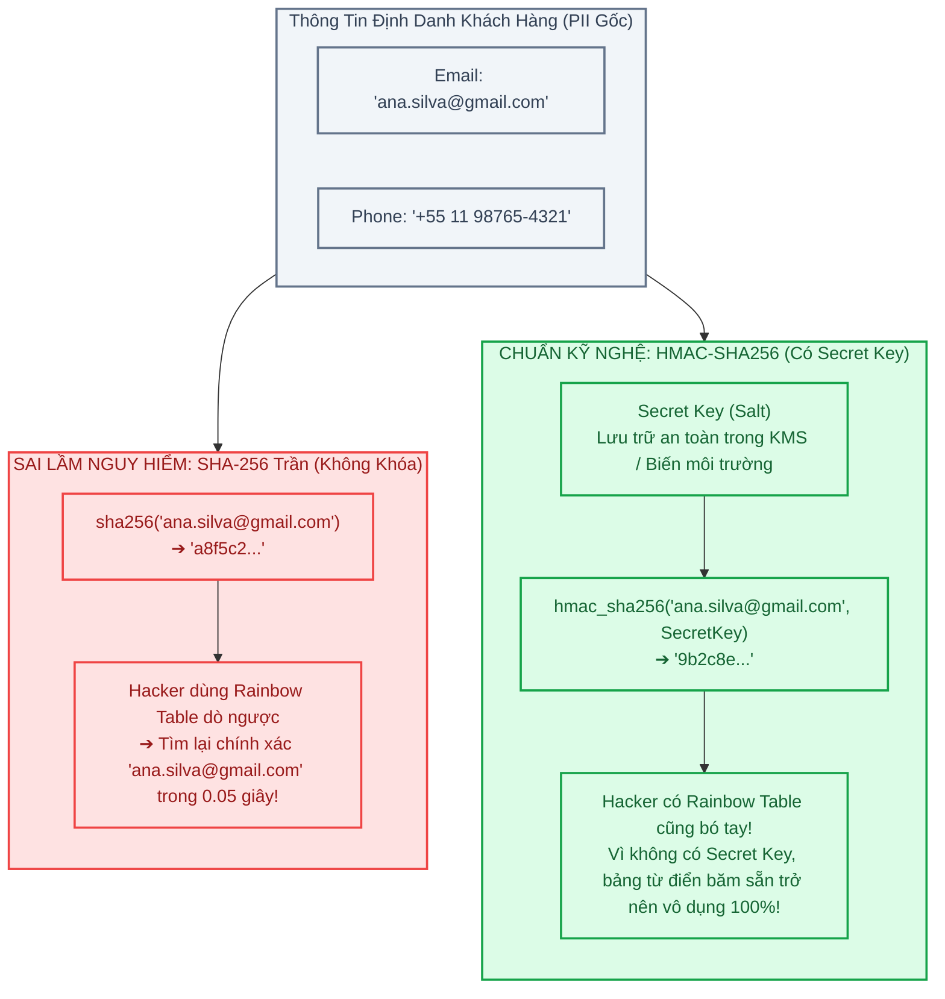
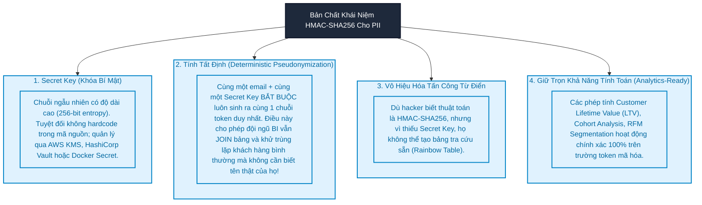
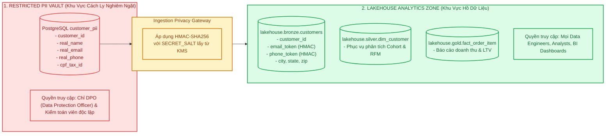
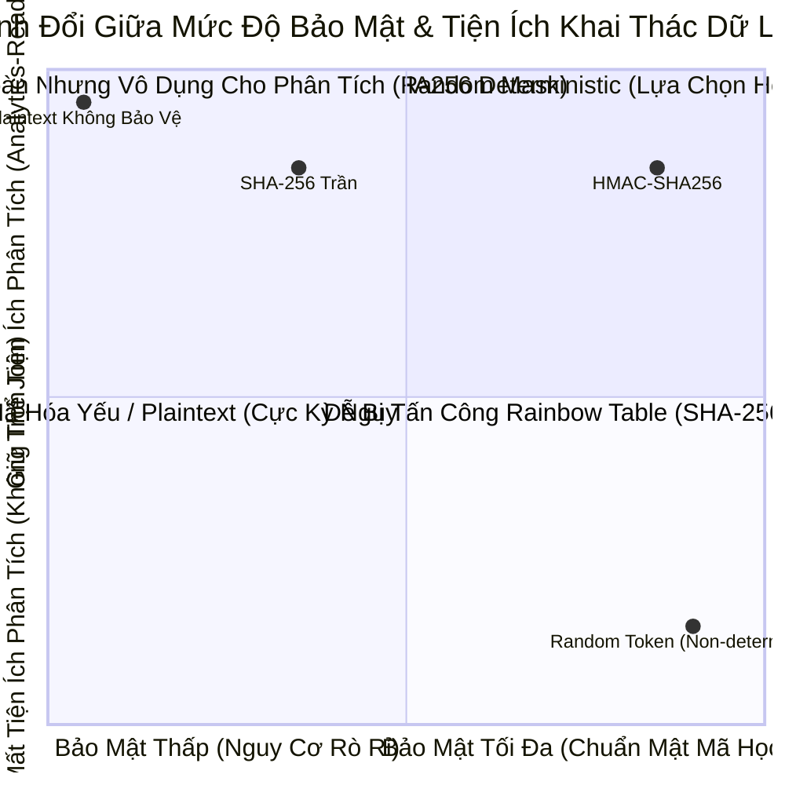

# Module 06: PII Privacy Engineering — Mã Hóa HMAC-SHA256 & An Ninh Dữ Liệu Hồ

> **Target Audience:** Sinh viên CNTT & Kỹ sư phần mềm đang chuyển dịch sang Data Engineering  
> **Topic Scope:** PII Protection, LGPD/GDPR Compliance, Rainbow Table Attacks, HMAC-SHA256, Deterministic Pseudonymization  
> **Estimated Reading Time:** 17 phút  

---

## 1. The Big Picture: Ảo Tưởng An Toàn Khi Dùng SHA-256 Trần

Nhiều lập trình viên và kỹ sư dữ liệu non trẻ thường tự tin tuyên bố:
> *"Bảng khách hàng của em có cột email và số điện thoại, nhưng em đã băm nó bằng `sha256(email)` trước khi lưu vào Lakehouse rồi, nên dữ liệu an toàn 100%!"*

Đây là một **ảo tưởng an toàn chết người (Dangerous Illusion)**.

Hãy phân tích cách một hacker có thể bẻ khóa chuỗi SHA-256 của bạn chỉ trong vài phút:
1. **Không gian Entropy của Email & Số điện thoại là cực kỳ nhỏ:**  
   * Một số điện thoại di động tại Brazil hay Việt Nam chỉ có khoảng 10 chữ số (khoảng $10^8$ đến $10^9$ khả năng).
   * Danh sách tên người phổ biến (`nguyen.van.a@gmail.com`, `john.smith@hotmail.com`) chỉ có vài chục triệu biến thể quen thuộc.
2. **Kỹ thuật tấn công Rainbow Table & Bảng tra cứu trước (Precomputed Lookup Tables):**  
   * Một hacker chỉ cần bỏ ra vài giờ với một chiếc card đồ họa (GPU) phổ thông để tính toán sẵn mã SHA-256 của toàn bộ 100 triệu số điện thoại khả dĩ và 50 triệu email phổ biến, sau đó lưu vào một file từ điển tra cứu.
   * Khi hacker chiếm được bảng Bronze hoặc Silver trong Lakehouse của bạn: Họ chỉ việc lấy chuỗi SHA-256 trong hồ dữ liệu đem dò vào bảng từ điển (Lookup Table) ➔ **Ngay lập tức danh tính thật, số điện thoại thật và email thật của khách hàng bị lộ ra ánh sáng!**

Hậu quả là doanh nghiệp đối mặt với các án phạt hàng triệu USD theo đạo luật bảo vệ dữ liệu **LGPD (Brazil)** hoặc **GDPR (Châu Âu)**.

Để vô hiệu hóa hoàn toàn kiểu tấn công này, kỹ nghệ dữ liệu hiện đại bắt buộc phải sử dụng **HMAC-SHA256 kết hợp Khóa Bí Mật (Secret Key)**.



---

## 2. Concept Anatomy: PII, Pseudonymization & HMAC

### Academic Definition (Định nghĩa chuẩn học thuật)
> **Personally Identifiable Information (PII - Thông tin định danh cá nhân)** là *bất kỳ dữ liệu nào có thể được sử dụng trực tiếp hoặc gián tiếp để nhận dạng một cá nhân cụ thể ngoài đời thực*.  
> **HMAC-SHA256 (Hash-based Message Authentication Code)** là *thuật toán mật mã học kết hợp một hàm băm mật mã (SHA-256) với một khóa bí mật (Secret Key)*, tạo ra một giá trị token định danh vừa bảo đảm **tính tất định (deterministic)** để phục vụ truy vấn, vừa bảo đảm **tính kháng tra cứu ngược (pre-image resistance)** trước mọi hình thức tấn công từ điển.

### Keyword Dissection (Giải phẫu khái niệm)



---

## 3. Kiến Trúc Lá Chắn Bảo Mật Hai Tầng (The Dual-Zone Privacy Shield)

Làm sao để doanh nghiệp vừa tuân thủ pháp lý bảo vệ dữ liệu, vừa cho phép các nhà khoa học dữ liệu (Data Scientist) và nhà phân tích (Data Analyst) làm việc hiệu quả?

Giải pháp chuẩn mực là phân tách kiến trúc thành **2 vùng bảo mật độc lập**:



### Tại Sao Phải Tính Tất Định (Deterministic)?
* Nếu bạn mã hóa ngẫu nhiên (mỗi lần nạp sinh một chuỗi ngẫu nhiên khác nhau), thì khi khách hàng mua đơn thứ 2, email của họ sẽ sinh ra token khác với đơn thứ 1.
* Kết quả là: Hệ thống BI sẽ tưởng rằng đây là 2 khách hàng hoàn toàn xa lạ ➔ **Chỉ số Retention Rate, Customer Lifetime Value (LTV) và phân khúc RFM bị tính toán sai bét!**
* Nhờ HMAC có tính tất định: Một email duy nhất của khách hàng luôn sinh ra chính xác cùng một chuỗi `email_token` xuyên suốt toàn bộ các bảng `orders`, `payments`, `reviews` mà không để lộ một ký tự nào của email thật!

---

## 4. Hiện Thực Kỹ Thuật: PySpark HMAC Tokenizer Chuẩn Doanh Nghiệp

Dưới đây là đoạn mã hiện thực Tokenization sử dụng thư viện mật mã học Python kết hợp User Defined Function (UDF) hoặc Native Spark SQL:

```python
import os
import hmac
import hashlib
from pyspark.sql import functions as F
from pyspark.sql.types import StringType

# 1. Đọc Secret Key từ biến môi trường (Tuyệt đối không hardcode trong git!)
SECRET_SALT = os.getenv("PII_SECRET_SALT", "olist_secure_lakehouse_salt_2026").encode("utf-8")

def compute_hmac_sha256(value: str) -> str:
    """
    Hàm băm HMAC-SHA256 tất định có sử dụng Secret Key.
    
    Lý do (Why):
    - Chuẩn hóa chữ thường (lower) và cắt khoảng trắng (strip) để 'User@Gmail.Com' 
      và 'user@gmail.com' luôn sinh cùng một mã token.
    - Trả về None nếu giá trị rỗng hoặc NULL để bảo toàn tính toàn vẹn.
    """
    if not value or str(value).strip().lower() in ["", "none", "null"]:
        return None
    normalized_val = str(value).strip().lower().encode("utf-8")
    return hmac.new(SECRET_SALT, normalized_val, hashlib.sha256).hexdigest()

# Đăng ký hàm UDF trong PySpark
hmac_udf = F.udf(compute_hmac_sha256, StringType())

def mask_customer_pii(raw_customers_df):
    """
    Áp dụng mã hóa PII ngay tại ranh giới Ingestion trước khi ghi vào Bronze.
    """
    return raw_customers_df \
        .withColumn("customer_email_token", hmac_udf(F.col("customer_email"))) \
        .withColumn("customer_phone_token", hmac_udf(F.col("customer_phone"))) \
        .withColumn("customer_cpf_token", hmac_udf(F.col("customer_cpf"))) \
        .drop("customer_email", "customer_phone", "customer_cpf")  # Xóa sạch cột raw PII!
```

---

## 5. Phân Tích Đánh Đổi (Trade-Off Analysis)



| Phương Pháp | Chống Tấn Công Rainbow Table | Giữ Được Khả Năng JOIN Bảng | Khả Năng Tính RFM & LTV | Mức Độ An Toàn Pháp Lý |
| :--- | :---: | :---: | :---: | :---: |
| **Plaintext (Không che giấu)** | ❌ Bị lộ 100% | ✔ Được | ✔ Được | ❌ Vi phạm nghiêm trọng LGPD |
| **SHA-256 Trần (Không muối)** | ❌ Bị giải mã bằng từ điển | ✔ Được | ✔ Được | ⚠️ Rủi ro bị phạt rất cao |
| **Random UUID Masking** | ✔ Không thể đoán | ❌ Không thể JOIN | ❌ Sai lệch hoàn toàn | ✔ An toàn nhưng vô dụng |
| **HMAC-SHA256 Có Khóa Bí Mật** | **✔ Kháng 100% từ điển** | **✔ Hoàn hảo** | **✔ Chính xác 100%** | **✔ Đạt chuẩn quốc tế LGPD/GDPR** |

---

## 6. Quản Trị Khóa Bí Mật (Key Management & Rotation)

Trong thiết kế kỹ thuật, **bảo mật của hệ thống phụ thuộc hoàn toàn vào tính bí mật của Khóa (Kerckhoffs's Principle)**. Nếu khóa bị lộ, toàn bộ cơ chế bảo vệ sụp đổ.

### 3 Nguyên Tắc Vàng Quản Lý Khóa PII:
1. **Never Commit to Git:** Tuyệt đối không bao giờ ghi chuỗi Secret Key vào file code Python, SQL hay file cấu hình commit lên GitHub.
2. **Environment Injection:** Khóa bí mật chỉ được nạp vào bộ nhớ container tại thời điểm chạy (Runtime) thông qua Docker Secret hoặc AWS Secrets Manager.
3. **Quy Trình Xoay Vòng Khóa (Key Rotation):** Định kỳ 1 năm hoặc khi có sự cố nghi ngờ rò rỉ, hệ thống phải thực hiện xoay vòng khóa. Các bảng lịch sử sẽ được kích hoạt job chạy lại để tái mã hóa theo khóa phiên bản mới (`v2_salt`).

---

## 7. Ánh Xạ Vào Dự Án Thực Tế `olist-lakehouse`

* Trong dự án của chúng ta, bảng `customer_pii` trong PostgreSQL chứa thông tin định danh cá nhân nhạy cảm (`customer_email, customer_phone, customer_cpf`).
* Trước khi dữ liệu này được chuyển dịch vào `lakehouse.bronze.customers` hoặc `lakehouse.silver.dim_customer`, toàn bộ 3 trường này được băm bằng hàm HMAC-SHA256 với khóa bí mật cấu hình trong [.env](file:///Users/anhtus/Documents/Development/DE/GRT_DA-DE/.env).
* Khi kỹ sư kiểm tra bảng trong Apache Iceberg bằng Trino:
  `SELECT customer_id, customer_email_token FROM lakehouse.silver.dim_customer LIMIT 5;`  
  Kết quả chỉ hiển thị các chuỗi hex 64 ký tự, đảm bảo an toàn tuyệt đối ngay cả khi dữ liệu bị chụp màn hình chia sẻ ra ngoài.

---

## 8. Bài Tập Tự Đánh Giá (Knowledge Check)

1. **Câu hỏi:** *Tại sao dùng hàm băm chuẩn SHA-256 trần cho trường số điện thoại của khách hàng lại cực kỳ dễ bị giải mã ngược, trong khi SHA-256 được xem là hàm băm một chiều an toàn?*  
   * **Đáp án:** Vì không gian số điện thoại quá nhỏ (Entropy thấp, chỉ khoảng vài trăm triệu số). Kẻ tấn công không cần đảo ngược hàm toán học của SHA-256, mà chỉ cần băm sẵn toàn bộ các số điện thoại có thể có (Precomputed Dictionary / Rainbow Table), sau đó đem mã băm thu được đi tra cứu ngược để tìm ra số điện thoại gốc chỉ trong vài mili-giây.

2. **Câu hỏi:** *Khóa bí mật (Secret Key) trong thuật toán HMAC-SHA256 đóng vai trò cốt tử gì trong việc chống lại tấn công Rainbow Table?*  
   * **Đáp án:** Khóa bí mật làm tăng không gian tìm kiếm lên vô hạn đối với kẻ tấn công. Vì kẻ tấn công không biết Secret Key, mọi bảng từ điển băm sẵn mà chúng chuẩn bị từ trước đều trở nên hoàn toàn vô giá trị. Muốn tạo lại từ điển mới, kẻ tấn công phải đoán đúng cả Secret Key 256-bit — điều bất khả thi về mặt điện toán.

3. **Câu hỏi:** *Tại sao việc che giấu PII bằng mã hóa ngẫu nhiên (Non-deterministic Random Token) lại phá hỏng các phân tích Customer Lifetime Value (LTV) và RFM của doanh nghiệp?*  
   * **Đáp án:** Vì tính ngẫu nhiên làm mất khả năng liên kết dữ liệu giữa các lần mua sắm. Nếu một khách hàng quay lại mua hàng 5 lần nhưng mỗi lần lại được gán một token ngẫu nhiên khác nhau, hệ thống BI sẽ hiểu nhầm đó là 5 khách hàng riêng biệt chỉ mua 1 lần. Khi đó, tần suất mua hàng (Frequency) luôn bằng 1 và giá trị vòng đời (LTV) bị tính toán sai lệch hoàn toàn.

---
*Made by Anh Tu - Share to be share*
