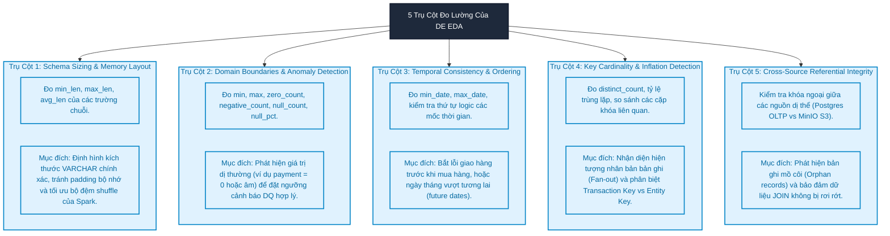
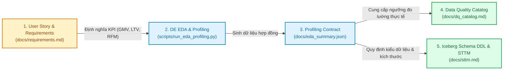
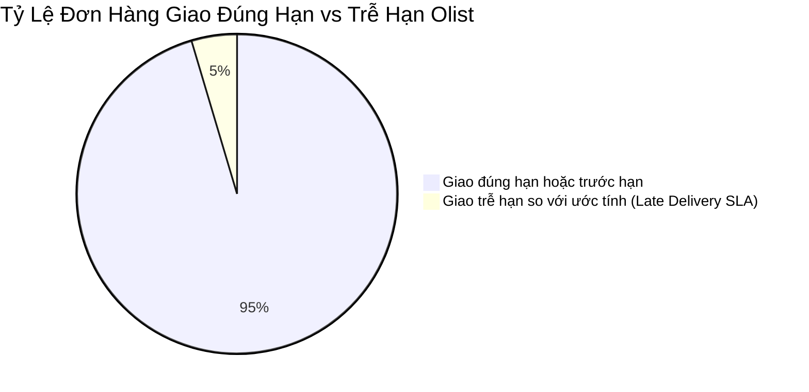
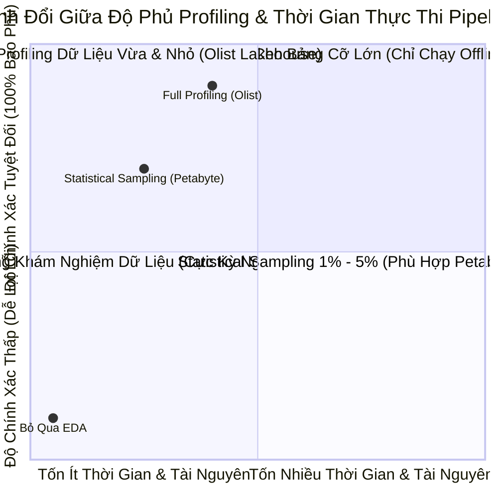

# Module 07: Data Engineering EDA — Khám Nghiệm Dữ Liệu Cho Lakehouse, Contracts & Sizing

> **Target Audience:** Sinh viên CNTT & Kỹ sư phần mềm đang chuyển dịch sang Data Engineering  
> **Topic Scope:** DE EDA vs DS EDA, The 5 Pillars of Profiling, Schema Sizing, Domain Boundaries, Empirical DQ Thresholds  
> **Estimated Reading Time:** 20 phút  

---

## 1. The Big Picture: Khác Biệt Sống Còn Giữa Data Science EDA & Data Engineering EDA

Trong hầu hết các khóa học nhập môn dữ liệu, khi nghe đến thuật ngữ **EDA (Exploratory Data Analysis - Khám phá dữ liệu)**, sinh viên thường nghĩ ngay đến:
* Vẽ biểu đồ phân phối hình chuông (Histogram, Boxplot).
* Ma trận tương quan giữa các biến (Correlation Heatmap).
* Phân tích giảm chiều dữ liệu (PCA) để chuẩn bị huấn luyện mô hình Machine Learning.

Tuy nhiên, trong **Kỹ nghệ Dữ liệu (Data Engineering)**, những biểu đồ đó **hoàn toàn vô dụng** đối với việc thiết kế hạ tầng pipeline!

Là một Data Engineer, các câu hỏi sống còn bạn phải trả lời trước khi viết dòng code pipeline đầu tiên là:
1. *Độ dài chuỗi tối đa của `customer_id` là bao nhiêu? Nếu ta khai báo `VARCHAR(255)` thay vì `VARCHAR(32)`, bộ nhớ RAM đệm (Shuffle Buffer) của Apache Spark sẽ bị lãng phí bao nhiêu Gigabyte khi xử lý hàng trăm triệu dòng?*
2. *Cột `payment_value` có xuất hiện số âm hoặc số 0 hay không? Nếu có 9 đơn hàng thanh toán 0 đồng (do dùng voucher 100%), mà bạn vội vã đặt Data Quality Rule: `payment_value > 0` mức Critical ➔ Pipeline sẽ bị dừng ngay lập tức lúc nửa đêm!*
3. *Bảng khách hàng có bao nhiêu người thực? Tại sao có 99.441 `customer_id` nhưng chỉ có 96.096 `customer_unique_id`? Nếu dùng nhầm khóa, báo cáo LTV và RFM sẽ bị phóng đại ảo bao nhiêu phần trăm?*
4. *Khóa ngoại giữa bảng `order_items` trong cơ sở dữ liệu PostgreSQL và tệp CSV `products` trên MinIO S3 có bị lệch pha không? Có bao nhiêu dòng mồ côi (Orphan Records)?*

Đó là lý do quy trình **Data Engineering EDA (DE EDA)** ra đời. Đây là bước **khám nghiệm cấu trúc & ranh giới dữ liệu (Structural & Boundary Inspection)** nhằm cung cấp số liệu thực chứng để xây dựng Data Contract, định cỡ Schema DDL và thiết lập các ngưỡng Data Quality chuẩn xác.

```mermaid
flowchart TD
    subgraph DSEDA ["DATA SCIENCE EDA (Mục tiêu: Machine Learning)"]
        direction TB
        DS1["Phân phối chuẩn, độ lệch (Skewness)"]
        DS2["Tương quan giữa các biến (Pearson Correlation)"]
        DS3["Trích xuất đặc trưng (Feature Engineering)"]
    end

    subgraph DEEDA ["DATA ENGINEERING EDA (Mục tiêu: Pipeline Reliability)"]
        direction TB
        DE1["1. Schema Sizing (Độ dài chuỗi min/max/avg -> Tối ưu RAM/Đĩa)"]
        DE2["2. Domain Boundaries (Min/Max, số 0, số âm, tỷ lệ NULL)"]
        DE3["3. Temporal Consistency (Thứ tự thời gian, phát hiện tương lai)"]
        DE4["4. Key Cardinality & Inflation (Bẫy nhân dòng, khách quay lại)"]
        DE5["5. Cross-Source Integrity (Độ lệch khóa giữa SQL và Object Storage)"]
    end

    classDef dsStyle fill:#fee2e2,stroke:#ef4444,stroke-width:2px,color:#991b1b;
    classDef deStyle fill:#dcfce7,stroke:#16a34a,stroke-width:2px,color:#166534;

    class DSEDA,DS1,DS2,DS3 dsStyle;
    class DEEDA,DE1,DE2,DE3,DE4,DE5 deStyle;
```



---

## 2. Concept Anatomy: 5 Trụ Cột Kỹ Thuật Của Data Engineering EDA

### Academic Definition (Định nghĩa chuẩn học thuật)
> **Data Engineering Exploratory Data Analysis (DE EDA)** là *quy trình phân tích định lượng có hệ thống về các thuộc tính vật lý, ranh giới miền giá trị, tính nhất quán thời gian, bản số của khóa và tính toàn vẹn liên nguồn của dữ liệu*, nhằm thiết lập các tham số kỹ thuật chính xác cho **Data Contract, Schema Sizing, Ingestion Pattern và Data Quality Catalog** trước khi triển khai đường ống dữ liệu phân tán.

### Keyword Dissection (Giải phẫu 5 Trụ Cột Kỹ Thuật)



---

## 3. Vòng Đời Thiết Kế: Từ Yêu Cầu Nghiệp Vụ Đến Đo Lường Thực Tế

Trong kỹ nghệ phần mềm chuyên nghiệp, không có bước nào được làm một cách tùy hứng. Mọi hoạt động kỹ thuật đều liên kết chặt chẽ theo một chuỗi giá trị:



### Tại Sao Không Được Đặt Ngưỡng DQ Rules Trước Khi Làm EDA?
Hãy tưởng tượng bạn ngồi trong phòng họp và tự đặt ra một quy tắc chất lượng dữ liệu theo trực giác:
* *"Tôi nghĩ cột `product_category_name` trong bảng sản phẩm bắt buộc phải có, ai lại bán hàng mà không có danh mục? Đặt rule `NOT NULL` với mức độ **Severity Critical (Dừng Pipeline)**!"*
* Khi pipeline chạy thật: EDA đo được thực tế có **610 sản phẩm (~1.85%) không hề có danh mục**.
* **Hậu quả:** Pipeline nạp dữ liệu bị sập ngay trong đêm đầu tiên vận hành! Hàng trăm nghìn đơn hàng bị ách tắc chỉ vì 610 sản phẩm thiếu tên loại hàng.
* **Cách xử lý đúng của Data Engineer:** Nhờ EDA phát hiện trước 1.85% null, bạn sẽ thiết lập rule: 
  * Cho phép null nhưng gán nhãn về `'Unknown'` tại tầng Silver.
  * Đặt ngưỡng cảnh báo: Nếu tỷ lệ null vượt quá **3.0%** (ngưỡng bất thường so với thực tế 1.85%) thì mới bắn cảnh báo Major!

---

## 4. 5 Phát Hiện Kỹ Thuật Đắt Giá Từ Dữ Liệu Olist (Quantified Evidence)

Qua việc thực thi bộ công cụ profiling trên **1.281.490 bản ghi** của toàn bộ 10 thực thể Olist (kết quả lưu tại `docs/week02/eda_summary.json`), chúng ta đã khám nghiệm được 5 sự thật kỹ thuật có tính quyết định đến kiến trúc hệ thống:



### 1. Phát hiện 1: 9 Bản ghi có `payment_value = 0.0`
* **Số liệu đo lường:** Trong số 103.886 giao dịch thanh toán của bảng `order_payments`, có đúng **9 bản ghi có giá trị bằng 0.0 BRL**.
* **Nguyên nhân gốc rễ (Root Cause):** Khách hàng sử dụng phiếu giảm giá toàn phần (**Voucher 100%**).
* **Tác động thiết kế:** Tuyệt đối không đặt rule `payment_value > 0` mức Critical. Bắt buộc chấp nhận `payment_value >= 0`.

### 2. Phát hiện 2: 610 Sản phẩm (~1.85%) khuyết danh mục (`product_category_name IS NULL`)
* **Số liệu đo lường:** 610 / 32.951 sản phẩm không có tên danh mục tiếng Bồ Đào Nha, và do đó không thể map sang tiếng Anh trong bảng `category_translation`.
* **Tác động thiết kế:** Khi thực hiện phép `LEFT JOIN` giữa `products` và `category_translation`, phải sử dụng hàm `COALESCE(category_english, 'unknown')` để tránh làm thất thoát doanh thu của các sản phẩm này tại tầng Gold.

### 3. Phát hiện 3: 4.59% Đơn hàng bị giao trễ hẹn (4.437 / 96.478 đơn delivered)
* **Số liệu đo lường:** Ngày giao thực tế `order_delivered_customer_date` lớn hơn ngày ước tính `order_estimated_delivery_date`.
* **Tác động thiết kế:** Bổ sung cột cờ chỉ báo `is_late_delivery (BOOLEAN)` tại tầng Gold `fact_order_item` để phục vụ bảng điều khiển phân tích chất lượng dịch vụ logistics của Olist.

### 4. Phát hiện 4: Bẫy phóng đại khách hàng (Key Inflation) giữa `customer_id` & `customer_unique_id`
* **Số liệu đo lường:** Có **99.441** `customer_id` nhưng chỉ có **96.096** `customer_unique_id`. Số khách hàng mua từ lần thứ 2 trở lên là **3.345 người (~3.36% độ lệch)**. Khách hàng trung thành nhất đã mua tới **17 đơn hàng**.
* **Tác động sống còn:** Khi xây dựng mô hình Star Schema tại tầng Gold:
  * Khóa tự nhiên của bảng chiều khách hàng `dim_customer` bắt buộc phải là `customer_unique_id`.
  * Nếu dùng nhầm `customer_id`, doanh nghiệp sẽ bị ảo tưởng rằng toàn bộ khách hàng đều chỉ mua hàng đúng 1 lần, và chỉ số Customer Lifetime Value (LTV) bị tính sai hoàn toàn.

### 5. Phát hiện 5: Tính Toàn Vẹn Khóa Ngoại Liên Nguồn (Cross-Source Integrity)
* **Số liệu đo lường:** Khi đối chiếu 112.650 bản ghi `order_items` từ PostgreSQL với 32.951 bản ghi `products` từ tệp CSV trên MinIO S3, **100% `product_id` đều tồn tại hợp lệ (0 bản ghi mồ côi)**.
* **Tác động thiết kế:** Khẳng định quy trình đồng bộ giữa hai nguồn hoạt động chuẩn xác, bảo đảm tính an toàn khi thực thi câu lệnh phân tán `BROADCAST HASH JOIN` giữa Spark và Iceberg.

---

## 5. Hiện Thực Kỹ Thuật: Kiến Trúc Script DE EDA Không Gây Nghẽn Bộ Nhớ

Khi quét qua hàng triệu dòng dữ liệu phân tán, một script profiling tồi sẽ kéo toàn bộ dữ liệu vào một mảng Python lớn trong RAM và gây sập hệ thống.

Đoạn mã dưới đây (trích từ `scripts/run_eda_profiling.py`) minh họa kiến trúc **Streaming Profiling** tối ưu:

```python
import psycopg2
import boto3
import pandas as pd

def profile_stream_table(cur, table_name: str):
    """
    Khám nghiệm cấu trúc và đo lường 5 trụ cột kỹ thuật trực tiếp trên động cơ SQL.
    Đẩy toàn bộ tính toán phức tạp cho PostgreSQL / Spark xử lý, chỉ trả về số liệu tổng kết.
    """
    # 1. Đo lường kích thước chuỗi (Pillar 1: Schema Sizing)
    cur.execute(f"""
        SELECT 
            MIN(LENGTH(customer_id)) as min_len,
            MAX(LENGTH(customer_id)) as max_len,
            ROUND(AVG(LENGTH(customer_id)), 2) as avg_len
        FROM {table_name};
    """)
    sizing_stats = cur.fetchone()
    
    # 2. Đo lường ranh giới miền giá trị (Pillar 2: Domain Boundaries)
    cur.execute(f"""
        SELECT 
            COUNT(*) as total_rows,
            COUNT(customer_id) as non_null_count,
            COUNT(*) - COUNT(customer_id) as null_count
        FROM {table_name};
    """)
    boundary_stats = cur.fetchone()
    
    return {
        "sizing": {"min_len": sizing_stats[0], "max_len": sizing_stats[1], "avg_len": float(sizing_stats[2])},
        "boundaries": {"total_rows": boundary_stats[0], "null_pct": round(100.0 * boundary_stats[2] / boundary_stats[0], 2)}
    }
```

---

## 6. Phân Tích Đánh Đổi (Trade-Off Analysis)



| Chiến Lược | Độ Bao Phủ Dữ Liệu | Rủi Ro Bỏ Sót Bản Ghi Lỗi Biên | Chi Phí Tính Toán | Khi Nào Nên Áp Dụng |
| :--- | :--- | :--- | :--- | :--- |
| **Full Dataset Profiling (Khuyên dùng)** | **100% bản ghi** | **0% rủi ro** (Bắt trọn 9 dòng payment = 0). | Vừa phải với tập dữ liệu < 50 triệu dòng. | Giai đoạn thiết kế Lab, chuẩn bị hợp đồng dữ liệu ban đầu. |
| **Statistical Sampling (Lấy mẫu)** | 1% đến 5% ngẫu nhiên | Cao (Rất dễ bỏ sót các trường hợp ngoại lệ hiếm gặp). | Cực thấp, chạy rất nhanh. | Hệ thống Big Data thực sự quy mô hàng tỷ bản ghi mỗi ngày. |

---

## 7. Ánh Xạ Vào Dự Án Thực Tế `olist-lakehouse`

Toàn bộ các hiện thực kỹ thuật của mô-đun này đã được triển khai sẵn sàng trong repo:
* **Mã nguồn thực thi tự động:** [scripts/run_eda_profiling.py](file:///Users/anhtus/Documents/Development/DE/GRT_DA-DE/scripts/run_eda_profiling.py) (kết nối trực tiếp PostgreSQL và streaming từ MinIO S3).
* **Sổ tay tương tác PySpark:** [notebooks/eda_profiling.ipynb](file:///Users/anhtus/Documents/Development/DE/GRT_DA-DE/notebooks/eda_profiling.ipynb) (chạy trực tiếp trong container Docker `olist_spark_notebook`).
* **Hợp đồng kết quả khám nghiệm:** [docs/week02/eda_summary.json](file:///Users/anhtus/Documents/Development/DE/GRT_DA-DE/docs/week02/eda_summary.json) (lưu trữ đầy đủ các chỉ số của 10 bảng, làm đầu vào cho các bài kiểm tra tự động).

---

## 8. Bài Tập Tự Đánh Giá (Knowledge Check)

1. **Câu hỏi:** *Sự khác biệt lớn nhất giữa câu hỏi nghiên cứu của một Data Scientist và một Data Engineer khi tiếp cận một tập dữ liệu mới là gì?*  
   * **Đáp án:** Data Scientist tìm kiếm các mối tương quan thống kê (Correlation, Feature Importance) để xây dựng mô hình dự báo. Trong khi đó, Data Engineer tìm kiếm các thuộc tính cấu trúc và ranh giới vật lý (Schema Sizing, NULL rates, Domain Boundaries, Key Cardinality) để bảo đảm đường ống dữ liệu vận hành kiên cường, không bị sập và không làm phình to bộ nhớ phân tán.

2. **Câu hỏi:** *Nếu kết quả EDA cho thấy cột `customer_id` có độ dài cố định chính xác 32 ký tự trên 100% bản ghi, điều này mang lại lợi ích gì cho việc thiết kế bảng?*  
   * **Đáp án:** Cho phép kỹ sư định hình kiểu dữ liệu chính xác là `CHAR(32)` hoặc `VARCHAR(32)` thay vì để mặc định `VARCHAR(255)` hay kiểu `TEXT` tự do. Việc này giúp các động cơ phân tán như Spark và Trino cấp phát vùng nhớ đệm (Shuffle Buffer) vừa khít, tránh lãng phí RAM khi thực hiện các phép toán xáo trộn dữ liệu (Shuffle) trên quy mô lớn.

3. **Câu hỏi:** *Tại sao việc phát hiện 3.345 khách hàng quay lại mua hàng từ lần thứ 2 trở lên (`customer_id` khác `customer_unique_id`) lại có ý nghĩa sống còn đối với mô hình dữ liệu tầng Gold?*  
   * **Đáp án:** Vì nếu sử dụng `customer_id` làm khóa của bảng Dimension khách hàng, mỗi lần mua sắm của cùng một người sẽ bị coi là một khách hàng mới tinh. Hệ thống sẽ kết luận sai lầm rằng Olist có 100% khách hàng chỉ mua 1 lần, phá hỏng hoàn toàn việc tính toán các chỉ số kinh doanh cốt lõi như Tần suất mua hàng (Frequency) trong RFM và Giá trị trọn đời (Customer Lifetime Value - LTV).

---
*Made by Anh Tu - Share to be share*
