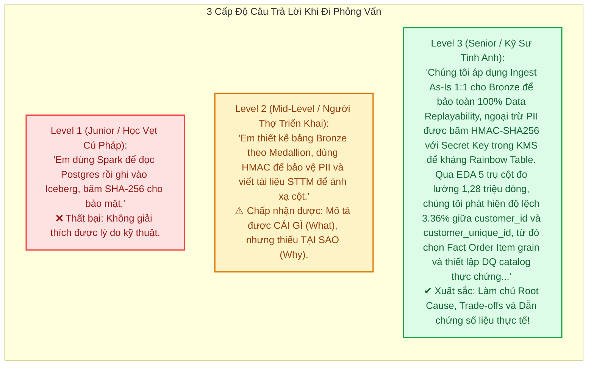

# Module 08: Week 02 Synthesis & Technical Interview Cheatsheet — Phản Xạ Kỹ Thuật Phỏng Vấn

> **Target Audience:** Kỹ sư dữ liệu chuẩn bị phỏng vấn vị trí Data Engineer (Junior to Senior Level)  
> **Topic Scope:** Fact Table Grain, DE EDA vs DS EDA, STTM Data Contracts, Customer ID vs Unique ID, HMAC PII Defense  
> **Estimated Reading Time:** 20 phút  

---

## 1. The Big Picture: Chiến Lược Trả Lời Phỏng Vấn Data Engineering

Trong các buổi phỏng vấn kỹ thuật tuyển dụng Data Engineer, người phỏng vấn (Hiring Manager / Tech Lead) không tìm kiếm những người chỉ thuộc lòng cú pháp câu lệnh PySpark hay SQL.

Họ tìm kiếm **Tư Duy Kiến Trúc (Architectural Reasoning)** và **Ý Thức Về Sự Đánh Đổi (Trade-Off Awareness)**.  
Họ muốn biết:
* *Khi đứng trước một bài toán, bạn có nhìn thấy rủi ro tiềm ẩn không?*
* *Bạn chọn giải pháp đó vì nó "tiện" hay vì bạn đã tính toán cẩn thận về chi phí CPU, RAM và tính toàn vẹn dữ liệu?*
* *Bạn có hiểu sâu sắc về bản chất của dữ liệu thực tế hay chỉ cắm đầu viết code?*

---

## 2. Tổng Hợp Tinh Hoa Tuần 02 (Executive Mental Model)

Trước khi bước vào các câu hỏi chi tiết, hãy khắc ghi bức tranh toàn cảnh 4 trụ cột kiến trúc của Tuần 02 trong tâm trí:

```mermaid
graph TD
    subgraph IngestionBoundary ["1. Ingestion & Preservation (Tầng Bronze)"]
        B_AsIs["Nguyên tắc Ingest As-Is 1:1 (Không cast, không lọc)"]
        B_Meta["Bộ 5 Cột Metadata (_ingest_ts, _source, _batch_id, _record_hash, _is_del)"]
        B_PII["Ngoại lệ duy nhất: Tokenize PII bằng HMAC-SHA256 với Secret Key"]
    end

    subgraph LoadDesign ["2. Pattern & Watermark Engineering"]
        LP_Matrix["4 Mẫu Nạp: Full Snapshot, Incremental Append, CDC Merge, Full Reload"]
        LP_WM["High-Watermark kết hợp Safe Lookback Window (Lùi 10 phút)"]
        LP_Part["Phòng tránh Small Files: Unpartitioned hoặc Partition theo Tháng"]
    end

    subgraph ProfilingContract ["3. Data Engineering EDA & Profiling"]
        EDA_5P["5 Trụ Cột: Sizing, Boundaries, Temporal, Cardinality, Cross-Source"]
        EDA_DQ["Dữ liệu thực chứng sinh ra Data Quality Catalog (docs/dq_catalog.md)"]
    end

    subgraph DimensionalModeling ["4. Gold Star Schema & STTM Contracts"]
        DM_Grain["Fact Table Grain: 1 Order Item (Chi tiết nguyên tử nhất có giá)"]
        DM_Key["Khóa khách hàng tự nhiên: customer_unique_id (Tránh phóng đại LTV)"]
        DM_STTM["STTM làm hợp đồng ràng buộc giữa Business và Data Engineering"]
    end

    IngestionBoundary --> LoadDesign
    LoadDesign --> ProfilingContract
    ProfilingContract --> DimensionalModeling

    classDef c1 fill:#e0f2fe,stroke:#0284c7,stroke-width:2px,color:#0369a1;
    classDef c2 fill:#f0fdf4,stroke:#16a34a,stroke-width:2px,color:#15803d;
    classDef c3 fill:#fef3c7,stroke:#d97706,stroke-width:2px,color:#b45309;
    classDef c4 fill:#fdf4ff,stroke:#c026d3,stroke-width:2px,color:#86198f;

    class IngestionBoundary,B_AsIs,B_Meta,B_PII c1;
    class LoadDesign,LP_Matrix,LP_WM,LP_Part c2;
    class ProfilingContract,EDA_5P,EDA_DQ c3;
    class DimensionalModeling,DM_Grain,DM_Key,DM_STTM c4;
```

---

## 3. Bộ 5 Câu Hỏi Phỏng Vấn Chuyên Sâu Tuần 02 (Senior Technical Q&A)

---

### ❓ CÂU HỎI 1: Grain của Fact Table là gì? Bạn chọn Grain nào cho dự án Olist và vì sao?

#### 1. Definition Anatomy (Định nghĩa chuẩn học thuật):
* **Fact Table Grain (Hạt nhân bảng Fact):** Là *mức độ chi tiết nguyên tử đại diện cho đúng một dòng dữ liệu duy nhất trong bảng Fact*. Grain là quyết định kiến trúc quan trọng nhất trong mô hình hóa chiều (Kimball Dimensional Modeling), phải được xác lập đầu tiên trước khi chọn bất kỳ trường thông tin (dimensions) hay độ đo (measures) nào.

#### 2. Root Cause & Phân tích lựa chọn Olist:
* Trong tập dữ liệu thương mại điện tử Olist, ta có 2 phương án chọn Grain:
  * *Phương án A (Order Grain):* 1 dòng = 1 đơn hàng (`order_id`).
  * *Phương án B (Order Item Grain):* 1 dòng = 1 mặt hàng trong đơn hàng (`order_id + order_item_id`).
* **Lựa chọn của chúng tôi:** BẮT BUỘC chọn **Order Item Grain (Phương án B)**.
* **Lý do kỹ thuật (Why):** 
  * Đây là mức độ chi tiết nguyên tử nhất có giá sản phẩm (`price`) và cước phí vận chuyển riêng lẻ (`freight_value`).
  * Trong một sàn thương mại điện tử (Marketplace), một đơn hàng có thể chứa nhiều sản phẩm đến từ **nhiều người bán khác nhau (Multiple Sellers)** và thuộc **nhiều ngành hàng khác nhau (Multiple Categories)**.
  * Nếu chọn Grain theo đơn hàng (Phương án A), ta sẽ **mất hoàn toàn khả năng phân tích đa chiều**: Ta không thể tính doanh thu đóng góp theo từng Seller, không thể phân tích danh mục hàng bán chạy, và không thể phân bổ cước vận chuyển chính xác.

#### 3. Phân tích Đánh Đổi (Trade-Off):
* **Đánh đổi:** Chọn `order_item` khiến số dòng của bảng Fact tăng từ 99.441 dòng lên 112.650 dòng (~13.3% dung lượng).
* **Được lợi:** Bảo toàn trọn vẹn khả năng cuộn lên (Roll-up) thành bất kỳ góc nhìn nào: Tính tổng tiền theo đơn hàng, theo người bán, theo danh mục hoặc theo thời gian đều chính xác 100%.

#### 4. Kịch bản trả lời 60 giây (Elevator Pitch):
> *"Grain là mức độ chi tiết nguyên tử của một dòng trong bảng Fact. Cho Olist, tôi chọn grain là **'1 order item'** thay vì '1 order'. Lý do cốt tử là vì trên sàn thương mại điện tử, một đơn hàng có thể gồm sản phẩm từ nhiều seller khác nhau. Grain order item là mức thấp nhất có giá và cước vận chuyển riêng. Nếu chọn grain theo đơn hàng, doanh nghiệp sẽ mất vĩnh viễn khả năng phân tích doanh thu theo nhà bán và danh mục sản phẩm. Từ grain item, ta luôn có thể roll-up lên đơn hàng dễ dàng mà không bao giờ mất thông tin."*

---

### ❓ CÂU HỎI 2: Vì sao BẮT BUỘC phải làm DE EDA trước khi viết DQ Rules? Phân biệt DE EDA vs DS EDA?

#### 1. Definition Anatomy (Định nghĩa chuẩn học thuật):
* **Data Engineering EDA (Khám nghiệm dữ liệu kỹ nghệ):** Là quá trình kiểm tra cấu trúc, ranh giới miền giá trị, tính nhất quán thời gian và tính toàn vẹn liên nguồn nhằm xác lập tham số thực chứng cho **Data Contract, Schema Sizing, Ingestion Pattern và Data Quality Catalog**.
* **Khác biệt với Data Science EDA:** DS EDA tập trung vào tìm mối tương quan (Correlation), độ lệch phân phối (Skewness) và trích xuất đặc trưng phục vụ huấn luyện mô hình Machine Learning. Ngược lại, DE EDA tập trung vào độ dài chuỗi (Memory Sizing), các giá trị biên (0, âm, NULL) và độ lệch khóa ngoại để đảm bảo pipeline vận hành kiên cường.

#### 2. Root Cause: Tại sao không thể đặt DQ Rules theo trực giác?
* Mọi quy tắc chất lượng dữ liệu (DQ Rules) đều có ngưỡng (Threshold) và mức độ nghiêm trọng (Severity: Critical, Major, Minor).
* Nếu bạn đặt ngưỡng bằng cảm tính trong phòng họp:
  * Bạn nghĩ `payment_value` luôn phải dương (`> 0`) mức Critical. Khi chạy thật, hệ thống gặp 9 giao dịch dùng voucher 100% (`payment_value = 0.0`) ➔ Pipeline sập oan uổng!
  * Bạn nghĩ `product_category_name` bắt buộc không được null. Thực tế có 610 sản phẩm (~1.85%) thiếu tên danh mục ➔ Pipeline dừng mãi mãi!
* **Quy luật:** DE EDA cung cấp **Số Liệu Thực Chứng (Empirical Evidence)** để phân loại xử lý: 9 dòng thanh toán 0 đồng là hợp lệ; 1.85% sản phẩm thiếu category được map về nhãn `'Unknown'` và đặt ngưỡng cảnh báo nếu tỷ lệ vượt quá 3.0%.

#### 3. Kịch bản trả lời 60 giây (Elevator Pitch):
> *"DE EDA khác DS EDA ở chỗ nó không đi tìm feature correlation cho ML, mà là cuộc khám nghiệm cấu trúc và ranh giới vật lý để định hình Data Contract. Ta bắt buộc phải làm DE EDA trước khi viết DQ Rules vì ngưỡng chất lượng phải dựa trên số liệu thực tế thay vì cảm tính. Ví dụ trên dữ liệu Olist, EDA của tôi phát hiện có đúng 9 đơn thanh toán 0 đồng do dùng voucher 100%, và 1.85% sản phẩm khuyết category. Nhờ biết trước số liệu này, tôi không đặt nhầm rule NOT NULL mức Critical làm sập pipeline lúc nửa đêm, mà phân luồng map về Unknown an toàn."*

---

### ❓ CÂU HỎI 3: Tài liệu Source-to-Target Mapping (STTM) dùng để làm gì trong dự án Data Lakehouse thực tế?

#### 1. Definition Anatomy (Định nghĩa chuẩn học thuật):
* **Source-to-Target Mapping (STTM - Bản đồ ánh xạ dữ liệu):** Là *tài liệu kỹ thuật và hợp đồng dữ liệu chuẩn mực (Data Contract)* quy định chi tiết mối quan hệ chuyển dịch dữ liệu từ các trường của hệ thống nguồn (Source) sang các trường tương ứng của bảng đích (Target) xuyên suốt các tầng Bronze, Silver và Gold.

#### 2. Các thành phần bắt buộc của một dòng STTM chuẩn:
Một tài liệu STTM chuyên nghiệp bắt buộc phải có đủ 6 trường thông tin:
1. **Target Table & Target Column:** Bảng đích và cột đích trong Lakehouse.
2. **Target Data Type:** Kiểu dữ liệu vật lý (ví dụ `DECIMAL(10,2)` thay vì `FLOAT` để tránh sai số tiền tệ).
3. **Source System & Source Column:** Bảng nguồn và cột nguồn chính xác (ví dụ `postgresql.public.orders.order_id`).
4. **Transformation Rule (Quy tắc chuyển đổi):** Công thức logic nghiệp vụ (ví dụ: `COALESCE(category_english, 'unknown')`, `Lookup Surrogate Key`).
5. **DQ & Filter Criteria:** Điều kiện nghiệm thu (ví dụ: `price > 0`, `order_status = 'delivered'`).
6. **Sensitivity / Classification:** Phân loại an ninh bảo mật (ví dụ: `Public`, `Internal`, `PII-High (HMAC Required)`).

#### 3. Giá trị thực tế trong dự án:
* **Hợp đồng giữa các bộ phận:** Là tiếng nói chung giữa Kỹ sư dữ liệu (DE), Chuyên viên phân tích (DA) và Chủ sản phẩm (Product Owner).
* **Căn cứ viết kiểm thử (TDD):** Đội ngũ QA/DE dùng chính các quy tắc trong STTM để viết bộ test tự động (`pytest`).
* **Truy vết nguồn gốc (Data Lineage & Governance):** Khi có sự cố sai lệch số liệu tài chính, kiểm toán viên mở STTM để tra cứu ngược chính xác công thức và nguồn gốc dữ liệu.

#### 4. Kịch bản trả lời 60 giây (Elevator Pitch):
> *"Tài liệu STTM là bản hợp đồng dữ liệu kỹ thuật kết nối giữa bộ phận nghiệp vụ và đội ngũ kỹ thuật. Nó quy định rõ từng cột đích ở Silver/Gold được lấy từ nguồn nào, chuyển đổi theo công thức gì, kiểu dữ liệu ra sao và độ nhạy cảm an ninh (PII) mức nào. Trong dự án của tôi, STTM là căn cứ duy nhất để viết mã pipeline, thiết kế bộ test tự động và phục vụ truy vết Data Lineage khi kiểm toán."*

---

### ❓ CÂU HỎI 4: Phân biệt `customer_id` và `customer_unique_id` trong kiến trúc Olist? Ảnh hưởng gì đến thiết kế?

#### 1. Bản chất hệ thống nguồn (Root Cause):
* **`customer_id` (Khóa giao dịch - Transaction Key):** Là mã định danh phiên mua hàng, sinh mới hoàn toàn cho mỗi đơn đặt hàng. Nếu một người mua hàng 5 lần trên ứng dụng Olist, cơ sở dữ liệu sẽ sinh ra 5 mã `customer_id` khác nhau.
* **`customer_unique_id` (Khóa thực thể con người - Real Human Identifier):** Là mã định danh duy nhất của một cá nhân ngoài đời thực (gắn liền với mã số thuế CPF hoặc tài khoản khách hàng).

#### 2. Số liệu thực chứng từ EDA:
* Tổng số `customer_id`: **99.441**.
* Tổng số `customer_unique_id`: **96.096**.
* Số lượng khách hàng mua lặp lại từ lần thứ 2 trở lên: **3.345 người (~3.36% độ lệch)**. Khách hàng trung thành nhất mua tới **17 đơn hàng**.

#### 3. Tác động sống còn đến thiết kế mô hình dữ liệu (Gold Data Model):
* **Bảng chiều khách hàng (`dim_customer`):** Khóa tự nhiên (Natural Business Key) BẮT BUỘC phải là `customer_unique_id`.
* **Hậu quả nếu dùng nhầm `customer_id`:**
  * Báo cáo sẽ hiển thị 99.441 khách hàng và kết luận rằng 100% khách hàng chỉ mua 1 lần rồi bỏ đi!
  * Tần suất mua hàng (Frequency) trong mô hình phân khúc RFM sẽ luôn bằng 1 đối với tất cả mọi người.
  * Chỉ số Giá trị trọn đời của khách hàng (Customer Lifetime Value - LTV) theo từng Cohort sẽ bị chia nhỏ vụn và tính toán sai lệch hoàn toàn.

#### 4. Kịch bản trả lời 60 giây (Elevator Pitch):
> *"Trong Olist, `customer_id` chỉ là mã phiên giao dịch sinh mới cho từng đơn, còn `customer_unique_id` mới là định danh cố định của một người thực. Qua EDA, tôi phát hiện có 3.345 khách hàng quay lại mua từ lần 2 trở lên, tạo ra độ lệch 3.36%. Trong thiết kế Star Schema tầng Gold, khóa tự nhiên của `dim_customer` bắt buộc phải là `customer_unique_id`. Nếu dùng nhầm `customer_id`, hệ thống sẽ hiểu sai rằng mọi khách hàng chỉ mua 1 lần, làm sai lệch hoàn toàn chỉ số LTV và mô hình phân khúc khách hàng RFM."*

---

### ❓ CÂU HỎI 5: Vì sao bảo vệ dữ liệu PII phải dùng HMAC-SHA256 với Secret Key thay vì SHA-256 trần?

#### 1. Lỗ hổng mật mã của SHA-256 trần:
* Hàm băm SHA-256 chuẩn là hàm một chiều an toàn đối với các chuỗi có độ ngẫu nhiên cao (High Entropy).
* Tuy nhiên, thông tin PII như **Số điện thoại** hay **Email** có không gian giá trị cực kỳ nhỏ (Low Entropy): Một quốc gia chỉ có vài trăm triệu số điện thoại khả dĩ.
* **Tấn công Rainbow Table / Precomputed Dictionary:** Hacker chỉ mất vài giờ dùng GPU để tính toán sẵn bảng ánh xạ băm của hàng trăm triệu số điện thoại và email phổ biến. Khi chiếm được hồ dữ liệu, chúng tra ngược bảng từ điển để giải mã danh tính khách hàng trong nháy mắt.

#### 2. Sức mạnh phòng vệ của HMAC-SHA256:
* HMAC đưa thêm một **Khóa bí mật (Secret Key / Salt)** vào thuật toán băm:  
  $\text{HMAC}(K, m) = H\big((K \oplus opad) \parallel H((K \oplus ipad) \parallel m)\big)$
* Vì hacker không nắm giữ Secret Key (được lưu an toàn trong KMS hoặc biến môi trường), mọi bảng từ điển băm sẵn của chúng đều trở nên vô giá trị 100%!

#### 3. Tính Tất Định (Deterministic) Cho Phân Tích:
* Không thể dùng mã hóa ngẫu nhiên vì làm mất khả năng liên kết dữ liệu giữa các lần mua hàng.
* HMAC có tính tất định: Cùng một email + cùng secret key luôn sinh ra cùng 1 chuỗi token duy nhất.
* **Lợi ích kép:** Doanh nghiệp vừa tuân thủ tuyệt đối quy định bảo vệ dữ liệu **LGPD/GDPR**, vừa cho phép đội ngũ phân tích thực hiện các phép `JOIN`, tính tỷ lệ giữ chân khách hàng (Retention) và phân tích RFM bình thường.

#### 4. Kịch bản trả lời 60 giây (Elevator Pitch):
> *"Email và số điện thoại có không gian giá trị rất nhỏ. Nếu dùng SHA-256 trần, hacker có thể dùng Rainbow Table tính sẵn để giải mã ngược danh tính trong vài giây, vi phạm đạo luật LGPD/GDPR. Tôi sử dụng HMAC-SHA256 với Secret Key quản lý trong KMS. Vì không có Secret Key, bảng từ điển băm sẵn của hacker bị vô hiệu hóa 100%. Đồng thời, do HMAC có tính tất định, cùng một email luôn ra cùng một token, giúp đội ngũ BI vẫn JOIN bảng và tính toán RFM, LTV trơn tru mà không bao giờ để lộ danh tính thật."*

---

## 4. Bảng Đối Soát Phản Xạ Kỹ Thuật (Rapid Technical Reflex Matrix)

| Chủ Đề / Từ Khóa | Câu Trả Lời Ngắn Chuẩn Kỹ Sư | Lỗi Hay Gặp Cần Tránh |
| :--- | :--- | :--- |
| **Bronze Layer** | Ingest As-Is 1:1, lưu trữ bất biến phục vụ Data Replayability và Lineage Audit. | Tự ý lọc dữ liệu lỗi hoặc ép kiểu ngay tại Bronze. |
| **Technical Metadata** | 5 cột: `_ingest_ts, _source, _batch_id, _record_hash, _is_del`. Lưu bằng Parquet Dictionary encoding không tốn đĩa. | Gán ID bằng vòng lặp Python trên Spark Driver làm sập bộ nhớ. |
| **Record Hashing** | SHA-256 trên các cột nghiệp vụ đã sort và coalesce để bắt biến động CDC và khử trùng lặp. | Dùng `concat` không dấu phân tách gây nhập nhằng chuỗi khi gặp NULL. |
| **Schema Drift** | Dùng Iceberg Additive Evolution: Cột mới tự động thêm vào Metadata, không rewrite data files. | Bị động để pipeline sập lúc nửa đêm vì thêm cột. |
| **Structural Quarantine** | Cách ly tệp hỏng vật lý tại Landing S3, phân biệt với Logical DQ Quarantine tại Silver. | Đánh đồng lỗi định dạng tệp với lỗi vi phạm logic nghiệp vụ. |
| **Load Patterns** | 4 mẫu: Full Snapshot, Incremental Append, CDC Merge, Full Reload. | Áp dụng 1 mẫu duy nhất cho toàn bộ các bảng trong hệ thống. |
| **Small Files Problem** | Olist chỉ có ~136 đơn/ngày ➔ Tuyệt đối không phân vùng theo ngày, dùng phân vùng theo Tháng. | Phân vùng quá nhỏ tạo ra hàng nghìn file 5KB làm nghẽn Trino/Spark. |
| **PII Tokenization** | Dùng HMAC-SHA256 có Secret Key. Giữ tính tất định để JOIN bảng phân tích LTV/RFM. | Dùng SHA-256 trần (dễ bị Rainbow Table) hoặc Token ngẫu nhiên (mất khả năng JOIN). |

---
*Made by Anh Tu - Share to be share*
