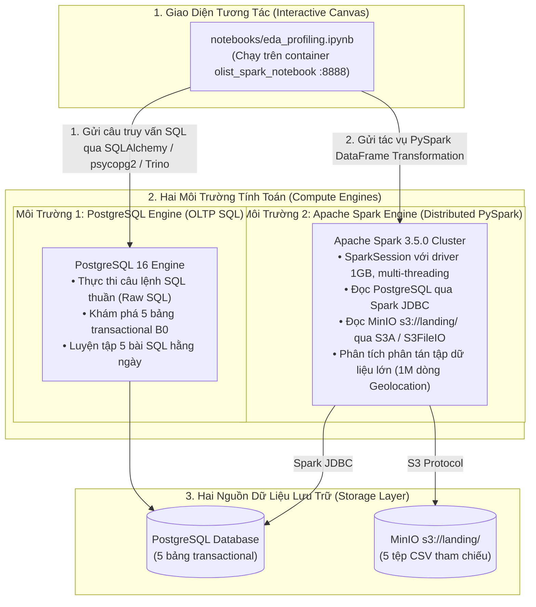

Container này tích hợp sẵn Apache Spark 3.5 (PySpark) và Jupyter Lab. Khi mở tệp notebook notebooks/eda.ipynb trên cổng localhost:8888, bạn đang sử dụng notebook như một "bảng điều khiển trung tâm" để làm việc với cả 2 môi trường tính toán:
