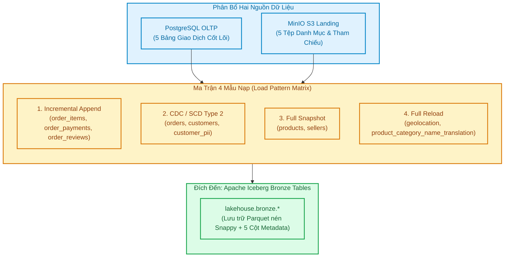
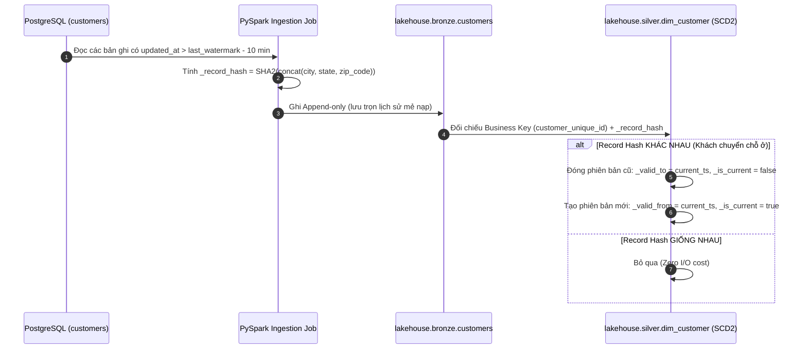
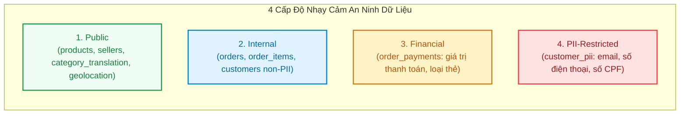

# Tài Liệu Thiết Kế Ma Trận Nạp Dữ Liệu & Khóa Nghiệp Vụ (Load Pattern Matrix & Business Keys Design)

> **Mô-đun:** Tuần 02 — Lab M1: Bước 4 (Thiết Kế Mẫu Nạp & Khóa Nghiệp Vụ)  
> **Tác giả:** Anh Tú (Pedagogical Approach)  
> **Tài liệu căn cứ:** [lab_syllabus_v2/00_PROJECT_OVERVIEW.md](file:///Users/anhtus/Documents/Development/DE/GRT_DA-DE/lab_syllabus_v2/00_PROJECT_OVERVIEW.md) & [docs/week02/05-load-patterns-and-watermarks.md](file:///Users/anhtus/Documents/Development/DE/GRT_DA-DE/docs/week02/05-load-patterns-and-watermarks.md)  
> **Phạm vi đối tượng:** 10 thực thể dữ liệu Olist Lakehouse (5 bảng PostgreSQL OLTP + 5 bảng MinIO S3 Landing)  

---

## 🧭 1. NGUYÊN TẮC THIẾT KẾ KIẾN TRÚC NẠP DỮ LIỆU

Trong một hệ sinh thái dữ liệu doanh nghiệp hiện đại, việc chọn chiến lược nạp dữ liệu (Ingestion Pattern) không thể dựa trên cảm tính. Một quyết định sai lầm có thể dẫn đến nghẽn mạng lúc nửa đêm, khóa bảng hệ thống bán hàng (OLTP lock), hoặc làm sai lệch các chỉ số tài chính sống còn.

Thiết kế nạp dữ liệu của dự án Olist Lakehouse tuân thủ **4 nguyên tắc vàng**:
1. **Ranh giới hai nguồn rõ ràng (Multi-Source Separation):**
   * **PostgreSQL OLTP:** Chỉ lưu trữ các bảng giao dịch tài chính và thực thể lõi biến động theo thời gian thực (`orders`, `order_items`, `order_payments`, `customers`, `customer_pii`).
   * **MinIO S3 Landing:** Lưu trữ các tệp danh mục tham chiếu, nhận xét và viễn thám không gian từ bên thứ ba (`products`, `sellers`, `order_reviews`, `geolocation`, `product_category_name_translation`).
2. **Khóa nghiệp vụ tự nhiên (Natural Business Keys):** Phân định rạch ròi giữa mã phiên checkout tạm thời (`customer_id`) và định danh thực thể con người vĩnh viễn (`customer_unique_id`).
3. **Phù hợp với tính bất biến của dữ liệu (Immutability Alignment):**
   * Dữ liệu sự kiện một khi đã phát sinh thì không thay đổi (như `order_payments`, `order_reviews`) ➔ Dùng **Append-only Incremental**.
   * Dữ liệu trạng thái có vòng đời thay đổi (như `orders`) ➔ Dùng **CDC / Iceberg MERGE INTO**.
4. **Phòng chống Vấn nạn Tệp Nhỏ (Small Files Prevention):** Tuyệt đối không phân vùng theo ngày đối với tập dữ liệu quy mô nhỏ (Olist ~136 đơn/ngày). Bảng `orders` phân vùng theo Tháng (`months(order_purchase_timestamp)`), các bảng còn lại không phân vùng (Unpartitioned).



---

## 📊 2. MA TRẬN NẠP DỮ LIỆU & KHÓA NGHIỆP VỤ (MASTER LOAD PATTERN MATRIX)

Bảng ma trận dưới đây là **bản hợp đồng kỹ thuật chuẩn mực** quy định chi tiết phương thức trích xuất, phát hiện thay đổi và mức độ nhạy cảm an ninh cho toàn bộ 10 thực thể:

| # | Tên Thực Thể | Đặt Ở Đâu | Số Dòng | Khóa Nghiệp Vụ (Business Key) | Mẫu Nạp (Load Pattern) | Cột Watermark | Chiến Lược Bắt Thay Đổi | Độ Nhạy Cảm | Lý Do Kỹ Thuật (Why) |
| :---: | :--- | :--- | :---: | :--- | :--- | :--- | :--- | :---: | :--- |
| **1** | `orders` | **PostgreSQL** | ~99.441 | `order_id` | **Incremental / CDC** | `updated_at` (hoặc `order_purchase_timestamp`) | Record Hash SHA-256 + Iceberg MERGE INTO | Internal | Đơn hàng chuyển trạng thái (`created` ➔ `shipped` ➔ `delivered`); cần cập nhật bản ghi mới nhất tại Silver nhưng giữ vết tại Bronze. |
| **2** | `order_items` | **PostgreSQL** | ~112.650 | `order_id, order_item_id` | **Append-only Incremental** | `shipping_limit_date` / `updated_at` | Composite Business Key | Internal | Chi tiết giỏ hàng sau khi đặt không bị sửa đổi; nạp tăng dần dựa theo ngày giới hạn giao hàng hoặc mốc cập nhật. |
| **3** | `order_payments` | **PostgreSQL** | ~103.886 | `order_id, payment_sequential` | **Append-only Incremental** | `updated_at` (theo batch) | Composite Business Key | Financial | Giao dịch quẹt thẻ/voucher mang tính lịch sử tài chính bất biến; nạp append-only để bảo toàn dòng tiền kiểm toán. |
| **4** | `customers` | **PostgreSQL** | ~99.441 | `customer_id` (+ `customer_unique_id`) | **CDC / SCD2** | `updated_at` | Record Hash trên địa chỉ (`city, state, zip`) | Internal | Khách hàng có thể chuyển nhà/đổi bang giữa các đơn hàng (Batch B1); cần theo dõi lịch sử biến đổi bằng SCD Type 2. |
| **5** | `customer_pii` | **PostgreSQL** | ~96.096 | `customer_unique_id` | **CDC / SCD2** | `updated_at` | HMAC-SHA256 Tokenization | **PII-Restricted** | Chứa họ tên, email, SĐT thật; bắt buộc băm token bằng HMAC với Secret Key ngay từ cửa ngõ Bronze để tuân thủ luật LGPD/GDPR. |
| **6** | `products` | **MinIO Landing** | ~32.951 | `product_id` | **Full snapshot** | File upload timestamp | Record Hash SHA-256 | Public | Danh mục tham chiếu từ bên thứ ba; dữ liệu ít biến động; nạp toàn bộ snapshot định kỳ giúp đối soát kho dễ dàng. |
| **7** | `sellers` | **MinIO Landing** | ~3.095 | `seller_id` | **Full snapshot** | File upload timestamp | Record Hash SHA-256 | Public | Quy mô cực nhỏ (3.095 dòng, < 500 KB); snapshot toàn bộ chỉ tốn chưa tới 1 giây xử lý. |
| **8** | `order_reviews` | **MinIO Landing** | ~100.000 | `review_id, order_id` | **Incremental theo file** | Batch file key / `review_creation_date` | Composite Business Key | Public | Nhận xét của khách gửi lên định kỳ theo từng tệp CSV; nạp tăng dần theo tên file batch để tránh đọc lặp lại. |
| **9** | `geolocation` | **MinIO Landing** | ~1.000.163 | `geolocation_zip_code_prefix` | **Full reload** | File upload timestamp | Khử trùng & Tính trọng tâm tọa độ (Centroid) | Public | Dữ liệu viễn thám tĩnh; 1 triệu dòng được nạp một lần duy nhất và gom nhóm tính trung bình tọa độ về 19.015 zip codes. |
| **10** | `product_category_name_translation` | **MinIO Landing** | ~71 | `product_category_name` | **Full reload** | N/A (Static mapping) | Ghi đè toàn bộ (Truncate & Overwrite) | Public | Bảng từ điển dịch thuật siêu nhỏ (71 dòng, vài KB); ghi đè hoàn toàn bảo đảm luôn khớp 100% với danh mục chuẩn. |

---

## 🔬 3. PHÂN TÍCH CHI TIẾT TỪNG MẪU NẠP (DEEP DIVE IMPLEMENTATION)

---

### 1. Mẫu 1: CDC / SCD Type 2 (`orders`, `customers`, `customer_pii`)



* **Cơ chế Watermark an toàn (Safe Lookback Window):**
  ```sql
  -- Truy vấn an toàn tránh lọt giao dịch commit trễ
  SELECT * FROM public.orders 
  WHERE updated_at >= (:last_watermark - INTERVAL '10 minutes');
  ```
* **Lý do áp dụng cho `orders`:** Đơn hàng Olist trải qua nhiều bước cập nhật (`order_approved_at`, `order_delivered_carrier_date`, `order_delivered_customer_date`). Áp dụng CDC giúp bảng Silver luôn phản ánh đúng thời điểm giao hàng mà không cần ghi đè toàn bộ bảng.
* **Lý do áp dụng cho `customers`:** Trong Batch B1 của dự án, một số khách hàng chuyển bang (ví dụ từ São Paulo sang Rio de Janeiro). Kỹ thuật SCD Type 2 cho phép bảo toàn lịch sử: Các đơn hàng cũ vẫn được ghi nhận ở bang cũ, còn các đơn hàng mới được tính doanh thu cho bang mới.

---

### 2. Mẫu 2: Append-Only Incremental (`order_items`, `order_payments`, `order_reviews`)

* **Đặc tính nghiệp vụ:**
  * Một khi khách hàng đã quẹt thẻ thanh toán (`order_payments`), giao dịch tài chính đó trở thành bằng chứng kiểm toán bất biến.
  * Tương tự, mỗi dòng sản phẩm trong giỏ hàng (`order_items`) hoặc một lời đánh giá (`order_reviews`) là các sự kiện chỉ sinh mới (Event Stream).
* **Cơ chế kỹ thuật:**
  * Tại tầng Bronze: Spark nạp thêm dữ liệu với chế độ `.mode("append")`.
  * Khử trùng lặp tại Silver: Sử dụng Composite Business Key kết hợp hàm cửa sổ:
    ```sql
    ROW_NUMBER() OVER (
        PARTITION BY order_id, order_item_id 
        ORDER BY _ingest_timestamp DESC
    ) AS rn
    ```

---

### 3. Mẫu 3: Full Snapshot (`products`, `sellers`)

* **Đặc tính nghiệp vụ:**
  * Bảng `products` (32.951 dòng) và `sellers` (3.095 dòng) là các bảng chiều tham chiếu (Reference Dimensions).
  * Quy mô dữ liệu nhỏ (< 5MB), tốc độ thay đổi chậm (Slowly Changing).
* **Cơ chế kỹ thuật:**
  * Thay vì xây dựng cơ chế CDC phức tạp tốn kém thời gian bảo trì, mỗi chu kỳ nạp (hằng ngày hoặc hằng tuần), hệ thống đọc toàn bộ tệp CSV mới nhất từ `s3://landing/ref/` và lưu thành một Snapshot mới trong Apache Iceberg.
  * Tận dụng tính năng **Time Travel** của Apache Iceberg để xem lại danh mục sản phẩm tại bất kỳ thời điểm nào trong quá khứ mà không tốn công cài đặt SCD Type 2 thủ công.

---

### 4. Mẫu 4: Full Reload / Spatial Aggregation (`geolocation`, `category_translation`)

* **Bảng dịch thuật ngữ (`category_translation`):**
  * Chỉ có đúng **71 dòng**.
  * Hành động: Xóa sạch và ghi đè (`.mode("overwrite")`). Đảm bảo độ trễ = 0 và luôn đồng bộ tuyệt đối với file dịch của đội ngũ sản phẩm.
* **Bảng tọa độ địa lý (`geolocation`):**
  * Chứa **1.000.163 dòng GPS thô**, nhưng chỉ đại diện cho **19.015 mã ZIP**.
  * Hành động: Tầng Bronze lưu trọn 1M dòng raw. Tầng Silver thực hiện tính toán tọa độ trọng tâm (Centroid):
    ```sql
    SELECT 
        geolocation_zip_code_prefix AS zip_code_prefix,
        ROUND(AVG(geolocation_lat), 6) AS latitude,
        ROUND(AVG(geolocation_lng), 6) AS longitude,
        MAX(geolocation_city) AS city,
        MAX(geolocation_state) AS state
    FROM lakehouse.bronze.geolocation
    GROUP BY geolocation_zip_code_prefix;
    ```
  * Kết quả thu về đúng **19.015 dòng duy nhất**, loại bỏ 100% rủi ro làm phình to dữ liệu (Fan-out) khi JOIN với khách hàng và nhà bán.

---

## 🔒 4. KHUNG PHÂN LOẠI AN NINH DỮ LIỆU (DATA SENSITIVITY GOVERNANCE)

Mọi trường dữ liệu đi qua đường ống nạp đều được gắn nhãn an ninh để kiểm soát quyền truy cập theo nguyên tắc tối thiểu (Principle of Least Privilege):



1. **`PII-Restricted` (Mức độ cao nhất):**
   * Áp dụng cho: Bảng `customer_pii` (`real_email, real_phone, real_cpf, real_name`).
   * Rào chắn: Bắt buộc mã hóa tokenization bằng **HMAC-SHA256 kết hợp Secret Key trong KMS** trước khi ghi vào Bronze. Chỉ DPO (Data Protection Officer) có quyền truy cập bảng gốc.
2. **`Financial` (Mức độ tài chính):**
   * Áp dụng cho: Bảng `order_payments` (`payment_value, payment_installments`).
   * Rào chắn: Giới hạn truy cập cho đội ngũ Kế toán và Analytics Core. Mọi dòng dữ liệu phải được lưu vết kiểm toán (Audit Trail) bất biến.
3. **`Internal` (Mức độ nội bộ):**
   * Áp dụng cho: `orders`, `order_items`, địa chỉ khách hàng trong `customers`.
   * Rào chắn: Mọi nhân viên nội bộ và nhà phân tích BI có tài khoản đều được truy vấn.
4. **`Public` (Mức độ công khai):**
   * Áp dụng cho: Danh mục sản phẩm, mã vùng bưu chính, danh mục tiếng Anh.
   * Rào chắn: Dữ liệu mở, có thể chia sẻ cho đối tác và công chúng.

---

## 📌 5. CHIẾN LƯỢC PHÂN VÙNG BẢNG BRONZE (PARTITION SPECIFICATION)

Để tránh **Vấn nạn Tệp Nhỏ (The Small Files Problem)** đã được phân tích tại [Module 05](file:///Users/anhtus/Documents/Development/DE/GRT_DA-DE/docs/week02/05-load-patterns-and-watermarks.md):

| Bảng Bronze | Chiến Lược Phân Vùng | Kích Thước File Kỳ Vọng | Lý Do Kỹ Thuật (Why) |
| :--- | :--- | :---: | :--- |
| `lakehouse.bronze.orders` | `PARTITIONED BY (months(order_purchase_timestamp))` | ~2.5 MB - 5 MB | 2 năm dữ liệu chỉ chia thành 24 partitions; query lọc theo tháng chỉ quét đúng 1 thư mục metadata. |
| `lakehouse.bronze.order_items` | `PARTITIONED BY (months(shipping_limit_date))` | ~3 MB - 6 MB | Giúp Trino quét nhanh các mặt hàng theo kỳ hạn giao hàng mà không quét toàn bảng. |
| **8 Bảng Còn Lại** | **KHÔNG PHÂN VÙNG (Unpartitioned)** | 1 File Parquet duy nhất / Bảng | Tổng dung lượng mỗi bảng < 15 MB. Phân vùng sẽ tạo ra hàng trăm file vài KB gây nghẽn Polaris Catalog! |

---
*Made by Anh Tu - Share to be share*
