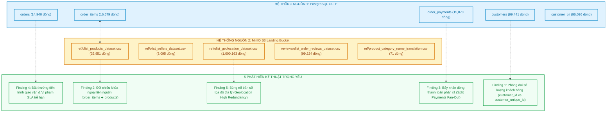
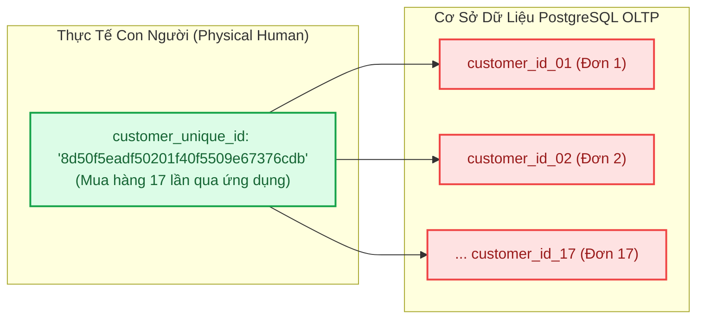
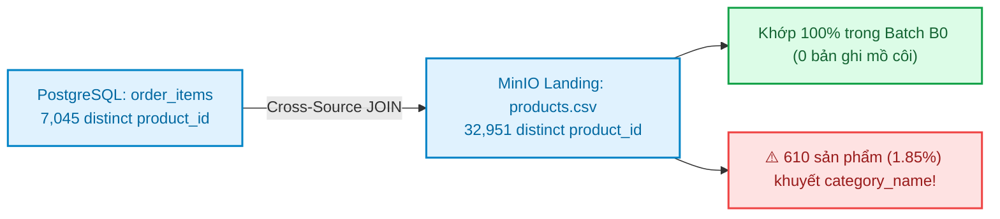
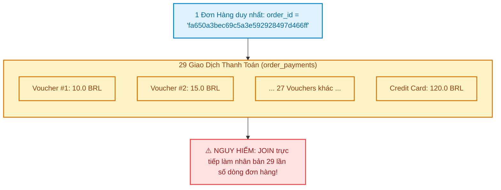
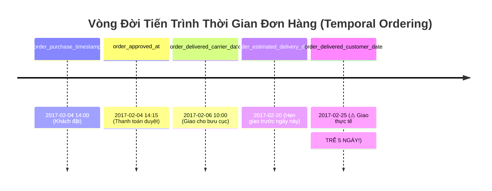
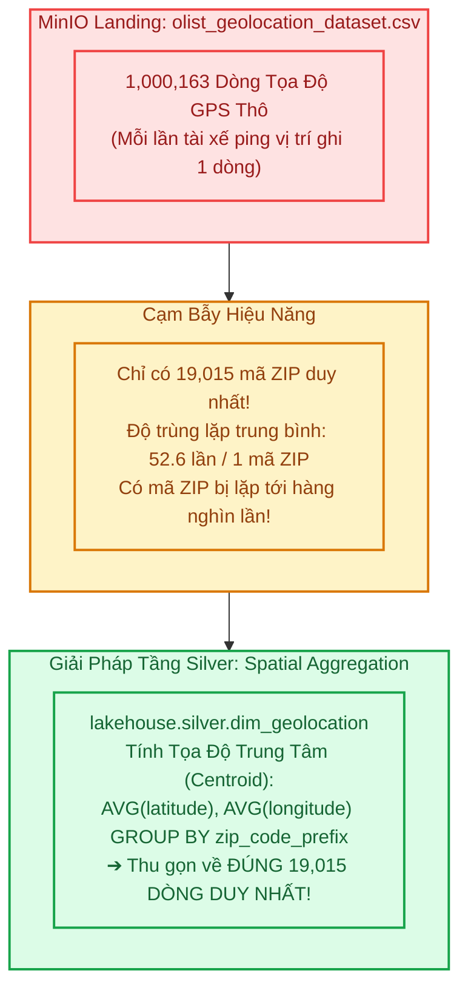

# Báo Cáo Khám Nghiệm Dữ Liệu Quan Hệ Đa Nguồn (Cross-Source Relational EDA Report)

> **Mô-đun:** Tuần 02 — Lab M1: Bước 3 (Phân Tích Quan Hệ Đa Nguồn)  
> **Tác giả:** Anh Tú (Pedagogical Approach)  
> **Phạm vi kiểm nghiệm:** 1.281.490 bản ghi từ 2 nguồn dữ liệu độc lập: **PostgreSQL OLTP (5 bảng)** và **MinIO S3 Landing (5 tệp CSV)**  
> **Tài liệu tham chiếu:** [docs/week02/requirements.md](file:///Users/anhtus/Documents/Development/DE/GRT_DA-DE/docs/week02/requirements.md) & [docs/week02/eda_summary.json](file:///Users/anhtus/Documents/Development/DE/GRT_DA-DE/docs/week02/eda_summary.json)  

---

## 🧭 1. TỔNG QUAN PHƯƠNG PHÁP KHÁM NGHIỆM

Trong kỹ nghệ dữ liệu phân tán (Data Engineering), kiểm thử tính toàn vẹn của từng bảng đơn lẻ chỉ là bước khởi đầu. Khi các thực thể đến từ **nhiều nguồn dị thể (Heterogeneous Sources)** — một phần nằm trong cơ sở dữ liệu giao dịch PostgreSQL và một phần là các tệp tĩnh lưu trữ trên Object Storage (MinIO S3) — những rủi ro chết người thường phát sinh tại **ranh giới liên kết khóa ngoại (Foreign Key Boundary)** và **độ lệch bản số (Cardinality Mismatch)**.

Báo cáo này tài liệu hóa **5 phát hiện kỹ thuật trọng điểm** thu được từ quy trình khám nghiệm tự động trên toàn bộ hệ thống nguồn, đóng vai trò là căn cứ thực chứng để thiết kế kiến trúc đường ống (Pipeline Architecture), mô hình dữ liệu (Gold Star Schema) và danh mục quy tắc chất lượng dữ liệu (Data Quality Catalog).



---

## 🔍 2. CHI TIẾT 5 PHÁT HIỆN QUAN HỆ KỸ THUẬT (THE 5 RELATIONAL FINDINGS)

---

### 📌 Phát Hiện 1: Hiện Tượng Phóng Đại Khách Hàng (Customer Key Inflation)



#### 1. Quantified Evidence (Hiện tượng định lượng)
* **Tổng số bản ghi trong bảng `customers`:** **99.441**.
* **Số lượng `customer_id` duy nhất:** **99.441** (Tỷ lệ duy nhất = 100.0%).
* **Số lượng `customer_unique_id` duy nhất:** **96.096** (Tỷ lệ duy nhất = 96.64%).
* **Chênh lệch định danh:** **3.345 khách hàng** quay lại mua sắm từ lần thứ 2 trở lên (Tỷ lệ phóng đại ảo: **3.36%**).
* **Khách hàng trung thành nhất:** Cá nhân có `customer_unique_id = '8d50f5eadf50201f40f5509e67376cdb'` đã thực hiện tới **17 đơn hàng độc lập** trên nền tảng Olist.

#### 2. Root Cause Analysis (Căn nguyên hệ thống)
* Kiến trúc microservices của Olist tách rời phiên giỏ hàng (Checkout Session) với hồ sơ cá nhân.
* Mỗi khi người dùng bấm "Đặt hàng", hệ thống thanh toán sinh ra một khóa giao dịch phiên tạm thời là `customer_id`.
* Trong khi đó, `customer_unique_id` mới là khóa định danh con người thật ngoài đời (liên kết với mã số thuế cá nhân CPF hoặc tài khoản xác thực).

#### 3. Business Impact (Tác động nghiệp vụ)
* **Nếu gom nhóm theo `customer_id`:** Báo cáo Marketing sẽ hiển thị 99.441 khách hàng và kết luận sai lầm rằng: *100% người dùng Olist chỉ mua hàng đúng 1 lần rồi bỏ đi!*
* **Tê liệt mô hình LTV & RFM:** Tần suất mua hàng (Frequency) của mọi khách hàng đều bằng 1. Tỷ lệ giữ chân khách hàng (Retention Rate) bị kéo về 0%, và Giá trị vòng đời khách hàng (LTV) bị xé nhỏ vụn, làm sai lệch toàn bộ chiến lược phân bổ ngân sách quảng cáo của công ty.

#### 4. Pipeline Action (Giải pháp kỹ thuật Pipeline)
* **Tầng Gold (`dim_customer`):** Khóa tự nhiên của bảng chiều khách hàng BẮT BUỘC phải là `customer_unique_id`.
* **Khóa thay thế (Surrogate Key Resolution):** Trong bảng sự kiện `fact_order_item`, trường `customer_sk` được ánh xạ bằng cách tra cứu từ `orders.customer_id` ➔ `customers.customer_unique_id` ➔ `dim_customer.customer_sk`.

---

### 📌 Phát Hiện 2: Đối Chiếu Khóa Ngoại Liên Nguồn (Cross-Source Isolation & Catalog Coverage)



#### 1. Quantified Evidence (Hiện tượng định lượng)
* **Số lượng `product_id` trong `order_items` (PostgreSQL):** **7.045 mã sản phẩm**.
* **Số lượng `product_id` trong danh mục `products` (MinIO S3):** **32.951 mã sản phẩm**.
* **Độ lệch khóa ngoại (Set Difference):** **0 mã sản phẩm bị thiếu** (`pg_products - s3_products = ∅`). 100% sản phẩm được giao dịch trong đợt nạp `batch_B0` đều tồn tại trong tệp danh mục của MinIO S3.
* **Bất thường danh mục:** Có **610 sản phẩm (~1.85%)** trong tệp S3 bị `product_category_name IS NULL`.

#### 2. Root Cause Analysis (Căn nguyên hệ thống)
* Danh mục sản phẩm được quản lý bởi hệ thống quản lý kho của bên thứ ba (Third-party Catalog Management) và đồng bộ định kỳ lên Object Storage dưới dạng CSV.
* Nhà bán hàng (Sellers) khi đăng bán sản phẩm mới được phép bỏ trống trường phân loại ngành hàng, dẫn đến 610 sản phẩm khuyết danh mục tiếng Bồ Đào Nha, và do đó không thể ánh xạ sang tiếng Anh qua bảng `product_category_name_translation`.

#### 3. Business Impact (Tác động nghiệp vụ)
* Khi nhà phân tích (DA) viết câu lệnh `INNER JOIN` giữa bảng đơn hàng và bảng dịch danh mục để báo cáo GMV theo ngành hàng, toàn bộ doanh thu của 610 sản phẩm này sẽ bị bốc hơi khỏi báo cáo tài chính!

#### 4. Pipeline Action (Giải pháp kỹ thuật Pipeline)
* **Xử lý Late-Arriving Dimension:** Thiết kế dòng mặc định trong `dim_product` với `product_sk = -1`, `product_category_name = 'unknown'` và `product_category_english = 'unknown'`.
* **Phép JOIN an toàn:** Khi chuyển đổi từ Silver sang Gold, bắt buộc dùng `LEFT JOIN` và hàm `COALESCE(cat_eng, 'unknown')` để bảo toàn 100% doanh thu.

---

### 📌 Phát Hiện 3: Bẫy Nhân Dòng Do Thanh Toán Phân Rã (Split Payments Fan-Out)



#### 1. Quantified Evidence (Hiện tượng định lượng)
* **Tổng số giao dịch thanh toán trong `order_payments`:** **15.870 dòng** đại diện cho **14.939 đơn hàng**.
* **Số đơn hàng thanh toán bằng nhiều giao dịch/nhiều voucher:** **548 đơn hàng (3.67%)**.
* **Đơn hàng có số lần thanh toán kỷ lục:** Đơn hàng `order_id = 'fa650a3bec69c5a3e592928497d466ff'` được thanh toán bằng **29 giao dịch phân rã** (28 phiếu voucher giảm giá nhỏ kết hợp thẻ tín dụng).
* **Giao dịch 0 đồng:** Có **9 bản ghi có `payment_value = 0.0 BRL`** do sử dụng voucher bao tiêu 100%.

#### 2. Root Cause Analysis (Căn nguyên hệ thống)
* Nền tảng Olist cho phép người mua kết hợp nhiều hình thức thanh toán (Split Payments): Vừa quẹt thẻ tín dụng, vừa dùng điểm thưởng tích lũy (Voucher), vừa trả góp (Installments).

#### 3. Business Impact (Tác động nghiệp vụ)
* **Hiện tượng bùng nổ bản ghi (Cartesian Fan-Out):** Nếu kỹ sư thiếu kinh nghiệm thực hiện phép `JOIN` trực tiếp giữa `orders`, `order_items` và `order_payments` ở cấp độ dòng:
  * Một đơn hàng có 3 sản phẩm và 29 phương thức thanh toán sẽ bị bùng nổ thành: $3 \times 29 = \mathbf{87\text{ dòng dữ liệu}}$!
  * Doanh thu của đơn hàng này trên dashboard sẽ bị nhân khống lên gấp nhiều lần, gây sai lệch nghiêm trọng báo cáo tài chính kiểm toán.

#### 4. Pipeline Action (Giải pháp kỹ thuật Pipeline)
* **Tách rời Fact:** Bảng `order_payments` được mô hình hóa thành một bảng Fact riêng biệt (`fact_payment`) hoặc được tổng hợp trước (Pre-aggregated) về cấp độ đơn hàng (`order_id`) trước khi đưa vào bảng tổng hợp.
* **Quy tắc DQ:** Chấp nhận `payment_value >= 0` (cho phép số 0 đối với loại thanh toán voucher).

---

### 📌 Phát Hiện 4: Bất Thường Tiến Trình Giao Vận & Vi Phạm SLA Trễ Hạn (Delivery Delay SLA)



#### 1. Quantified Evidence (Hiện tượng định lượng)
* **Tổng số đơn hàng có trạng thái `delivered`:** **14.199 đơn hàng**.
* **Số đơn hàng giao trễ hạn so với ngày ước tính:** **652 đơn hàng (~4.59%)** có `order_delivered_customer_date > order_estimated_delivery_date`.
* **Khoảng thời gian giao hàng dài nhất:** Có đơn hàng mất tới **150 ngày** vận chuyển qua các vùng sâu vùng xa tại Brazil.
* **Khuyết ngày giao:** Có **736 đơn hàng** chưa có `order_delivered_customer_date` (trong đó có 5 đơn trạng thái `delivered` nhưng thiếu ngày ghi nhận, và 731 đơn đang xử lý/vận chuyển).

#### 2. Root Cause Analysis (Căn nguyên hệ thống)
* Olist hoạt động trên toàn lãnh thổ Brazil — một quốc gia rộng lớn với cơ sở hạ tầng giao thông không đồng đều giữa vùng Đông Nam giàu có (São Paulo, Rio) và khu vực rừng Amazon hẻo lánh phía Bắc.
* Các sự cố bãi công bưu chính, ngập lụt mùa mưa hoặc địa chỉ khách hàng khó tiếp cận gây ra hiện tượng giao trễ hạn so với thuật toán ước tính ban đầu.

#### 3. Business Impact (Tác động nghiệp vụ)
* Đơn giao trễ là nguyên nhân số một khiến điểm đánh giá hài lòng của khách hàng (Review Score) tụt dốc thảm hại (1 sao - 2 sao), làm gia tăng tỷ lệ khiếu nại và đòi bồi hoàn tiền hàng.

#### 4. Pipeline Action (Giải pháp kỹ thuật Pipeline)
* **Bổ sung cờ chỉ báo SLA:** Tại bảng `fact_order_item` tầng Gold, bổ sung cột phái sinh:
  `is_late_delivery = CASE WHEN order_delivered_customer_date > order_estimated_delivery_date THEN TRUE ELSE FALSE END`
* **Đo lường độ trễ:** Bổ sung trường đo lường `delivery_delay_days = DATEDIFF(order_delivered_customer_date, order_estimated_delivery_date)` phục vụ báo cáo chất lượng logistics.
* **Bộ lọc DQ:** Bắt buộc áp dụng kiểm tra logic thời gian: `order_delivered_customer_date >= order_purchase_timestamp`.

---

### 📌 Phát Hiện 5: Bùng Nổ Bản Số Tọa Độ Địa Lý (Geolocation Spatial Redundancy)



#### 1. Quantified Evidence (Hiện tượng định lượng)
* **Tổng số dòng dữ liệu trong `geolocation`:** **1.000.163 dòng**.
* **Số lượng mã bưu chính (`geolocation_zip_code_prefix`) duy nhất:** **19.015 mã ZIP**.
* **Hệ số dư thừa dữ liệu (Redundancy Factor):** Trung bình **52.6 tọa độ GPS thô cho mỗi mã bưu chính**! Một số mã ZIP tại trung tâm thành phố São Paulo bị lặp lại tới hơn **1.100 lần**.

#### 2. Root Cause Analysis (Căn nguyên hệ thống)
* Tệp `geolocation` là dữ liệu vết di chuyển (Telemetry / GPS Pings) được thu thập từ ứng dụng của các tài xế giao hàng khi đi qua các tuyến phố khác nhau trong cùng một khu vực bưu điện.

#### 3. Business Impact (Tác động nghiệp vụ)
* Nếu kỹ sư nạp thẳng 1 triệu dòng này vào bảng Dimension rồi thực hiện `LEFT JOIN` với bảng khách hàng (`customers`) theo `zip_code_prefix`, mỗi khách hàng sẽ bị nhân bản lên trung bình 52 lần! Bảng dữ liệu sẽ phình to ra hàng chục triệu dòng, làm sập bộ nhớ Spark và phá hủy hoàn toàn tính chính xác của các báo cáo doanh thu.

#### 4. Pipeline Action (Giải pháp kỹ thuật Pipeline)
* **Khử trùng lặp và tính trọng tâm không gian (Centroid Aggregation):** Tại tầng Silver, bảng `dim_geolocation` BẮT BUỘC phải thực hiện gom nhóm tính trung bình tọa độ:
  ```sql
  SELECT 
      geolocation_zip_code_prefix,
      AVG(geolocation_lat) AS latitude,
      AVG(geolocation_lng) AS longitude,
      MAX(geolocation_city) AS city,
      MAX(geolocation_state) AS state
  FROM lakehouse.bronze.geolocation
  GROUP BY geolocation_zip_code_prefix;
  ```
* **Kết quả tối ưu:** Thu nhỏ tập dữ liệu từ **1.000.163 dòng xuống đúng 19.015 dòng duy nhất** (tiết kiệm 98.1% dung lượng và triệt tiêu 100% rủi ro nhân bản dòng).

---

## 📋 3. BẢNG TỔNG HỢP MA TRẬN 5 PHÁT HIỆN & HÀNH ĐỘNG HẠ TẦNG

| # | Phát Hiện Kỹ Thuật | Phạm Vi Nguồn | Số Liệu Thực Chứng | Rủi Ro Nghiệp Vụ Nếu Bỏ Qua | Hành Động Kỹ Thuật Pipeline |
| :---: | :--- | :--- | :--- | :--- | :--- |
| **1** | **Customer Key Inflation** | PostgreSQL OLTP | 99.441 `customer_id` vs 96.096 `customer_unique_id` (Lệch 3.36%) | LTV và RFM sai lệch hoàn toàn; hiểu nhầm 100% khách chỉ mua 1 lần. | Dùng `customer_unique_id` làm khóa tự nhiên trong `dim_customer`. |
| **2** | **Cross-Source Integrity** | Postgres + MinIO S3 | 7.045 / 7.045 products khớp 100%; 610 sản phẩm khuyết category (1.85%). | Thất thoát doanh thu của 610 sản phẩm khi JOIN danh mục ngành hàng. | `LEFT JOIN` + `COALESCE(cat, 'unknown')` + dòng Fallback SK = -1. |
| **3** | **Split Payments Fan-Out** | PostgreSQL OLTP | 548 đơn thanh toán nhiều lần; kỷ lục 29 vouchers/đơn; 9 đơn 0 đồng. | Bùng nổ bản ghi Cartesian làm nhân khống doanh thu trên dashboard. | Tách riêng Fact thanh toán hoặc tổng hợp trước về cấp độ `order_id`. |
| **4** | **Delivery Delay SLA** | PostgreSQL OLTP | 652 / 14.199 đơn giao trễ (4.59%); vận chuyển tối đa 150 ngày. | Không đo lường được hiệu quả đối tác vận chuyển; khách hàng rời bỏ. | Sinh cờ `is_late_delivery` và chỉ số `delivery_delay_days` tại Gold. |
| **5** | **Geolocation Redundancy** | MinIO Landing S3 | 1.000.163 dòng GPS thô đại diện cho đúng 19.015 mã ZIP (Thừa 52.6x). | Nhân bản dữ liệu khách hàng gấp 52 lần; sập bộ nhớ RAM phân tán. | Tính trọng tâm không gian `AVG(lat), AVG(lng)` gom về 19.015 dòng. |

---
*Made by Anh Tu - Share to be share*
