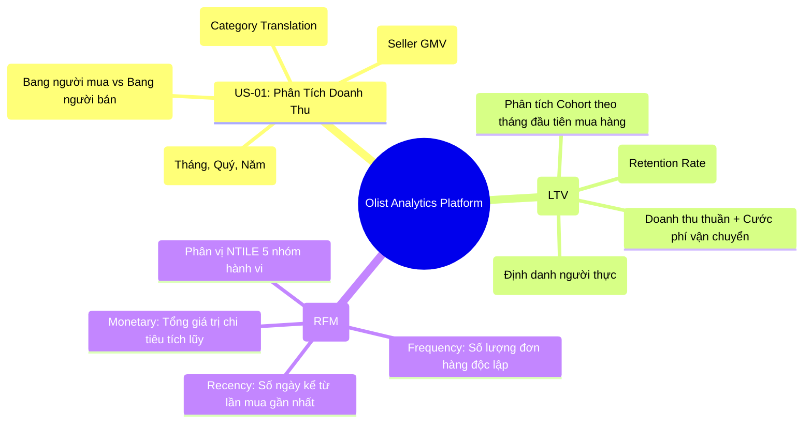

# Yêu Cầu Nghiệp Vụ Olist Analytics Platform (Business Requirements)

> **Mô-đun:** Tuần 02 — Lab M1 (Phân Tích Dữ Liệu & Thiết Kế Pipeline)  
> **Tác giả:** Anh Tú (Pedagogical Approach)  
> **Đối tượng thụ hưởng:** Data Engineers, Data Analysts, Business Stakeholders  
> **Tài liệu căn cứ:** [lab_syllabus_v2/week02.md](file:///Users/anhtus/Documents/Development/DE/GRT_DA-DE/lab_syllabus_v2/week02.md) & [00_PROJECT_OVERVIEW.md](file:///Users/anhtus/Documents/Development/DE/GRT_DA-DE/lab_syllabus_v2/00_PROJECT_OVERVIEW.md)  

---

## 🧭 1. TỔNG QUAN BỐI CẢNH KINH DOANH (BUSINESS CONTEXT)

Olist là nền tảng thương mại điện tử hàng đầu tại Brazil, đóng vai trò là giải pháp tập trung (Store-in-Store Marketplace) giúp các doanh nghiệp vừa và nhỏ (SMBs / Sellers) kết nối và bán hàng đồng thời trên nhiều sàn thương mại điện tử lớn (như Mercado Livre, B2W, Amazon).

Để tối ưu hóa vận hành, giữ chân khách hàng và phân bổ ngân sách tiếp thị hiệu quả, Ban Lãnh đạo Olist (C-Level Executive) đặt ra **3 bài toán kinh doanh trọng yếu** mà nền tảng Data Lakehouse bắt buộc phải trả lời:
1. **Doanh thu:** Doanh thu tăng trưởng theo từng tháng, từng bang và từng ngành hàng là bao nhiêu? Đơn vị bán hàng (Seller) nào đóng góp tỷ trọng lớn nhất?
2. **Giá trị vòng đời (LTV):** Khách hàng sau khi mua đơn đầu tiên mang lại bao nhiêu giá trị trong 6, 12, 24 tháng tiếp theo (Cohort Analysis)?
3. **Phân khúc khách hàng (RFM):** Làm thế nào để tự động nhận diện nhóm khách hàng VIP (Champions), nhóm tiềm năng (Loyal), và nhóm có nguy cơ rời bỏ (At-Risk) để kích hoạt chiến dịch tiếp thị tự động?

---

## 📋 2. CHI TIẾT CÁC USER STORIES & TIÊU CHÍ NGHIỆM THU (ACCEPTANCE CRITERIA)

---

### 🔹 US-01: Báo Cáo Doanh Thu Đa Chiều (Revenue Analytics by Time, Category, Seller)

* **User Story:**  
  *Là* Giám đốc Kinh doanh (Head of Commercial / Sales Director),  
  *Tôi muốn* có một báo cáo số liệu doanh thu hợp nhất có thể phân bổ linh hoạt theo trục thời gian, bang địa lý, danh mục ngành hàng và nhà bán hàng,  
  *Để tôi có thể* đánh giá chính xác tốc độ tăng trưởng doanh số, nhận diện các danh mục mũi nhọn và phát hiện sớm các thị trường suy giảm nhằm điều chỉnh chiến lược hợp tác thương mại.

#### Tiêu chí nghiệm thu (Acceptance Criteria — Given-When-Then):
* **AC-01.1 (Bộ lọc trạng thái đơn hàng hợp lệ):**  
  * **Given** bảng dữ liệu giao dịch `orders` và `order_items`,  
  * **When** thực hiện tính toán doanh thu bán hàng,  
  * **Then** hệ thống CHỈ tính các đơn hàng có trạng thái `order_status = 'delivered'` (đã giao thành công). Các đơn hàng bị hủy (`canceled`) hoặc không hoàn thành (`unavailable`) phải được loại trừ khỏi doanh thu thực tế.
* **AC-01.2 (Công thức tính các chỉ số tài chính):**  
  * **Given** danh sách các mặt hàng trong đơn hàng hợp lệ,  
  * **When** tổng hợp số liệu tài chính,  
  * **Then** hệ thống phải phân định rõ 3 chỉ số đo lường:  
    1. **Doanh thu hàng hóa (Gross Merchandise Value - GMV / Item Sales):** $GMV = \sum(item\_price)$.  
    2. **Tổng cước vận chuyển (Freight Value):** $Freight = \sum(freight\_value)$.  
    3. **Tổng giá trị đơn hàng (Total Order Value):** $Total = GMV + Freight$.
* **AC-01.3 (Phân bổ chính xác theo Nhà bán hàng - Seller Attribution):**  
  * **Given** một đơn hàng chứa nhiều sản phẩm từ nhiều nhà bán hàng khác nhau (`seller_id`),  
  * **When** tính toán doanh thu theo nhà bán hàng,  
  * **Then** doanh thu của từng mặt hàng (`item_price`) phải được gán chính xác về đúng `seller_id` của mặt hàng đó, tuyệt đối không phân bổ cào bằng theo cấp đơn hàng.
* **AC-01.4 (Chuẩn hóa danh mục sản phẩm):**  
  * **Given** mã danh mục gốc tiếng Bồ Đào Nha (`product_category_name`),  
  * **When** kết xuất báo cáo ngành hàng cho quản lý quốc tế,  
  * **Then** hệ thống phải ánh xạ sang tên tiếng Anh chuẩn (`product_category_name_english`) thông qua bảng tham chiếu dịch thuật từ MinIO Landing. Nếu sản phẩm bị thiếu danh mục, gán nhãn là `'Unknown'`.

---

### 🔹 US-02: Phân Tích Giá Trị Vòng Đời Khách Hàng (Customer Lifetime Value - LTV Cohort)

* **User Story:**  
  *Là* Trưởng phòng Tiếp thị Tăng trưởng (Head of Growth & Retention),  
  *Tôi muốn* theo dõi chỉ số LTV tích lũy của từng nhóm khách hàng (Cohort) theo từng tháng kể từ thời điểm họ thực hiện đơn hàng đầu tiên,  
  *Để tôi có thể* xác định ngân sách chi phí thu hút khách hàng tối đa (Customer Acquisition Cost - CAC) bảo đảm tỷ lệ $LTV / CAC > 3.0$ mang lại lợi nhuận bền vững.

#### Tiêu chí nghiệm thu (Acceptance Criteria — Given-When-Then):
* **AC-02.1 (Ràng buộc định danh người dùng thực tế - Crucial Business Key):**  
  * **Given** tập dữ liệu khách hàng Olist,  
  * **When** nhóm các giao dịch mua hàng để tính vòng đời một khách,  
  * **Then** hệ thống BẮT BUỘC phải nhóm theo trường `customer_unique_id` (định danh người thực), TUYỆT ĐỐI KHÔNG dùng `customer_id` (mã giao dịch đơn lẻ).  
  *(Giải phẫu lý do: Một khách hàng thực tế mua 5 lần sẽ có 5 `customer_id` khác nhau nhưng chỉ có 1 `customer_unique_id` duy nhất).*
* **AC-02.2 (Xác định Tháng thuần tập - Cohort Month):**  
  * **Given** một khách hàng có định danh `customer_unique_id`,  
  * **When** xác định nhóm thuần tập cho khách hàng đó,  
  * **Then** Cohort Month được tính là tháng của đơn hàng giao thành công đầu tiên:  
    $$Cohort\_Month = \text{DATE\_TRUNC}('month', \min(order\_purchase\_timestamp))$$
* **AC-02.3 (Tính toán LTV lũy kế theo tuổi thọ Cohort):**  
  * **Given** tháng của đơn hàng mua tiếp theo và Cohort Month của khách hàng,  
  * **When** tính tuổi thọ giao dịch ($Age\_Month = \text{Datediff}(month, Cohort\_Month, Order\_Month)$),  
  * **Then** $LTV(\text{Cohort}, m)$ là giá trị chi tiêu trung bình tích lũy tính trên toàn bộ số lượng khách hàng ban đầu của Cohort đó từ tháng 0 đến tháng $m$:  
    $$LTV(m) = \frac{\sum_{i=0}^{m} \text{Doanh thu phát sinh tại tháng } i}{\text{Tổng số khách hàng của Cohort}}$$
* **AC-02.4 (Bảo vệ dữ liệu cá nhân - PII Compliance):**  
  * **Given** báo cáo phân tích LTV,  
  * **When** các nhà phân tích dữ liệu (DA/BI) truy vấn thông tin khách hàng,  
  * **Then** hệ thống KHÔNG ĐƯỢC để lộ email, số điện thoại thô (raw PII). Mọi định danh liên hệ phải được hiển thị dưới dạng mã token đã băm bảo mật bằng `HMAC-SHA256`.

---

### 🔹 US-03: Phân Khúc Khách Hàng Tự Động Theo Mô Hình RFM (Recency - Frequency - Monetary)

* **User Story:**  
  *Là* Chuyên viên Quản trị Trải nghiệm Khách hàng (CRM & Loyalty Specialist),  
  *Tôi muốn* tự động chấm điểm và phân loại toàn bộ khách hàng thành các phân khúc hành vi RFM định kỳ hằng tuần,  
  *Để tôi có thể* kích hoạt các kịch bản gửi voucher kích cầu cho nhóm có nguy cơ rời bỏ (At-Risk) và chương trình tri ân đặc quyền cho nhóm khách hàng giá trị cao (VIP Champions).

#### Tiêu chí nghiệm thu (Acceptance Criteria — Given-When-Then):
* **AC-03.1 (Đo lường Recency - Thời gian mua gần nhất):**  
  * **Given** ngày mốc phân tích (Snapshot Date $T_{now}$),  
  * **When** tính chỉ số Recency ($R$) cho mỗi `customer_unique_id`,  
  * **Then** $R$ là số ngày tính từ ngày đặt hàng của đơn hàng thành công gần nhất đến $T_{now}$:  
    $$R = \text{DATEDIFF}('day', \max(order\_purchase\_timestamp), T_{now})$$
* **AC-03.2 (Đo lường Frequency - Tần suất giao dịch):**  
  * **Given** toàn bộ lịch sử mua sắm của một khách hàng,  
  * **When** tính chỉ số Frequency ($F$),  
  * **Then** $F$ là tổng số đơn hàng độc lập giao thành công:  
    $$F = \text{COUNT}(\text{DISTINCT } order\_id)$$
* **AC-03.3 (Đo lường Monetary - Tổng mức chi tiêu):**  
  * **Given** toàn bộ các mặt hàng được mua bởi khách hàng,  
  * **When** tính chỉ số Monetary ($M$),  
  * **Then** $M$ là tổng số tiền khách hàng đã thanh toán thành công (Bao gồm cả giá hàng và phí ship):  
    $$M = \sum(item\_price + freight\_value)$$
* **AC-03.4 (Phân vị điểm số 1–5 và Gán nhãn phân khúc):**  
  * **Given** các chỉ số thô $R, F, M$ của toàn bộ tập khách hàng,  
  * **When** xếp hạng và chuẩn hóa theo phân vị 5 nhóm (`NTILE(5)`),  
  * **Then** hệ thống tính điểm $R\_Score, F\_Score, M\_Score \in [1..5]$ (trong đó $R$ thấp hơn thì điểm cao hơn; $F, M$ cao hơn thì điểm cao hơn), và gán nhãn phân khúc theo ma trận nghiệp vụ chuẩn:
    - **VIP Champions ($R \ge 4, F \ge 4, M \ge 4$):** Mua thường xuyên, chi tiêu khủng, mua gần đây.
    - **Khách hàng tiềm năng / Loyal ($F \ge 3, M \ge 3$):** Phản hồi tốt với các khuyến mãi.
    - **Khách hàng mới ($R \ge 4, F = 1$):** Cần kịch bản chào mừng onboarding.
    - **Nguy cơ rời bỏ / At-Risk ($R \le 2, F \ge 2$):** Đã từng mua nhiều nhưng lâu rồi không quay lại.
    - **Đã rời bỏ / Lost ($R = 1, F = 1, M \le 2$):** Giá trị thấp, ngừng giao dịch.

---

## ⚖️ 3. PHÂN TÍCH ĐÁNH ĐỔI & ẢNH HƯỞNG THIẾT KẾ DATA PIPELINE (TRADE-OFF ANALYSIS)

| Quyết Định Nghiệp Vụ | Giải Pháp Lựa Chọn | Đánh Đổi Kỹ Thuật (Engineering Trade-off) | Ảnh Hưởng Tới Thiết Kế Data Model (Task 6) |
|:---|:---|:---|:---|
| **Grain của bảng Fact** | Chọn **Order Item Grain** (1 dòng = 1 mặt hàng). | Số lượng dòng trong bảng Fact tăng từ ~99k (cấp đơn) lên ~112k dòng. Cần lưu trữ nhiều hơn. | **Quyết định đúng đắn:** Chỉ có cấp Order Item mới thỏa mãn cả US-01 (doanh thu theo category, seller) và US-02/03 (LTV, RFM). |
| **Xử lý Đơn Hàng Hủy** | Lọc bỏ ở tầng Gold (`order_status = 'delivered'`). | Tầng Bronze và Silver vẫn lưu trữ nguyên vẹn các đơn `canceled`/`unavailable`. | Giúp duy trì tính kiểm toán (Auditability) ở tầng Bronze/Silver, chỉ áp dụng bộ lọc nghiệp vụ khi phục vụ báo cáo tầng Gold. |
| **Xử lý Khách Hàng Trùng Lặp** | Sử dụng `customer_unique_id` làm khóa tự nhiên trong Dimension. | Cần cơ chế ánh xạ giữa `customer_id` (tại fact) sang `customer_unique_id` (tại dim_customer). | Xây dựng bảng `dim_customer` hỗ trợ SCD Type 2 để theo dõi cả lịch sử thay đổi địa chỉ của khách hàng. |

---

## 🔗 4. MA TRẬN TRUY XUẤT NGUỒN GỐC (REQUIREMENTS TRACEABILITY MATRIX - RTM)

| Mã Yêu Cầu | Tên Yêu Cầu Nghiệp Vụ | Nguồn Dữ Liệu Đầu Vào | Tầng Xử Lý Tương Ứng | Bảng Đích Cuối Cùng |
|:---:|:---|:---|:---|:---|
| **US-01** | Báo cáo Doanh thu Đa Chiều | PostgreSQL (`orders`, `order_items`) + MinIO Landing (`products`, `sellers`, `translation`) | Silver ➔ Gold | `fact_order_item`, `dim_product`, `dim_seller`, `dim_date` |
| **US-02** | Phân Tích LTV theo Cohort | PostgreSQL (`orders`, `order_items`, `customers`) | Silver ➔ Gold | `fact_order_item`, `dim_customer` (SCD2) |
| **US-03** | Phân Khúc Khách Hàng RFM | PostgreSQL (`orders`, `order_items`, `order_payments`, `customers`) | Gold Data Mart | `mart_rfm_customer_segments` |

---
*Made by Anh Tu - Share to be share*
