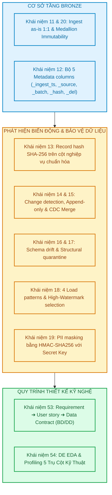

# Tổng Hợp Cơ Sở Lý Thuyết Tầng Bronze — Khái Niệm 11 Đến 20 (Bronze Layer Theory)

> **Mô-đun:** Tuần 02 — Lab M1: Lý Thuyết Nền Tảng Tầng Bronze  
> **Tác giả:** Anh Tú (Pedagogical Approach)  
> **Bộ tài liệu chi tiết (8 Modules):** Tham khảo bộ tài liệu chuẩn mực tại [docs/week02/01-bronze-layer-fundamentals.md](file:///Users/anhtus/Documents/Development/DE/GRT_DA-DE/docs/week02/01-bronze-layer-fundamentals.md) đến [docs/week02/08-week02-interview-cheatsheet.md](file:///Users/anhtus/Documents/Development/DE/GRT_DA-DE/docs/week02/08-week02-interview-cheatsheet.md)  

---

## 🧭 1. TỔNG QUAN HỆ THỐNG KHÁI NIỆM TUẦN 02

Tài liệu này đóng vai trò là bản đồ lý thuyết tổng hợp toàn bộ 10 khái niệm cốt lõi (Khái niệm 11 – 20, 53, 54) của Tuần 02, được giải phẫu theo tiêu chuẩn sư phạm của Anh Tú:
1. **Definition Anatomy:** Định nghĩa chuẩn học thuật và giải phẫu từ khóa.
2. **Root Cause Analysis:** Lý giải lịch sử phát triển và vấn đề công nghệ giải quyết.
3. **Trade-Off Analysis:** Đánh đổi kỹ thuật giữa các giải pháp.
4. **Mã nguồn minh họa:** Code mẫu sạch có chú thích *Tại sao (Why)*.

---

## 📚 2. CHI TIẾT 10 KHÁI NIỆM LÝ THUYẾT TRỌNG TÂM

---

### 🔹 Khái niệm 11 & 20: Ingest As-Is 1:1 & Bản Chất Tầng Bronze Trong Medallion
* **Chi tiết tại:** [Module 01: Bronze Layer Foundations](file:///Users/anhtus/Documents/Development/DE/GRT_DA-DE/docs/week02/01-bronze-layer-fundamentals.md)
* **Definition Anatomy:** **Ingest as-is (Nạp nguyên trạng 1:1)** là nguyên lý cốt lõi của tầng Bronze trong kiến trúc Lakehouse, quy định rằng dữ liệu từ hệ thống nguồn phải được thu nạp vào hồ dữ liệu mà không trải qua bất kỳ biến đổi ngữ nghĩa, ép kiểu dữ liệu (no casting), đổi tên trường (no renaming) hay loại bỏ bản ghi (no filtering) nào.
* **Root Cause & Lợi ích:** 
  * Khắc phục nhược điểm của bảng Staging truyền thống thường xuyên bị `TRUNCATE` làm mất lịch sử.
  * Bảo đảm tính toàn vẹn 100% của nguồn cội sự thật (Raw Truth) và mang lại khả năng **Tái lập dữ liệu (Data Replayability)**: Khi logic nghiệp vụ tầng Gold/Silver thay đổi, ta chỉ việc chạy lại từ Bronze mà không cần dump lại từ nguồn.
* **Ngoại lệ duy nhất:** Mã hóa bảo vệ thông tin định danh cá nhân (**PII Masking**) ngay tại ranh giới Ingestion để tuân thủ pháp luật (LGPD/GDPR).

---

### 🔹 Khái niệm 12: Bộ 5 Cột Siêu Dữ Liệu Kỹ Thuật (Metadata Columns)
* **Chi tiết tại:** [Module 02: Metadata Columns & Tracing Data Lineage](file:///Users/anhtus/Documents/Development/DE/GRT_DA-DE/docs/week02/02-metadata-columns-and-lineage.md)
* **Definition Anatomy:** **Metadata columns (Cột siêu dữ liệu kỹ thuật)** là tập hợp các trường hệ thống được sinh tự động trong quá trình nạp, gắn với từng dòng nhằm phục vụ kiểm toán (audit), gỡ lỗi (debugging) và truy vết nguồn gốc (data lineage).
* **5 Cột chuẩn mực:**
  1. `_ingest_timestamp`: Thời điểm mẻ nạp ghi bản ghi vào Bronze (chuẩn UTC).
  2. `_source_file_or_table`: Nhận diện nguồn gốc phát sinh (`postgresql.public.orders` hoặc đường dẫn S3).
  3. `_batch_id`: Mã định danh mẻ chạy (UUID / Airflow execution_date) phục vụ tính lũy đẳng (Idempotent Retry).
  4. `_record_hash`: Dấu vân tay băm SHA-256 từ các cột nghiệp vụ để phát hiện thay đổi (CDC).
  5. `_is_deleted`: Cờ đánh dấu xóa mềm từ hệ thống nguồn.
* **Tối ưu lưu trữ:** Nhờ cơ chế Dictionary Encoding của Apache Parquet, việc bổ sung 5 cột metadata chỉ làm tăng dưới 3% dung lượng đĩa.

---

### 🔹 Khái niệm 13: Băm Dấu Vân Tay Bản Ghi (Record Hash SHA-256)
* **Chi tiết tại:** [Module 03: Record Hashing & Change Detection](file:///Users/anhtus/Documents/Development/DE/GRT_DA-DE/docs/week02/03-record-hash-and-cdc.md)
* **Definition Anatomy:** **Record hash (Dấu vân tay bản ghi)** là chuỗi băm mật mã học tất định (deterministic cryptographic hash) sinh từ toàn bộ các cột nghiệp vụ của một bản ghi sau khi đã qua bước chuẩn hóa hình thái (sort cột theo bảng chữ cái, trim khoảng trắng, coalesce NULL an toàn).
* **Root Cause & Lợi ích:** Thay thế câu lệnh so sánh từng cột dài hàng chục dòng (`col1 = col1 AND col2 = col2...`). Chỉ cần so sánh đúng 1 chuỗi hash 64 ký tự, giảm thiểu 95% băng thông mạng (Network Shuffle I/O) khi thực hiện các phép JOIN phân tán trong cụm Spark/Trino.

---

### 🔹 Khái niệm 14 & 15: Phát Hiện Thay Đổi (Change Detection), Append-Only & CDC
* **Chi tiết tại:** [Module 03: Record Hashing & Change Detection](file:///Users/anhtus/Documents/Development/DE/GRT_DA-DE/docs/week02/03-record-hash-and-cdc.md)
* **Definition Anatomy:**
  * **Change detection (Phát hiện thay đổi):** Logic so sánh dựa trên cặp giá trị: `Business Key + Record Hash`.
    * Cùng Key + Cùng Hash ➔ Trùng lặp (Duplicate), bỏ qua.
    * Cùng Key + Khác Hash ➔ Bản ghi cập nhật (Updated), tiến hành Merge.
    * Khác Key ➔ Bản ghi mới tinh (Inserted).
  * **Append-only vs CDC:** 
    * *Append-only:* Giữ trọn vẹn mọi phiên bản lịch sử dưới dạng dòng mới (SCD Type 2), áp dụng tại tầng Bronze.
    * *CDC (Change Data Capture) In-place Merge:* Áp dụng câu lệnh `MERGE INTO` của Apache Iceberg tại tầng Silver để duy trì trạng thái mới nhất của thực thể.

---

### 🔹 Khái niệm 16: Quản Trị Biến Động Lược Đồ (Schema Drift)
* **Chi tiết tại:** [Module 04: Schema Drift Management & Structural Quarantine](file:///Users/anhtus/Documents/Development/DE/GRT_DA-DE/docs/week02/04-schema-drift-and-quarantine.md)
* **Definition Anatomy:** **Schema drift (Biến động lược đồ)** là hiện tượng cấu trúc dữ liệu của nguồn (tên cột, số lượng trường, kiểu dữ liệu) bị thay đổi bất ngờ theo thời gian.
* **Nguyên tắc ứng xử chuẩn:**
  * *Additive Drift (Cột mới bổ sung):* Kích hoạt cơ chế **Additive Schema Evolution** của Apache Iceberg (`mergeSchema = true`). Cột mới được ghi nhận thuần túy vào Metadata JSON với Field ID mới, **không rewrite data files cũ**, ghi log cảnh báo và KHÔNG DỪNG pipeline!
  * *Destructive Drift (Xóa hoặc đổi tên cột cốt lõi):* Dừng pipeline lập tức vì đe dọa làm hỏng các báo cáo downstream.

---

### 🔹 Khái niệm 17: Cách Ly Cấu Trúc (Structural Quarantine)
* **Chi tiết tại:** [Module 04: Schema Drift Management & Structural Quarantine](file:///Users/anhtus/Documents/Development/DE/GRT_DA-DE/docs/week02/04-schema-drift-and-quarantine.md)
* **Definition Anatomy:** **Structural quarantine (Cách ly cấu trúc)** là cơ chế phòng vệ tại tầng tiếp nhận (Landing/Bronze) nhằm cô lập các tệp dữ liệu bị hỏng định dạng vật lý (0 bytes, corrupted bytes, unparseable syntax) ra thư mục Dead Letter Queue (`s3://landing/quarantine/`) để bảo vệ cụm Spark không bị crash, đồng thời gửi cảnh báo kỹ thuật P1.
* **Phân biệt sống còn:** Structural Quarantine xử lý ở cấp độ **Tệp tin (File level)** tại Landing; khác hoàn toàn với **Logical DQ Quarantine** xử lý ở cấp độ **Dòng dữ liệu (Row level)** tại tầng Silver.

---

### 🔹 Khái niệm 18: Các Mẫu Nạp Dữ Liệu (Load Patterns) & Watermark Engineering
* **Chi tiết tại:** [Module 05: Ingestion Load Patterns & Watermarks](file:///Users/anhtus/Documents/Development/DE/GRT_DA-DE/docs/week02/05-load-patterns-and-watermarks.md)
* **Definition Anatomy:** **Load patterns (Mẫu nạp dữ liệu)** là chiến lược kiến trúc xác định phương thức trích xuất và đồng bộ dữ liệu vào Lakehouse.
* **4 Mẫu kinh điển:**
  1. *Full Snapshot:* Chụp ảnh toàn bộ định kỳ (áp dụng cho bảng tham chiếu `products`, `sellers`).
  2. *Incremental Append:* Nạp tăng dần theo Watermark (áp dụng cho sự kiện bất biến `order_reviews`, `order_payments`).
  3. *CDC Merge / Upsert:* Nạp và hợp nhất biến động (áp dụng cho bảng giao dịch trạng thái `orders`).
  4. *Full Reload (Truncate & Load):* Xóa và ghi đè hoàn toàn (áp dụng cho bảng từ điển cực nhỏ `category_translation`).
* **Watermark & Small Files:** Áp dụng kỹ thuật Safe Lookback Window (lùi 10 phút) để tránh mất giao dịch commit chậm. Tuyệt đối không phân vùng theo ngày đối với tập dữ liệu nhỏ (Olist ~136 đơn/ngày) để chặn đứng vấn nạn Small Files Problem.

---

### 🔹 Khái niệm 19: Bảo Mật Thông Tin Định Danh Cá Nhân (PII Masking)
* **Chi tiết tại:** [Module 06: PII Privacy Engineering & HMAC](file:///Users/anhtus/Documents/Development/DE/GRT_DA-DE/docs/week02/06-pii-masking-and-privacy.md)
* **Definition Anatomy:** **PII masking (Mã hóa che giấu thông tin định danh cá nhân)** là kỹ thuật thay thế các trường nhạy cảm (Email, SĐT, CPF) bằng các mã đại diện bảo mật nhằm tuân thủ đạo luật bảo vệ dữ liệu LGPD/GDPR.
* **Root Cause: Tại sao phải dùng HMAC-SHA256 với Secret Key thay vì SHA-256 trần?**
  * Không gian giá trị của email và số điện thoại rất nhỏ (Entropy thấp). Kẻ tấn công có thể dùng **Rainbow Table** băm sẵn từ điển để tra cứu ngược và tìm ra số điện thoại/email thật trong vài giây.
  * HMAC-SHA256 bổ sung Khóa bí mật (Secret Key) từ KMS, vô hiệu hóa hoàn toàn mọi bảng từ điển băm sẵn.
  * Đồng thời, do HMAC có tính tất định (deterministic), cùng một email luôn ra cùng 1 token, giúp đội ngũ phân tích vẫn JOIN bảng và tính toán RFM, LTV trơn tru mà không lộ danh tính khách hàng.

---

### 🔹 Khái niệm 53: Từ Yêu Cầu Nghiệp Vụ Đến Hợp Đồng Dữ Liệu (Requirements ➔ User Story ➔ Data Contracts)
* **Chi tiết tại:** [docs/week02/requirements.md](file:///Users/anhtus/Documents/Development/DE/GRT_DA-DE/docs/week02/requirements.md)
* **Definition Anatomy:** Quy trình chuyển hóa nhu cầu kinh doanh mơ hồ của các bên liên quan (C-Level Stakeholders) thành các **User Story** có cấu trúc chuẩn mực (*As a... I want... So that...*) đi kèm bộ tiêu chí nghiệm thu lượng hóa đo lường được theo cú pháp **Given-When-Then (Acceptance Criteria)**.
* **3 Bài toán trọng điểm Olist:**
  * US-01: Phân tích Doanh thu đa chiều theo thời gian, danh mục và Seller (GMV).
  * US-02: Giá trị vòng đời khách hàng theo Cohort tháng (LTV).
  * US-03: Phân khúc khách hàng hành vi Recency - Frequency - Monetary (RFM).

---

### 🔹 Khái niệm 54: Khám Nghiệm Dữ Liệu Kỹ Nghệ (Data Engineering EDA & Profiling)
* **Chi tiết tại:** [Module 07: Data Engineering EDA & Profiling](file:///Users/anhtus/Documents/Development/DE/GRT_DA-DE/docs/week02/07-data-engineering-eda-and-profiling.md)
* **Definition Anatomy:** Quy trình khám nghiệm cấu trúc và đo lường 5 trụ cột kỹ thuật của dữ liệu (Schema Sizing, Domain Boundaries, Temporal Consistency, Key Cardinality & Inflation, Cross-Source Integrity) nhằm xác lập cơ sở thực chứng xây dựng Data Quality Rules và định cỡ bộ đệm RAM Spark trước khi lập trình.
* **Kết quả đo lường Olist (1.281.490 bản ghi):** Phát hiện 9 dòng thanh toán 0 đồng, 1.85% sản phẩm khuyết danh mục, 4.59% đơn giao trễ, và độ lệch 3.36% giữa `customer_id` và `customer_unique_id`.

---

## 3. BẢNG TỔNG HỢP ÁNH XẠ THỰC THI (IMPLEMENTATION CHECKLIST)

| Khái Niệm | Module Chuyên Sâu | File Hiện Thực Trong Codebase | Trạng Thái |
| :--- | :--- | :--- | :---: |
| **Ingest as-is 1:1** | Module 01 | [docs/week02/01-bronze-layer-fundamentals.md](file:///Users/anhtus/Documents/Development/DE/GRT_DA-DE/docs/week02/01-bronze-layer-fundamentals.md) | ✔ Hoàn thiện |
| **Metadata columns** | Module 02 | [docs/week02/02-metadata-columns-and-lineage.md](file:///Users/anhtus/Documents/Development/DE/GRT_DA-DE/docs/week02/02-metadata-columns-and-lineage.md) | ✔ Hoàn thiện |
| **Record hash** | Module 03 | [docs/week02/03-record-hash-and-cdc.md](file:///Users/anhtus/Documents/Development/DE/GRT_DA-DE/docs/week02/03-record-hash-and-cdc.md) | ✔ Hoàn thiện |
| **Change detection** | Module 03 | [docs/week02/03-record-hash-and-cdc.md](file:///Users/anhtus/Documents/Development/DE/GRT_DA-DE/docs/week02/03-record-hash-and-cdc.md) | ✔ Hoàn thiện |
| **Schema drift** | Module 04 | [docs/week02/04-schema-drift-and-quarantine.md](file:///Users/anhtus/Documents/Development/DE/GRT_DA-DE/docs/week02/04-schema-drift-and-quarantine.md) | ✔ Hoàn thiện |
| **Structural quarantine** | Module 04 | [docs/week02/04-schema-drift-and-quarantine.md](file:///Users/anhtus/Documents/Development/DE/GRT_DA-DE/docs/week02/04-schema-drift-and-quarantine.md) | ✔ Hoàn thiện |
| **Load patterns** | Module 05 | [docs/week02/05-load-patterns-and-watermarks.md](file:///Users/anhtus/Documents/Development/DE/GRT_DA-DE/docs/week02/05-load-patterns-and-watermarks.md) | ✔ Hoàn thiện |
| **PII masking** | Module 06 | [docs/week02/06-pii-masking-and-privacy.md](file:///Users/anhtus/Documents/Development/DE/GRT_DA-DE/docs/week02/06-pii-masking-and-privacy.md) | ✔ Hoàn thiện |
| **User story & Contract** | Module 07 | [docs/week02/requirements.md](file:///Users/anhtus/Documents/Development/DE/GRT_DA-DE/docs/week02/requirements.md) | ✔ Hoàn thiện |
| **DE EDA Profiling** | Module 07 | [docs/week02/eda_summary.json](file:///Users/anhtus/Documents/Development/DE/GRT_DA-DE/docs/week02/eda_summary.json) | ✔ Hoàn thiện |
| **Interview Cheatsheet** | Module 08 | [docs/week02/interview_cheatsheet.md](file:///Users/anhtus/Documents/Development/DE/GRT_DA-DE/docs/week02/interview_cheatsheet.md) | ✔ Hoàn thiện |

---
*Made by Anh Tu - Share to be share*
