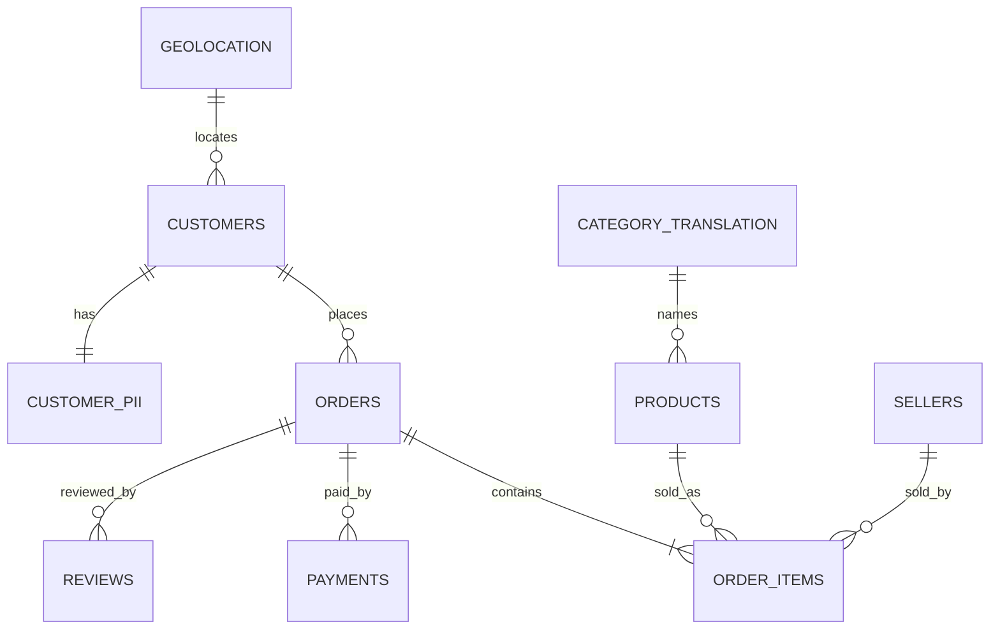
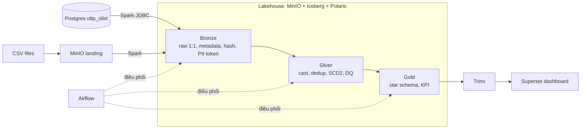
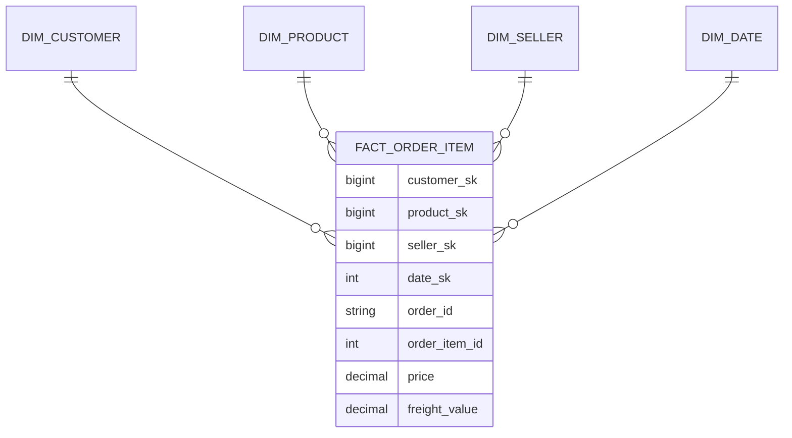

# Mock Project xuyên suốt: Olist Lakehouse

> Đọc file này **trước** tuần 1. Mọi lab trong 8 tuần đều xây tiếp trên cùng một project này.

## 1. Bài toán (đóng vai Data Engineer)
Công ty thương mại điện tử **Olist** (Brazil) cần một nền tảng dữ liệu để trả lời 3 câu hỏi kinh doanh:
1. Doanh thu theo tháng, theo bang, theo danh mục sản phẩm là bao nhiêu?
2. Giá trị vòng đời khách hàng (**LTV**) là bao nhiêu?
3. Khách hàng thuộc nhóm nào theo **RFM** (Recency – Frequency – Monetary)?

Nhiệm vụ của bạn: xây pipeline đưa dữ liệu từ hệ thống bán hàng (Postgres) → Lakehouse (Bronze → Silver → Gold) → Dashboard, chạy tự động, có kiểm soát chất lượng và bảo vệ dữ liệu cá nhân (PII).

## 2. Bộ dữ liệu
**Nguồn:** Kaggle – *Brazilian E-Commerce Public Dataset by Olist* (kaggle.com/datasets/olistbr/brazilian-ecommerce). Khoảng 100k đơn hàng, 2016–2018, đã ẩn danh.

| # | Bảng | Ý nghĩa | Khóa chính | Đặt ở đâu | Load pattern |
|---|---|---|---|---|---|
| 1 | olist_customers_dataset | Khách hàng | customer_id (+ customer_unique_id) | Postgres | CDC |
| 2 | customer_pii *(tự sinh bằng Faker)* | Họ tên, email, SĐT, ngày sinh giả | customer_unique_id | Postgres | CDC |
| 3 | olist_orders_dataset | Đơn hàng, trạng thái, các mốc thời gian | order_id | Postgres | Incremental (watermark `order_purchase_timestamp`) |
| 4 | olist_order_items_dataset | Từng sản phẩm trong đơn | order_id + order_item_id | Postgres | Incremental |
| 5 | olist_order_payments_dataset | Thanh toán | order_id + payment_sequential | Postgres | Incremental |
| 6 | olist_order_reviews_dataset | Đánh giá | review_id | CSV → MinIO landing | Incremental theo file |
| 7 | olist_products_dataset | Sản phẩm | product_id | CSV → MinIO landing | Full snapshot |
| 8 | olist_sellers_dataset | Người bán | seller_id | CSV → MinIO landing | Full snapshot |
| 9 | olist_geolocation_dataset | Zip code → toạ độ, bang | zip_code_prefix | CSV → MinIO landing | Full reload |
| 10 | product_category_name_translation | Dịch tên danh mục | product_category_name | CSV → MinIO landing | Full reload |

**Lưu ý quan trọng:** `customer_id` sinh mới theo **từng đơn**; `customer_unique_id` mới là **một người**. Đây là câu hỏi interview kinh điển về business key.

**Cột tự thêm (không có trong Olist gốc):** `updated_at` (để làm CDC), `sales_channel` (để giả lập schema drift ở batch B2), bảng `customer_pii` (để thực hành mask PII).

### Mô hình dữ liệu nguồn


## 3. Kịch bản phát lại batch (giả lập dữ liệu chảy vào hằng ngày)
Bạn **không** nạp hết một lần. Bạn chia dữ liệu theo tháng và "phát lại" từng batch, mỗi batch có cài sẵn một lỗi để luyện xử lý.

| Batch | Dữ liệu | Lỗi cài sẵn | Bạn luyện kỹ năng gì | Tuần |
|---|---|---|---|---|
| B0 | Trước 2018-01 | — | Initial full load | 3 |
| B1 | 2018-01 | Một số khách đổi city/state | SCD Type 2 | 4 |
| B2 | 2018-02 | orders có thêm cột `sales_channel` | Schema drift | 3 |
| B3 | 2018-03 | 1 file reviews CSV bị hỏng dấu phẩy | Structural quarantine | 3 |
| B4 | 2018-04 | order_items trỏ tới product_id không tồn tại | Referential integrity → Unknown(-1) | 4 |
| B5 | 2018-05 | Ngày sai định dạng, payment âm, email sai | DQ severity + quarantine | 4 |
| B6 | 2018-06 | Gửi lại trùng B5 | Idempotency, dedup | 6 |
| B7 | 2018-07 | Cần sửa và nạp lại dữ liệu 2018-03 | Backfill | 6 |

## 4. Kiến trúc mục tiêu


| Công cụ | Vai trò |
|---|---|
| PostgreSQL | Hệ thống nguồn (OLTP) |
| MinIO | Kho file kiểu S3 (landing/bronze/silver/gold) |
| Apache Iceberg | Định dạng bảng: ACID, time travel, schema evolution |
| Apache Polaris | Catalog: ghi nhớ bảng nào nằm ở đâu |
| Apache Spark (PySpark) | Xử lý ETL giữa các tầng |
| Trino | Query SQL, đối soát, phục vụ dashboard |
| Airflow | Lập lịch và điều phối pipeline |
| Superset | Dashboard |

## 5. Mô hình Gold (đích cuối)

**Grain:** 1 dòng = 1 sản phẩm trong 1 đơn hàng. Bảng KPI: `kpi_monthly_revenue`, `kpi_customer_ltv`, `kpi_customer_rfm`.

## 6. Cấu trúc repo cuối cùng
```
olist-lakehouse/
├── README.md
├── docker-compose.yml
├── .env.example
├── data_prep/        # tải Kaggle, sinh Faker PII, cắt batch B0–B7, seed Postgres
├── docs/             # requirements, EDA, data model, STTM, DQ catalog, runbook
├── spark_jobs/
│   ├── common/       # hàm hash, HMAC, metadata, DQ
│   ├── bronze/
│   ├── silver/
│   └── gold/
├── dags/             # Airflow DAG
├── sql/              # query đối soát, serving SQL, bài SQL luyện tập
├── tests/            # pytest, data compare
└── dashboard/        # export + ảnh chụp Superset
```

## 7. Bản đồ 8 tuần → project
| Tuần | Module | Bạn có thêm gì trong repo |
|---|---|---|
| 1 | M0 Setup | `docker-compose.yml`, `data_prep/`, Postgres đã có dữ liệu |
| 2 | M1 Design | `docs/` đầy đủ thiết kế |
| 3 | M2 Bronze | `spark_jobs/bronze/`, xử lý B0, B2, B3 |
| 4 | M3 Silver | `spark_jobs/silver/`, xử lý B1, B4, B5 |
| 5 | M4 Gold | `spark_jobs/gold/`, KPI, đối soát |
| 6 | M5 Orchestration | `dags/`, xử lý B6, B7 |
| 7 | M6–M7 | `dashboard/`, `tests/` |
| 8 | M8 | README, runbook, CV |
