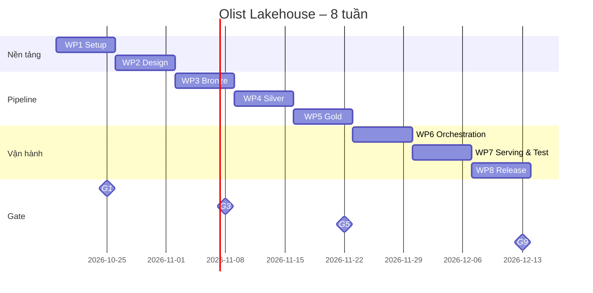
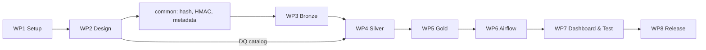

# Mock Project: Olist Lakehouse – Mô tả chi tiết & Kế hoạch thực hiện

> File này là "hồ sơ dự án". [00_PROJECT_OVERVIEW.md](00_PROJECT_OVERVIEW.md) cho bức tranh tổng quan; file này trả lời **làm gì, theo thứ tự nào, mất bao lâu, thế nào là xong**.

---

# PHẦN A – MÔ TẢ DỰ ÁN

## A1. Project Charter
| Mục | Nội dung |
|---|---|
| Tên dự án | Olist Lakehouse – Customer & Sales Analytics Platform |
| Vai trò của bạn | Data Engineer (kiêm DA khi làm requirement và dashboard) |
| Bối cảnh | Dữ liệu bán hàng của Olist nằm rải rác trong Postgres và file CSV. Team kinh doanh tự export Excel, mỗi người một con số, dữ liệu cá nhân khách hàng bị lộ trong file chia sẻ. |
| Mục tiêu kinh doanh | Một nguồn số liệu đáng tin duy nhất cho doanh thu, LTV và phân khúc RFM; cập nhật tự động; không lộ PII. |
| Mục tiêu học tập | Có một project end-to-end để đưa vào CV và kể trong interview DE. |
| Thời gian | 19/10 – 13/12/2026 (8 tuần, ~8h lab/tuần ≈ 63h) |
| Chi phí | 0 đồng: toàn bộ open-source, chạy bằng Docker trên máy cá nhân |
| Người dùng cuối (giả định) | Sales Manager (doanh thu), Marketing (RFM), Finance (đối soát) |

## A2. Phạm vi
| Trong phạm vi (In scope) | Ngoài phạm vi (Out of scope) |
|---|---|
| 10 bảng Olist + bảng PII giả (Faker) | Streaming thời gian thực |
| Batch hằng ngày giả lập B0–B7 | Triển khai lên cloud (AWS/GCP) |
| Bronze → Silver → Gold trên Iceberg | Machine learning |
| 3 KPI: doanh thu, LTV, RFM | Phân quyền chi tiết theo vai trò |
| Airflow điều phối, DQ gate, backfill | High availability, cluster nhiều node |
| Dashboard Superset, test tự động, CI | dbt, Great Expectations (ghi vào "hướng phát triển") |

## A3. Yêu cầu chức năng (Functional Requirements)
| ID | Yêu cầu | Tiêu chí chấp nhận | Tuần |
|---|---|---|---|
| FR-01 | Nạp 5 bảng giao dịch từ Postgres theo incremental/CDC | Batch mới chỉ đọc dữ liệu mới; số dòng khớp nguồn | 3 |
| FR-02 | Nạp 5 bảng CSV từ MinIO landing | Mỗi dòng ghi được tên file nguồn | 3 |
| FR-03 | Mask PII khi ingest | 0 giá trị email/phone/tên dạng raw từ Bronze trở đi | 3 |
| FR-04 | Xử lý schema drift | Cột mới không làm hỏng batch, có log cảnh báo | 3 |
| FR-05 | Cách ly file hỏng | File không đọc được nằm trong `_quarantine`, batch vẫn chạy | 3 |
| FR-06 | Làm sạch, ép kiểu, dedup ở Silver | Silver + quarantine = input; không trùng key | 4 |
| FR-07 | Lưu lịch sử địa chỉ khách (SCD2) | Mỗi khách đúng 1 dòng current | 4 |
| FR-08 | Không mất dòng khi khóa ngoại thiếu | Gán Unknown (-1), có log | 4 |
| FR-09 | DQ rule có severity | Critical dừng pipeline, Major cách ly dòng, Minor ghi log | 4 |
| FR-10 | Star schema `fact_order_item` + 4 dim | Grain = 1 sản phẩm trong 1 đơn | 5 |
| FR-11 | KPI doanh thu tháng, LTV, RFM | Khớp với query đối soát trên Silver | 5 |
| FR-12 | Pipeline tự động B→S→G | 1 lần trigger chạy hết, gate chặn khi lỗi | 6 |
| FR-13 | Chạy lại không nhân đôi dữ liệu | Rerun B6 → số dòng Gold không đổi | 6 |
| FR-14 | Backfill 1 tháng | Chỉ partition tháng đó thay đổi | 6 |
| FR-15 | Dashboard 4 chart | Số liệu khớp Gold 100% | 7 |

## A4. Yêu cầu phi chức năng (NFR)
| ID | Nhóm | Yêu cầu |
|---|---|---|
| NFR-01 | Bảo mật | Secret (HMAC key, mật khẩu DB) không nằm trong Git; dùng `.env` + Airflow Variables |
| NFR-02 | Truy vết | Mỗi lần chạy ghi audit: batch, bảng nguồn/đích, rows in/out, thời gian, trạng thái |
| NFR-03 | Khôi phục | Rollback được bằng Iceberg snapshot |
| NFR-04 | Hiệu năng | Pipeline 1 batch chạy < 15 phút trên laptop |
| NFR-05 | Chất lượng code | Unit test cho hàm dùng chung, CI chạy khi push |
| NFR-06 | Tái lập | Người khác clone repo, làm theo README là chạy được |
| NFR-07 | Quy ước | Tên bucket/namespace/bảng thống nhất (Theory #46) |

## A5. Quyết định kiến trúc (ADR)
| ADR | Quyết định | Lý do | Phương án đã cân nhắc |
|---|---|---|---|
| ADR-01 | Iceberg làm table format | ACID, time travel, schema evolution, hidden partitioning; Spark và Trino cùng đọc | Delta Lake (gắn Spark nhiều hơn), Hive table (không ACID) |
| ADR-02 | Polaris REST catalog | Chuẩn REST của Iceberg, tách catalog khỏi engine | Hive Metastore (nặng), JDBC catalog (đơn giản, ít tính năng quản trị) |
| ADR-03 | Mask PII **một lần ở Bronze** bằng HMAC-SHA256 | Raw PII không vào lakehouse; token deterministic vẫn join được | Mask ở Silver (Bronze còn raw); SHA-256 trần (dò ngược được) |
| ADR-04 | Bronze append-only, giữ mọi version | Rebuild được tầng dưới, phục vụ SCD và audit | Overwrite (mất lịch sử) |
| ADR-05 | Ghi Silver/Gold bằng MERGE / overwrite partition | Idempotent khi rerun | Append (dễ nhân đôi) |
| ADR-06 | Spark cho ETL, Trino cho query/serving | Đúng thế mạnh từng engine | Trino cho mọi việc (kém chịu lỗi với job dài) |
| ADR-07 | Unknown member SK = -1 | Không mất fact khi dim thiếu | Drop dòng (sai doanh thu) |

> Mẹo interview: ADR là "kho câu trả lời" cho câu *"Why did you choose X?"*.

## A6. Đặc tả từng tầng
### Bronze (`lakehouse.bronze`)
| Bảng | Nguồn | Load pattern | Ghi chú |
|---|---|---|---|
| crm_customers | Postgres customers | CDC | |
| crm_customer_pii | Postgres customer_pii | CDC | Token HMAC thay raw |
| oms_orders / oms_order_items / oms_payments | Postgres | Incremental (watermark) | |
| file_reviews | CSV landing | Incremental theo file | Có thể bị quarantine (B3) |
| file_products / file_sellers | CSV landing | Full snapshot | |
| ref_geolocation / ref_category_translation | CSV landing | Full reload | |

Mọi bảng có 5 cột metadata: `_ingest_timestamp`, `_source_file_name`, `_batch_id`, `_record_hash` (SHA-256), `_is_current`.

### Silver (`lakehouse.silver`)
| Bảng | Xử lý chính |
|---|---|
| customer | Cast, conform state/zip, **SCD2** (`_valid_from`, `_valid_to`, `_is_current`) |
| orders, order_items, payments | Cast ngày/tiền, dedup, RI → `UNKNOWN` |
| products, sellers | Category null → `unknown`, dịch category sang tiếng Anh |
| reviews | Cast điểm 1–5 |
| silver_quarantine | Dòng lỗi + `_dq_rule`, `_dq_reason`, `_batch_id` |

### Gold (`lakehouse.gold`)
| Bảng | Grain | Dùng cho |
|---|---|---|
| dim_date, dim_product, dim_seller | 1 dòng / thực thể | Lọc, nhóm |
| dim_customer | 1 dòng / version khách (SCD2) | Phân tích theo địa chỉ tại thời điểm mua |
| fact_order_item | 1 sản phẩm trong 1 đơn | Mọi phân tích bán hàng |
| kpi_monthly_revenue | tháng × bang × category | Chart doanh thu |
| kpi_customer_ltv | 1 khách (`customer_unique_id`) | LTV, AOV |
| kpi_customer_rfm | 1 khách | Phân khúc marketing |

### Bảng hệ thống (`lakehouse.meta`)
`watermark`, `schema_change_log`, `dq_result`, `pipeline_audit`.

## A7. Định nghĩa KPI
| KPI | Công thức | Ghi chú |
|---|---|---|
| Revenue | Σ (price + freight_value) của order item, chỉ tính đơn hợp lệ | Chốt danh sách `order_status` hợp lệ ở tuần 2 |
| AOV | Revenue / số đơn | |
| LTV | Σ revenue theo `customer_unique_id` | Không dùng `customer_id` |
| Recency | Số ngày từ đơn cuối đến ngày tham chiếu (ngày lớn nhất trong dữ liệu) | Không dùng ngày hôm nay vì dữ liệu dừng ở 2018 |
| Frequency | Số đơn riêng biệt | |
| Monetary | = LTV | |
| RFM segment | `NTILE(5)` cho R, F, M → ghép điểm → Champions / Loyal / At Risk / Lost… | Kiểm tra phân phối F ở EDA; nếu đa số khách chỉ mua 1 lần thì cần điều chỉnh cách chia và giải thích |

## A8. Sản phẩm bàn giao (Deliverables)
| # | Sản phẩm | Vị trí trong repo | Tuần |
|---|---|---|---|
| D1 | Môi trường chạy bằng 1 lệnh | `docker-compose.yml`, `.env.example` | 1 |
| D2 | Dữ liệu + script chuẩn bị | `data_prep/` | 1 |
| D3 | Tài liệu thiết kế (requirement, EDA, model, STTM, DQ catalog, ADR) | `docs/` | 2 |
| D4 | Pipeline Bronze / Silver / Gold | `spark_jobs/` | 3–5 |
| D5 | DAG Airflow + runbook backfill | `dags/`, `docs/runbook.md` | 6 |
| D6 | Dashboard + bằng chứng tie-out | `dashboard/` | 7 |
| D7 | Test + CI | `tests/`, `.github/workflows/` | 7 |
| D8 | README, CV bullet, kịch bản demo 5 phút | `README.md` | 8 |

---

# PHẦN B – KẾ HOẠCH THỰC HIỆN

## B1. Milestone & Gate
| Milestone | Ngày | Gate | Điều kiện qua gate |
|---|---|---|---|
| M0 Môi trường sẵn sàng | 25/10 | G1 | Stack lên đủ, Postgres có B0, Trino đọc được 1 bảng Iceberg, dữ liệu còn sau restart |
| M1 Thiết kế xong | 01/11 | G2 | D3 đủ 6 tài liệu, STTM phủ 100% cột Gold |
| M2 Bronze xong | 08/11 | G3 | FR-01→05 đạt, 0 raw PII, unit test hash/HMAC pass |
| M3 Silver xong | 15/11 | G4 | FR-06→09 đạt, DQ report có B1, B4, B5 |
| M4 Gold xong | 22/11 | G5 | FR-10→11 đạt, reconcile chênh lệch = 0 hoặc giải thích được |
| M5 Tự động hóa | 29/11 | G6 | FR-12→14 đạt, có audit/lineage |
| M6–M7 Serving & Test | 06/12 | G7–G8 | FR-15 đạt, pytest + CI xanh, biên bản E2E |
| M8 Release | 13/12 | G9 | NFR-06 đạt (clone sạch chạy được), CV cập nhật |

**Quy tắc gate:** chưa qua gate thì **không** sang tầng tiếp theo; đánh dấu Blocked và dùng giờ dự phòng.

## B2. WBS – Danh sách công việc
Ước lượng theo giờ lab. Cột "Phụ thuộc" ghi ID task phải xong trước.

### WP1 – Setup (Tuần 1, 8h)
| ID | Task | Giờ | Phụ thuộc | Output |
|---|---|---|---|---|
| 1.1 | Tạo repo, cấu trúc thư mục, `.gitignore`, `.env.example` | 0.5 | – | Repo GitHub |
| 1.2 | Compose: Postgres + MinIO, tạo 4 bucket | 1 | 1.1 | Service chạy |
| 1.3 | Compose: Polaris + Trino, cấu hình Iceberg REST catalog | 1.5 | 1.2 | `SHOW CATALOGS` thấy `lakehouse` |
| 1.4 | Compose: Spark/Jupyter + Iceberg runtime; hello world Postgres → Iceberg → Trino | 1.5 | 1.3, 1.8 | Query được |
| 1.5 | Compose: Airflow + Superset | 1 | 1.2 | UI mở được |
| 1.6 | Tải Olist, script Faker PII, thêm `updated_at` | 1 | 1.1 | `data_prep/` |
| 1.7 | Script cắt batch B0–B7 + cài lỗi | 1 | 1.6 | 8 thư mục batch |
| 1.8 | Seed Postgres `oltp_olist` (B0), đặt CSV vào landing | 0.5 | 1.2, 1.7 | DB có dữ liệu |

### WP2 – Design (Tuần 2, 8h)
| ID | Task | Giờ | Phụ thuộc | Output |
|---|---|---|---|---|
| 2.1 | Requirement, user story, định nghĩa KPI (A7) | 1 | – | `docs/requirements.md` |
| 2.2 | EDA từng bảng | 2 | 1.8 | `notebooks/eda.ipynb` |
| 2.3 | EDA quan hệ & bất thường | 1 | 2.2 | `docs/eda_report.md` |
| 2.4 | Data model Gold + grain | 1 | 2.1 | `docs/data_model.md` |
| 2.5 | STTM Bronze/Silver/Gold | 1.5 | 2.3, 2.4 | `docs/sttm.xlsx` |
| 2.6 | DQ catalog + ngưỡng | 1 | 2.3 | `docs/dq_catalog.md` |
| 2.7 | Viết ADR-01→07 | 0.5 | – | `docs/adr.md` |

### WP3 – Bronze (Tuần 3, 8h)
| ID | Task | Giờ | Phụ thuộc |
|---|---|---|---|
| 3.1 | `common/metadata.py` | 0.5 | G2 |
| 3.2 | `common/hashing.py` + unit test | 1 | 3.1 |
| 3.3 | `common/pii.py` (HMAC) + unit test | 1 | 3.1 |
| 3.4 | Ingest JDBC 5 bảng + bảng watermark | 1.5 | 3.2 |
| 3.5 | Ingest CSV 5 bảng | 1 | 3.2 |
| 3.6 | Mask PII khi ingest `customer_pii` | 0.5 | 3.3, 3.4 |
| 3.7 | Dedup theo key + hash, test rerun | 0.5 | 3.4, 3.5 |
| 3.8 | B2 schema drift + `schema_change_log` | 1 | 3.4 |
| 3.9 | B3 structural quarantine | 1 | 3.5 |

### WP4 – Silver (Tuần 4, 8h)
| ID | Task | Giờ | Phụ thuộc |
|---|---|---|---|
| 4.1 | Cast + quarantine dòng lỗi | 1.5 | G3 |
| 4.2 | Chuẩn hóa, conform geolocation, dịch category | 1 | 4.1 |
| 4.3 | Dedup Silver | 0.5 | 4.1 |
| 4.4 | `common/dq.py` + bảng `dq_result` | 1.5 | 2.6 |
| 4.5 | SCD2 customer bằng MERGE – B1 | 1.5 | 4.3 |
| 4.6 | RI → UNKNOWN – B4 | 0.5 | 4.3 |
| 4.7 | DQ severity – B5 + DQ report | 1 | 4.4 |
| 4.8 | Verify PII ở Silver | 0.5 | 4.4 |

### WP5 – Gold (Tuần 5, 8h)
| ID | Task | Giờ | Phụ thuộc |
|---|---|---|---|
| 5.1 | dim_date, dim_product, dim_seller (+ SK -1) | 1.5 | G4 |
| 5.2 | dim_customer từ SCD2 + age_band | 1 | 4.5 |
| 5.3 | fact_order_item + lookup SK theo thời điểm mua | 2 | 5.1, 5.2 |
| 5.4 | Partition + sort order, kiểm tra `EXPLAIN` | 0.5 | 5.3 |
| 5.5 | kpi_monthly_revenue, kpi_customer_ltv | 1 | 5.3 |
| 5.6 | kpi_customer_rfm | 1 | 5.5 |
| 5.7 | Reconcile Gold ↔ Silver | 1 | 5.5 |

### WP6 – Orchestration (Tuần 6, 8h)
| ID | Task | Giờ | Phụ thuộc |
|---|---|---|---|
| 6.1 | DAG B→S→G có tham số batch | 2 | G5 |
| 6.2 | DQ gate + retry + alert | 1 | 6.1, 4.4 |
| 6.3 | `pipeline_audit` / lineage | 1 | 6.1 |
| 6.4 | Chuyển ghi sang MERGE/overwrite partition, test B6 | 1.5 | 6.1 |
| 6.5 | Runbook + chạy backfill B7 | 1.5 | 6.4 |
| 6.6 | SLA check + chuẩn hóa tên theo convention | 1 | 6.3 |

### WP7 – Serving & Test (Tuần 7, 9h)
| ID | Task | Giờ | Phụ thuộc |
|---|---|---|---|
| 7.1 | Kết nối Superset ↔ Trino, tạo dataset từ bảng KPI | 1 | G6 |
| 7.2 | 4 chart + dashboard | 2 | 7.1 |
| 7.3 | Tie-out 3 con số với Gold | 0.5 | 7.2 |
| 7.4 | Pytest cho transform chính | 2 | 3.2, 3.3, 4.5 |
| 7.5 | Data compare tự động trong DAG | 1 | 6.1 |
| 7.6 | E2E với batch mới + biên bản | 1.5 | 7.2, 7.5 |
| 7.7 | GitHub Actions CI | 1 | 7.4 |

### WP8 – Release (Tuần 8, 6h)
| ID | Task | Giờ | Phụ thuộc |
|---|---|---|---|
| 8.1 | README hoàn chỉnh + ảnh + bảng "thách thức & cách giải" B1–B7 | 2 | G8 |
| 8.2 | Runbook vận hành | 1 | 6.5 |
| 8.3 | Dọn code, quét secret | 1 | – |
| 8.4 | Clone sạch và chạy lại từ đầu | 1 | 8.1 |
| 8.5 | CV bullet + kịch bản demo 5 phút | 1 | 8.1 |

**Tổng:** 8 + 8 + 8 + 8 + 8 + 8 + 9 + 6 = **63 giờ** lab.

## B3. Lộ trình (Gantt)

## B4. Luồng phụ thuộc chính

## B5. Rủi ro & dự phòng
| Rủi ro | Khả năng | Ảnh hưởng | Phòng ngừa / xử lý |
|---|---|---|---|
| Laptop không đủ RAM cho 7 service | Cao | Cao | Giới hạn memory từng container; tắt Superset/Airflow khi chưa dùng; Spark chạy `local[2]` |
| Cấu hình Polaris + Iceberg + Trino mất nhiều thời gian | Cao | Cao | Timebox 3h; nếu kẹt, tạm dùng Iceberg **JDBC catalog** trên Postgres và ghi lại trong ADR |
| Lệch version Spark – Iceberg runtime | Trung bình | Trung bình | Ghim version trong compose, ghi vào README |
| Trễ tiến độ do bận việc | Trung bình | Cao | Cắt phần "Could" theo bảng B6 |
| Hiểu sai SCD2 / lookup SK | Trung bình | Trung bình | Test trên DataFrame 5 dòng trước khi chạy dữ liệu thật |
| Lộ secret lên GitHub | Thấp | Cao | `.gitignore` từ ngày đầu, kiểm tra trước khi push |

## B6. Ưu tiên khi thiếu thời gian (MoSCoW)
| Must | Should | Could | Won't (lần này) |
|---|---|---|---|
| Bronze/Silver/Gold, PII HMAC, SCD2, KPI, DAG cơ bản, README | DQ gate, idempotency B6, backfill B7, dashboard | CI, SLA, lineage chi tiết | Streaming, cloud, ML |

## B7. Theo dõi tiến độ hằng tuần
| Tuần | Task xong / tổng | Gate | Giờ thực tế | Vướng mắc | Hành động tuần sau |
|---|---|---|---|---|---|
| 1 | /8 | G1 ⬜ | | | |
| 2 | /7 | G2 ⬜ | | | |
| 3 | /9 | G3 ⬜ | | | |
| 4 | /8 | G4 ⬜ | | | |
| 5 | /7 | G5 ⬜ | | | |
| 6 | /6 | G6 ⬜ | | | |
| 7 | /7 | G7–G8 ⬜ | | | |
| 8 | /5 | G9 ⬜ | | | |

## B8. Definition of Done của toàn dự án
- [ ] 15/15 Functional Requirements đạt tiêu chí chấp nhận
- [ ] 7/7 NFR được kiểm chứng
- [ ] 9/9 Gate qua
- [ ] 8/8 Deliverables có trong repo
- [ ] Demo 5 phút bằng tiếng Anh trôi chảy
