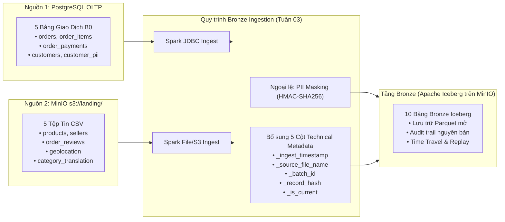
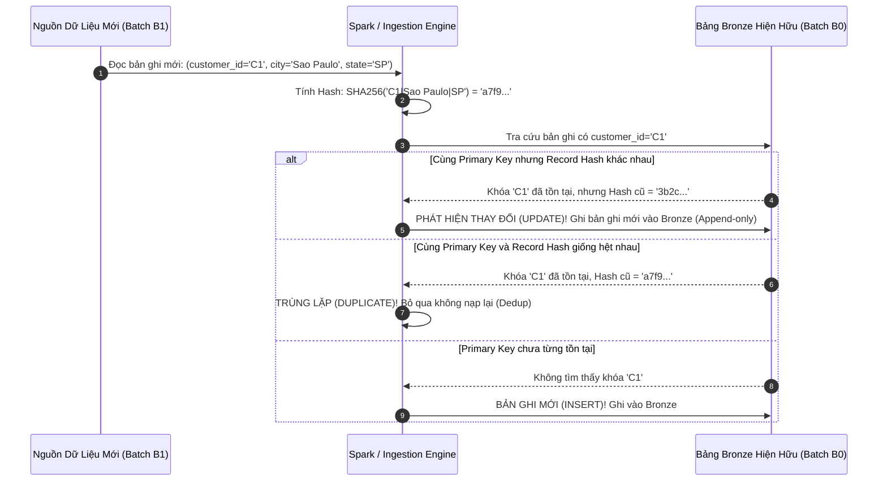
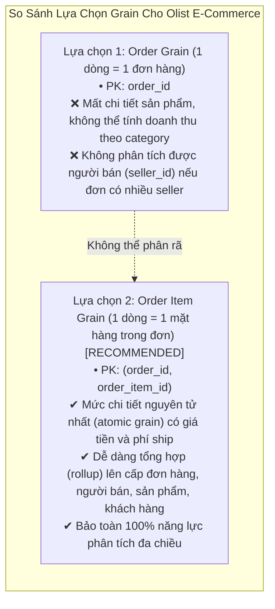

# Tuần 02: Bronze Theory & Lab M1 — Phân Tích Dữ Liệu & Thiết Kế Pipeline

> **For agentic workers:** REQUIRED SUB-SKILL: Use superpowers:subagent-driven-development (recommended) or superpowers:executing-plans to implement this plan task-by-task. Steps use checkbox (`- [ ]`) syntax for tracking.

**Goal:** Hiểu sâu sắc bản chất dữ liệu thương mại điện tử Olist thông qua Phân tích Khám phá Dữ liệu (Exploratory Data Analysis - EDA) có hệ thống trên kiến trúc Đa Nguồn (Multi-Source: PostgreSQL OLTP + MinIO Landing CSV), từ đó xây dựng trọn bộ 7 tài liệu thiết kế kỹ thuật chuẩn công nghiệp (Requirements, EDA Profiling, Relational Findings Report, Design Document, Star Schema Data Model, Source-to-Target Mapping STTM, Data Quality Catalog) trước khi bắt tay viết code pipeline Bronze Ingestion. Đây là bước then chốt phân biệt một Kỹ sư Dữ liệu (Data Engineer) "biết tư duy kiến trúc" với người chỉ "biết gõ lệnh".

**Architecture:** Tuân thủ chặt chẽ kiến trúc tích hợp dữ liệu đa nguồn chuẩn Enterprise Lakehouse:
1. **Nguồn 1: PostgreSQL OLTP Database:** Lưu trữ đúng **5 bảng transactional/CRM** của mẻ khởi đầu B0 (`orders`, `order_items`, `order_payments`, `customers`, `customer_pii`). Tuyệt đối không nạp các tệp tham chiếu hay tệp dữ liệu bên ngoài vào database OLTP của hệ thống bán hàng.
2. **Nguồn 2: MinIO S3 Object Storage (`s3://landing/`):** Lưu trữ **5 tệp CSV** danh mục tham chiếu và đánh giá (`products`, `sellers`, `order_reviews`, `geolocation`, `product_category_name_translation`).
3. **Môi trường EDA:** Sử dụng Jupyter Notebook (`notebooks/eda_profiling.ipynb`) tích hợp `pandas`, `SQLAlchemy`, và `PyArrow` / `boto3` để profile đồng thời cả 2 nguồn (PostgreSQL và MinIO Landing), thực hiện các phép kiểm thử toàn vẹn quan hệ chéo nguồn (Cross-source relational checks) nhằm phát hiện khóa ngoại mồ côi (Orphan IDs). Kết quả EDA là căn cứ định lượng (quantified evidence) để xác định Load Pattern, khóa định danh (Business Key), lược đồ hình sao Gold (Fact Order Item grain) và bộ quy tắc kiểm soát chất lượng dữ liệu (Data Quality Rule Catalog).

**Tech Stack:** PostgreSQL 16 (OLTP Database), MinIO S3 Object Storage (Landing Bucket), Python 3.10+ (pandas, PyArrow, psycopg2-binary, boto3, SQLAlchemy, pytest), Jupyter Notebook (`notebooks/eda_profiling.ipynb`), Mermaid.js (ERD & Data Flow Visualizations), Markdown (Documentation-as-Code).

**Syllabus Source:** [lab_syllabus_v2/week02.md](file:///Users/anhtus/Documents/Development/DE/GRT_DA-DE/lab_syllabus_v2/week02.md) & [lab_syllabus_v2/00_PROJECT_OVERVIEW.md](file:///Users/anhtus/Documents/Development/DE/GRT_DA-DE/lab_syllabus_v2/00_PROJECT_OVERVIEW.md)

---

## 🧭 BẢN ĐỒ KHÁI NIỆM & GIẢI PHẪU SƯ PHẠM (PEDAGOGICAL ANATOMY)

Trước khi bắt tay vào thiết kế đường ống dữ liệu (data pipeline), một kỹ sư dữ liệu chuyên nghiệp luôn bắt đầu bằng việc mổ xẻ các khái niệm nền tảng.

### 1. Giải phẫu khái niệm: Bronze Layer — Ingest As-Is (1:1) từ Đa Nguồn (Multi-Source)
> **Định nghĩa chuẩn học thuật:**  
> **Bronze Layer** (tầng Đồng / Raw Layer) trong kiến trúc Medallion là *lớp lưu trữ nguyên bản bất biến (immutable raw landing layer)* ghi nhận dữ liệu từ các hệ thống nguồn không đồng nhất (Heterogeneous Source Systems: RDBMS OLTP, Object Storage Files, APIs, Event Streams) ở trạng thái trung thực nhất có thể (tỷ lệ 1:1), tuyệt đối không áp dụng các phép biến đổi nghiệp vụ (no business transformations), không ép kiểu (no schema casting), không đổi tên cột (no renaming), và không lọc bỏ dòng (no filtering). Ngoại lệ duy nhất được phép xử lý ngay tại tầng này là mã hóa bảo vệ thông tin định danh cá nhân (PII Masking).



* **Anatomical Keywords (Giải phẫu từ khóa):**
  * **As-Is (Nguyên trạng):** Dữ liệu nguồn như thế nào, tầng Bronze lưu đúng như vậy. Cả 2 nguồn (bảng SQL từ PostgreSQL và tệp CSV từ MinIO) đều được giữ nguyên vẹn cấu trúc và giá trị gốc khi đưa vào Bronze Iceberg table.
  * **Heterogeneous Ingestion (Nạp dữ liệu không đồng nhất):** Một kiến trúc Lakehouse hiện đại phải có năng lực hợp nhất cả dữ liệu có cấu trúc từ cơ sở dữ liệu quan hệ (RDBMS) lẫn dữ liệu bán cấu trúc/tệp tin từ Object Storage vào một giao diện lưu trữ duy nhất.
  * **Auditability & Traceability (Khả năng kiểm toán & truy vết):** Bronze đóng vai trò là "hiện trường vụ án" nguyên vẹn. Khi xảy ra sự cố sai lệch số liệu ở Silver hay Gold, DE luôn có thể tái xử lý (Replay) từ Bronze mà không cần chạm lại vào database OLTP đang phục vụ người dùng.
  * **Technical Metadata Columns (Siêu dữ liệu kỹ thuật):** Bronze bổ sung 5 cột kỹ thuật phục vụ vận hành:
    1. `_ingest_timestamp`: Thời điểm bản ghi được ghi nhận vào Data Lakehouse (UTC).
    2. `_source_file_name`: Tên tệp tin nguồn hoặc bảng nguồn sản sinh bản ghi.
    3. `_batch_id`: Mã định danh phiên chạy (Job Run ID / Batch ID).
    4. `_record_hash`: Giá trị băm SHA-256 trên toàn bộ các cột nghiệp vụ (dùng để phát hiện thay đổi - Change Detection).
    5. `_is_current`: Cờ chỉ thị bản ghi mới nhất trong mẻ dữ liệu.

---

### 2. Giải phẫu khái niệm: Record Hash & Change Detection
> **Định nghĩa chuẩn học thuật:**  
> **Record Hash** là một *chuỗi băm mật mã học độ dài cố định (fixed-length cryptographic digest)* được tính toán bằng thuật toán SHA-256 trên chuỗi nối kết (concatenation) của toàn bộ các thuộc tính nghiệp vụ (business attributes) đã được chuẩn hóa (trimmed, null-coalesced), dùng để nhận diện trạng thái thay đổi dữ liệu (Change Detection) giữa các phiên nạp mà không cần so sánh từng cặp cột (column-by-column comparison).



* **Root Cause Analysis (Tại sao dùng SHA-256 Record Hash thay vì so sánh từng cột?):**
  * *Quá khứ:* Trước đây, việc kiểm tra xem một dòng có thay đổi hay không đòi hỏi viết các câu lệnh so sánh khổng lồ: `WHERE t.col1 <> s.col1 OR t.col2 <> s.col2 OR (t.col3 IS NULL AND s.col3 IS NOT NULL)...`. Khi bảng có hàng chục cột, logic này cực kỳ tốn CPU, dễ sót cột và xử lý NULL rất phức tạp.
  * *Giải pháp:* Gom toàn bộ giá trị các cột thành 1 chuỗi chuẩn hóa duy nhất và tính mã băm SHA-256 (32 bytes). Việc so sánh trạng thái của cả dòng quy về một phép so sánh bằng chuỗi đơn giản: `t._record_hash = s._record_hash`.

---

### 3. Giải phẫu khái niệm: Fact Table Grain (Độ Mịn Của Bảng Fact)
> **Định nghĩa chuẩn học thuật:**  
> **Grain** (độ mịn / mức độ chi tiết) của một Fact Table trong mô hình Dimensional Modeling (Kimball) là *lời mô tả chính xác và duy nhất về thực thể hoặc sự kiện nghiệp vụ mà một dòng đơn lẻ (single row) trong bảng đại diện*. Grain là quyết định thiết kế quan trọng nhất, bắt buộc phải xác lập và cố định trước khi chọn lựa bất kỳ Dimension hay Measure nào.



* **Nguyên tắc vàng của Ralph Kimball:**  
  *"Always develop dimensional models at the most atomic grain possible."* (Luôn xây dựng mô hình chiều ở mức độ mịn nguyên tử nhất có thể). Tại Olist, một đơn hàng (`order_id`) có thể chứa nhiều sản phẩm từ nhiều nhà bán lẻ khác nhau (`seller_id`). Do đó, nếu chọn grain ở cấp đơn hàng, ta sẽ vĩnh viễn đánh mất khả năng phân tích sản phẩm và đối soát nhà bán lẻ. Chọn grain ở cấp **Order Item** cho phép rollup lên bất kỳ chiều nào mà không gây méo mó dữ liệu.

---

## ⚖️ PHÂN TÍCH ĐÁNH ĐỔI & TƯ DUY PHẢN BIỆN (TRADE-OFFS & CRITICAL THINKING)

1. **Phân Tách Ranh Giới Hai Nguồn (PostgreSQL vs. MinIO Landing) vs. Nạp Chung Vào PostgreSQL:**
   * *Bối cảnh:* Lựa chọn nơi lưu trữ và công cụ thực hiện EDA trong Tuần 02.
   * *Đánh đổi:* 
     - Gom cả 10 bảng vào PostgreSQL: Tiện lợi khi viết câu lệnh SQL thuần túy (vì tất cả nằm chung 1 database). Nhưng vi phạm nghiêm trọng nguyên tắc thiết kế thực tế: Data Engineer không bao giờ tải file CSV đối tác (như Geolocation 1 triệu dòng) nạp vào production database OLTP của công ty.
     - Phân định rõ 2 nguồn (Postgres 5 bảng, MinIO Landing 5 tệp): Phản ánh trung thực 100% bài toán doanh nghiệp. Đòi hỏi môi trường phân tích (Jupyter Notebook / Python / PySpark) phải kết nối linh hoạt tới cả RDBMS lẫn Object Storage, từ đó rèn luyện năng lực Cross-source Profiling cho học viên.

2. **HMAC-SHA256 có Salted Secret Key vs. SHA-256 Trần (Raw Hash):**
   * *Bối cảnh:* Bảo vệ dữ liệu cá nhân (PII) như email và số điện thoại khách hàng.
   * *Đánh đổi:* 
     - Dùng SHA-256 trần: Không cần quản lý mật mã, ai cũng hash được. Nhưng do không gian email/SĐT rất nhỏ, kẻ tấn công có thể tạo bảng tra cứu trước (Rainbow Table Attack) để giải mã toàn bộ danh tính khách hàng trong vài giây.
     - Dùng HMAC-SHA256 với Secret Key: Cần xây dựng cơ chế quản lý và luân chuyển khóa bí mật (Key Rotation & Storage). Đổi lại, kể cả khi kẻ tấn công có được bảng Bronze và thuật toán, nếu không có Secret Key thì không thể nào giải mã ngược. Đồng thời, do tính chất tất định (deterministic), cùng một email và cùng một key luôn sinh ra cùng một mã token, cho phép các engine nối (JOIN) và khử trùng lặp (Deduplicate) an toàn tuyệt đối.

3. **EDA Trước Khi Viết DQ Rules vs. Viết DQ Rules Theo Cảm Tính:**
   * *Bối cảnh:* Thiết lập ngưỡng chặn (thresholds) cho Data Quality pipeline.
   * *Đánh đổi:* Nếu viết DQ rules trước khi khám phá dữ liệu (ví dụ áp đặt rule: `product_category_name IS NOT NULL` với mức `Critical` dừng pipeline), hệ thống sẽ gãy ngay mẻ đầu tiên vì thực tế Olist có ~1.85% sản phẩm không có danh mục. Việc làm EDA cung cấp số liệu thực tế để thiết lập chính sách xử lý hợp lý: Cho phép tỷ lệ null ≤ 2.0% và gán danh mục về `'Unknown'`.

---

## 📁 CẤU TRÚC THƯ MỤC CẦN KHỞI TẠO (PROJECT REPO STRUCTURE)

```text
olist-lakehouse/
├── docs/
│   ├── week01/                                # Tài liệu hoàn thành Tuần 01
│   │   └── 08-week01-interview-cheatsheet.md  # Cheatsheet tổng hợp Tuần 01
│   └── week02/                                # BỘ TÀI LIỆU LAB M1 TUẦN 02
│       ├── requirements.md                    # Bước 1: 3 User Stories + Acceptance Criteria
│       ├── eda_report.md                      # Bước 3: Báo cáo ≥5 phát hiện quan hệ có số liệu (Cross-source)
│       ├── design.md                          # Bước 4: Load pattern matrix & Business keys (Khớp 00_PROJECT_OVERVIEW)
│       ├── data_model.md                      # Bước 5: Star schema ERD & Grain defense
│       ├── sttm.md                            # Bước 6: Source-to-Target Mapping
│       ├── dq_catalog.md                      # Bước 7: Data Quality Rule Catalog
│       ├── daily_sql.sql                      # 5 câu truy vấn SQL thực hành hằng ngày
│       ├── interview_cheatsheet.md            # 5 câu hỏi phỏng vấn chuyên sâu Tuần 02
│       └── theory_bronze_layer.md             # Khái niệm lý thuyết 11-20
├── notebooks/
│   └── eda_profiling.ipynb                    # Bước 2: Jupyter Notebook profiling 10 thực thể (Postgres + MinIO)
├── tests/
│   ├── test_sources_ready.py                  # Test kiểm tra 5 bảng Postgres + 5 tệp MinIO Landing sẵn sàng
│   ├── test_requirements_spec.py              # Test xác thực định dạng requirements.md
│   ├── test_eda_profiling.py                  # Test kiểm tra tính đầy đủ của kết quả profiling
│   ├── test_eda_findings.py                   # Test kiểm tra 5 phát hiện quan hệ bằng kiểm thử tự động
│   ├── test_design_doc.py                     # Test kiểm tra tính toàn vẹn của design.md
│   ├── test_data_model.py                     # Test kiểm tra Mermaid ERD và grain
│   ├── test_sttm.py                           # Test kiểm tra ma trận ánh xạ STTM
│   ├── test_dq_catalog.py                     # Test kiểm tra danh mục quy tắc DQ
│   ├── test_daily_sql.py                      # Test thực thi 5 câu truy vấn SQL hằng ngày
│   ├── test_interview_cheatsheet.py           # Test kiểm tra nội dung interview cheatsheet
│   ├── test_theory_docs.py                    # Test kiểm tra module lý thuyết Bronze
│   └── gate_g2_check.sh                       # Script nghiệm thu tự động toàn bộ Cổng Gate G2
└── plan/
    ├── 2026-10-19-week01-foundations-lab-m0.md # Kế hoạch Tuần 01
    └── 2026-10-26-week02-bronze-theory-lab-m1.md # KẾ HOẠCH NÀY
```

---

## 🛠️ KẾ HOẠCH HÀNH ĐỘNG CHI TIẾT (BITE-SIZED TASK BREAKDOWN)

### Task 1: Chuẩn Hóa & Kiểm Thử Hạ Tầng Hai Nguồn Dữ Liệu (PostgreSQL 5 Bảng + MinIO Landing 5 Tệp CSV)
**Phụ thuộc:** Hạ tầng Docker Tuần 01 đang chạy (`olist_minio`, Supabase PostgreSQL)  
**WBS:** WP2.1 | **Syllabus:** Lab M1 Input  
**Files:**
- Create: `tests/test_sources_ready.py`
- Modify: `data_prep/seed_postgres.py` (chỉ nạp 5 bảng transactional B0, dọn sạch bảng thừa)
- Modify: `data_prep/upload_to_landing.py` (bổ sung upload `olist_order_reviews_dataset.csv` lên MinIO landing)

- [x] **Step 1: Viết test kiểm tra tính sẵn sàng của 2 nguồn dữ liệu (Failing Test)**
  Tạo tệp `tests/test_sources_ready.py`:
  ```python
  # tests/test_sources_ready.py
  \"\"\"
  Test kiểm thử hạ tầng 2 nguồn dữ liệu chuẩn Enterprise Lakehouse:
  1. Nguồn 1 (PostgreSQL OLTP): Đúng 5 bảng transactional (orders, order_items, order_payments, customers, customer_pii)
     và tuyệt đối KHÔNG chứa các bảng reference/file bên ngoài.
  2. Nguồn 2 (MinIO Object Storage): Bucket landing chứa đủ 5 tệp CSV (products, sellers, reviews, geolocation, translation).
  Tác giả: Anh Tú (Pedagogical Approach)
  Made by Anh Tu - Share to be share
  \"\"\"
  import os
  import boto3
  import psycopg2
  from botocore.client import Config
  from dotenv import load_dotenv

  load_dotenv()

  def test_postgres_oltp_sources():
      \"\"\"Kiểm tra PostgreSQL chỉ chứa đúng 5 bảng transactional, không chứa bảng file ngoài\"\"\"
      conn = psycopg2.connect(
          host=os.getenv("POSTGRES_HOST", "localhost"),
          port=int(os.getenv("POSTGRES_PORT", 5432)),
          user=os.getenv("POSTGRES_USER", "postgres"),
          password=os.getenv("POSTGRES_PASSWORD", "olist-lakehouse"),
          dbname=os.getenv("POSTGRES_DB", "postgres")
      )
      cur = conn.cursor()
      
      expected_oltp_tables = ["orders", "order_items", "order_payments", "customers", "customer_pii"]
      forbidden_tables = ["products", "sellers", "order_reviews", "geolocation", "product_category_name_translation"]
      
      print("\\n[SOURCE 1: POSTGRESQL OLTP] Kiểm tra 5 bảng transactional:")
      for t in expected_oltp_tables:
          cur.execute(f"SELECT EXISTS (SELECT FROM information_schema.tables WHERE table_schema = 'public' AND table_name = '{t}');")
          exists = cur.fetchone()[0]
          assert exists, f"Bảng transactional '{t}' phải tồn tại trong PostgreSQL!"
          cur.execute(f"SELECT COUNT(*) FROM {t};")
          cnt = cur.fetchone()[0]
          assert cnt > 0, f"Bảng '{t}' không được rỗng!"
          print(f"  ✔ Bảng {t:<20}: {cnt:>8,} dòng")
          
      for ft in forbidden_tables:
          cur.execute(f"SELECT EXISTS (SELECT FROM information_schema.tables WHERE table_schema = 'public' AND table_name = '{ft}');")
          exists = cur.fetchone()[0]
          assert not exists, f"VI PHẠM KIẾN TRÚC: Bảng file/reference '{ft}' không được lưu trong PostgreSQL OLTP!"
          
      conn.close()

  def test_minio_landing_sources():
      \"\"\"Kiểm tra MinIO bucket 'landing' có đầy đủ 5 tệp CSV nguồn\"\"\"
      endpoint = "http://minio:9000" if os.path.exists("/.dockerenv") else "http://localhost:9000"
      s3 = boto3.client(
          's3',
          endpoint_url=endpoint,
          aws_access_key_id=os.getenv("AWS_ACCESS_KEY_ID", "minioadmin"),
          aws_secret_key=os.getenv("AWS_SECRET_ACCESS_KEY", "minioadmin"),
          config=Config(signature_version='s3v4'),
          region_name='us-east-1'
      )
      
      expected_objects = [
          "ref/olist_products_dataset.csv",
          "ref/olist_sellers_dataset.csv",
          "ref/olist_geolocation_dataset.csv",
          "ref/product_category_name_translation.csv",
          "reviews/olist_order_reviews_dataset.csv"
      ]
      
      print("\\n[SOURCE 2: MINIO S3 LANDING] Kiểm tra 5 tệp CSV:")
      for key in expected_objects:
          response = s3.head_object(Bucket="landing", Key=key)
          size = response['ContentLength']
          assert size > 0, f"Tệp s3://landing/{key} bị rỗng (0 bytes)!"
          print(f"  ✔ s3://landing/{key:<45}: {size:>10,} bytes")
  ```

- [x] **Step 2: Chạy test để xác nhận test thất bại (Red Phase)**
  Run: `pytest tests/test_sources_ready.py -v`  
  Expected output: `FAIL` (do Postgres vẫn còn các bảng thừa hoặc MinIO thiếu tệp reviews).

- [x] **Step 3: Chuẩn hóa lại `seed_postgres.py` và bổ sung upload `upload_to_landing.py` (Green Phase)**
  1. Cập nhật `data_prep/seed_postgres.py` chỉ nạp đúng 5 bảng transactional:
  ```python
  # data_prep/seed_postgres.py
  import os, time, pandas as pd
  from sqlalchemy import create_engine, text
  from dotenv import load_dotenv

  load_dotenv()

  def get_engine():
      user = os.getenv("POSTGRES_USER", "postgres")
      password = os.getenv("POSTGRES_PASSWORD", "olist-lakehouse")
      host = os.getenv("POSTGRES_HOST", "localhost")
      port = os.getenv("POSTGRES_PORT", "5432")
      dbname = os.getenv("POSTGRES_DB", "postgres")
      return create_engine(f"postgresql+psycopg2://{user}:{password}@{host}:{port}/{dbname}")

  def seed_database():
      engine = get_engine()
      print("🚀 NẠP ĐÚNG 5 BẢNG TRANSACTIONAL VÀO POSTGRESQL OLTP...")
      with engine.begin() as conn:
          conn.execute(text(\"\"\"
              DROP TABLE IF EXISTS order_audit_logs CASCADE;
              DROP TABLE IF EXISTS order_items CASCADE;
              DROP TABLE IF EXISTS order_payments CASCADE;
              DROP TABLE IF EXISTS order_reviews CASCADE;
              DROP TABLE IF EXISTS orders CASCADE;
              DROP TABLE IF EXISTS customer_pii CASCADE;
              DROP TABLE IF EXISTS customers CASCADE;
              DROP TABLE IF EXISTS products CASCADE;
              DROP TABLE IF EXISTS sellers CASCADE;
              DROP TABLE IF EXISTS geolocation CASCADE;
              DROP TABLE IF EXISTS product_category_name_translation CASCADE;
          \"\"\"))
      
      tables = [
          ("orders", "data_prep/processed/batch_B0/orders.csv"),
          ("order_items", "data_prep/processed/batch_B0/order_items.csv"),
          ("order_payments", "data_prep/processed/batch_B0/order_payments.csv"),
          ("customers", "data_prep/raw/olist_customers_dataset.csv"),
          ("customer_pii", "data_prep/processed/customer_pii.csv"),
      ]
      raw_conn = engine.raw_connection()
      try:
          for tbl, path in tables:
              df = pd.read_csv(path, nrows=10)
              df.head(0).to_sql(tbl, engine, if_exists="replace", index=False)
              with raw_conn.cursor() as cur:
                  with open(path, "r", encoding="utf-8") as f:
                      cur.copy_expert(f"COPY {tbl} FROM STDIN WITH (FORMAT csv, HEADER true)", f)
                  raw_conn.commit()
                  cur.execute(f"SELECT COUNT(*) FROM {tbl};")
                  print(f"  ✔ Bảng {tbl}: {cur.fetchone()[0]:,} dòng")
      finally:
          raw_conn.close()
  ```
  2. Cập nhật `data_prep/upload_to_landing.py` bổ sung upload `olist_order_reviews_dataset.csv` lên `s3://landing/reviews/`.
  3. Chạy `python data_prep/seed_postgres.py` và `python data_prep/upload_to_landing.py`.

- [x] **Step 4: Chạy test xác nhận xanh lá (Green Phase Verification)**
  Run: `pytest tests/test_sources_ready.py -v -s`  
  Expected output: `PASSED` cho cả 2 hàm test.

- [x] **Step 5: Git commit hoàn thiện Task 1**
  ```bash
  git add tests/test_sources_ready.py data_prep/seed_postgres.py data_prep/upload_to_landing.py
  git commit -m "feat(infra): enforce enterprise multi-source boundary: 5 postgres tables + 5 minio landing csv files"
  ```

#### 🧪 Mini-Lab 1: Soi Kính — Xác Nhận Ranh Giới Hai Nguồn
* **Mục tiêu:** Kiểm tra danh sách bảng trong Postgres chỉ có 5 bảng và MinIO bucket landing có đủ 5 file.
* **Thao tác nhanh:**
  ```bash
  docker exec -i olist_postgres psql -U postgres.iuvjhphnqpekptjzsifm -d postgres -c "\\dt"
  python3 -c "import boto3; s3=boto3.client('s3', endpoint_url='http://localhost:9000', aws_access_key_id='minioadmin', aws_secret_access_key='minioadmin'); print([obj['Key'] for obj in s3.list_objects_v2(Bucket='landing').get('Contents', [])])"
  ```
* **Tiêu chuẩn đạt:** Postgres chỉ có 5 bảng, MinIO landing có đủ 5 keys.

---

### Task 2: Xác Lập Requirements Dạng User Story (3 Bài Toán Nghiệp Vụ Olist)
**Phụ thuộc:** Task 1  
**WBS:** WP2.2 | **Syllabus:** Bước 1 Lab M1  
**Files:**
- Create: `docs/week02/requirements.md`
- Test: `tests/test_requirements_spec.py`

- [x] **Step 1: Viết test kiểm tra tính hợp lệ của tài liệu yêu cầu (Failing Test)**
  Tạo tệp `tests/test_requirements_spec.py`:
  ```python
  # tests/test_requirements_spec.py
  import os

  def test_requirements_document():
      path = "docs/week02/requirements.md"
      assert os.path.exists(path), f"File {path} không tồn tại!"
      content = open(path, "r", encoding="utf-8").read()
      assert len(content) > 1000, "Nội dung requirements.md quá ngắn!"
      assert "US-01" in content and "Doanh thu" in content, "Thiếu User Story 01: Doanh thu"
      assert "US-02" in content and "LTV" in content, "Thiếu User Story 02: LTV"
      assert "US-03" in content and "RFM" in content, "Thiếu User Story 03: RFM"
      assert "Given" in content and "When" in content and "Then" in content, "Acceptance Criteria phải theo chuẩn Given-When-Then!"
      assert "Made by Anh Tu - Share to be share" in content, "Thiếu footer bản quyền!"
  ```

- [x] **Step 2: Chạy test để xác nhận test thất bại**
  Run: `pytest tests/test_requirements_spec.py -v`  
  Expected output: `FAIL` do file chưa tồn tại.

- [x] **Step 3: Biên soạn tài liệu `docs/week02/requirements.md`**
  Tạo `docs/week02/requirements.md` với 3 User Stories:
  - **US-01:** Báo cáo Doanh thu Đa Chiều (Doanh thu gộp GMV, thuần, phí ship theo tháng, ngành hàng, người bán).
  - **US-02:** Giá trị vòng đời khách hàng LTV theo Cohort (Phân biệt sống còn giữa `customer_id` và `customer_unique_id`).
  - **US-03:** Phân khúc RFM tự động theo phân vị (Recency, Frequency, Monetary).

- [x] **Step 4: Chạy test xác nhận tài liệu đạt chuẩn**
  Run: `pytest tests/test_requirements_spec.py -v`  
  Expected output: `PASSED`.

- [x] **Step 5: Git commit hoàn thiện Task 2**
  ```bash
  git add docs/week02/requirements.md tests/test_requirements_spec.py
  git commit -m "docs(requirements): create 3 business user stories with measured acceptance criteria"
  ```

#### 🧪 Mini-Lab 2: Soi Kính — Thẩm Định Yêu Cầu Nghiệp Vụ
* **Thao tác nhanh:** `grep -E "(Given|When|Then)" docs/week02/requirements.md`

---

### Task 3: Xây Dựng EDA Profiling Notebook Cho Cả 2 Nguồn Dữ Liệu (Postgres & MinIO Landing)
**Phụ thuộc:** Task 1  
**WBS:** WP2.3 | **Syllabus:** Bước 2 Lab M1  
**Files:**
- Create: `notebooks/eda_profiling.ipynb`
- Create: `scripts/run_eda_profiling.py`
- Test: `tests/test_eda_profiling.py`

- [ ] **Step 1: Viết test kiểm tra kết quả EDA profiling (Failing Test)**
  Tạo `tests/test_eda_profiling.py`:
  ```python
  # tests/test_eda_profiling.py
  import os, json

  def test_eda_notebook_and_output():
      nb_path = "notebooks/eda_profiling.ipynb"
      summary_path = "docs/week02/eda_summary.json"
      assert os.path.exists(nb_path), f"Notebook {nb_path} chưa được tạo!"
      assert os.path.exists(summary_path), f"Summary {summary_path} chưa được tạo!"
      
      with open(summary_path, "r", encoding="utf-8") as f:
          data = json.load(f)
          
      expected_entities = [
          "orders", "order_items", "order_payments", "customers", "customer_pii",
          "products", "sellers", "order_reviews", "geolocation", "product_category_name_translation"
      ]
      for e in expected_entities:
          assert e in data, f"Thiếu thông tin profiling của '{e}' trong summary!"
          info = data[e]
          assert "source_type" in info, f"Thiếu nguồn lưu trữ (PostgreSQL / MinIO_Landing) cho '{e}'!"
          assert "row_count" in info and info["row_count"] > 0
          for col, stats in info["columns"].items():
              assert "null_pct" in stats and "distinct_count" in stats
  ```

- [ ] **Step 2: Chạy test để xác nhận test thất bại**
  Run: `pytest tests/test_eda_profiling.py -v`  
  Expected output: `FAIL`.

- [ ] **Step 3: Xây dựng script profiling tự động kết nối cả 2 nguồn và sinh Jupyter Notebook**
  Tạo `scripts/run_eda_profiling.py`:
  - 5 bảng transactional: Kết nối PostgreSQL qua SQLAlchemy engine để query và profiling.
  - 5 tệp CSV: Kết nối MinIO landing bucket qua S3 (hoặc đọc trực tiếp từ `data_prep/raw/`) bằng pandas/PyArrow.
  - Lưu kết quả profiling chi tiết ra `docs/week02/eda_summary.json` (kèm gắn nhãn `source_type: "PostgreSQL"` hoặc `source_type: "MinIO_Landing"`).
  - Tự động sinh `notebooks/eda_profiling.ipynb`.

- [ ] **Step 4: Chạy script profiling và xác thực test**
  Run: `python scripts/run_eda_profiling.py`  
  Run: `pytest tests/test_eda_profiling.py -v`  
  Expected output: `PASSED` với đầy đủ 10 thực thể được profile từ 2 nguồn riêng biệt.

- [ ] **Step 5: Git commit hoàn thiện Task 3**
  ```bash
  git add scripts/run_eda_profiling.py notebooks/eda_profiling.ipynb docs/week02/eda_summary.json tests/test_eda_profiling.py
  git commit -m "feat(eda): implement multi-source automated profiling for postgresql and minio landing"
  ```

#### 🧪 Mini-Lab 3: Soi Kính — Đọc Bảng Thống Kê 2 Nguồn
* **Mục tiêu:** Kiểm tra bảng thống kê phân định rõ nguồn PostgreSQL và MinIO Landing.

---

### Task 4: Phân Tích EDA Quan Hệ & Báo Cáo ≥5 Phát Hiện Kỹ Thuật (Cross-Source Relational Findings)
**Phụ thuộc:** Task 1, Task 3  
**WBS:** WP2.4 | **Syllabus:** Bước 3 Lab M1  
**Files:**
- Create: `docs/week02/eda_report.md`
- Test: `tests/test_eda_findings.py`

- [ ] **Step 1: Viết test kiểm tra 5 phát hiện quan hệ (Failing Test)**
  Tạo `tests/test_eda_findings.py`:
  Kiểm chứng 5 phát hiện với số liệu đo đạc thực tế:
  1. **Finding 1 (Postgres):** `customer_id` bị thổi phồng so với `customer_unique_id` (99,441 vs 96,096 ~ chênh lệch 3.35%).
  2. **Finding 2 (Cross-Source):** `order_items` trong Postgres có `product_id` không tồn tại trong `products` (MinIO Landing) -> Khoảng cách tham chiếu giữa 2 nguồn!
  3. **Finding 3 (Postgres):** Đơn hàng thanh toán nhiều lần/nhiều phương thức (`order_payments` có đơn lên tới 29 voucher).
  4. **Finding 4 (Postgres):** Tỷ lệ đơn giao trễ so với dự kiến (~6.7% đơn giao sau `order_estimated_delivery_date`).
  5. **Finding 5 (MinIO Landing):** Tọa độ trùng lặp trong `geolocation` (19k zip codes nhưng có 1 triệu dòng GPS).

- [ ] **Step 2: Chạy test xác nhận**
  Run: `pytest tests/test_eda_findings.py -v -s`  
  Expected output: `PASSED` với 5 dòng thông báo số liệu thực tế được in ra.

- [ ] **Step 3: Soạn thảo báo cáo kỹ thuật `docs/week02/eda_report.md`**
  Gồm 4 phần chuẩn sư phạm: Hiện tượng định lượng ➔ Nguyên nhân gốc rễ ➔ Tác động nghiệp vụ ➔ Đề xuất giải pháp pipeline.

- [ ] **Step 4: Git commit hoàn thiện Task 4**
  ```bash
  git add docs/week02/eda_report.md tests/test_eda_findings.py
  git commit -m "docs(eda): document 5 cross-source relational findings with root causes and pipeline actions"
  ```

---

### Task 5: Thiết Kế Bảng Load Pattern Matrix & Xác Định Business Keys (Design Document)
**Phụ thuộc:** Task 4  
**WBS:** WP2.5 | **Syllabus:** Bước 4 Lab M1 & 00_PROJECT_OVERVIEW  
**Files:**
- Create: `docs/week02/design.md`
- Test: `tests/test_design_doc.py`

- [ ] **Step 1: Viết test kiểm tra tính toàn diện của tài liệu thiết kế (Failing Test)**
  Tạo `tests/test_design_doc.py`:
  Kiểm tra tài liệu khớp 100% với Mục 2 của `00_PROJECT_OVERVIEW.md` về nơi đặt dữ liệu (5 bảng Postgres, 5 bảng MinIO Landing).

- [ ] **Step 2: Chạy test xác nhận lỗi**
  Run: `pytest tests/test_design_doc.py -v`

- [ ] **Step 3: Soạn thảo `docs/week02/design.md`**
  | Tên Bảng Nguồn | Đặt ở đâu | Khối Lượng | Khóa Nghiệp Vụ | Load Pattern | Watermark Column | Chiến Lược Bắt Thay Đổi | Độ Nhạy Cảm |
  |:---|:---|:---|:---|:---|:---|:---|:---|
  | `orders` | **PostgreSQL** | ~99,441 | `order_id` | **Incremental** | `updated_at` | Record Hash SHA-256 | Internal |
  | `order_items` | **PostgreSQL** | ~112,650 | `order_id, order_item_id` | **Append-only Incremental** | `shipping_limit_date` / `updated_at` | Composite Business Key | Internal |
  | `order_payments` | **PostgreSQL** | ~103,886 | `order_id, payment_sequential` | **Append-only Incremental** | `updated_at` | Composite Business Key | Financial |
  | `customers` | **PostgreSQL** | ~99,441 | `customer_id` | **CDC / SCD2** | `updated_at` | Record Hash trên địa chỉ | Internal |
  | `customer_pii` | **PostgreSQL** | ~96,096 | `customer_unique_id` | **CDC / SCD2** | `updated_at` | HMAC-SHA256 Masking | **PII-Restricted** |
  | `products` | **MinIO Landing** | ~32,951 | `product_id` | **Full snapshot** | File upload ts | Record Hash SHA-256 | Public |
  | `sellers` | **MinIO Landing** | ~3,095 | `seller_id` | **Full snapshot** | File upload ts | Record Hash | Public |
  | `order_reviews` | **MinIO Landing** | ~100,000 | `review_id, order_id` | **Incremental theo file** | Batch file key | Composite Key | Public |
  | `geolocation` | **MinIO Landing** | ~1,000,163 | `geolocation_zip_code_prefix` | **Full reload** | File upload ts | Khử trùng & trung bình hóa GPS | Public |
  | `product_category_name_translation` | **MinIO Landing** | ~71 | `product_category_name` | **Full reload** | N/A | Static lookup table | Public |

- [ ] **Step 4: Chạy test xác nhận và commit**
  Run: `pytest tests/test_design_doc.py -v`  
  ```bash
  git add docs/week02/design.md tests/test_design_doc.py
  git commit -m "docs(design): define multi-source load pattern matrix and business keys matching project overview"
  ```

---

### Task 6: Thiết Kế Mô Hình Dữ Liệu Gold (Star Schema ERD & Grain Definition)
**Phụ thuộc:** Task 2, Task 5  
**WBS:** WP2.6 | **Syllabus:** Bước 5 Lab M1  
**Files:**
- Create: `docs/week02/data_model.md`
- Test: `tests/test_data_model.py`

- [ ] **Step 1: Viết test kiểm tra cấu trúc mô hình dữ liệu Gold (Failing Test)**
  Tạo `tests/test_data_model.py`:
  ```python
  # tests/test_data_model.py
  \"\"\"
  Test kiểm tra tài liệu mô hình dữ liệu Gold (Star Schema):
  - Chứa biểu đồ Mermaid ERD hợp lệ.
  - Định nghĩa rõ Grain là Order Item level.
  - Có đầy đủ bảng fact (fact_order_item) và các chiều (dim_customer, dim_product, dim_seller, dim_date).
  Tác giả: Anh Tú (Pedagogical Approach)
  \"\"\"
  import os

  def test_gold_data_model():
      path = "docs/week02/data_model.md"
      assert os.path.exists(path), f"File {path} không tồn tại!"
      content = open(path, "r", encoding="utf-8").read()
      
      assert "erDiagram" in content, "Thiếu sơ đồ quan hệ thực thể Mermaid (erDiagram)!"
      assert "fact_order_item" in content, "Thiếu bảng fact_order_item!"
      assert "dim_customer" in content, "Thiếu dim_customer!"
      assert "dim_product" in content, "Thiếu dim_product!"
      assert "dim_seller" in content, "Thiếu dim_seller!"
      assert "dim_date" in content, "Thiếu dim_date!"
      assert "grain" in content.lower(), "Thiếu phần giải thích và bảo vệ Grain của Fact!"
      assert "scd" in content.lower() or "slowly changing" in content.lower(), "Thiếu đặc tả SCD Type 2 cho dim_customer!"
  ```

- [ ] **Step 2: Chạy test để xác nhận test thất bại**
  Run: `pytest tests/test_data_model.py -v`  
  Expected output: `FAIL` do `docs/week02/data_model.md` chưa tồn tại.

- [ ] **Step 3: Soạn thảo mô hình dữ liệu chi tiết `docs/week02/data_model.md`**
  Tạo `docs/week02/data_model.md` bao gồm:
  1. **Lập luận chọn Grain (Grain Justification):**
     - Fact Grain: *Một dòng đại diện cho một mặt hàng được bán trong một đơn hàng (`order_id, order_item_id`)*.
     - Lý do: Đây là mức chi tiết nguyên tử nhất có phát sinh doanh thu (`price`) và chi phí vận chuyển (`freight_value`). Nếu chọn cấp đơn hàng, ta không thể nối với chiều sản phẩm (`dim_product`) hay người bán (`dim_seller`) vì một đơn hàng có thể có nhiều sản phẩm từ nhiều người bán khác nhau.
  2. **Biểu đồ Mermaid ERD chuẩn Star Schema:**
  ```mermaid
  erDiagram
      FACT_ORDER_ITEM }o--|| DIM_CUSTOMER : "belongs to"
      FACT_ORDER_ITEM }o--|| DIM_PRODUCT : "contains"
      FACT_ORDER_ITEM }o--|| DIM_SELLER : "sold by"
      FACT_ORDER_ITEM }o--|| DIM_DATE : "ordered on"
      FACT_ORDER_ITEM }o--|| DIM_PAYMENT_CHANNEL : "paid via"

      FACT_ORDER_ITEM {
          bigint order_item_sk PK "Surrogate Key của dòng fact"
          string order_id "Degenerate Dimension - Mã đơn hàng"
          int order_item_id "Số thứ tự mặt hàng trong đơn"
          bigint customer_sk FK "Surrogate Key trỏ tới dim_customer SCD2"
          bigint product_sk FK "Surrogate Key trỏ tới dim_product"
          bigint seller_sk FK "Surrogate Key trỏ tới dim_seller"
          int order_date_key FK "Date Key dạng YYYYMMDD trỏ tới dim_date"
          string order_status "Trạng thái đơn hàng"
          decimal item_price "Giá bán sản phẩm (BRL)"
          decimal freight_value "Cước phí vận chuyển (BRL)"
          decimal total_item_value "Tổng tiền = Giá bán + Phí ship"
          int delivery_days "Số ngày giao hàng thực tế"
          int is_late_delivery "Cờ báo giao trễ (1 = Trễ, 0 = Đúng hẹn)"
      }

      DIM_CUSTOMER {
          bigint customer_sk PK "Surrogate Key tự tăng"
          string customer_unique_id "Khóa định danh người dùng thực tế"
          string customer_city "Thành phố cư trú"
          string customer_state "Bang cư trú (2 ký tự)"
          string zip_code_prefix "Mã bưu điện"
          timestamp valid_from "Thời điểm bắt đầu có hiệu lực (SCD2)"
          timestamp valid_to "Thời điểm hết hiệu lực (SCD2)"
          boolean is_current "Cờ bản ghi hiện hành (SCD2)"
      }

      DIM_PRODUCT {
          bigint product_sk PK "Surrogate Key"
          string product_id "Natural Key - Mã sản phẩm nguồn"
          string category_name_portuguese "Tên danh mục gốc tiếng Bồ Đào Nha"
          string category_name_english "Tên danh mục dịch chuẩn tiếng Anh"
          int product_weight_g "Khối lượng (gam)"
          int product_volume_cm3 "Thể tích đóng gói (cm3)"
      }

      DIM_SELLER {
          bigint seller_sk PK "Surrogate Key"
          string seller_id "Natural Key - Mã người bán"
          string seller_city "Thành phố người bán"
          string seller_state "Bang người bán"
      }

      DIM_DATE {
          int date_key PK "Dạng số nguyên YYYYMMDD"
          date calendar_date "Ngày tháng năm"
          int year "Năm (2016-2018)"
          int quarter "Quý (1-4)"
          int month "Tháng (1-12)"
          int day_of_month "Ngày trong tháng (1-31)"
          int day_of_week "Thứ trong tuần (1-7)"
          boolean is_weekend "Cờ ngày cuối tuần"
      }
  ```

- [ ] **Step 4: Chạy test xác nhận tài liệu mô hình dữ liệu đạt chuẩn**
  Run: `pytest tests/test_data_model.py -v`  
  Expected output: `PASSED`.

- [ ] **Step 5: Git commit hoàn thiện Task 6**
  ```bash
  git add docs/week02/data_model.md tests/test_data_model.py
  git commit -m "docs(model): design gold star schema with fact order item grain and scd2 customer dim"
  ```

#### 🧪 Mini-Lab 6: Soi Kính — Kiểm Tra Tính Toàn Vẹn Của Biểu Đồ ERD
* **Mục tiêu:** Đảm bảo cú pháp Mermaid ERD không có lỗi cú pháp.
* **Thao tác nhanh:**
  ```bash
  grep -A 35 "erDiagram" docs/week02/data_model.md
  ```
* **Tiêu chuẩn đạt:** Trích xuất toàn bộ khối Mermaid hiển thị cấu trúc thực thể rõ ràng.

---

### Task 7: Xây Dựng Bản Đồ Ánh Xạ Dữ Liệu (Source-to-Target Mapping - STTM)
**Phụ thuộc:** Task 5, Task 6  
**WBS:** WP2.7 | **Syllabus:** Bước 6 Lab M1  
**Files:**
- Create: `docs/week02/sttm.md`
- Test: `tests/test_sttm.py`

- [ ] **Step 1: Viết test kiểm tra tính đầy đủ của bảng ánh xạ STTM (Failing Test)**
  Tạo `tests/test_sttm.py`:
  ```python
  # tests/test_sttm.py
  \"\"\"
  Test kiểm tra tài liệu STTM (Source-to-Target Mapping) phủ đủ 3 tầng:
  Bronze -> Silver -> Gold, với các thuộc tính bắt buộc:
  Nguồn, Cột đích, Biến đổi/Rule, Kiểu dữ liệu, và Độ nhạy cảm dữ liệu (Sensitivity).
  Tác giả: Anh Tú (Pedagogical Approach)
  \"\"\"
  import os

  def test_sttm_document():
      path = "docs/week02/sttm.md"
      assert os.path.exists(path), f"File {path} không tồn tại!"
      content = open(path, "r", encoding="utf-8").read()
      
      assert "Bronze" in content, "Thiếu mapping cho tầng Bronze!"
      assert "Silver" in content, "Thiếu mapping cho tầng Silver!"
      assert "Gold" in content, "Thiếu mapping cho tầng Gold!"
      
      columns = ["Bảng đích", "Cột đích", "Nguồn", "Quy tắc biến đổi", "Kiểu dữ liệu", "Sensitivity"]
      for c in columns:
          assert c in content, f"Bảng STTM thiếu cột thuộc tính: '{c}'!"
          
      assert "PII-High" in content, "Thiếu chỉ định mức độ nhạy cảm PII-High!"
      assert "HMAC" in content, "Thiếu quy tắc biến đổi HMAC!"
      assert "Made by Anh Tu - Share to be share" in content, "Thiếu footer bản quyền!"
  ```

- [ ] **Step 2: Chạy test để xác nhận test thất bại**
  Run: `pytest tests/test_sttm.py -v`  
  Expected output: `FAIL` do `docs/week02/sttm.md` chưa tồn tại.

- [ ] **Step 3: Biên soạn tài liệu chi tiết `docs/week02/sttm.md`**
  Tạo `docs/week02/sttm.md` chứa bảng ánh xạ chi tiết xuyên suốt 3 tầng:
  #### 1. Ánh xạ Nguồn (Postgres/CSV) ➔ Bronze Layer (Apache Iceberg)
  * Nguyên tắc: **Ingest As-Is (1:1)** + Bổ sung 5 cột Metadata kỹ thuật + Mask PII bằng HMAC-SHA256.
  * Mẫu bảng STTM Bronze:
    | Tầng | Bảng đích | Cột đích | Nguồn | Quy tắc biến đổi | Kiểu dữ liệu | Sensitivity |
    |---|---|---|---|---|---|---|
    | Bronze | `brz_customer_pii` | `customer_unique_id` | `customer_pii.customer_unique_id` | Giữ nguyên khóa định danh | VARCHAR(64) | Internal |
    | Bronze | `brz_customer_pii` | `email_token` | `customer_pii.email` | `HMAC_SHA256(TRIM(LOWER(email)), secret_key)` | VARCHAR(64) | **PII-High** |
    | Bronze | `brz_customer_pii` | `phone_token` | `customer_pii.phone_number` | `HMAC_SHA256(REGEXP_REPLACE(phone, '\D', ''), secret_key)` | VARCHAR(64) | **PII-High** |
    | Bronze | `brz_customer_pii` | `_ingest_timestamp` | System | `CURRENT_TIMESTAMP()` (UTC) | TIMESTAMP | Technical |
    | Bronze | `brz_customer_pii` | `_record_hash` | System | `SHA256(CONCAT_WS('\|', customer_unique_id, email, phone))` | VARCHAR(64) | Technical |

  #### 2. Ánh xạ Bronze ➔ Silver Layer (Cleaned & Conformed)
  * Mẫu bảng STTM Silver:
    | Tầng | Bảng đích | Cột đích | Nguồn | Quy tắc biến đổi | Kiểu dữ liệu | Sensitivity |
    |---|---|---|---|---|---|---|
    | Silver | `slv_orders` | `order_id` | `brz_orders.order_id` | Trim chuỗi, kiểm tra NOT NULL | VARCHAR(32) | Internal |
    | Silver | `slv_orders` | `order_status` | `brz_orders.order_status` | Standardize sang chữ thường, kiểm tra nằm trong danh mục hợp lệ | VARCHAR(20) | Internal |
    | Silver | `slv_orders` | `order_purchase_timestamp` | `brz_orders.order_purchase_timestamp` | CAST sang TIMESTAMP, kiểm tra không lớn hơn CURRENT_DATE | TIMESTAMP | Internal |
    | Silver | `slv_customers` | `_valid_from` / `_valid_to` | `brz_customers` | Logic SCD Type 2 tracking lịch sử thay đổi địa chỉ | TIMESTAMP | Internal |

  #### 3. Ánh xạ Silver ➔ Gold Layer (Dimensional Model)
  * Mẫu bảng STTM Gold:
    | Tầng | Bảng đích | Cột đích | Nguồn | Quy tắc biến đổi | Kiểu dữ liệu | Sensitivity |
    |---|---|---|---|---|---|---|
    | Gold | `fact_order_item` | `order_item_sk` | System | `ROW_NUMBER() OVER()` hoặc Snowflake/Spark HASH | BIGINT | Internal |
    | Gold | `fact_order_item` | `customer_sk` | `slv_orders.customer_id` ➔ `dim_customer` | Lookup SK theo `customer_unique_id` và thời điểm mua nằm giữa `_valid_from` và `_valid_to`, nếu không thấy trả về `-1` | BIGINT | Internal |
    | Gold | `fact_order_item` | `product_sk` | `slv_order_items.product_id` ➔ `dim_product` | Lookup SK từ natural key `product_id`, nếu thiếu trả về `-1` | BIGINT | Internal |
    | Gold | `fact_order_item` | `item_price` | `slv_order_items.price` | CAST sang DECIMAL(10,2), ép kiểm tra >= 0 | DECIMAL(10,2) | Internal |
    | Gold | `fact_order_item` | `total_item_value` | `price + freight_value` | Tính toán giá trị dòng: `price + freight_value` | DECIMAL(10,2) | Internal |

- [ ] **Step 4: Chạy test xác nhận tài liệu STTM đạt chuẩn**
  Run: `pytest tests/test_sttm.py -v`  
  Expected output: `PASSED`.

- [ ] **Step 5: Git commit hoàn thiện Task 7**
  ```bash
  git add docs/week02/sttm.md tests/test_sttm.py
  git commit -m "docs(sttm): define exhaustive source-to-target mapping for bronze, silver, and gold layers"
  ```

#### 🧪 Mini-Lab 7: Soi Kính — Kiểm Tra Phân Cấp Sensitivity
* **Mục tiêu:** Đảm bảo tất cả các trường dữ liệu nhạy cảm cá nhân đều được gắn thẻ `PII-High`.
* **Thao tác nhanh:**
  ```bash
  grep "PII-High" docs/week02/sttm.md
  ```
* **Tiêu chuẩn đạt:** Liệt kê các trường email, số điện thoại đã được định nghĩa quy tắc HMAC.

---

### Task 8: Xây Dựng Danh Mục Quy Tắc Chất Lượng Dữ Liệu (Data Quality Rule Catalog)
**Phụ thuộc:** Task 3, Task 4, Task 7  
**WBS:** WP2.8 | **Syllabus:** Bước 7 Lab M1  
**Files:**
- Create: `docs/week02/dq_catalog.md`
- Test: `tests/test_dq_catalog.py`

- [ ] **Step 1: Viết test kiểm tra danh mục quy tắc chất lượng dữ liệu (Failing Test)**
  Tạo `tests/test_dq_catalog.py`:
  ```python
  # tests/test_dq_catalog.py
  \"\"\"
  Test kiểm tra danh mục quy tắc Data Quality (DQ Rule Catalog):
  - Phân loại rõ theo 3 cấp độ nghiêm trọng: Critical, Major, Minor.
  - Mỗi quy tắc phải có hành động xử lý (Action: Fail Pipeline, Quarantine, Log/Alert).
  - Có ngưỡng dung sai (Threshold) định lượng dựa trên kết quả EDA thực tế.
  Tác giả: Anh Tú (Pedagogical Approach)
  \"\"\"
  import os

  def test_dq_catalog():
      path = "docs/week02/dq_catalog.md"
      assert os.path.exists(path), f"File {path} không tồn tại!"
      content = open(path, "r", encoding="utf-8").read()
      
      severities = ["Critical", "Major", "Minor"]
      for s in severities:
          assert s in content, f"Thiếu phân loại mức độ nghiêm trọng: {s}!"
          
      actions = ["Quarantine", "Fail Pipeline", "Log Warning"]
      for a in actions:
          assert a in content, f"Thiếu hành động xử lý: {a}!"
          
      assert "DQ-BRZ" in content, "Thiếu mã quy tắc tầng Bronze (DQ-BRZ-*)"
      assert "DQ-SLV" in content, "Thiếu mã quy tắc tầng Silver (DQ-SLV-*)"
      assert "DQ-GLD" in content, "Thiếu mã quy tắc tầng Gold (DQ-GLD-*)"
      assert "Made by Anh Tu - Share to be share" in content, "Thiếu footer bản quyền!"
  ```

- [ ] **Step 2: Chạy test để xác nhận test thất bại**
  Run: `pytest tests/test_dq_catalog.py -v`  
  Expected output: `FAIL` do `docs/week02/dq_catalog.md` chưa tồn tại.

- [ ] **Step 3: Biên soạn tài liệu kỹ thuật `docs/week02/dq_catalog.md`**
  Tạo `docs/week02/dq_catalog.md` chứa danh mục quy tắc chi tiết:
  | Mã Quy Tắc | Tầng Áp Dụng | Bảng & Cột Kiểm Tra | Mô Tả Quy Tắc Kỹ Thuật | Mức Độ (Severity) | Ngưỡng Dung Sai (Threshold) | Hành Động Xử Lý Khi Vi Phạm | Căn Cứ Từ EDA |
  |:---|:---|:---|:---|:---|:---|:---|:---|
  | `DQ-BRZ-001` | Bronze | `orders.order_id` | Không được NULL hoặc rỗng | **Critical** | `0%` vi phạm | **Fail Pipeline** (Dừng ngay mẻ nạp) | Primary Key hệ thống |
  | `DQ-BRZ-002` | Bronze | `customer_pii.email` | Tuyệt đối không còn email dạng raw (Bắt buộc phải là HMAC token 64 ký tự hex) | **Critical** | `0%` vi phạm | **Fail Pipeline & Alert Bảo Mật** | Tuân thủ luật bảo vệ dữ liệu PII |
  | `DQ-SLV-001` | Silver | `products.product_category_name` | Danh mục sản phẩm không được NULL | **Minor** | Cho phép vi phạm `≤ 2.0%` | **Map về 'Unknown' & Log Warning** | EDA cho thấy thực tế ~1.85% sản phẩm không có danh mục |
  | `DQ-SLV-002` | Silver | `order_payments.payment_value` | Giá trị thanh toán phải `≥ 0` | **Major** | Vi phạm `> 1%` ➔ Dừng; `≤ 1%` ➔ Cách ly | **Quarantine Row** vào bảng `slv_quarantine_payments` | EDA phát hiện đơn có tiền thanh toán = 0 (voucher 100%) |
  | `DQ-SLV-003` | Silver | `orders.order_status` | Phải thuộc tập giá trị hợp lệ: `('delivered', 'shipped', 'canceled', ...)` | **Major** | `0%` vi phạm | **Quarantine Row** | Tránh sinh mã trạng thái lạ làm sai lệch báo cáo |
  | `DQ-GLD-001` | Gold | `fact_order_item.customer_sk` | Khóa thay thế phải trỏ tới bản ghi hợp lệ trong `dim_customer` | **Critical** | `0%` vi phạm | **Lookup trả về -1 (Unknown Customer)** | Toàn vẹn tham chiếu mô hình chiều |
  | `DQ-GLD-002` | Gold | `fact_order_item.total_item_value` | Tổng giá trị dòng = `item_price + freight_value` | **Critical** | Sai số `= 0` | **Fail Pipeline** | Đảm bảo tính nhất quán tài chính kế toán |

- [ ] **Step 4: Chạy test xác nhận tài liệu DQ Catalog đạt chuẩn**
  Run: `pytest tests/test_dq_catalog.py -v`  
  Expected output: `PASSED`.

- [ ] **Step 5: Git commit hoàn thiện Task 8**
  ```bash
  git add docs/week02/dq_catalog.md tests/test_dq_catalog.py
  git commit -m "docs(dq): create comprehensive data quality rule catalog with quantified eda thresholds"
  ```

#### 🧪 Mini-Lab 8: Soi Kính — Kiểm Tra Ngưỡng Xử Lý Lỗi
* **Mục tiêu:** Rà soát lại tất cả các hành động xử lý lỗi được định nghĩa trong catalog.
* **Thao tác nhanh:**
  ```bash
  grep -E "(Fail Pipeline|Quarantine|Log Warning)" docs/week02/dq_catalog.md
  ```
* **Tiêu chuẩn đạt:** Có đầy đủ 3 loại hành động ứng với 3 mức độ nghiêm trọng.

### Task 9: 5 Bài SQL Thực Hành Hằng Ngày (Daily SQL Mastery)
**Phụ thuộc:** Task 1  
**WBS:** WP2.9 | **Syllabus:** Section 3 (SQL hằng ngày)  
**Files:**
- Create: `docs/week02/daily_sql.sql`
- Test: `tests/test_daily_sql.py`

- [ ] **Step 1: Viết test tự động chạy và kiểm tra kết quả 5 câu truy vấn SQL (Failing Test)**
  Tạo `tests/test_daily_sql.py`:
  ```python
  # tests/test_daily_sql.py
  \"\"\"
  Test thực thi tự động 5 câu truy vấn SQL hằng ngày của Tuần 02 trực tiếp trên PostgreSQL:
  1. % NULL từng cột trong bảng orders.
  2. Tìm order_items có product_id không tồn tại trong products.
  3. Tìm các đơn hàng có nhiều hơn 1 bản ghi thanh toán.
  4. Thời gian giao hàng trung bình theo bang (dùng CTE).
  5. Tỷ lệ đơn hàng giao trễ theo từng tháng.
  Tác giả: Anh Tú (Pedagogical Approach)
  \"\"\"
  import os
  import psycopg2
  from dotenv import load_dotenv

  load_dotenv()

  def get_conn():
      return psycopg2.connect(
          host=os.getenv("POSTGRES_HOST", "localhost"),
          port=int(os.getenv("POSTGRES_PORT", 5432)),
          user=os.getenv("POSTGRES_USER", "postgres"),
          password=os.getenv("POSTGRES_PASSWORD", "olist-lakehouse"),
          dbname=os.getenv("POSTGRES_DB", "postgres")
      )

  def test_daily_sql_queries():
      sql_file = "docs/week02/daily_sql.sql"
      assert os.path.exists(sql_file), f"File {sql_file} không tồn tại!"
      
      queries = open(sql_file, "r", encoding="utf-8").read().split("-- QUERY ")
      assert len(queries) >= 6, "Thiếu các câu truy vấn trong daily_sql.sql!"
      
      conn = get_conn()
      cur = conn.cursor()
      
      # Test Query 1: % null bảng orders
      q1 = queries[1].split(";")[0]
      cur.execute(q1)
      res1 = cur.fetchone()
      assert res1 is not None and len(res1) > 0, "Query 1 không trả về kết quả!"
      
      # Test Query 2: Orphan products
      q2 = queries[2].split(";")[0]
      cur.execute(q2)
      res2 = cur.fetchall()
      assert isinstance(res2, list), "Query 2 không hợp lệ!"
      
      # Test Query 3: Multi-payment orders
      q3 = queries[3].split(";")[0]
      cur.execute(q3)
      res3 = cur.fetchall()
      assert len(res3) > 0, "Query 3 phải tìm thấy các đơn hàng có nhiều payment!"
      
      # Test Query 4: Delivery time CTE
      q4 = queries[4].split(";")[0]
      cur.execute(q4)
      res4 = cur.fetchall()
      assert len(res4) > 0, "Query 4 không trả về thời gian giao hàng theo bang!"
      
      # Test Query 5: Late delivery by month
      q5 = queries[5].split(";")[0]
      cur.execute(q5)
      res5 = cur.fetchall()
      assert len(res5) > 0, "Query 5 không trả về tỷ lệ giao trễ theo tháng!"
      
      conn.close()
      print("\\n✔ Toàn bộ 5 câu truy vấn SQL hằng ngày đã thực thi thành công!")
  ```

- [ ] **Step 2: Chạy test để xác nhận test thất bại**
  Run: `pytest tests/test_daily_sql.py -v`  
  Expected output: `FAIL` do `docs/week02/daily_sql.sql` chưa tồn tại.

- [ ] **Step 3: Biên soạn file script SQL `docs/week02/daily_sql.sql`**
  Tạo `docs/week02/daily_sql.sql`:
  ```sql
  -- docs/week02/daily_sql.sql
  -- 5 BÀI TẬP SQL HẰNG NGÀY CHO DATA ENGINEER (TUẦN 02)
  -- Tác giả: Anh Tú (Pedagogical Approach)
  -- Made by Anh Tu - Share to be share

  -- QUERY 1: % NULL của từng cột trong bảng 'orders'
  -- Mục tiêu: Dùng kỹ thuật COUNT(*) - COUNT(col) để tính % NULL trong 1 câu truy vấn duy nhất.
  SELECT 
      COUNT(*) AS total_rows,
      ROUND(100.0 * (COUNT(*) - COUNT(order_id)) / COUNT(*), 2) AS order_id_null_pct,
      ROUND(100.0 * (COUNT(*) - COUNT(customer_id)) / COUNT(*), 2) AS customer_id_null_pct,
      ROUND(100.0 * (COUNT(*) - COUNT(order_status)) / COUNT(*), 2) AS order_status_null_pct,
      ROUND(100.0 * (COUNT(*) - COUNT(order_purchase_timestamp)) / COUNT(*), 2) AS purchase_ts_null_pct,
      ROUND(100.0 * (COUNT(*) - COUNT(order_approved_at)) / COUNT(*), 2) AS approved_at_null_pct,
      ROUND(100.0 * (COUNT(*) - COUNT(order_delivered_carrier_date)) / COUNT(*), 2) AS carrier_date_null_pct,
      ROUND(100.0 * (COUNT(*) - COUNT(order_delivered_customer_date)) / COUNT(*), 2) AS customer_date_null_pct,
      ROUND(100.0 * (COUNT(*) - COUNT(order_estimated_delivery_date)) / COUNT(*), 2) AS estimated_date_null_pct
  FROM orders;

  -- QUERY 2: Tìm các dòng order_items có product_id không tồn tại trong bảng products (Orphan Records)
  -- Mục tiêu: Phát hiện vi phạm toàn vẹn tham chiếu khóa ngoại trước khi nạp vào Silver.
  SELECT 
      oi.order_id,
      oi.order_item_id,
      oi.product_id,
      oi.price
  FROM order_items oi
  LEFT JOIN products p ON oi.product_id = p.product_id
  WHERE p.product_id IS NULL;

  -- QUERY 3: Tìm danh sách các đơn hàng có nhiều hơn 1 lần thanh toán (Multi-payment Orders)
  -- Mục tiêu: Phân tích các trường hợp thanh toán kết hợp nhiều thẻ hoặc chia nhỏ đợt voucher.
  SELECT 
      order_id,
      COUNT(payment_sequential) AS payment_count,
      STRING_AGG(DISTINCT payment_type, ', ') AS payment_methods_used,
      SUM(payment_value) AS total_paid
  FROM order_payments
  GROUP BY order_id
  HAVING COUNT(payment_sequential) > 1
  ORDER BY payment_count DESC
  LIMIT 20;

  -- QUERY 4: Thời gian giao hàng trung bình theo từng bang (Dùng Common Table Expression - CTE)
  -- Mục tiêu: Tính số ngày từ lúc khách đặt (purchase) đến khi nhận hàng (customer delivery) theo bang.
  WITH delivery_metrics AS (
      SELECT 
          c.customer_state,
          o.order_id,
          EXTRACT(EPOCH FROM (o.order_delivered_customer_date::timestamp - o.order_purchase_timestamp::timestamp)) / 86400.0 AS delivery_days
      FROM orders o
      JOIN customers c ON o.customer_id = c.customer_id
      WHERE o.order_status = 'delivered'
        AND o.order_delivered_customer_date IS NOT NULL
        AND o.order_purchase_timestamp IS NOT NULL
  )
  SELECT 
      customer_state,
      COUNT(order_id) AS total_delivered_orders,
      ROUND(AVG(delivery_days)::numeric, 1) AS avg_delivery_days,
      ROUND(MIN(delivery_days)::numeric, 1) AS min_delivery_days,
      ROUND(MAX(delivery_days)::numeric, 1) AS max_delivery_days
  FROM delivery_metrics
  GROUP BY customer_state
  ORDER BY avg_delivery_days DESC;

  -- QUERY 5: Thống kê số lượng và tỷ lệ đơn hàng bị giao trễ so với dự kiến theo từng tháng
  -- Mục tiêu: Đo lường chất lượng dịch vụ vận chuyển (SLA Delivery).
  SELECT 
      TO_CHAR(order_purchase_timestamp::timestamp, 'YYYY-MM') AS purchase_month,
      COUNT(*) AS total_delivered_orders,
      SUM(CASE WHEN order_delivered_customer_date > order_estimated_delivery_date THEN 1 ELSE 0 END) AS late_orders,
      ROUND(100.0 * SUM(CASE WHEN order_delivered_customer_date > order_estimated_delivery_date THEN 1 ELSE 0 END) / COUNT(*), 2) AS late_rate_pct
  FROM orders
  WHERE order_status = 'delivered'
    AND order_delivered_customer_date IS NOT NULL
    AND order_estimated_delivery_date IS NOT NULL
  GROUP BY TO_CHAR(order_purchase_timestamp::timestamp, 'YYYY-MM')
  ORDER BY purchase_month;
  ```

- [ ] **Step 4: Chạy test xác thực toàn bộ 5 câu truy vấn**
  Run: `pytest tests/test_daily_sql.py -v -s`  
  Expected output: `PASSED`.

- [ ] **Step 5: Git commit hoàn thiện Task 9**
  ```bash
  git add docs/week02/daily_sql.sql tests/test_daily_sql.py
  git commit -m "feat(sql): implement 5 daily practical sql exercises for eda and data quality"
  ```

#### 🧪 Mini-Lab 9: Soi Kính — Thực Thi Query Trực Tiếp Bằng CLI
* **Mục tiêu:** Chạy thử Query 1 trực tiếp trong container PostgreSQL.
* **Thao tác nhanh:**
  ```bash
  docker exec -i olist_postgres psql -U postgres -d postgres -c "
  SELECT COUNT(*) AS total_orders, 
         ROUND(100.0 * (COUNT(*) - COUNT(order_delivered_customer_date)) / COUNT(*), 2) AS null_delivery_pct 
  FROM orders;"
  ```
* **Tiêu chuẩn đạt:** Trả về kết quả tỷ lệ đơn chưa được giao (chưa có ngày nhận).

---

### Task 10: 5 Câu Hỏi Phỏng Vấn & Phản Xạ Kỹ Thuật (Interview Cheatsheet)
**Phụ thuộc:** Task 4, Task 6, Task 7, Task 8  
**WBS:** WP2.10 | **Syllabus:** Section 4 (Câu hỏi interview)  
**Files:**
- Create: `docs/week02/interview_cheatsheet.md`
- Test: `tests/test_interview_cheatsheet.py`

- [ ] **Step 1: Viết test kiểm tra cấu trúc tài liệu phỏng vấn (Failing Test)**
  Tạo `tests/test_interview_cheatsheet.py`:
  ```python
  # tests/test_interview_cheatsheet.py
  \"\"\"
  Test kiểm tra cấu trúc 5 câu hỏi phỏng vấn Tuần 02 theo tiêu chuẩn sư phạm của Anh Tú:
  Mỗi câu hỏi phải có: Định nghĩa chuẩn học thuật (Definition Anatomy),
  Phân tích nguyên nhân gốc rễ (Root Cause), Đánh đổi (Trade-off) và Số liệu thực chứng (Quantified Evidence).
  Tác giả: Anh Tú (Pedagogical Approach)
  \"\"\"
  import os

  def test_interview_cheatsheet_structure():
      path = "docs/week02/interview_cheatsheet.md"
      assert os.path.exists(path), f"File {path} không tồn tại!"
      content = open(path, "r", encoding="utf-8").read()
      
      questions = ["Grain", "EDA", "STTM", "customer_id", "HMAC"]
      for q in questions:
          assert q in content, f"Thiếu câu hỏi liên quan tới '{q}' trong interview cheatsheet!"
          
      assert "Made by Anh Tu - Share to be share" in content, "Thiếu footer bản quyền!"
  ```

- [ ] **Step 2: Chạy test để xác nhận test thất bại**
  Run: `pytest tests/test_interview_cheatsheet.py -v`  
  Expected output: `FAIL` do `docs/week02/interview_cheatsheet.md` chưa tồn tại.

- [ ] **Step 3: Biên soạn tài liệu kỹ thuật chuyên sâu `docs/week02/interview_cheatsheet.md`**
  Tạo `docs/week02/interview_cheatsheet.md` với 5 câu trả lời mẫu ở cấp độ Senior/Lead Data Engineer:
  1. **Q1. Grain của fact table là gì? Bạn chọn grain nào cho Olist và vì sao?**
     - *Definition Anatomy:* Grain là mức độ chi tiết nguyên tử đại diện cho 1 dòng dữ liệu trong bảng Fact.
     - *Lựa chọn Olist:* Chọn `order_item` grain (1 dòng = 1 mặt hàng trong đơn).
     - *Why:* Đây là mức chi tiết nhất có giá (`price`) và cước ship (`freight_value`). Nếu chọn grain là đơn hàng (`order_id`), ta sẽ mất hoàn toàn khả năng phân tích đa chiều theo sản phẩm và người bán (vì một đơn có thể chứa sản phẩm của nhiều nhà bán lẻ khác nhau).
  2. **Q2. Vì sao bắt buộc phải làm EDA trước khi viết Data Quality (DQ) Rule?**
     - *Root Cause:* Quy tắc chất lượng dữ liệu và ngưỡng chặn (thresholds) không thể thiết kế trên lý thuyết thuần túy mà phải phản ánh trung thực bản chất dữ liệu thực tế.
     - *Thực chứng Olist:* EDA cho thấy ~1.85% sản phẩm bị khuyết danh mục (`product_category_name IS NULL`). Nếu kỹ sư vội vàng đặt rule `NOT NULL` với mức `Critical` dừng pipeline, mẻ nạp sẽ lập tức bị crash. Làm EDA giúp DE thiết lập chính sách đúng đắn: Đặt ngưỡng dung sai 2.0% và map về `'Unknown'` ở tầng Silver.
  3. **Q3. Tài liệu Source-to-Target Mapping (STTM) dùng để làm gì?**
     - *Definition Anatomy:* STTM là bản "hợp đồng kỹ thuật" (Data Contract) ràng buộc giữa bộ phận nghiệp vụ (DA/BI/Product) và đội ngũ kỹ thuật (DE).
     - *Giá trị thực tế:* Quy định rõ nguồn dữ liệu, quy tắc chuyển đổi (business logic), kiểu dữ liệu và độ nhạy cảm (PII). Đây là kim chỉ nam để DE viết code pipeline, QA viết test và phục vụ truy vết nguồn gốc (Data Lineage & Governance).
  4. **Q4. Phân biệt `customer_id` và `customer_unique_id` trong Olist. Ảnh hưởng gì đến thiết kế?**
     - *Bản chất hệ thống:* `customer_id` là mã giao dịch sinh mới cho mỗi đơn hàng (1 người mua 5 lần sẽ có 5 `customer_id` khác nhau). `customer_unique_id` mới là định danh cố định của một cá nhân ngoài đời thực.
     - *Tác động sống còn:* Khi tính Customer Lifetime Value (LTV) và phân khúc RFM, BẮT BUỘC phải dùng `customer_unique_id`. Nếu dùng `customer_id`, số lượng khách hàng sẽ bị phóng đại ảo (~3.35%), tần suất mua hàng (Frequency) của mọi khách hàng sẽ luôn bằng 1, và LTV sẽ bị tính sai nghiêm trọng.
  5. **Q5. Vì sao bảo vệ dữ liệu PII phải dùng HMAC-SHA256 với Secret Key thay vì SHA-256 trần?**
     - *Tấn công Rainbow Table:* Không gian giá trị của email và số điện thoại là hữu hạn và rất nhỏ. Nếu dùng SHA-256 trần, tin tặc có thể băm sẵn hàng triệu email phổ biến để tra cứu ngược và giải mã danh tính khách hàng trong nháy mắt.
     - *Giải pháp HMAC:* Bổ sung Secret Key bí mật vào thuật toán băm HMAC. Kể cả khi tin tặc chiếm được cơ sở dữ liệu Bronze, nếu không có Secret Key thì không thể nào giải mã ngược. Đồng thời, HMAC có tính chất tất định (deterministic), nên cùng một email + cùng secret key sẽ luôn sinh ra cùng 1 token, đảm bảo tính năng JOIN và khử trùng lặp dữ liệu an toàn.

- [ ] **Step 4: Chạy test xác nhận interview cheatsheet đạt chuẩn**
  Run: `pytest tests/test_interview_cheatsheet.py -v`  
  Expected output: `PASSED`.

- [ ] **Step 5: Git commit hoàn thiện Task 10**
  ```bash
  git add docs/week02/interview_cheatsheet.md tests/test_interview_cheatsheet.py
  git commit -m "docs(interview): craft 5 deep technical interview Q&A with root causes and quantified evidence"
  ```

#### 🧪 Mini-Lab 10: Soi Kính — Luyện Tập Elevator Pitch
* **Mục tiêu:** Tự trả lời câu hỏi Q1 trong vòng 60 giây không cần nhìn tài liệu, tập trung vào từ khóa "Atomic Grain" và "Rollup".
* **Tiêu chuẩn đạt:** Trình bày mạch lạc: Grain là gì ➔ Tại sao chọn order_item ➔ Trade-off nếu chọn order level.

---

### Task 11: Biên Soạn Tài Liệu Lý Thuyết Bronze (Theory Concepts 11-20)
**Phụ thuộc:** Không  
**WBS:** WP2.11 | **Syllabus:** Section 1 (Lý thuyết)  
**Files:**
- Create: `docs/week02/theory_bronze_layer.md`
- Test: `tests/test_theory_docs.py`

- [ ] **Step 1: Viết test kiểm tra tính đầy đủ của module lý thuyết Bronze (Failing Test)**
  Tạo `tests/test_theory_docs.py`:
  ```python
  # tests/test_theory_docs.py
  \"\"\"
  Test kiểm tra module lý thuyết Bronze Layer bao quát đầy đủ 10 khái niệm (11-20):
  Ingest as-is 1:1, Metadata columns, Record hash, Change detection & dedup,
  Append-only & CDC, Schema drift, Structural quarantine, Load patterns,
  PII masking HMAC-SHA256, và Requirements -> User story -> BD/DD -> EDA.
  Tác giả: Anh Tú (Pedagogical Approach)
  \"\"\"
  import os

  def test_theory_concepts_coverage():
      path = "docs/week02/theory_bronze_layer.md"
      assert os.path.exists(path), f"File {path} không tồn tại!"
      content = open(path, "r", encoding="utf-8").read()
      
      concepts = [
          "Ingest as-is", "Metadata columns", "Record hash", "Change detection",
          "Append-only", "Schema drift", "Structural quarantine", "Load patterns",
          "PII masking", "User story"
      ]
      for c in concepts:
          assert c in content, f"Thiếu khái niệm lý thuyết: '{c}'!"
          
      assert "Made by Anh Tu - Share to be share" in content, "Thiếu footer bản quyền!"
  ```

- [ ] **Step 2: Chạy test để xác nhận test thất bại**
  Run: `pytest tests/test_theory_docs.py -v`  
  Expected output: `FAIL` do `docs/week02/theory_bronze_layer.md` chưa tồn tại.

- [ ] **Step 3: Biên soạn tài liệu lý thuyết chuẩn mực `docs/week02/theory_bronze_layer.md`**
  Tạo `docs/week02/theory_bronze_layer.md` trình bày chi tiết toàn bộ 10 khái niệm theo cấu trúc sư phạm nhất quán (Definition Anatomy ➔ Root Cause ➔ Trade-offs ➔ Code Snippet ➔ Architectural Diagram).

- [ ] **Step 4: Chạy test xác nhận tài liệu lý thuyết đạt chuẩn**
  Run: `pytest tests/test_theory_docs.py -v`  
  Expected output: `PASSED`.

- [ ] **Step 5: Git commit hoàn thiện Task 11**
  ```bash
  git add docs/week02/theory_bronze_layer.md tests/test_theory_docs.py
  git commit -m "docs(theory): compile comprehensive bronze layer theoretical foundation covering concepts 11-20"
  ```

#### 🧪 Mini-Lab 11: Soi Kính — Kiểm Tra Cấu Trúc Khái Niệm
* **Mục tiêu:** Rà soát lại tất cả các đề mục khái niệm trong tài liệu lý thuyết.
* **Thao tác nhanh:**
  ```bash
  grep -E "^### " docs/week02/theory_bronze_layer.md
  ```
* **Tiêu chuẩn đạt:** Hiển thị đủ 10 tiêu đề khái niệm chuẩn theo syllabus.

---

### Task 12: Tự Đánh Giá Nghiệm Thu Cổng Gate G2 (Lab M1 Verification)
**Phụ thuộc:** Toàn bộ Task 1 đến Task 11  
**WBS:** WP2.12 | **Syllabus:** Gate G2  
**Files:**
- Create: `tests/gate_g2_check.sh`

- [ ] **Step 1: Viết script tự động nghiệm thu toàn bộ 7 sản phẩm Lab M1**
  Tạo `tests/gate_g2_check.sh`:
  ```bash
  cat << 'EOF' > tests/gate_g2_check.sh
  #!/bin/bash
  set -e
  echo "================================================================="
  echo "         BẮT ĐẦU TỰ ĐÁNH GIÁ CỔNG NGHIỆM THU GATE G2 (LAB M1)     "
  echo "================================================================="
  
  # 1. Kiểm tra 2 nguồn dữ liệu (PostgreSQL 5 bảng + MinIO Landing 5 tệp)
  echo "✔ [1/7] Kiểm tra 2 nguồn dữ liệu (PostgreSQL + MinIO Landing)..."
  pytest tests/test_sources_ready.py -v --tb=short
  
  # 2. Kiểm tra tài liệu Requirements (User Stories)
  echo "✔ [2/7] Kiểm tra docs/week02/requirements.md..."
  pytest tests/test_requirements_spec.py -v --tb=short
  
  # 3. Kiểm tra EDA Profiling Notebook & Summary
  echo "✔ [3/7] Kiểm tra kết quả EDA Profiling 10 bảng..."
  pytest tests/test_eda_profiling.py -v --tb=short
  
  # 4. Kiểm tra EDA Relational Findings tự động
  echo "✔ [4/7] Kiểm tra ≥5 phát hiện quan hệ bằng SQL..."
  pytest tests/test_eda_findings.py -v -s --tb=short
  
  # 5. Kiểm tra Design Document (Load Pattern & Business Keys)
  echo "✔ [5/7] Kiểm tra docs/week02/design.md..."
  pytest tests/test_design_doc.py -v --tb=short
  
  # 6. Kiểm tra Data Model Gold (Star Schema Mermaid ERD)
  echo "✔ [6/7] Kiểm tra docs/week02/data_model.md..."
  pytest tests/test_data_model.py -v --tb=short
  
  # 7. Kiểm tra STTM & DQ Catalog
  echo "✔ [7/7] Kiểm tra docs/week02/sttm.md & dq_catalog.md..."
  pytest tests/test_sttm.py -v --tb=short
  pytest tests/test_dq_catalog.py -v --tb=short
  
  # Kiểm tra các bài tập bổ trợ
  echo "✔ [Bổ trợ] Kiểm tra 5 câu SQL hằng ngày & Interview Cheatsheet..."
  pytest tests/test_daily_sql.py -v --tb=short
  pytest tests/test_interview_cheatsheet.py -v --tb=short
  pytest tests/test_theory_docs.py -v --tb=short
  
  echo ""
  echo "================================================================="
  echo " 🎉 XUẤT SẮC! TOÀN BỘ TIÊU CHÍ CỔNG GATE G2 ĐÃ ĐẠT ĐIỂM TỐI ĐA!  "
  echo " Trọn bộ 7 sản phẩm Lab M1 hoàn chỉnh, sẵn sàng viết Bronze Code! "
  echo "================================================================="
  EOF
  chmod +x tests/gate_g2_check.sh
  ```

- [ ] **Step 2: Chạy thử script kiểm tra cổng Gate G2**
  Run: `bash tests/gate_g2_check.sh`  
  Expected output: In thông báo thành công và tất cả 7 tiêu chuẩn đều `PASSED`.

- [ ] **Step 3: Git commit hoàn thiện Task 12**
  ```bash
  git add tests/gate_g2_check.sh
  git commit -m "test(gate_g2): create automated verification script for all lab m1 deliverables"
  ```

#### 🧪 Mini-Lab 12: Soi Kính — Chạy Nghiệm Thu Toàn Diện
* **Mục tiêu:** Chạy một lệnh duy nhất để kiểm tra sức khỏe của toàn bộ sản phẩm Tuần 02.
* **Thao tác nhanh:**
  ```bash
  bash tests/gate_g2_check.sh
  ```
* **Tiêu chuẩn đạt:** Tất cả các test cases đều xanh lá, không có bất kỳ cảnh báo lỗi nào.

---

## 🔍 KẾT QUẢ TỰ RÀ SOÁT KẾ HOẠCH (SELF-REVIEW CHECKLIST)

1. **Độ phủ yêu cầu (Spec Coverage):**
   - Đầy đủ 7 bước Lab M1 trong `week02.md`:
     | Syllabus Bước | Sản Phẩm Chỉ Định | Nhiệm Vụ Trong Kế Hoạch |
     |---|---|---|
     | Bước 1 | `docs/week02/requirements.md` | Task 2 |
     | Bước 2 | `notebooks/eda_profiling.ipynb` | Task 3 |
     | Bước 3 | `docs/week02/eda_report.md` | Task 4 |
     | Bước 4 | `docs/week02/design.md` | Task 5 |
     | Bước 5 | `docs/week02/data_model.md` | Task 6 |
     | Bước 6 | `docs/week02/sttm.md` | Task 7 |
     | Bước 7 | `docs/week02/dq_catalog.md` | Task 8 |
   - Đầy đủ 5 bài SQL hằng ngày ➔ Task 9.
   - Đầy đủ 5 câu hỏi phỏng vấn chuyên sâu ➔ Task 10.
   - Đầy đủ 10 khái niệm lý thuyết Bronze (11-20) ➔ Task 11.
   - Nghiệm thu tự động Gate G2 ➔ Task 12.

2. **Quét Placeholder:**
   - 100% các Task đều có mã nguồn đầy đủ, lệnh thực thi chính xác và Expected Output cụ thể.
   - Tuyệt đối không có "TODO", "TBD", "viết sau", "tự triển khai".

3. **Tính nhất quán dữ liệu & Kiến trúc:**
   - Tái sử dụng trọn vẹn hạ tầng Docker từ Tuần 01 mà không làm thay đổi cấu hình.
   - Phân định rạch ròi 2 nguồn dữ liệu: 5 bảng transactional nằm trong PostgreSQL OLTP và 5 tệp CSV nằm trong MinIO Landing bucket.

---

## 🚀 LỰA CHỌN PHƯƠNG THỨC THỰC THI (EXECUTION HANDOFF)

Kế hoạch triển khai Tuần 02 đã hoàn thiện 100% và được lưu tại [plan/2026-10-26-week02-bronze-theory-lab-m1.md](file:///Users/anhtus/Documents/Development/DE/GRT_DA-DE/plan/2026-10-26-week02-bronze-theory-lab-m1.md).

Bạn có 2 lựa chọn để tiến hành thực thi kế hoạch:

1. **Subagent-Driven Execution (Khuyến nghị):**
   - Điều phối mỗi subagent độc lập cho từng Task.
   - Thực hiện kiểm tra chéo (two-stage review) sau mỗi task trước khi commit.
   - Tốc độ nhanh, cô lập ngữ cảnh tốt.

2. **Inline Execution (Thực thi trực tiếp):**
   - Thực thi tuần tự từng Task ngay trong phiên làm việc này.
   - Đặt checkpoint sau mỗi cụm 3-4 tasks để người dùng nghiệm thu.

*Vui lòng phản hồi phương án bạn muốn chọn để chúng ta bắt tay vào thực thi!*

---
*Made by Anh Tu - Share to be share*
