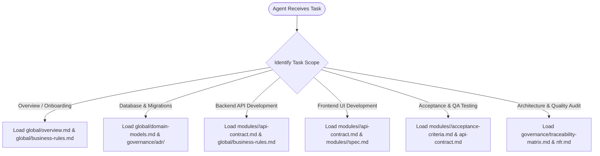

# Olist-Lakehouse-M0 — Requirement Analysis Package (Enterprise Granular Architecture)

> **Version:** 1.0 (Baseline — Option C Architecture)  
> **Methodology:** AI-Driven Context Engineering & Progressive Disclosure

---

## 🧭 AI Agent Context Router

When executing tasks in the SDLC workflow (coding, testing, refactoring, reviewing), **DO NOT LOAD THE ENTIRE REPOSITORY CONTEXT AT ONCE**. Follow the **Just-in-Time (JIT) Context Loading** decision tree:

---

## 📁 Package Structure & Token Budgets

| Directory / File | Core Responsibility | Estimated Tokens | Target Consumer |
|---|---|---|---|
| **global/** | System-wide invariants, business rules, and domain models | ~3,000 tokens | All Agents / Tech Lead |
| **modules/** | Micro-specs decoupled by role (infra_stack, data_seeding, smoke_test) | ~1,500 tokens/module | PO / Dev / QA |
| **governance/** | Quality standards, RTM, change control, and ADRs | ~3,000 tokens | Tech Lead / Architect |

---
*Made by Anh Tu - Share to be share*
