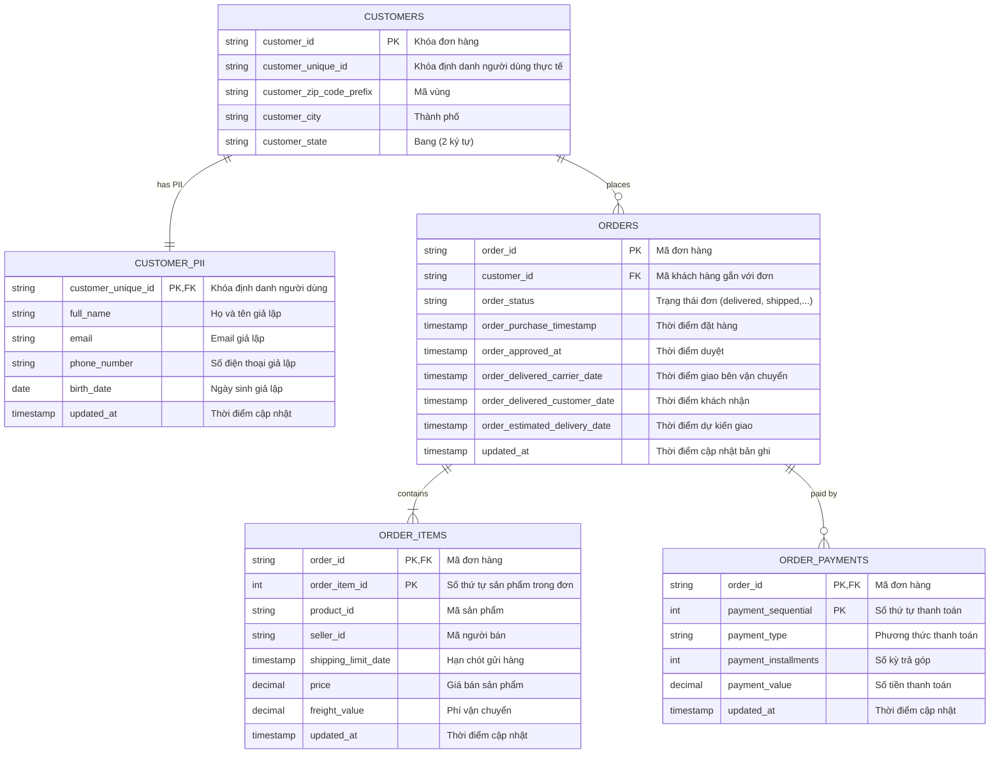

# Global 03 — Domain Models, ERD & Glossary: Olist-Lakehouse-M0

> **Parent Document:** [Requirement Analysis Package](../README.md)  
> **Version:** 1.0 (Baseline)  
> **Architecture Layer:** `global/` (System-Wide Invariants)

---

## 1. Domain Glossary
* **OLTP (Online Transaction Processing):** Hệ thống cơ sở dữ liệu giao dịch nguồn (ở đây là PostgreSQL 16), tối ưu cho các thao tác đọc/ghi theo dòng (row-oriented).
* **Object Storage:** Hệ thống lưu trữ dữ liệu dạng tệp tin phi cấu trúc/bán cấu trúc (MinIO giả lập chuẩn AWS S3), tổ chức theo bucket và prefix key.
* **Table Format (Apache Iceberg):** Đặc tả cấu trúc dữ liệu quản lý danh sách file Parquet thông qua metadata hierarchy (Manifest List -> Manifest File -> Data File), hỗ trợ ACID và Time Travel.
* **REST Catalog:** Chuẩn giao diện mở của Iceberg để các compute engine truy vấn vị trí tệp tin metadata mới nhất thông qua HTTP/REST protocol (thực thi bởi Apache Polaris).
* **Smoke Test (Kiểm thử thông luồng):** Thao tác kiểm tra tích hợp tối giản nhằm bảo đảm toàn bộ các thành phần trong chuỗi mắt xích (Postgres -> Spark -> MinIO -> Trino) có thể giao tiếp thông suốt.

---

## 2. Entity Relationship Diagram (OLTP Source Database: `oltp_olist`)

Mô hình dữ liệu quan hệ được seed vào PostgreSQL trong giai đoạn M0:

---

## 3. MinIO Storage Bucket Specification

| Bucket Name | Quyền hạn | Mục đích sử dụng | Định dạng lưu trữ |
|---|---|---|---|
| `landing` | Read / Write | Chứa các file CSV nguồn tải từ Kaggle (Reviews, Products, Sellers, Geolocation) | Raw CSV files |
| `bronze` | Read / Write | Chứa Iceberg Table tầng Bronze (1:1 với nguồn, có thêm metadata tracking) | Parquet + Iceberg Metadata |
| `silver` | Read / Write | Chứa Iceberg Table tầng Silver (Làm sạch, SCD Type 2, kiểm tra chất lượng) | Parquet + Iceberg Metadata |
| `gold` | Read / Write | Chứa Iceberg Table tầng Gold (Star schema, KPI aggregates) | Parquet + Iceberg Metadata |

---
*Made by Anh Tu - Share to be share*
