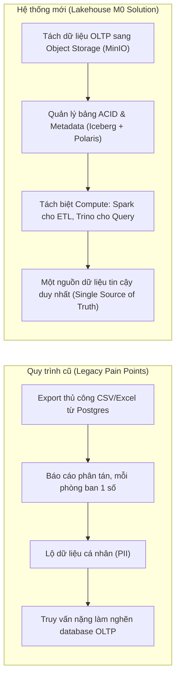

# Global 01 — Business Goal, Scope & Context: Olist-Lakehouse-M0

> **Parent Document:** [Requirement Analysis Package](../README.md)  
> **Version:** 1.0 (Baseline)  
> **Architecture Layer:** `global/` (System-Wide Invariants)

---

## 1. Vision Statement
Xây dựng nền tảng hạ tầng Data Lakehouse cục bộ (Local M0 Environment) phục vụ cho dự án Olist Analytics Platform, giải quyết triệt để sự phụ thuộc vào database đơn lẻ và các file xuất CSV phân tán, bằng cách tích hợp kiến trúc **Storage-Compute Decoupling** (MinIO + Apache Iceberg + Polaris REST Catalog + Apache Spark + Trino) chạy ổn định với tài nguyên kiểm soát (RAM < 6GB).

---

## 2. Root Cause Analysis
Tại sao cần xây dựng nền tảng Lakehouse thay thế hệ thống báo cáo thủ công truyền thống của Olist:

---

## 3. Actors & Role-Based Access Control
| Actor | Real-World Role | System Role Identifier | Core Permissions |
|---|---|---|---|
| **Data Engineer (Bạn)** | Pipeline & Platform Engineer | `engineer` | Cấu hình Docker, viết script nạp dữ liệu, build Iceberg jobs, kiểm tra catalog |
| **Data Analyst / BI** | Người tiêu thụ số liệu | `analyst` | Truy vấn Trino SQL, kiểm tra schema, dựng dashboard (Tuần 7) |
| **System Operator** | Vận hành hạ tầng | `devops` | Quản trị container, kiểm tra healthcheck, giám sát tài nguyên RAM/CPU |

---

## 4. Project Scope (Tuần 1 - Module M0)
* **In-Scope (Phạm vi hoàn thành trong Tuần 1):**
  * Dựng cụm 5 core container: PostgreSQL 16 (OLTP), MinIO (Object Storage), Polaris REST Catalog, Apache Spark 3.5 (PySpark), Trino 442.
  * Tối ưu hóa bộ nhớ: Phân chia Docker profile `core`, giới hạn JVM heap size đảm bảo tổng RAM < 6GB.
  * Chuẩn bị dữ liệu: Tải 9 file CSV Olist, sinh bảng `customer_pii` giả lập bằng Faker, cắt dữ liệu thành 8 batch B0–B7 có bổ sung `updated_at`.
  * Nạp dữ liệu ban đầu: Seed batch B0 vào PostgreSQL database `oltp_olist`.
  * Khởi tạo lưu trữ: Tạo 4 bucket trên MinIO (`landing`, `bronze`, `silver`, `gold`).
  * Kiểm chứng thông luồng (E2E Smoke Test): PySpark đọc bảng `orders` từ Postgres qua JDBC, ghi bảng Iceberg vào MinIO qua Polaris, và Trino đọc lại thành công.
* **Out-of-Scope (Bảo lưu cho các tuần tiếp theo):**
  * Airflow orchestration (Dành riêng cho Tuần 6).
  * Apache Superset dashboard (Dành riêng cho Tuần 7).
  * Tầng Silver SCD2, Data Quality rules, Tầng Gold Star Schema (Tuần 3–5).

---
*Made by Anh Tu - Share to be share*
