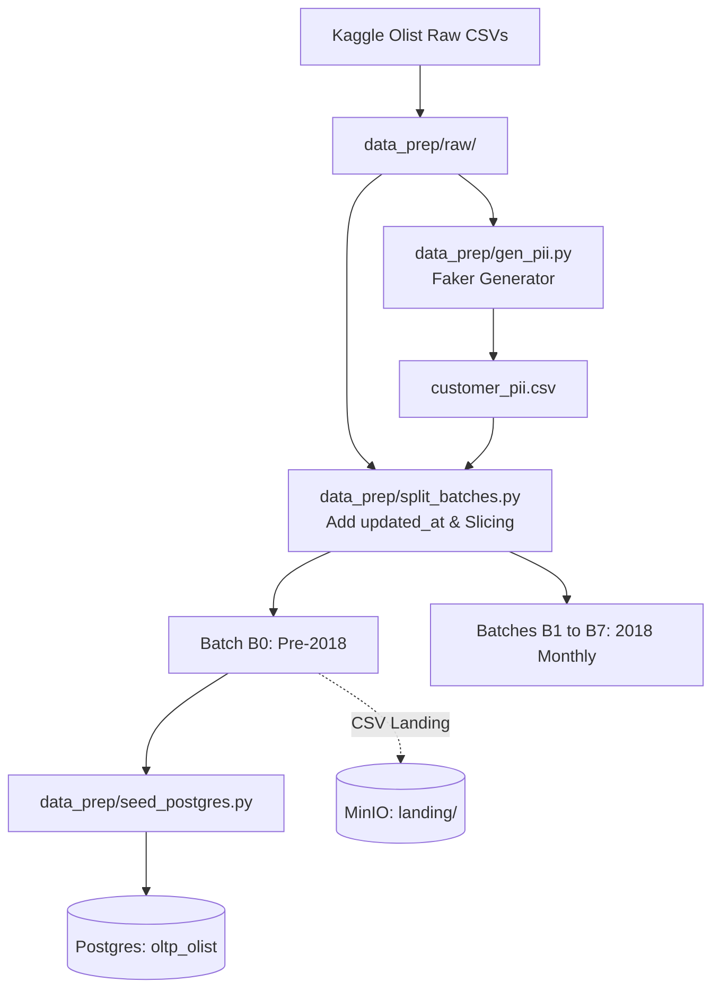

# Module data_seeding — Business Specification

> **Parent Document:** [Requirement Analysis Package](../../README.md)  
> **Module ID:** `DATA_SEED` | **Domain:** Data Ingestion & Synthetic Preparation  
> **Linked Documents:** [Data Schemas & Contracts](api-contract.md) | [Acceptance Criteria](acceptance-criteria.md)

---

## 1. Business Objective
Cung cấp bộ dữ liệu nguồn chuẩn hóa cho nền tảng Lakehouse bằng cách tự động hóa quy trình: thu nạp bộ dữ liệu Olist Brazil E-Commerce từ Kaggle, tổng hợp dữ liệu cá nhân (PII) giả lập bằng thư viện Faker, phân chia thành 8 đợt phát dữ liệu (Batch B0 đến B7) kèm cột `updated_at`, và nạp mẻ dữ liệu khởi đầu (Batch B0) vào hệ thống PostgreSQL OLTP.

---

## 2. Functional Requirements
| FR ID | Feature Description | Actor | Pre-condition | Post-condition | Mapped Interface Contract | Target AC |
|---|---|---|---|---|---|---|
| **FR-SEED-01** | Tải và giải nén bộ dữ liệu Kaggle Olist | `engineer` | Có file `kaggle.json` hoặc tải trực tiếp | 9 file CSV có mặt trong `data_prep/raw/` | [`CLI Data Prep`](api-contract.md#1-cli-command-contracts) | [`AC-SEED-01`](acceptance-criteria.md#ac-seed-01) |
| **FR-SEED-02** | Sinh dữ liệu PII giả lập bằng Faker | `engineer` | File `olist_customers_dataset.csv` đã tải | File `customer_pii.csv` chứa PII khớp 1:1 theo `customer_unique_id` | [`PII Schema Contract`](api-contract.md#2-customer-pii-data-contract) | [`AC-SEED-02`](acceptance-criteria.md#ac-seed-02) |
| **FR-SEED-03** | Phân chia Batch B0–B7 và thêm `updated_at` | `engineer` | Đầy đủ dữ liệu nguồn Olist | 8 thư mục batch `batch_B0` đến `batch_B7` | [`Batch Partition Contract`](api-contract.md#3-batch-slicing-contract) | [`AC-SEED-03`](acceptance-criteria.md#ac-seed-03) |
| **FR-SEED-04** | Nạp dữ liệu B0 vào PostgreSQL (`oltp_olist`) | `engineer` | Postgres container healthy | Bảng `customers, customer_pii, orders, order_items, payments` có dữ liệu | [`Postgres Tables Contract`](api-contract.md#4-postgres-table-schemas-contract) | [`AC-SEED-04`](acceptance-criteria.md#ac-seed-04) |
| **FR-SEED-05** | Đặt file CSV tham chiếu vào MinIO Landing | `engineer` | MinIO bucket `landing` đã tạo | Các file snapshot (products, sellers, geolocation) nằm trong `landing/` | [`Landing Object Contract`](api-contract.md#5-minio-landing-contract) | [`AC-SEED-05`](acceptance-criteria.md#ac-seed-05) |

---

## 3. User Stories

### US-SEED-01: Chuẩn bị dữ liệu và Seed Postgres OLTP
- **ID:** `US-SEED-01`
- **Actor:** `engineer`
- **Priority:** Must-have
- **Mapped FR:** [`FR-SEED-02`, `FR-SEED-03`, `FR-SEED-04`](#2-functional-requirements)
- **Mapped Contract:** [`Data Contracts`](api-contract.md)
- **Mapped Acceptance Criteria:** [`AC-SEED-02`, `AC-SEED-04`](acceptance-criteria.md)

**User Story Statement:**
> As a **Data Engineer**,  
> I want to **chạy script chuẩn bị dữ liệu và seed dữ liệu B0 vào database PostgreSQL**,  
> So that **hệ thống có dữ liệu bán hàng chân thực kèm PII để phục vụ các pipeline ETL và kiểm thử bảo mật sau này**.

#### Data Flow Diagram

---
*Made by Anh Tu - Share to be share*
