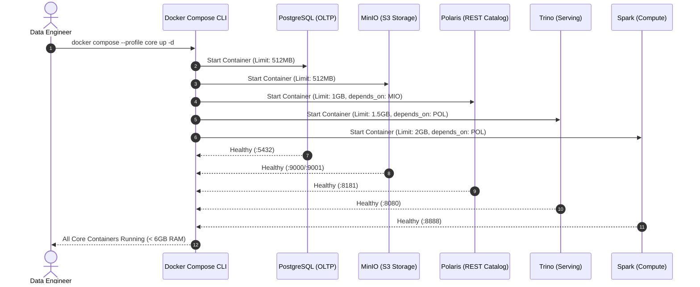

# Module infra_stack — Business Specification

> **Parent Document:** [Requirement Analysis Package](../../README.md)  
> **Module ID:** `INFRA` | **Domain:** Platform & Infrastructure  
> **Linked Documents:** [Service Contract](api-contract.md) | [Acceptance Criteria](acceptance-criteria.md)

---

## 1. Business Objective
Cung cấp hạ tầng ảo hóa cục bộ bằng Docker Compose, thiết lập nền tảng Data Lakehouse tích hợp 5 dịch vụ cốt lõi (PostgreSQL, MinIO, Polaris Catalog, Apache Spark, Trino) với khả năng cô lập tài nguyên bộ nhớ (RAM < 6GB), đảm bảo tính bền vững của dữ liệu và cho phép tái lập môi trường bất kỳ lúc nào chỉ bằng một lệnh duy nhất.

---

## 2. Functional Requirements
| FR ID | Feature Description | Actor | Pre-condition | Post-condition | Mapped Service Interface | Target AC |
|---|---|---|---|---|---|---|
| **FR-INFRA-01** | Khởi chạy cụm Core container bằng Docker Profile | `engineer` | Docker Engine đang chạy, RAM trống ≥ 6GB | 5 container ở trạng thái healthy | [`Core Services`](api-contract.md#1-core-services-endpoint--port-contract) | [`AC-INFRA-01`](acceptance-criteria.md#ac-infra-01) |
| **FR-INFRA-02** | Lưu trữ bền vững (Data Persistence) | `devops` | Dữ liệu đã ghi vào Postgres & MinIO | Khởi động lại container dữ liệu vẫn còn nguyên | [`Persistent Volumes`](api-contract.md#2-docker-volumes-and-mount-points) | [`AC-INFRA-02`](acceptance-criteria.md#ac-infra-02) |
| **FR-INFRA-03** | Khởi tạo MinIO Buckets tự động | `engineer` | MinIO container sẵn sàng | 4 bucket `landing, bronze, silver, gold` được tạo | [`MinIO Console / S3`](api-contract.md#1-core-services-endpoint--port-contract) | [`AC-INFRA-03`](acceptance-criteria.md#ac-infra-03) |
| **FR-INFRA-04** | Kết nối Trino tới Iceberg REST Catalog | `analyst` | Polaris container sẵn sàng | Trino nhận diện catalog `lakehouse` qua query `SHOW CATALOGS` | [`Trino Catalog Interface`](api-contract.md#1-core-services-endpoint--port-contract) | [`AC-INFRA-04`](acceptance-criteria.md#ac-infra-04) |
| **FR-INFRA-05** | Spark nạp Iceberg runtime & cấu hình Catalog | `engineer` | PySpark container khởi động | Spark context nhận diện catalog `lakehouse` | [`Spark Driver / SQL`](api-contract.md#1-core-services-endpoint--port-contract) | [`AC-INFRA-05`](acceptance-criteria.md#ac-infra-05) |

---

## 3. User Stories

### US-INFRA-01: Khởi động hệ thống an toàn và tối ưu bộ nhớ
- **ID:** `US-INFRA-01`
- **Actor:** `engineer`
- **Priority:** Must-have
- **Mapped FR:** [`FR-INFRA-01`](#2-functional-requirements)
- **Mapped Service Contract:** [`Core Services`](api-contract.md#1-core-services-endpoint--port-contract)
- **Mapped Acceptance Criteria:** [`AC-INFRA-01`](acceptance-criteria.md#ac-infra-01)

**User Story Statement:**
> As a **Data Engineer**,  
> I want to **khởi chạy cụm hạ tầng bằng lệnh `docker compose --profile core up -d`**,  
> So that **tôi có đầy đủ công cụ làm việc mà máy tính cá nhân không bị quá tải RAM hay gián đoạn công việc**.

#### Sequence Diagram (System Startup & Healthcheck)

---
*Made by Anh Tu - Share to be share*
