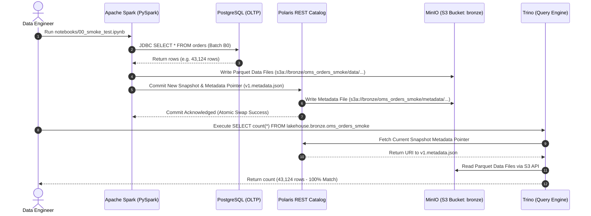

# Module smoke_test — Business Specification

> **Parent Document:** [Requirement Analysis Package](../../README.md)  
> **Module ID:** `SMOKE` | **Domain:** End-to-End Integration & Verification  
> **Linked Documents:** [Pipeline Contract](api-contract.md) | [Acceptance Criteria](acceptance-criteria.md)

---

## 1. Business Objective
Cung cấp kịch bản kiểm thử tích hợp toàn diện (End-to-End Smoke Test) nhằm xác thực kiến trúc **Decoupled Storage-Compute**: chứng minh rằng một bản ghi đơn hàng từ cơ sở dữ liệu giao dịch nguồn (PostgreSQL) có thể được trích xuất bởi công cụ tính toán phân tán (Apache Spark), ghi nhận trạng thái bảng ACID vào Object Storage (MinIO) thông qua cơ chế quản trị metadata (Polaris REST Catalog), và sẵn sàng phục vụ cho công cụ truy vấn phân tích (Trino) với độ chính xác số liệu tuyệt đối (100% data tie-out).

---

## 2. Functional Requirements
| FR ID | Feature Description | Actor | Pre-condition | Post-condition | Mapped Interface Contract | Target AC |
|---|---|---|---|---|---|---|
| **FR-SMOKE-01** | Trích xuất dữ liệu Postgres qua Spark JDBC | `engineer` | Postgres có dữ liệu B0 | DataFrame trong Spark nạp thành công dữ liệu `orders` | [`JDBC Interface`](api-contract.md#1-jdbc-source-connection-contract) | [`AC-SMOKE-01`](acceptance-criteria.md#ac-smoke-01) |
| **FR-SMOKE-02** | Khởi tạo namespace và ghi Iceberg Table | `engineer` | Spark kết nối Polaris | Bảng `lakehouse.bronze.oms_orders_smoke` được tạo trên MinIO | [`Iceberg Write Interface`](api-contract.md#2-iceberg-table-write-contract) | [`AC-SMOKE-02`](acceptance-criteria.md#ac-smoke-02) |
| **FR-SMOKE-03** | Trino truy vấn bảng Iceberg vừa tạo | `analyst` | Bảng Iceberg đã commit | Trino đọc được schema và dữ liệu từ MinIO | [`Trino Query Interface`](api-contract.md#3-trino-query-and-tie-out-contract) | [`AC-SMOKE-03`](acceptance-criteria.md#ac-smoke-03) |
| **FR-SMOKE-04** | Tự động đối soát số lượng bản ghi (Count Tie-out) | `engineer` | Postgres và Trino sẵn sàng | Số dòng Trino == Số dòng Postgres | [`Tie-out Verification`](api-contract.md#3-trino-query-and-tie-out-contract) | [`AC-SMOKE-04`](acceptance-criteria.md#ac-smoke-04) |
| **FR-SMOKE-05** | Xác nhận tệp tin Parquet & Metadata trên MinIO | `devops` | Job Spark commit thành công | Tệp tin `.metadata.json` và `.parquet` xuất hiện trên bucket `bronze` | [`Storage Audit Interface`](api-contract.md#4-minio-storage-audit-contract) | [`AC-SMOKE-05`](acceptance-criteria.md#ac-smoke-05) |

---

## 3. User Stories

### US-SMOKE-01: Thông luồng E2E Postgres → Spark → Iceberg → Trino
- **ID:** `US-SMOKE-01`
- **Actor:** `engineer`
- **Priority:** Must-have
- **Mapped FR:** [`FR-SMOKE-01` đến `FR-SMOKE-05`](#2-functional-requirements)
- **Mapped Contract:** [`Pipeline Contract`](api-contract.md)
- **Mapped Acceptance Criteria:** [`AC-SMOKE-01` đến `AC-SMOKE-05`](acceptance-criteria.md)

**User Story Statement:**
> As a **Data Engineer**,  
> I want to **chạy notebook `notebooks/00_smoke_test.ipynb` để thông luồng toàn bộ stack**,  
> So that **tôi kiểm chứng được các thành phần độc lập trong kiến trúc Lakehouse đã tích hợp hoàn hảo với nhau trước khi bước sang Tuần 2**.

#### Sequence Diagram (E2E Smoke Test Verification)

---
*Made by Anh Tu - Share to be share*
